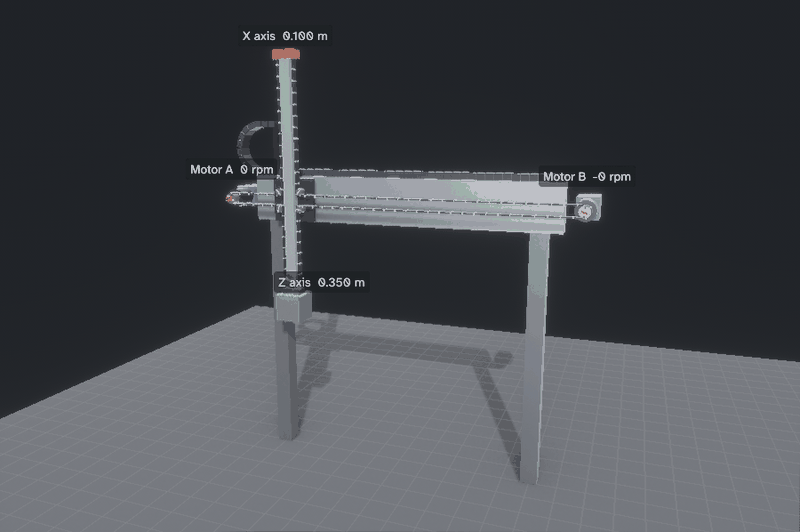

# Kinematics Simulation

[](https://github.com/Sparkz400/KinematicsSimulation/actions/workflows/ci.yml)
[](https://github.com/Sparkz400/KinematicsSimulation/releases)
[](https://pypi.org/project/kinematics-sim/)
[](#license)

**A physics workbench for motion machines.** Describe a machine (gantry, delta picker, arm, press, hexapod, cable robot and more), run its cycle, and see what the motors, drives, belts, gearboxes and guides really go through, then check it against the vendors' ratings.



**[Try it in your browser](https://sparkz400.github.io/KinematicsSimulation/)** (nothing to install) · [Download](https://github.com/Sparkz400/KinematicsSimulation/releases) · [Documentation](https://sparkz400.github.io/KinematicsSimulation/docs/) · [Deutsch](docs/de/README.md)

## Why

Sizing spreadsheets treat a machine as rigid masses and constant efficiencies. This simulator models the drive train physically: belts as springs, LuGre guide friction, gearbox backlash and losses, the motor winding with its temperature, a cascaded servo drive with its DC link. Torque, following error, heating and settling come out of that model instead of rules of thumb.

## Features

- **Sizing verdicts.** Peak, RMS and thermal load of every motor, drive, gearbox, belt, guide and bearing over a cycle, judged pass or fail against catalogue ratings, with bearing and guide lives.
- **Error bands.** Every estimated value has bounds; see how far each result moves when they are off, one at a time, sampled, or at the worst corner.
- **Catalogue search.** Find the lightest motor, drive and gearbox (and axis) that passes, from built-in data of Siemens, Beckhoff, B&R, SEW, Lenze, Kollmorgen, Yaskawa, Festo, Bahr, Neugart, Wittenstein and others.
- **Motion planning.** Paths of lines, arcs and splines, a time-optimal plan within every limit, corner blending, input shaping, electronic cams.
- **Dynamics.** Resonances and mode shapes over the workspace, loop margins, stopping distances for stop categories 0, 1 and 2.
- **Optimiser.** A shorter cycle or a lower energy use that still passes every check.
- **Real data.** Replay a drive trace and fit mass, inertia, friction and belt stiffness to it.
- **Your controller.** Drive the simulated machine in torque or velocity mode from Python, an FMU or a PLC over OPC UA.

## Machines

| Family | Machines |
| --- | --- |
| Axes and gantries | T-gantry, belt axis, ball screw, rack and pinion, linear motor, rotary table, H-bot, CoreXY, XYZ and dual-drive portals, five-axis machines |
| Delta and parallel robots | 3-arm delta, 4-axis delta, Quattro-type, planar delta, linear delta, parallel SCARA, hexapod (cylinders and cranks), tripod |
| Arms | Six-axis arm from URDF (also on a linear track), SCARA, palletiser, R-theta-Z wafer handler |
| Crank and cam | Servo press, toggle press, rotary knife, flying saw, disc cam |
| Other | Planar and spatial cable robots, winder with dancer, scissor lift |

Drives: permanent-magnet servo motors, steppers, induction motors (V/f or field-oriented) and pneumatic cylinders. New machines can be described in a [machine file](docs/machine-files.md) without writing code.

## Getting started

**Desktop app and command line:** download the Windows installer or the Linux package from [Releases](https://github.com/Sparkz400/KinematicsSimulation/releases).

**Python:**

```bash
pip install kinematics-sim
```

```python
import kinematics_sim as ks
import pandas as pd

cfg = ks.Config("t-gantry")         # a built-in machine with its default config
cfg["mass.payload_kg"] = 3.5        # change any value
print(pd.DataFrame(ks.verdicts(cfg)))   # every check of the cycle: value, limit, ok
```

**From source** (Rust stable, edition 2024):

```bash
cargo run --release -p sim-app                        # desktop app
cargo run --release -p sim-cli -- verdicts t-gantry   # command line
```

```text
check,motor,value,limit,result
motor-peak,a,0.1469,1.000,ok
motor-thermal,a,1.238,100.0,ok
gearbox-life,a,6519740756,20000,ok
belt-tension,,333.5,1500,ok
settling,,0.00004292,0.0001000,ok
...
```

Next: the [overview and five-minute tour](docs/overview.md), the [user guide](docs/user-guide.md) and the [examples](examples/README.md).

## How accurate is it?

Every component and analysis figure is tested against a hand calculation. The arms' dynamics match MuJoCo to 1e-14, the deltas' match independent Lagrangian derivations, and the drive loop matches an independent Python implementation. One real machine, a ball screw bench of ISW Stuttgart, has been replayed: the simulated motor torque is within 5 to 13 % RMS of the measured one.

The equations are checked; the parameters of a given machine (friction, damping, stiffness) are often estimates, and the configs mark which. Comparisons and trends are reliable; absolute numbers are as good as those values. Every check with its outcome and values: the [validation dashboard](https://sparkz400.github.io/KinematicsSimulation/validation/). Details and open points: [validation](docs/validation.md). Results per measured machine: [datasets/RESULTS.md](datasets/RESULTS.md). Measured data from your machine is the most valuable contribution: see [contributing a measured machine](docs/measurement-procedure.md#contributing-a-measured-machine-step-by-step).

## Interfaces

| Front end | For |
| --- | --- |
| Desktop app | 3D view, scopes, cycle analysis, search and tuning |
| `sim-cli` | Scripting and CI; CSV output |
| [Python](docs/python.md) | NumPy/pandas results, parameter sweeps, your own controller |
| [FMI 2.0 / 3.0](docs/fmi.md) | Co-simulation in Simulink, OpenModelica, Dymola |
| [OPC UA](docs/plc.md) | Virtual commissioning with a PLC (PLCopen-style axes) |
| [Browser](docs/web.md) | Zero-install demo and sizing check |

## Documentation

[User guide](docs/user-guide.md) · [Overview and tour](docs/overview.md) · [Machine files](docs/machine-files.md) · [Config reference](docs/config-reference.md) · [Model reference](docs/model-reference.md) · [Mechanisms](docs/mechanisms.md) · [Catalogue](docs/catalogue.md) · [Validation](docs/validation.md) · [Validation dashboard](docs/dashboard.md) · [API docs](https://sparkz400.github.io/KinematicsSimulation/api/) · [Roadmap](ROADMAP.md) · [Changelog](CHANGELOG.md)

## Contributing

Bug reports, measured datasets and new machines are welcome. See [CONTRIBUTING.md](CONTRIBUTING.md) for the build, the test setup and the house rules, and [SECURITY.md](SECURITY.md) for reporting vulnerabilities. If you use the simulator in research, please cite it ([CITATION.cff](CITATION.cff)).

## License

Licensed under either of [MIT](LICENSE-MIT) or [Apache-2.0](LICENSE-APACHE), at your option. Contributions are accepted under the same terms.

The OPC UA server (`sim-opcua`) uses `async-opcua`, which is MPL-2.0 (file-level copyleft): its binaries may be distributed under MIT or Apache-2.0 as long as the MPL-covered source stays available. The app, the command line and the FMU contain no MPL code. Third-party licences: [THIRD-PARTY-LICENSES.md](THIRD-PARTY-LICENSES.md).
