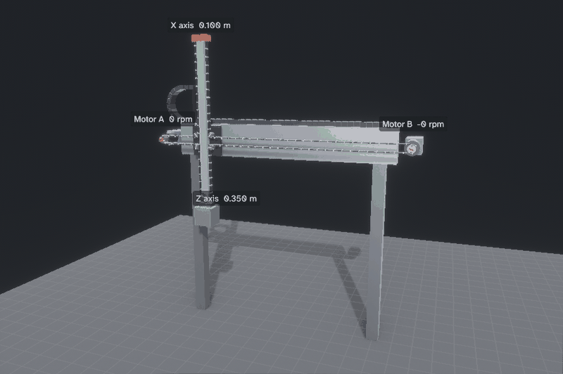
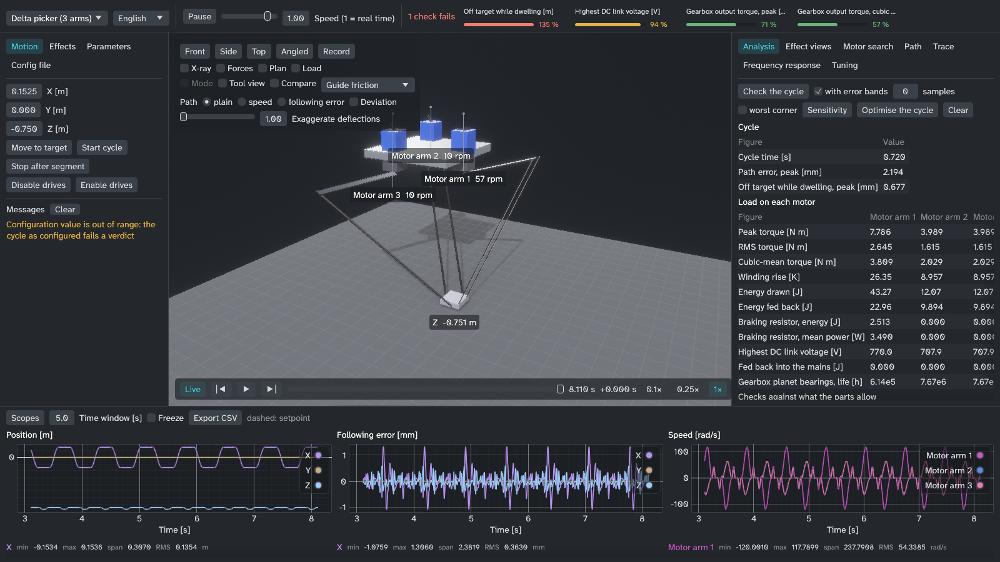
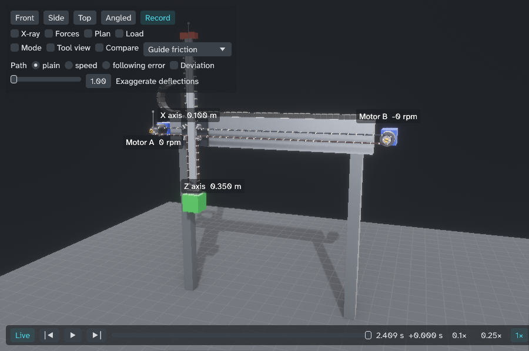

# Gantry physics simulator

[](https://github.com/Sparkz400/KinematicsSimulation/actions/workflows/ci.yml)
[](https://github.com/Sparkz400/KinematicsSimulation/releases)
[](#licence)



A simulator of motion machines in which torque, speed and following error come out of a physical model: belt sections as springs, LuGre guide friction, a gearbox with backlash, a motor winding and a cascaded servo drive.
It has twelve machines: a two-motor T-gantry (X and Z on one belt), a single belt axis, four delta pickers (the three-arm D3 sized like an Autonox RL3-1200-3kg, a four-axis D4 that also turns the tool, a planar two-arm D2 sized like a Codian D2-800 and a linear delta on three belt columns sized like a Festo EXPT-95), and from a kit of joints a ball screw axis, a rack and pinion axis, a linear motor axis, a rotary table, a six-axis arm read from a URDF file and a SCARA ([mechanisms](docs/mechanisms.md)). More machines are described in [machine files](docs/machine-files.md) without Rust code: an H-bot, a CoreXY table, an XYZ portal, a portal with a ball-screw Z and a rack-and-pinion gantry (`machines/*.toml`).
They run behind six front ends: a desktop app with a 3D view and scopes, a command-line tool that writes CSV, an OPC UA server with PLCopen-style axes for a PLC, an FMI 2.0 and 3.0 Co-Simulation export for Simulink, OpenModelica, Dymola and other tools, a Python module, and a browser page with a 3D view of the machine and a sizing check.
It is written in Rust; vendor data for motors, gearboxes, drives and belt axes is in [`catalog/`](catalog/).
**Quick start:** watch a machine run in 3D and try the sizing check in your browser at **https://sparkz400.github.io/KinematicsSimulation/** (nothing to install), download the Windows or Linux build from [Releases](https://github.com/Sparkz400/KinematicsSimulation/releases), or build it yourself with `cargo run --release -p sim-app` (see [Build and run](#build-and-run)).
Deutsche Fassung: [docs/de/README.md](docs/de/README.md) und [Benutzerhandbuch](docs/de/benutzerhandbuch.md).



*The delta picker (`delta-d3`) in the app. Its shipped config fails one check, the settling at the pick (0.68 mm against 0.5 mm); the top bar says so.*

## What it can and cannot tell you

It can tell you, for a machine described in a config file:

- peak, RMS and cubic-mean torque, speed, current, winding temperature rise and energy per motor over a cycle or a path
- how much of each motor's torque goes to inertia, gravity, friction and the belt, where the energy of a cycle is lost (each guide, shaft, gearbox, damper, winding, the braking resistor), and what each guide's friction does at its operating point
- pass or fail of that cycle against the ratings in the config (torque-speed curve, winding temperature, gearbox, belt tension, slack and tooth load, DC link and braking resistor, guide and shaft load, settling at the pick)
- for the joint machines also their transmission's own checks: a ball screw's speed, DN value, buckling and life, a rack's feed force, a strain wave gear's life
- how many hours the pulley shaft bearings, the gearbox's planet bearings and the guides last on that cycle, against a required life (ISO 281, Siemens' gearbox formula, the guide makers' formula; the belt has a tooth load rating instead, because no belt maker publishes a life)
- how long a gearbox's gearing lasts where the cycle takes it above its rated torque, and a motor's own bearings where the belt pulls on its shaft; the pulley shaft bearings' life with ISO 281's a_ISO for lubrication and contamination
- how those results move when an uncertain value is at its low or high bound, or when all uncertain values are off at once
- how far the tool tip is from its path, and what gains, corner blending and input shaping do to that
- how fast a path can be run within what the motors and the belt allow, read point by point along it (a time-optimal plan)
- the machine's resonances over the stroke of an axis, to set the input shapers by
- which catalogue motor with its drive (and gearbox), on which catalogue axis, is the cheapest that passes, with the installed weight standing in for the price
- a shorter cycle (higher limits, corner blending, input shaping, lower or rounded lifts) that still passes every check, as written and within the error bands
- the energy per cycle against the cycle time: the settings no other beats in both, and in peak motor utilisation
- from a drive trace of a delta, the SCARA or the arm: the payload's mass, and per motor the added inertia, friction and constant torque (per axis on the other machines)
- the belt's stiffness from the moves of a drive trace, without a frequency sweep

What stands behind the numbers:

| Checked against | What | Where |
| --- | --- | --- |
| Hand calculations | Every component and every analysis figure has a test that compares it with a number worked out by hand: belt frequency, friction levels, backlash, cycle torque, winding temperature, DC link voltage, guide and shaft loads, path error, and more | [docs/validation.md](docs/validation.md) |
| A SciPy reference | One open-loop move of the elastic T-gantry against a second implementation of the same equations in Python, integrated with LSODA. Agreement within 0.2 % of the travel. The reference has no leaning Z axis and predates the later effects | [docs/validation.md](docs/validation.md#independent-reference) |
| Vendor formulas | Festo's own torque formula for the EXCT-30 at 45 degrees travel, within 2 % | `exct_30_config_agrees_with_the_catalogue` |
| Cross-checks between vendor documents | The same Siemens motors read from two documents by two scripts must agree; catalogue values must fit their own physics | [docs/catalogue.md](docs/catalogue.md) |

These checks prove that the equations are solved correctly and that the catalogue data was read correctly. They do not prove that the parameters describe a real machine.

**No real machine has been measured.** Friction, damping, guide and frame stiffness, belt pretension, winding resistance and inductance, DC link and braking resistor data are estimates. The configs say so: [`exct-30.toml`](crates/machine-t-gantry/exct-30.toml) marks every value `[catalogue]` or `[estimate]`, and each config has a `[bounds]` table with a low and a high value for its estimates. Trends and comparisons (this motor against that one, with and without shaping) are sound. Absolute numbers are as good as the estimates. Use `verdicts --bands` to see how far a result moves with them.

Other limits that matter:

- The default configs of the two belt machines are made-up placeholder machines, not products. The deltas' configs are sized like products (Autonox RL3-1200-3kg, Codian D2-800, Festo EXPT-95; Siemens motors and gearboxes from the catalogue), but their arm and rod lengths, masses and inertias are estimates: the makers do not publish them (Autonox keeps them behind a registration). The joint machines (screw, rack, linear motor, rotary table, arms) are sized examples whose mechanics are estimates of a typical part of that size, not one maker's article; the arms are sized in joint space, with no Cartesian paths.
- The motor is one equivalent winding (R, L, back-EMF) that carries the RMS phase current and gets at most sqrt(3/2) times the DC link voltage. There is no three-phase model and no PWM; field weakening (`effects.field_weakening`, off by default) takes the winding as the q axis of a d-q model with a d current that follows its setpoint at once.
- The life figures are the makers' formulas and nothing more: ISO 281's life factor a1 on the bearings and a_ISO on the pulley shaft bearings alone (none on the guides), one bearing per pulley shaft, the gearing's life from a Wöhler exponent and knee that are estimates (Siemens' own damage sum was not read), load ratings and lubrication values that are partly estimates (Festo publishes none for the EXCT). They are not validated.
- The OPC UA link was tested against a client written with the same library, not against a PLC.
- The FMU was checked with fmpy's validator and simulator and run in OpenModelica 1.27.1 through OMSimulator, its co-simulation tool (OpenModelica's import as a Modelica block takes Model Exchange FMUs only, which this export does not write); not imported into Simulink or Dymola, and not with the Modelica Association's `fmusim` or the FMU Compliance Checker ([docs/fmi.md](docs/fmi.md#validation)).
- The browser's numbers agree with the command line's to four or five significant digits, not bit for bit ([docs/web.md](docs/web.md)).
- Mouse handling of the app (orbit camera, panels) was not checked by a person; screenshots were.
- Import of drive traces and the parameter fit were tested on traces the simulator made itself.

## Build and run

Needs a stable Rust toolchain with edition 2024 support. All dependency versions are pinned in [`Cargo.toml`](Cargo.toml). The catalogue data is compiled in, so the binaries need no data files.

```sh
cargo run --release -p sim-app                    # the desktop app
cargo run -q --release -p sim-cli -- list         # the command-line tool
cargo run --release -p sim-opcua -- t-gantry      # the OPC UA server on opc.tcp://127.0.0.1:4840/
cargo build --release -p sim-cli -p sim-fmi       # then: target/release/sim-cli fmu t-gantry --out t-gantry.fmu
cargo test --workspace                            # all tests
```

`cargo test --workspace` also builds the app with its graphics libraries. To test only the physics, the analysis and the command line:

```sh
cargo test -p sim-core -p sim-components -p machine-t-gantry -p machine-single-axis -p machine-delta-d3 -p machine-joint-kit -p sim-netlist -p sim-machines -p sim-cli
```

## Five-minute tour

All commands print CSV to standard output, or to a file with `--out FILE`. Messages and errors go to the error stream. The output below is real, with columns left out where marked.

**The machines.**

```text
$ cargo run -q --release -p sim-cli -- list
t-gantry	T-gantry
single-axis	Single axis
delta-d3	Delta picker (3 arms)
delta-d2	Planar delta picker (2 arms)
delta-linear	Linear delta (3 belt axes)
delta-d4	Delta picker (3 arms and a turning tool)
screw-axis	Ball screw axis
rack-axis	Rack and pinion axis
linear-motor-axis	Linear motor axis
rotary-table	Rotary indexing table
urdf-arm	Six-axis arm (URDF)
scara	SCARA arm (URDF)
```

A machine file is run like a registered machine: `sim-cli verdicts --machine-file machines/h-bot.toml`, or `sim-app --machine-file machines/h-bot.toml`.

**Cycle analysis of the default T-gantry.** One row per motor, measured over the second pass of the pick-and-place cycle. The first seven of 28 columns:

```text
$ cargo run -q --release -p sim-cli -- analyze t-gantry
Thermal start: warm, at the rises the cycle settles at; largest change of a rise over the measured pass 0.000 K
motor,cycle_s,peak_torque_nm,rms_torque_nm,peak_speed_rad_s,utilisation,thermal_utilisation,...
a,6.080000,0.559501,0.165359,200.4517,0.1475,0.1302,...
b,6.080000,0.460104,0.153384,200.4375,0.1211,0.1208,...
```

**Verdicts.** The same cycle judged against the motor data and the `[ratings]` of the config:

```text
$ cargo run -q --release -p sim-cli -- verdicts t-gantry
Thermal start: warm, at the rises the cycle settles at; largest change of a rise over the measured pass 0.000 K
check,motor,value,limit,result
motor-peak,a,0.1475,1.000,ok
motor-thermal,a,1.227,100.0,ok
drive-current,a,0.3676,3.000,ok
drive-peak-current,a,1.248,10.90,ok
gearbox-continuous,a,0.7955,40.00,ok
gearbox-input-speed,a,1914,13000,ok
gearbox-peak,a,2.175,64.00,ok
pulley-bearing-life,a,472218,20000,ok
gearbox-life,a,6736010395,20000,ok
belt-tooth-load,a,0.1909,1.000,ok
dc-link-energy,a,5.864,6.205,ok
dc-link-overvoltage,a,221.4,257.6,ok
motor-peak,b,0.1211,1.000,ok
...
dc-link-energy,b,6.205,6.205,ok
braking-resistor-continuous,b,0.8787,20.00,ok
braking-resistor-peak,b,32.63,500.0,ok
dc-link-overvoltage,b,224.7,257.6,ok
settling,,0.00004734,0.0001000,ok
belt-tension,,334.4,1500,ok
belt-slack,,204.6,0,ok
gearbox-radial-load,,644.8,1500,ok
guide-load,,177.8,2000,ok
guide-life,,4994979,20000,ok
thermal-warm-start,,0.00001281,0.1000,ok
```

The three lives are in hours: the bearing that takes the belt's pull on each pulley shaft (ISO 281, with its a_ISO for lubrication and contamination), the gearbox's planet bearings (Siemens' formula) and the guide, each against the 20000 h of `ratings.required_life_h`. The cycle is judged warm: with the windings at the temperature rises they settle at when it repeats for long (the first line, on the error stream, and the row `thermal-warm-start`). `belt-tooth-load` is the belt's tooth load over what its teeth allow at the pulley's speed (Megadyne's method): no belt maker publishes a life in hours.

The DC link is simulated (`effects.dc_link`). Motor B's braking fills the capacitors: 6.2 J of room between the DC link voltage of 155 V and the chopper's threshold of 224.65 V. That is `ok` because the config has a braking resistor, which burns the rest and is judged in the next two rows. Values are printed with four significant digits.

**A catalogue machine.** [`exct-30.toml`](crates/machine-t-gantry/exct-30.toml) is a Festo EXCT-30 with two Siemens 1FK2205-4AF motors:

```text
$ cargo run -q --release -p sim-cli -- verdicts t-gantry --config crates/machine-t-gantry/exct-30.toml
Thermal start: warm, at the rises the cycle settles at; largest change of a rise over the measured pass 0.000 K
check,motor,value,limit,result
motor-peak,a,0.2930,1.000,ok
motor-thermal,a,6.882,100.0,ok
drive-current,a,1.145,5.000,ok
drive-peak-current,a,2.876,19.00,ok
pulley-torque,a,3.126,12.50,ok
pulley-bearing-life,a,325762,20000,ok
belt-tooth-load,a,0.3529,1.000,ok
dc-link-energy,a,9.943,9.943,ok
braking-resistor-continuous,a,8.284,100.0,ok
braking-resistor-peak,a,200.5,5700,ok
dc-link-overvoltage,a,770.0,820.0,ok
...
settling,,0.00003949,0.0001000,ok
belt-tension,,555.0,2140,ok
belt-slack,,257.8,0,ok
gearbox-radial-load,,1000,2000,ok
guide-load,,185.0,2000,ok
guide-life,,3024374,20000,ok
thermal-warm-start,,0.00002993,0.1000,ok
```

The lowest belt tension in the cycle is 258 N. With `--bands` the same command runs the cycle with each bounded value at its low and at its high bound, one at a time: the slackest section keeps 158 N and the tool is at most 0.044 mm off in the dwell. With `--bands --samples 200` all bounded values lie between their bounds at once in 200 runs: 140 N and 0.050 mm at worst. With `--bands --worst` (a search for the worst corner of the bounds) it is 87 N and 0.094 mm against 0.1 mm. Every check passes in all three, but one: the pulley shaft bearings last 325800 h as written and pass in both band modes (at least 73200 h one at a time, 33400 h in the samples), but fail 20000 h at the worst corner (10000 h, every bounded value against them at once); Festo publishes no data on them, and their load rating and lubrication values are estimates. An earlier state of this config failed `belt-slack` and `settling` in the worst case. For that the belt pretension was raised from 300 N to 450 N, the X jerk limit lowered from 500 to 150 m/s³, input shaping and corner blending switched on, and a second input shaper at 17.5 Hz added; the comments in the file give the reasons.

**A motor by name.** `--motor ARTICLE` puts a motor of the Siemens S210 catalogue into any config:

```text
$ cargo run -q --release -p sim-cli -- verdicts t-gantry --motor 1FK2104-5AK
Thermal start: warm, at the rises the cycle settles at; largest change of a rise over the measured pass 0.000 K
check,motor,value,limit,result
motor-peak,a,0.07988,1.000,ok
motor-thermal,a,0.6971,100.0,ok
...
dc-link-energy,a,6.325,75.18,ok
dc-link-overvoltage,a,564.4,896.7,ok
...
```

The motor brings the 540 V DC link of its supply. The config's braking threshold and trip level are scaled with the DC link voltage (224.65 V and 257.6 V at 155.13 V become 782 V and 897 V), and its velocity gain is retuned for the motor's rotor. See [user guide](docs/user-guide.md#check-a-real-catalogue-machine).

**The search.** Every 1FK2 motor on the EXCT-30's cycle, each with the converter the catalogue pairs with it, passing ones first, cheapest first (no catalogue has prices; the installed weight of motors and gearboxes stands in):

```text
$ cargo run -q --release -p sim-cli -- search t-gantry --config crates/machine-t-gantry/exct-30.toml --series 1FK2
Ruled out by catalogue numbers against the axis limits, without simulating a cycle: 13 / 28 candidates
Search time on 16: 0.6 s
axis,motor,gearbox,drive,vendor,supply,mass_kg,cost_kg,result,tightest_check,tightest_utilisation,peak_torque_nm,winding_rise_k
,1FK2104-5AF,,6SL3210-5HE10-8UF0,siemens,400v,2.85,5.70,ok,settling,0.5312,3.2878,20.44
,1FK2104-5AK,,6SL3210-5HE11-5UF0,siemens,400v,2.85,5.70,ok,settling,0.5325,3.2958,41.53
,1FK2204-5AF,,6SL3210-5HE10-8UF0,siemens,400v,2.90,5.80,ok,drive-current,0.5142,3.4285,21.54
...
,1FK2205-4AF,,6SL3210-5HE11-5UF0,siemens,400v,5.20,10.40,ok,gearbox-radial-load,0.5002,3.6596,6.88
...
,1FK2204-5AK,,6SL3210-5HE11-5UF0,siemens,400v,2.90,5.80,FAIL,motor-thermal,1.6782,3.4287,167.82
,1FK2203-2AK,,6SL3210-5HE10-4UF0,siemens,400v,1.16,2.32,FAIL,limit-motor-torque,NaN,NaN,NaN
...
,1FK2208-3AC,,6SL3210-5HE13-5UF0,siemens,400v,12.60,25.20,FAIL,limit-motor-speed,NaN,NaN,NaN
```

No passing motor comes near a limit: the tightest check is the dwell for the lightest motors (0.53 of the tolerance), the drive current for the 1FK2204-5AF, and for the others the belt's pull on a pulley shaft (1000 N of 2000 N), which the motor hardly changes; `winding_rise_k` and `peak_torque_nm` tell the motors apart. `--supply s120` searches the S120 motors with their Motor Modules, `--gearboxes NRK` adds gearboxes on a machine that has one, and `--axes` tries every motor on every axis of the catalogue of the machine's kind as well (Festo EXCT and Bahr ELZI for this one: 338 candidates in 7.8 s on 16 cores; the Bahr ELZI 40 comes out lighter than the EXCT-30). A drive, a belt or an axis can be named like a motor (`--drive`, `--belt AT5-25`, `--axis ELZI-40`).

**The optimiser.** A shorter cycle that still passes every verdict, in the error bands too:

```text
$ cargo run -q --release -p sim-cli -- optimise t-gantry --config crates/machine-t-gantry/exct-30.toml
setting,before,after
cycle_s,2.0480,1.5900
dwell_error_peak_m,3.949e-5,5.295e-5
bands_fastest_cycle_s,,1.4920
bands_fastest_fails,,belt-slack settling
bands_steps_back,,1
bands_excused,,
Cycles simulated: search + error bands 40 + 387
axis.x.max_acceleration_m_s2,25.0,53.99999999999999
axis.x.max_jerk_m_s3,150.0,225.0
axis.x.max_velocity_m_s,2.5,3.0
axis.z.max_acceleration_m_s2,15.0,32.4
axis.z.max_jerk_m_s3,500.0,750.0
axis.z.max_velocity_m_s,1.5,1.7999999999999998
effects.input_shaping,true,false
```

The search judges the config as written; its fastest setting, 1.49 s, fails `belt-slack` and `settling` in the error bands (each bounded value at its low and at its high bound, as `verdicts --bands`). So the optimiser goes back one step of its search, to 1.59 s, which passes there too. The bands are one value at a time: at the worst corner of the bounds (`verdicts --bands --worst`) this result fails `settling` (0.71 mm) and `belt-slack` (0 N), so it takes back the margins the config was given for its worst case.

**A path file.** Lines, arcs and splines, from where the machine stands (the default T-gantry starts at 0.1, 0.35):

```text
$ cat corner.path
# line, arc, line from the start pose (0.1, 0.35)
line,0.5,0.35
arc,0.6,0.25,0.5,0.25,cw
line,0.6,0.05

$ cargo run -q --release -p sim-cli -- analyze t-gantry --path corner.path
Thermal start: warm, at the rises the cycle settles at; largest change of a rise over the measured pass 0.050 K
motor,cycle_s,peak_torque_nm,...,path_error_peak_m,path_error_rms_m,tracking_error_peak_m,...
a,2.128000,0.557940,...,1.821e-4,7.442e-5,1.821e-4,...
b,2.128000,0.299309,...,1.821e-4,7.442e-5,1.821e-4,...
```

With `--time-optimal` the same path takes 1.695 s instead of 2.128 s (both include 0.3 s of rest at the end), and the path error rises from 0.18 mm to 0.24 mm. That plan takes speed and acceleration from what the motors can give instead of from the axis limits, and keeps the jerk limits of the axes. It reads the motors' limits and the belt's tension ratings point by point along the path, not the gearbox, the guides or the DC link; the analysis shows what it costs.

Within the axis limits the path crawls into and out of the arc at 0.07 m/s, because the acceleration towards the centre steps there. `--set profile.path_tolerance_m=0.0001` lets the planner put transition curves at both ends of the arc: the path is then off the file's by up to 0.1 mm, enters the arc at 0.40 m/s and takes 1.890 s.

Lines of `spline,x,z` that follow one another form one smooth curve through their points:

```text
$ cat curve.path
# line, a curve through two via points, line; from the start pose (0.1, 0.35)
line,0.3,0.35
spline,0.45,0.3
spline,0.55,0.15
line,0.55,0.05

$ cargo run -q --release -p sim-cli -- analyze t-gantry --path curve.path
Thermal start: warm, at the rises the cycle settles at; largest change of a rise over the measured pass 0.038 K
motor,cycle_s,peak_torque_nm,...,path_error_peak_m,path_error_rms_m,tracking_error_peak_m,...
a,2.101000,0.558226,...,1.866e-4,7.199e-5,1.866e-4,...
b,2.101000,0.292883,...,1.866e-4,7.199e-5,1.866e-4,...
```

The curve leaves the first line in its direction and ends in the direction of the last one. Where it joins a line the curvature steps, so the path is slow there, like a line into an arc.



**The app** does the same from its right panel: the cycle analysis with its checks and their error bands (one value at a time or sampled), the sensitivity ranking, the optimiser, the motor search with a button that puts a motor into the running machine, paths and traces from files (a planned path is also drawn in the 3D view; a replayed trace is plotted against its simulation), the operating points over the torque-speed curve, the frequency response of the mechanics with the fit of the belt stiffness, and the tuning help.

## Where to go next

| Document | For |
| --- | --- |
| [docs/user-guide.md](docs/user-guide.md) | One section per task: size a motor, check a catalogue machine, search, error bands and sampled runs, shorten a cycle, run a path, tune, replay and fit a trace, connect a PLC, use the app |
| [docs/machine-files.md](docs/machine-files.md) | Define a machine in a TOML or JSON file, wired together from components like a netlist, without Rust code; the format, its checks, a worked example |
| [docs/config-reference.md](docs/config-reference.md) | Every config table and key, with unit, meaning, source and effect switch |
| [docs/model-reference.md](docs/model-reference.md) | The equations, per component and per machine, with assumptions and known shortcuts |
| [docs/mechanisms.md](docs/mechanisms.md) | Ball screw, rack and pinion, linear motor, rotary table and arms from URDF files: the machines, their formulas, checks and limits ([German](docs/de/mechanismen.md)) |
| [docs/catalogue.md](docs/catalogue.md) | What is in `catalog/`, where it came from, misprints found, what is missing |
| [docs/validation.md](docs/validation.md) | Every check against something independent, and what is not validated |
| [docs/python.md](docs/python.md) | The Python module `kinematics_sim`: configs, runs, analysis, verdicts, bands and sizing as NumPy arrays and pandas-ready tables; a parameter-sweep notebook |
| [docs/web.md](docs/web.md) | The simulator in the browser: built for WebAssembly, a static page with a 3D view and the sizing check |
| [docs/fmi.md](docs/fmi.md) | FMU export (FMI 2.0 and 3.0): variables, FMU state, directional derivatives, validation, import into Simulink, OpenModelica and Dymola |
| [docs/plc.md](docs/plc.md) | PLC virtual commissioning: PLCopen-style blocks per axis over OPC UA, real-time pacing and jitter, TwinCAT and CODESYS examples, soak test |
| [docs/fieldbus-emulation.md](docs/fieldbus-emulation.md) | Design note: emulating an EtherCAT or PROFINET drive for a real PLC |
| [PROGRESS.md](PROGRESS.md) | Status per phase, design decisions, what is blocked |
| [Project plan](<T-Gantry Physics Simulator Project Plan.md>) | Goal, architecture, stages |

## Layout

| Crate | Layer | Content |
| --- | --- | --- |
| [`sim-core`](crates/sim-core/src) | Core | Fixed-step integrator, machine interface, config loading, translations, the standard test suite. Knows no physics |
| [`sim-components`](crates/sim-components/src) | Components | Belt, friction, gearbox, rotary joint, drive, controller, profiles, paths (lines, arcs and splines on two and three axes), analysis, catalogue lookup, trace replay and fit. Knows no machine |
| [`machine-t-gantry`](crates/machine-t-gantry), [`machine-single-axis`](crates/machine-single-axis), [`machine-delta-d3`](crates/machine-delta-d3) | Machines | Transformation, assembly, signals, 3D scene description, configs. The delta: kinematics with its Jacobian and working range, the Codourey/Olsson dynamics, three rotary joints |
| [`machine-joint-kit`](crates/machine-joint-kit) | Machines | Ball screw, rack and pinion, linear motor, rotary table, and arms from URDF files (a six-axis arm, a SCARA), built from one kit of joints and transmissions |
| [`sim-netlist`](crates/sim-netlist) | Machines | Machines from TOML or JSON machine files ([`machines/`](machines/)), wired together from components like a netlist |
| [`sim-machines`](crates/sim-machines) | Registration | The one list that names the machines, the loader of machine files; cross-machine tests |
| [`sim-fmi`](crates/sim-fmi) | Front ends | FMI 2.0 and 3.0 Co-Simulation: the FMU's binary (C functions), its model description and archive. The command line writes the FMU with it |
| [`sim-cli`](crates/sim-cli), [`sim-app`](crates/sim-app), [`sim-opcua`](crates/sim-opcua) | Front ends | Command line, desktop app, OPC UA server with PLCopen-style axes |
| [`sim-py`](crates/sim-py), [`sim-wasm`](crates/sim-wasm) | Front ends | Python module (PyO3, maturin), WebAssembly module and sizing page |

A crate depends only on crates below it; a test checks that.

## Licence

Copyright (c) 2026 Nico Schuermann. Licensed under either of [MIT](LICENSE-MIT) or [Apache-2.0](LICENSE-APACHE), at
your option. Contributions are accepted under the same terms ([CONTRIBUTING.md](CONTRIBUTING.md)).

Third-party crates and their licences: [THIRD-PARTY-LICENSES.md](THIRD-PARTY-LICENSES.md), generated by
`tools/third_party_licenses.py`. None is GPL or LGPL. The OPC UA server (`sim-opcua`) uses `async-opcua`, which is
**MPL-2.0**: a file-level copyleft. Binaries that contain it may be distributed under MIT or Apache-2.0, as long as
the source of the MPL-covered files stays available to recipients (they are the unmodified crates.io releases listed
in that file) and any change to one of those files is published under the MPL. The project's own code is not
affected. `sim-app`, `sim-cli` and the FMU's binary do not contain MPL code.

Release notes: [CHANGELOG.md](CHANGELOG.md). What is planned: [ROADMAP.md](ROADMAP.md).
