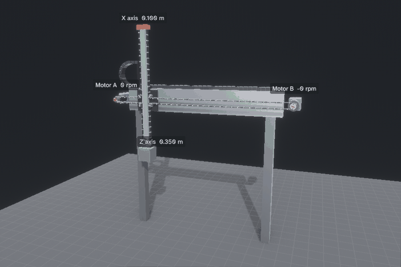
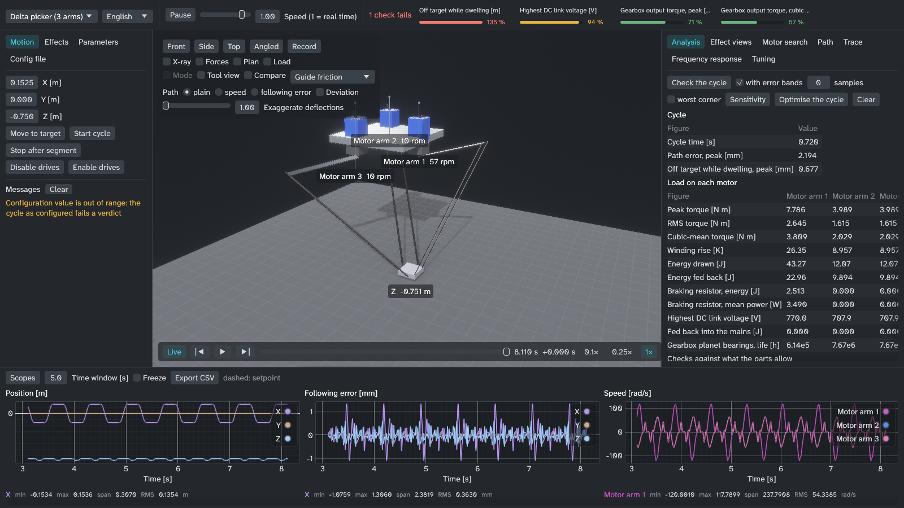

# Portal-Physiksimulator



Ein Simulator für Bewegungsmaschinen. Drehmoment, Drehzahl und Schleppfehler ergeben sich aus einem physikalischen Modell: Riementrume als Federn, Führungsreibung nach LuGre, ein Getriebe mit Spiel, eine Motorwicklung und ein Servoantrieb mit Kaskadenregelung.
Er enthält achtzehn Maschinen: ein T-Portal mit zwei Motoren (X und Z an einem Zahnriemen), eine Einzelachse mit Zahnriemen, fünf Delta-Picker (den D3 mit drei Armen, ausgelegt wie ein Autonox RL3-1200-3kg, einen D4 mit vierter Achse, die das Werkzeug dreht, einen Vierarm-Delta nach Quattro-Art, dessen zweiteilige Plattform das Werkzeug dreht, einen planaren D2 mit zwei Armen, ausgelegt wie ein Codian D2-800, und einen Linear-Delta auf drei Zahnriemensäulen, ausgelegt wie ein Festo EXPT-95) und, aus einem Baukasten von Gelenken, eine Kugelgewindeachse, eine Zahnstangenachse, eine Linearmotorachse, einen Rundtisch, einen Sechsachsroboter aus einer URDF-Datei, einen SCARA und einen Parallel-SCARA mit einem Fünfgelenk in der waagerechten Ebene ([Mechanismen](mechanismen.md)). Weitere Maschinen beschreiben [Maschinendateien](maschinendateien.md) ohne Rust-Code: ein H-Portal (H-Bot), einen CoreXY-Tisch, ein XYZ-Portal, ein Portal mit Kugelgewinde-Z und ein Portal mit Zahnstange (`machines/*.toml`).
Dazu gibt es sechs Bedienoberflächen: eine Desktop-App mit 3D-Ansicht und Oszilloskopen, ein Befehlszeilenprogramm, das CSV schreibt, einen OPC-UA-Server mit PLCopen-artigen Achsen für eine SPS, einen Export als FMU nach FMI 2.0 und 3.0 (Co-Simulation) für Simulink, OpenModelica, Dymola und andere Werkzeuge, ein Python-Modul und eine Browserseite mit 3D-Ansicht der Maschine und Auslegungsprüfung.
Das Programm ist in Rust geschrieben. Herstellerdaten zu Motoren, Getrieben, Antrieben und Riemenachsen liegen in [`catalog/`](../../catalog/).
**Schnellstart:** eine Maschine in 3D laufen sehen und die Auslegungsprüfung im Browser unter **https://sparkz400.github.io/KinematicsSimulation/** ausprobieren (ohne Installation), die Windows- oder Linux-Version unter [Releases](https://github.com/Sparkz400/KinematicsSimulation/releases) herunterladen oder selbst bauen mit `cargo run --release -p sim-app` (siehe [Bauen und starten](#bauen-und-starten)).



*Der Delta-Picker (`delta-d3`) in der App. Seine mitgelieferte Konfiguration besteht jede Prüfung: Mit dem Präzisions-Planetengetriebe SP100 von Siemens (spielreduziert) schwingt das Werkzeug an der Greifposition auf 0,30 mm ein, erlaubt sind 0,5 mm. Das Bild stammt von vor dem 14. November 2026, als das Economy-Getriebe der Konfiguration (9 Winkelminuten) diese Prüfung mit 0,68 mm nicht bestand, wie die obere Leiste zeigt.*

Diese Seite ist die deutsche Einstiegsseite. Die vollständige Projektbeschreibung ist das englische [README](../../README.md).

## Was das Programm aussagen kann und was nicht

Für eine Maschine, die in einer Konfigurationsdatei beschrieben ist, liefert es:

- Spitzenmoment, Effektivmoment und kubisches Mittel des Moments, Drehzahl, Strom, Übertemperatur der Wicklung und Energie je Motor über einen Zyklus oder eine Bahn
- wie viel vom Moment jedes Motors auf Trägheit, Schwerkraft, Reibung und Riemen entfällt, wo die Energie eines Zyklus verloren geht (jede Führung, Welle, jedes Getriebe, jeder Dämpfer, die Wicklungen, der Bremswiderstand) und was die Reibung jeder Führung an ihrem Arbeitspunkt tut
- ob dieser Zyklus die Grenzwerte der Bauteile in der Konfiguration einhält (Drehmoment-Drehzahl-Kennlinie, Wicklungstemperatur, Getriebe, Riemenkraft, schlaffes Trum und Zahnbelastung, Zwischenkreis und Bremswiderstand, Führungsbelastung und Radialkraft auf die Welle, Einschwingen an der Greifposition)
- für die Gelenkmaschinen zusätzlich die eigenen Prüfungen ihres Getriebes: Drehzahl, DN-Wert, Knickung und Lebensdauer eines Kugelgewindetriebs, Vorschubkraft einer Zahnstange, Lebensdauer eines Wellgetriebes
- wie viele Stunden die Lager der Scheibenwellen, die Planetenlager des Getriebes und die Führungen in diesem Zyklus halten, gegen eine geforderte Lebensdauer (ISO 281, die Getriebeformel von Siemens, die Formel der Führungshersteller; für den Riemen gibt es stattdessen eine zulässige Zahnbelastung, weil kein Riemenhersteller eine Lebensdauer veröffentlicht)
- wie lange die Verzahnung eines Getriebes hält, wo der Zyklus es über sein Nennmoment bringt, und die Lager eines Motors, wo der Riemen an seiner Welle zieht; die Lebensdauer der Lager der Scheibenwellen mit dem a_ISO der ISO 281 für Schmierung und Verschmutzung
- wie sich diese Ergebnisse verschieben, wenn ein unsicherer Wert an seiner unteren oder oberen Grenze liegt, oder wenn alle unsicheren Werte zugleich abweichen
- wie weit die Werkzeugspitze von ihrer Bahn entfernt ist und was Reglerverstärkungen, Überschleifen und Input Shaping daran ändern
- wie schnell eine Bahn innerhalb dessen gefahren werden kann, was Motoren und Riemen zulassen, Punkt für Punkt entlang der Bahn gelesen (ein zeitoptimaler Plan)
- die Resonanzen der Maschine über den Hub einer Achse, um die Input Shaper danach einzustellen
- welcher Katalogmotor mit seinem Antrieb (und Getriebe), auf welcher Katalogachse, der günstigste ist, der besteht; das eingebaute Gewicht steht für den Preis
- einen kürzeren Zyklus (höhere Grenzwerte, Überschleifen, Input Shaping, niedrigere oder gerundete Hübe), der jede Prüfung weiterhin besteht, wie geschrieben und in den Fehlerbändern
- die Energie je Zyklus gegen die Zykluszeit: die Einstellungen, die keine andere in beidem und in der Spitzenauslastung der Motoren übertrifft
- aus einer Antriebsaufzeichnung eines Deltas, des SCARA oder des Sechsachsroboters: die Masse der Nutzlast und je Motor zusätzliche Trägheit, Reibung und konstantes Moment (je Achse bei den übrigen Maschinen)
- die Steifigkeit des Riemens aus den Bewegungen einer Antriebsaufzeichnung, ohne Frequenzgang-Messung

Die Gleichungen sind gegen Handrechnungen, eine unabhängige Referenz in SciPy und Herstellerformeln geprüft; Einzelheiten stehen in [validation.md](../validation.md). Diese Prüfungen belegen, dass die Gleichungen richtig gelöst und die Katalogdaten richtig gelesen werden. Sie belegen nicht, dass die Parameter eine reale Maschine beschreiben.

**Es wurde keine reale Maschine vermessen.** Reibung, Dämpfung, Steifigkeit von Führung und Gestell, Riemenvorspannung, Wicklungswiderstand und Wicklungsinduktivität sowie die Daten von Zwischenkreis und Bremswiderstand sind Schätzungen. Die Konfigurationen sagen das selbst: [`exct-30.toml`](../../crates/machine-t-gantry/exct-30.toml) kennzeichnet jeden Wert mit `[catalogue]` oder `[estimate]`, und jede Konfiguration hat eine Tabelle `[bounds]` mit einer unteren und einer oberen Grenze für ihre Schätzwerte. Tendenzen und Vergleiche (dieser Motor gegen jenen, mit und ohne Input Shaping) sind belastbar. Absolute Zahlen sind so gut wie die Schätzungen. Mit `verdicts --bands` sehen Sie, wie weit sich ein Ergebnis mit ihnen verschiebt.

Weitere Grenzen, die zählen:

- Die Standardkonfigurationen der beiden Riemenmaschinen sind erfundene Platzhaltermaschinen, keine Produkte. Die Konfigurationen der Deltas sind wie Produkte ausgelegt (Autonox RL3-1200-3kg, Codian D2-800, Festo EXPT-95; Siemens-Motoren und -Getriebe aus dem Katalog), aber Arm- und Stablängen, Massen und Trägheiten sind Schätzungen: Die Hersteller veröffentlichen sie nicht (Autonox gibt sie nur nach Registrierung heraus). Die Gelenkmaschinen (Gewindetrieb, Zahnstange, Linearmotor, Rundtisch, Roboter) sind ausgelegte Beispiele, deren Mechanik ein typisches Teil dieser Größe schätzt, nicht den Artikel eines Herstellers; die Roboter werden im Gelenkraum ausgelegt, ohne kartesische Bahnen.
- Der Motor ist eine einzige Ersatzwicklung (R, L, Gegen-EMK), die den Effektivwert des Strangstroms führt und höchstens das sqrt(3/2)-Fache der Zwischenkreisspannung erhält. Es gibt kein Drehstrommodell, keine PWM und keine Feldschwächung.
- Die Lebensdauern sind die Formeln der Hersteller und nicht mehr: der Lebensdauerbeiwert a1 der ISO 281 an den Lagern und a_ISO nur an den Lagern der Scheibenwellen (keiner an den Führungen), ein Lager je Scheibenwelle, die Lebensdauer der Verzahnung aus einem Wöhler-Exponenten und einem Knick, die Schätzungen sind (die Schadenssumme von Siemens selbst wurde nicht gelesen), Tragzahlen und Schmierwerte, die zum Teil Schätzungen sind (Festo veröffentlicht für die EXCT keine). Sie sind nicht validiert.
- Die OPC-UA-Anbindung wurde gegen einen Client geprüft, der mit derselben Bibliothek geschrieben ist, nicht gegen eine SPS.
- Die FMU wurde mit dem Validator und dem Simulator von fmpy geprüft und in OpenModelica 1.27.1 mit OMSimulator, seinem Co-Simulationswerkzeug, gerechnet (der Import als Modelica-Block nimmt nur FMUs für Model Exchange, die dieser Export nicht schreibt); in Simulink oder Dymola importiert oder mit `fmusim` der Modelica Association oder dem FMU Compliance Checker geprüft wurde sie nicht ([FMI-Export](fmi.md)).
- Die Zahlen im Browser stimmen mit denen der Befehlszeile auf vier bis fünf signifikante Stellen überein, nicht Bit für Bit ([Auslegung im Browser](web.md)).
- Die Mausbedienung der App (Kamera, Bedienfelder) hat kein Mensch geprüft; Bildschirmfotos wurden geprüft.
- Das Einlesen von Antriebsaufzeichnungen und die Parameteranpassung wurden an Aufzeichnungen geprüft, die der Simulator selbst erzeugt hat.

## Bauen und starten

Benötigt wird eine stabile Rust-Toolchain, die die Edition 2024 unterstützt. Alle Versionen der Abhängigkeiten sind in [`Cargo.toml`](../../Cargo.toml) festgelegt. Die Katalogdaten sind einkompiliert; die Programme brauchen also keine Datendateien.

```sh
cargo run --release -p sim-app                    # die Desktop-App
cargo run -q --release -p sim-cli -- list         # das Befehlszeilenprogramm
cargo run --release -p sim-opcua -- t-gantry      # der OPC-UA-Server unter opc.tcp://127.0.0.1:4840/
cargo build --release -p sim-cli -p sim-fmi       # dann: target/release/sim-cli fmu t-gantry --out t-gantry.fmu
cargo test --workspace                            # alle Tests
```

`cargo test --workspace` baut auch die App mit ihren Grafikbibliotheken. Um nur die Physik, die Analyse und die Befehlszeile zu testen:

```sh
cargo test -p sim-core -p sim-components -p machine-t-gantry -p machine-single-axis -p machine-delta-d3 -p machine-joint-kit -p sim-netlist -p sim-machines -p sim-cli
```

Die App lässt sich im laufenden Betrieb auf Deutsch umschalten (Sprache). Das Befehlszeilenprogramm und der OPC-UA-Server geben ihre Meldungen mit `--lang de` auf Deutsch aus:

```text
$ cargo run -q --release -p sim-cli -- list --lang de
t-gantry	T-Portal
single-axis	Einzelachse
delta-d3	Delta-Picker (3 Arme)
delta-d2	Planarer Delta-Picker (2 Arme)
parallel-scara	Parallel-SCARA (Fünfgelenk in der Waagerechten, Z-Hub, Werkzeugdrehung)
delta-linear	Linear-Delta (3 Riemenachsen)
delta-d4	Delta-Picker (3 Arme und drehendes Werkzeug)
delta-h4	Delta nach Quattro-Art (4 Arme, zweiteilige Plattform)
screw-axis	Kugelgewindeachse
rack-axis	Zahnstangenachse
linear-motor-axis	Linearmotorachse
rotary-table	Rundschalttisch
urdf-arm	Sechsachsroboter (URDF)
scara	SCARA-Roboter (URDF)
slider-crank	Schubkurbel (Servopresse)
rotary-knife	Rotationsmesser (Querschneider)
flying-saw	Fliegende Säge
palletiser	Palettierer (URDF, Parallelogramm)
```

Alle Befehle schreiben CSV auf die Standardausgabe oder mit `--out FILE` in eine Datei. Meldungen und Fehler gehen auf die Fehlerausgabe. Die Spaltennamen der CSV-Ausgabe sind englische Bezeichner und werden nicht übersetzt.

## Wie es weitergeht

| Dokument | Wofür |
| --- | --- |
| [Benutzerhandbuch](benutzerhandbuch.md) | Deutsch. Ein Abschnitt je Aufgabe: einen Motor auslegen, eine Katalogmaschine prüfen, suchen, Fehlerbänder, einen Zyklus verkürzen, eine Bahn fahren, Regler einstellen, eine Aufzeichnung nachfahren und Parameter anpassen, eine SPS anbinden, die App bedienen |
| [Python-Modul](python.md) | `kinematics_sim`: Konfigurationen, Läufe, Analyse, Prüfurteile, Bänder und Auslegung als NumPy-Arrays und Tabellen für pandas; ein Notebook mit einer Parameterstudie |
| [Auslegung im Browser](web.md) | Der Simulator als WebAssembly und eine statische Seite mit 3D-Ansicht und Auslegungsprüfung |
| [FMI-Export](fmi.md) | FMUs nach FMI 2.0 und 3.0: Variablen, FMU-Zustand, Richtungsableitungen, Prüfung, Import in Simulink, OpenModelica und Dymola |
| [Virtuelle Inbetriebnahme mit einer SPS](sps.md) | PLCopen-artige Bausteine je Achse über OPC UA, Echtzeittakt und Jitter, Beispiele für TwinCAT und CODESYS, Dauertest |
| [Feldbus-Emulation](feldbus-emulation.md) | Entwurfsnotiz: einen EtherCAT- oder PROFINET-Antrieb für eine echte SPS nachbilden |

Die Referenzdokumente gibt es nur auf Englisch:

| Dokument | Wofür |
| --- | --- |
| [Maschinendateien](maschinendateien.md) | Deutsch. Eine Maschine in einer TOML- oder JSON-Datei beschreiben, wie eine Netzliste aus Bauteilen verschaltet, ohne Rust-Code; das Format, seine Prüfungen, ein durchgerechnetes Beispiel |
| [config-reference.md](../config-reference.md) | Jede Tabelle und jeder Schlüssel der Konfiguration, mit Einheit, Bedeutung, Quelle und dem zugehörigen Effektschalter |
| [model-reference.md](../model-reference.md) | Die Gleichungen, je Komponente und je Maschine, mit Annahmen und bekannten Vereinfachungen |
| [mechanismen.md](mechanismen.md) | Kugelgewindetrieb, Zahnstange, Linearmotor, Rundtisch, Roboter aus URDF-Dateien, Schubkurbel, Rotationsmesser, fliegende Säge und die elektronische Kurvenscheibe: die Maschinen, ihre Formeln, Prüfungen und Grenzen |
| [catalogue.md](../catalogue.md) | Was in `catalog/` liegt, woher es stammt, gefundene Druckfehler, was fehlt |
| [validation.md](../validation.md) | Jede Prüfung gegen etwas Unabhängiges, und was nicht validiert ist |
| [user-guide.md](../user-guide.md) | Die englische Fassung des Benutzerhandbuchs |
| [README](../../README.md) | Die englische Projektseite mit einem Rundgang in fünf Minuten und dem Aufbau des Quelltexts |
