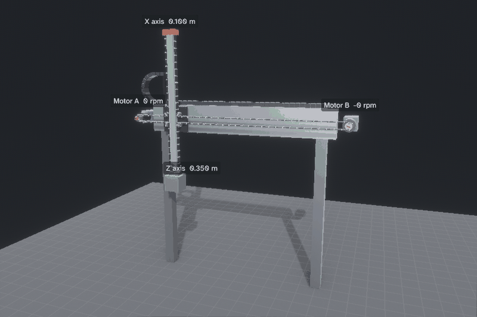
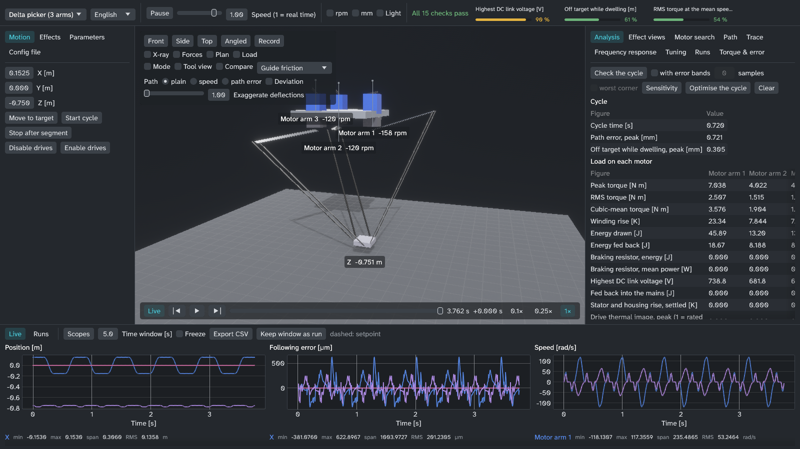

# Kinematics Simulation



Ein Physiksimulator für Bewegungsmaschinen. Drehmoment, Drehzahl und Schleppfehler ergeben sich aus einem physikalischen Modell: Riementrume als Federn, Führungsreibung nach LuGre, ein Getriebe mit Spiel, eine Motorwicklung und ein Servoantrieb mit Kaskadenregelung.
Er enthält achtundzwanzig Maschinen: ein T-Portal mit zwei Motoren (X und Z an einem Zahnriemen) und eine Einzelachse mit Zahnriemen; fünf Delta-Picker (den D3 mit drei Armen, ausgelegt wie ein Autonox RL3-1200-3kg, einen D4 mit vierter Achse, die das Werkzeug dreht, einen Vierarm-Delta nach Quattro-Art, dessen zweiteilige Plattform das Werkzeug dreht, einen planaren D2 mit zwei Armen, ausgelegt wie ein Codian D2-800, und einen Linear-Delta auf drei Zahnriemensäulen, ausgelegt wie ein Festo EXPT-95) und einen Parallel-SCARA; aus einem Baukasten von Gelenken eine Kugelgewindeachse, eine Zahnstangenachse, eine Linearmotorachse, einen Rundtisch, einen Sechsachsroboter aus einer URDF-Datei (auch auf einer Linearschiene), einen SCARA und einen Palettierer; Kurbel- und Kurvenmaschinen (eine Servopresse, eine Kniehebelpresse, ein Rotationsmesser, eine fliegende Säge, eine Kurvenscheibe); Parallelkinematiken (einen Hexapod auf elektrischen Zylindern, eine sechsachsige Plattform auf Kurbeln, einen Tripod, einen ebenen und einen räumlichen Seilroboter); einen Wafer-Handler mit R-Theta-Z-Arm; und einen Auf- und Abwickler mit Tänzer ([Mechanismen](mechanismen.md)). Weitere Maschinen beschreiben [Maschinendateien](maschinendateien.md) ohne Rust-Code: ein H-Portal (H-Bot), einen CoreXY-Tisch, ein XYZ-Portal, ein Portal mit Kugelgewinde-Z, Portale mit Zahnstange und mit zwei Antrieben, ein Portal mit C-Achse, zwei Fünfachsmaschinen, einen Scherenhubtisch, eine Riemenachse mit Schrittmotor, ein Hubwerk mit Asynchronmotor und eine Servoachse mit einem Pneumatikzylinder als Z (`machines/*.toml`).
Dazu gibt es sechs Bedienoberflächen: eine Desktop-App mit 3D-Ansicht und Oszilloskopen, ein Befehlszeilenprogramm, das CSV schreibt, einen OPC-UA-Server mit PLCopen-artigen Achsen für eine SPS, einen Export als FMU nach FMI 2.0 und 3.0 (Co-Simulation) für Simulink, OpenModelica, Dymola und andere Werkzeuge, ein Python-Modul und eine Browserseite mit 3D-Ansicht der Maschine und Auslegungsprüfung.
Das Programm ist in Rust geschrieben. Herstellerdaten zu Motoren, Getrieben, Antrieben, Riemenachsen, Gewindetrieben, Führungen und Pneumatikzylindern liegen in [`catalog/`](../../catalog/).
**Schnellstart:** eine Maschine in 3D laufen sehen und die Auslegungsprüfung im Browser unter **https://sparkz400.github.io/KinematicsSimulation/** ausprobieren (ohne Installation; die Dokumente liegen unter [/docs/](https://sparkz400.github.io/KinematicsSimulation/docs/)), die Windows- oder Linux-Version unter [Releases](https://github.com/Sparkz400/KinematicsSimulation/releases) herunterladen oder selbst bauen mit `cargo run --release -p sim-app` (siehe [Bauen und starten](#bauen-und-starten)).



*Der Delta-Picker (`delta-d3`) in der App; seine mitgelieferte Konfiguration besteht alle 15 Prüfungen, wie die obere Leiste zeigt. Im Bild schwingt das Werkzeug an der Greifposition auf 0,31 mm ein, erlaubt sind 0,5 mm; mit der Reibungsvorsteuerung, die die Konfiguration jetzt hat, ergibt `sim-cli verdicts delta-d3` 0,18 mm.*

Diese Seite ist die deutsche Einstiegsseite. Die vollständige Projektbeschreibung mit einem Rundgang in fünf Minuten ist das englische [README](../../README.md).

## Was das Programm aussagen kann und was nicht

Für eine Maschine, die in einer Konfigurationsdatei beschrieben ist, liefert es:

- Spitzenmoment, Effektivmoment und kubisches Mittel des Moments, Drehzahl, Strom, Übertemperatur der Wicklung und Energie je Motor über einen Zyklus oder eine Bahn
- wie viel vom Moment jedes Motors auf Trägheit, Schwerkraft, Reibung und Riemen entfällt, wo die Energie eines Zyklus verloren geht (jede Führung, Welle, jedes Getriebe, jeder Dämpfer, die Wicklungen, der Bremswiderstand) und was die Reibung jeder Führung an ihrem Arbeitspunkt tut
- ob dieser Zyklus die Grenzwerte der Bauteile in der Konfiguration einhält (Drehmoment-Drehzahl-Kennlinie, S1, Wicklungstemperatur, Getriebe, Riemenkraft, schlaffes Trum und Zahnbelastung, Zwischenkreis und Bremswiderstand, Führungsbelastung und Radialkraft auf die Welle, Einschwingen an der Greifposition), und die eigenen Prüfungen der Maschine: Drehzahl, DN-Wert, Knickung und Lebensdauer eines Kugelgewindetriebs, Vorschubkraft einer Zahnstange, Lebensdauer eines Wellgetriebes, Kraftreserve einer Presse, Rutschen eines Wafers, Seilkräfte, Bahnzug an Kern und vollem Wickel, Synchronität eines Schrittmotors, Endlagenenergie eines Pneumatikzylinders
- wie viele Stunden die Lager der Scheibenwellen, die Planetenlager des Getriebes und die Führungen in diesem Zyklus halten, gegen eine geforderte Lebensdauer (ISO 281 mit a_ISO, die Getriebeformel von Siemens, die Formel der Führungshersteller; für den Riemen gibt es stattdessen eine zulässige Zahnbelastung, weil kein Riemenhersteller eine Lebensdauer veröffentlicht), und wie lange die Verzahnung eines Getriebes über ihrem Nennmoment hält
- wie sich diese Ergebnisse verschieben, wenn ein unsicherer Wert an seiner unteren oder oberen Grenze liegt, oder wenn alle unsicheren Werte zugleich abweichen
- wie weit die Werkzeugspitze von ihrer Bahn entfernt ist und was Reglerverstärkungen, Überschleifen, Input Shaping und Reibungsvorsteuerung daran ändern
- wie schnell eine Bahn innerhalb jeder Grenze gefahren werden kann, die ein Prüfurteil an einem Punkt der Bahn beurteilt (ein zeitoptimaler Plan)
- wie weit die Maschine fährt, wenn sie im ungünstigsten Augenblick in Stoppkategorie 0, 1 oder 2 angehalten wird, mit den Verzögerungen der Haltebremsen
- die Resonanzen der Maschine über ihren Arbeitsraum, um die Input Shaper danach einzustellen, und ihre Eigenformen
- welcher Katalogmotor mit seinem Antrieb (und Getriebe), auf welcher Katalogachse, der günstigste ist, der besteht; das eingebaute Gewicht steht für den Preis
- einen kürzeren Zyklus (höhere Grenzwerte, Überschleifen, Input Shaping, niedrigere oder gerundete Hübe), der jede Prüfung weiterhin besteht, wie geschrieben und in den Fehlerbändern
- die Energie je Zyklus gegen die Zykluszeit: die Einstellungen, die keine andere in beidem und in der Spitzenauslastung der Motoren übertrifft
- aus einer Antriebsaufzeichnung: die Masse der Nutzlast, je Motor zusätzliche Trägheit, Reibung und konstantes Moment (je Glied bei den Robotern) und die Steifigkeit des Riemens aus seinen Bewegungen
- was ein eigener Regler mit der Maschine macht: Momenten- oder Drehzahlregelung je Motor aus der FMU oder aus Pythons `ks.Sim`, beurteilt mit derselben Analyse und denselben Prüfungen wie der eingebaute Antrieb

Die Motoren sind permanenterregte Servomotoren, zweiphasige Hybrid-Schrittmotoren an einem gesteuerten Antrieb ohne Rückführung oder Asynchronmotoren an einem Frequenzumrichter (U/f oder feldorientiert); eine Maschinendatei kann Pneumatikzylinder mit ihren Ventilen neben die Servoachsen setzen.

Was hinter den Zahlen steht ([validation.md](../validation.md)): Handrechnungen zu jedem Bauteil und jeder Kennzahl; unabhängige Implementierungen (die Bewegung des T-Portals gegen SciPy, die Starrkörperdynamik der Roboter und die Lage ihres Flanschs gegen MuJoCo 4.0.1, die Dynamik des D3 gegen eine Lagrange-Rechnung in SymPy und seine Massenaufteilung gegen ein Mehrkörpermodell in MuJoCo, die inverse Dynamik von D2 und Linear-Delta gegen Lagrange-Rechnungen, der geschlossene Regelkreis des Antriebs an der Einzelachse gegen eine Python-Implementierung nach der Modellreferenz); Messdaten eines Kugelgewinde-Prüfstands (unten); Herstellerformeln und Querprüfungen zwischen Herstellerdokumenten; Property-Tests und Fuzz-Ziele für alle Leser von Dateien. Diese Prüfungen belegen, dass die Gleichungen wie dokumentiert gelöst und die Katalogdaten richtig gelesen werden; MuJoCo, eine Implementierung anderer Leute, kann auch eine falsche Gleichung in der Kette der Roboter finden. Sie belegen nicht, dass die Parameter eine reale Maschine beschreiben.

**Eine Maschine wurde vermessen, von anderen; sonst keine.** Den Kugelgewinde-Prüfstand des ISW Stuttgart ([`datasets/isw-ball-screw-axis`](../../datasets/isw-ball-screw-axis/), CC BY 4.0) fährt der Simulator mit den aufgezeichneten Sollwerten nach. Mit der Reibung, die an seiner S-Profil-Aufzeichnung angepasst ist, weicht das simulierte Motormoment vom gemessenen um 5,3 % der Spitze im Effektivwert ab (28 % am ungünstigsten Abtastwert); an den beiden Aufzeichnungen, die als Prüfung zurückgehalten sind, um 13,3 % und 6,1 % (35 % und 25 %). Die Anpassung legt die bewegte Masse 92 kg unter die 584 kg der Konfiguration, die Haltekraft im Stillstand hat in einer Prüfung das falsche Vorzeichen, und die erste Eigenfrequenz des Modells liegt bei 137 Hz, wo die Frequenzgänge des Prüfstands 123 bis 134 Hz ergeben. Für jede andere Konfiguration sind Reibung, Dämpfung, Steifigkeit von Führung und Gestell, Riemenvorspannung, Wicklungswiderstand und Wicklungsinduktivität sowie die Daten von Zwischenkreis und Bremswiderstand Schätzungen. Die Konfigurationen sagen das selbst: [`exct-30.toml`](../../crates/machine-t-gantry/exct-30.toml) kennzeichnet jeden Wert mit `[catalogue]` oder `[estimate]`, und jede Konfiguration hat eine Tabelle `[bounds]` mit einer unteren und einer oberen Grenze für ihre Schätzwerte. Tendenzen und Vergleiche (dieser Motor gegen jenen, mit und ohne Input Shaping) sind belastbar. Absolute Zahlen sind so gut wie die Schätzungen. Mit `verdicts --bands` sehen Sie, wie weit sich ein Ergebnis mit ihnen verschiebt.

Weitere Grenzen, die zählen:

- Die Standardkonfigurationen der beiden Riemenmaschinen sind erfundene Platzhaltermaschinen, keine Produkte. Die Konfigurationen der Deltas sind wie Produkte ausgelegt (Autonox RL3-1200-3kg, Codian D2-800, Festo EXPT-95; Siemens-Motoren und -Getriebe aus dem Katalog), aber Arm- und Stablängen, Massen und Trägheiten sind Schätzungen: Die Hersteller veröffentlichen sie nicht. Die übrigen Maschinen sind ausgelegte Beispiele, deren Mechanik ein typisches Teil dieser Größe schätzt, nicht den Artikel eines Herstellers. Für Schrittmotoren, Asynchronmotoren, Vakuumsauger und Durchflusswerte von Ventilen gibt es keine Katalogdaten: Ihre Werte sind Schätzungen.
- Ein Servomotor ist eine einzige Ersatzwicklung (R, L, Gegen-EMK), die den Effektivwert des Strangstroms führt und höchstens das sqrt(3/2)-Fache der Zwischenkreisspannung erhält; mit Feldschwächung (`effects.field_weakening`, in den mitgelieferten Konfigurationen an) ist sie die q-Achse eines d-q-Modells, dessen d-Strom seinem Sollwert mit der Zeitkonstante des Stromreglers folgt. Es gibt kein Drehstrommodell und keine PWM ([Modellreferenz](../model-reference.md)).
- Der zeitoptimale Plan hält die Grenzen ein, die an einem Punkt der Bahn beurteilt werden, nicht die über den ganzen Zyklus (Erwärmung, S1, Effektivstrom, Lebensdauern, mittlere Bremsleistung): In den zeitoptimalen Zyklen von vier Maschinen wird ein Motor zu warm.
- Stopps: Kategorie 2 bremst in Fahrtrichtung ohne Ruckbegrenzung, eine Verzögerung gilt für alle Bremsen einer Maschine, und die Prüfurteile der Stopps gibt nur `sim-cli stop`; kein Stopp ist mit einem gemessenen verglichen.
- Die Lebensdauern sind die Formeln der Hersteller und nicht mehr: der Lebensdauerbeiwert a1 der ISO 281 an den Lagern und a_ISO nur an den Lagern der Scheibenwellen, ein Lager je Scheibenwelle, die Lebensdauer der Verzahnung aus einem Wöhler-Exponenten und einem Knick, die Schätzungen sind, Tragzahlen und Schmierwerte, die zum Teil Schätzungen sind. Sie sind nicht validiert.
- Der OPC-UA-Server wurde gegen einen Client geprüft, der mit derselben Bibliothek geschrieben ist (mit den gesicherten Endpunkten und den Jitter-Kennzahlen), nicht gegen eine SPS.
- Die FMU wurde mit dem Validator und dem Simulator von fmpy geprüft und in OpenModelica 1.27.1 mit OMSimulator gerechnet; in Simulink oder Dymola importiert oder mit `fmusim` der Modelica Association oder dem FMU Compliance Checker geprüft wurde sie nicht ([FMI-Export](fmi.md)).
- Die Zahlen im Browser stimmen mit denen der Befehlszeile auf vier bis fünf signifikante Stellen überein, nicht Bit für Bit ([Auslegung im Browser](web.md)).
- Das Fenster der App wird mit künstlichen Maus-, Tastatur- und Größenereignissen getestet, und seine Bilder wurden gelesen; die Dateidialoge sind nicht getestet, wie die Bewegung über die Zeit aussieht, hat niemand angesehen, und bei 1280 x 720 verdecken die Bedienelemente der Ansicht einen großen Teil der Maschine ([validation.md](../validation.md#what-is-not-validated)).
- Das Einlesen von Antriebsaufzeichnungen und die Parameteranpassung wurden an Aufzeichnungen geprüft, die der Simulator selbst erzeugt hat, und an denen des einen Prüfstands, mit einem Skript in CSV umgewandelt; der eigene Export eines Antriebs (Startdrive, TwinCAT, CODESYS) wurde noch nicht gelesen.
- Hexapod und räumlicher Seilroboter rechnen langsamer als Echtzeit.

Was noch nicht gebaut ist: [ROADMAP.md](../../ROADMAP.md) (englisch).

## Bauen und starten

Benötigt wird eine stabile Rust-Toolchain, die die Edition 2024 unterstützt. Alle Versionen der Abhängigkeiten sind in [`Cargo.toml`](../../Cargo.toml) festgelegt. Die Katalogdaten sind einkompiliert; die Programme brauchen also keine Datendateien.

```sh
cargo run --release -p sim-app                    # die Desktop-App
cargo run -q --release -p sim-cli -- list         # das Befehlszeilenprogramm
cargo run --release -p sim-opcua -- t-gantry      # der OPC-UA-Server unter opc.tcp://127.0.0.1:4840/
cargo build --release -p sim-cli -p sim-fmi       # dann: target/release/sim-cli fmu t-gantry --out t-gantry.fmu
cargo test --workspace                            # alle Tests
```

`cargo test --workspace` baut auch die App mit ihren Grafikbibliotheken. Um nur die Physik, die Analyse und die Befehlszeile zu testen:

```sh
cargo test -p sim-core -p sim-components -p machine-t-gantry -p machine-single-axis -p machine-delta-d3 -p machine-joint-kit -p sim-netlist -p sim-machines -p sim-cli
```

Die App lässt sich im laufenden Betrieb auf Deutsch umschalten (Sprache). Das Befehlszeilenprogramm und der OPC-UA-Server geben ihre Meldungen mit `--lang de` auf Deutsch aus:

```text
$ cargo run -q --release -p sim-cli -- list --lang de
t-gantry	T-Portal
single-axis	Einzelachse
delta-d3	Delta-Picker (3 Arme)
delta-d2	Planarer Delta-Picker (2 Arme)
parallel-scara	Parallel-SCARA (Fünfgelenk in der Waagerechten, Z-Hub, Werkzeugdrehung)
delta-linear	Linear-Delta (3 Riemenachsen)
delta-d4	Delta-Picker (3 Arme und drehendes Werkzeug)
delta-h4	Delta nach Quattro-Art (4 Arme, zweiteilige Plattform)
screw-axis	Kugelgewindeachse
rack-axis	Zahnstangenachse
linear-motor-axis	Linearmotorachse
rotary-table	Rundschalttisch
urdf-arm	Sechsachsroboter (URDF)
scara	SCARA-Roboter (URDF)
slider-crank	Schubkurbel (Servopresse)
rotary-knife	Rotationsmesser (Querschneider)
flying-saw	Fliegende Säge
palletiser	Palettierer (URDF, Parallelogramm)
hexapod	Hexapod (6 elektrische Zylinder)
cable-planar	Ebener Seilroboter (4 Seile)
cable-spatial	Räumlicher Seilroboter (8 Seile)
disc-cam	Kurvenscheibe mit Rollenstößel
tripod	Tripod (3-RPS, 3 elektrische Zylinder)
wafer-handler	Wafer-Handler (R-Theta-Z-Arm mit Bändern in den Gliedern)
toggle-press	Kniehebelpresse
arm-on-track	Sechsachsroboter auf Linearschiene (URDF, Zahnstange)
winder	Auf- und Abwickler mit Tänzer
hexapod-rotary	Sechsachsige Plattform auf Kurbeln (6-RSS, Drehantriebe)
```

Alle Befehle schreiben CSV auf die Standardausgabe oder mit `--out FILE` in eine Datei. Meldungen und Fehler gehen auf die Fehlerausgabe. Die Spaltennamen der CSV-Ausgabe sind englische Bezeichner und werden nicht übersetzt. Beispiele zu jeder Aufgabe, jedes getestet: [examples/README.md](../../examples/README.md) (englisch).

## Wie es weitergeht

| Dokument | Wofür |
| --- | --- |
| [Benutzerhandbuch](benutzerhandbuch.md) | Ein Abschnitt je Aufgabe: einen Motor auslegen, eine Katalogmaschine prüfen, suchen, Fehlerbänder, einen Zyklus verkürzen, eine Bahn fahren, die Maschine anhalten, einen eigenen Regler prüfen, einen Schrittmotor, einen Asynchronmotor oder einen Zylinder auslegen, Regler einstellen, eine Aufzeichnung nachfahren und Parameter anpassen, eine SPS anbinden, die App bedienen |
| [Maschinendateien](maschinendateien.md) | Eine Maschine in einer TOML- oder JSON-Datei beschreiben, wie eine Netzliste aus Bauteilen verschaltet, ohne Rust-Code; das Format, seine Prüfungen, ein durchgerechnetes Beispiel |
| [Mechanismen](mechanismen.md) | Kugelgewindetrieb, Zahnstange, Linearmotor, Rundtisch, Roboter aus URDF-Dateien, Kurbel- und Kurvenmaschinen, Kniehebelpresse, Parallel-SCARA, Vierarm-Delta, Wafer-Handler, Hexapod auf Zylindern und auf Kurbeln, Tripod, Seilroboter, Auf- und Abwickler und Pneumatikzylinder: die Maschinen, ihre Formeln, Prüfungen und Grenzen |
| [Python-Modul](python.md) | `kinematics_sim`: Konfigurationen, Läufe, Analyse, Prüfurteile, Bänder und Auslegung als NumPy-Arrays und Tabellen für pandas; eine Simulation, die ein eigener Regler schrittweise führt; ein Notebook mit einer Parameterstudie |
| [Auslegung im Browser](web.md) | Der Simulator als WebAssembly und eine statische Seite mit 3D-Ansicht und Auslegungsprüfung |
| [FMI-Export](fmi.md) | FMUs nach FMI 2.0 und 3.0: Variablen, Momenten- und Drehzahlregelung, FMU-Zustand, Richtungsableitungen, Prüfung, Import in Simulink, OpenModelica und Dymola |
| [Virtuelle Inbetriebnahme mit einer SPS](sps.md) | PLCopen-artige Bausteine je Achse über OPC UA, Sicherheit, Echtzeittakt und Jitter, Beispiele für TwinCAT und CODESYS, Dauertest |
| [Anbindungen](integrationen.md) | CAD (FreeCAD, Onshape) in eine Konfiguration, und der Auslegungsbericht |
| [Feldbus-Emulation](feldbus-emulation.md) | Entwurfsnotiz: einen EtherCAT- oder PROFINET-Antrieb für eine echte SPS nachbilden |

Die Referenzdokumente gibt es nur auf Englisch:

| Dokument | Wofür |
| --- | --- |
| [config-reference.md](../config-reference.md) | Jede Tabelle und jeder Schlüssel der Konfiguration, mit Einheit, Bedeutung, Quelle und dem zugehörigen Effektschalter |
| [model-reference.md](../model-reference.md) | Die Gleichungen, je Komponente und je Maschine, mit Annahmen und bekannten Vereinfachungen |
| [catalogue.md](../catalogue.md) | Was in `catalog/` liegt, woher es stammt, gefundene Druckfehler, was fehlt |
| [validation.md](../validation.md) | Jede Prüfung gegen etwas Unabhängiges, der vermessene Kugelgewinde-Prüfstand, und was nicht validiert ist |
| [measurement-procedure.md](../measurement-procedure.md) | Wie man an einer realen Maschine Aufzeichnungen für die Anpassung macht |
| [user-guide.md](../user-guide.md) | Die englische Fassung des Benutzerhandbuchs |
| [README](../../README.md) | Die englische Projektseite mit einem Rundgang in fünf Minuten und dem Aufbau des Quelltexts |
