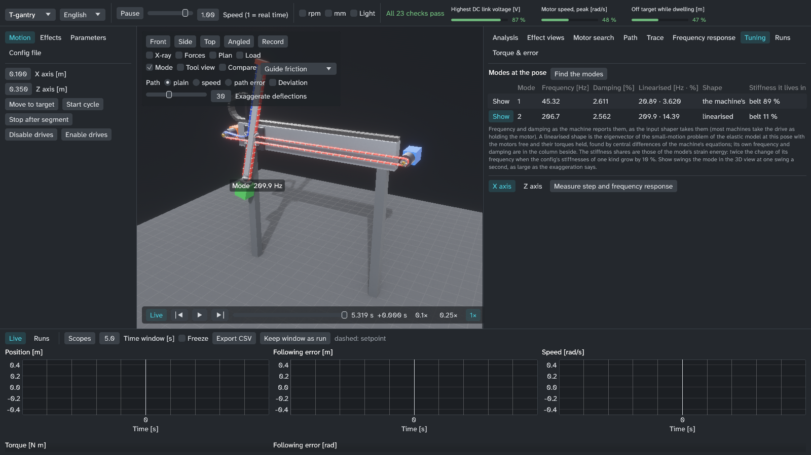
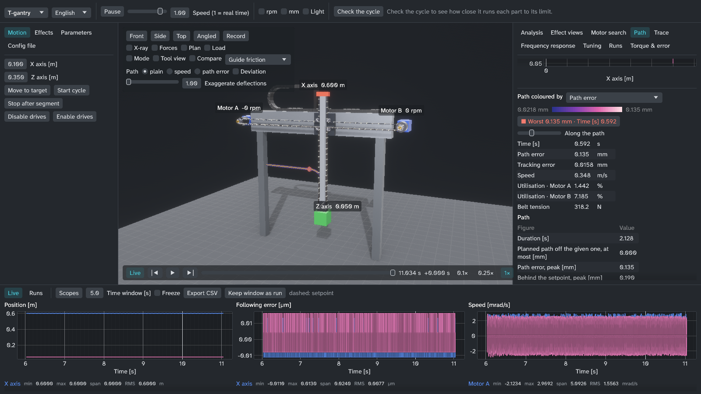
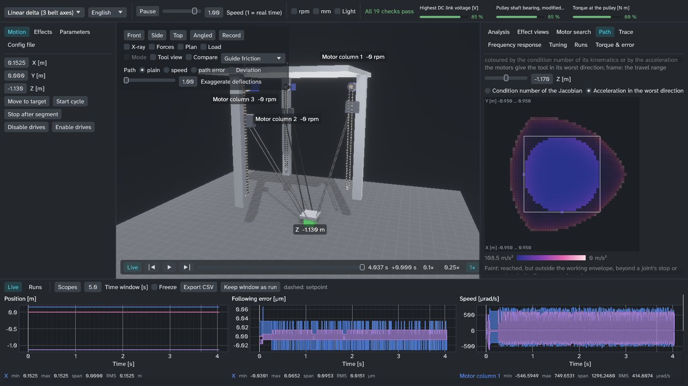
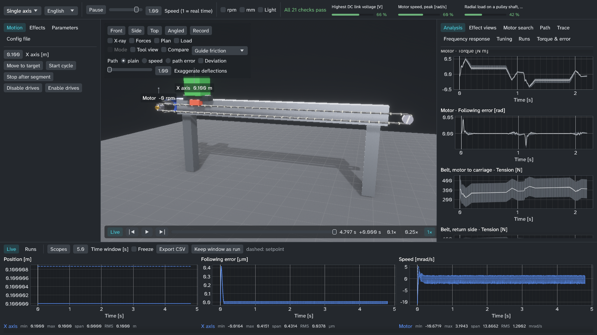

# Benutzerhandbuch

Ein Abschnitt je Aufgabe. Jeder nennt den Befehl, erklärt die Ausgabe und führt die Grenzen auf, die für diese Aufgabe zählen. Die Physik dahinter steht in der [Modellreferenz](../model-reference.md), die Konfigurationsschlüssel stehen in der [Konfigurationsreferenz](../config-reference.md).

Die Referenzdokumente, auf die dieses Handbuch verweist, gibt es nur auf Englisch. Die englische Fassung dieses Handbuchs ist [user-guide.md](../user-guide.md).

- [Für alle Befehle gleich](#für-alle-befehle-gleich)
- [Einen Motor für einen Zyklus auslegen](#einen-motor-für-einen-zyklus-auslegen)
- [Eine reale Katalogmaschine prüfen](#eine-reale-katalogmaschine-prüfen)
- [Den leichtesten Motor finden](#den-leichtesten-motor-finden)
- [Einfluss unsicherer Parameter erkennen und mit Fehlerbändern beurteilen](#einfluss-unsicherer-parameter-erkennen-und-mit-fehlerbändern-beurteilen)
- [Einen Zyklus verkürzen](#einen-zyklus-verkürzen)
- [Einen Delta-Picker auslegen](#einen-delta-picker-auslegen)
- [Einen Linear-Delta auslegen](#einen-linear-delta-auslegen)
- [Einen Hexapod oder einen Seilroboter auslegen](#einen-hexapod-oder-einen-seilroboter-auslegen)
- [Einen Tripod auslegen](#einen-tripod-auslegen)

- [Einen Wickler auslegen](#einen-wickler-auslegen)
- [Eine Bahn fahren und den Bahnfehler ablesen](#eine-bahn-fahren-und-den-bahnfehler-ablesen)
- [Programme: G-Code und Roboterprogramme](#programme-g-code-und-roboterprogramme)
- [Prüfurteile, Suche und Optimierung auf einer Bahn](#prüfurteile-suche-und-optimierung-auf-einer-bahn)
- [Die Form der Bewegungen wählen](#die-form-der-bewegungen-wählen)
- [Regler einstellen und Input Shaping nutzen](#regler-einstellen-und-input-shaping-nutzen)
- [Eine Antriebsaufzeichnung nachfahren und Parameter anpassen](#eine-antriebsaufzeichnung-nachfahren-und-parameter-anpassen)
- [Sehen, wohin Moment und Energie gehen](#sehen-wohin-moment-und-energie-gehen)
- [Signale aufzeichnen, Antriebe sperren](#signale-aufzeichnen-antriebe-sperren)
- [Eine SPS über OPC UA anbinden](#eine-sps-über-opc-ua-anbinden)
- [Das Modell in Simulink / Modelica über FMI nutzen](#das-modell-in-simulink--modelica-über-fmi-nutzen)
- [Die App bedienen](#die-app-bedienen)

In den Beispielen steht `sim-cli` für `cargo run -q --release -p sim-cli --`. Jede gezeigte Ausgabe stammt von dem Befehl, der darüber steht. Wo ein Befehl Meldungen ausgibt, lief er mit `--lang de`; in den Beispielen ist die Option der Kürze halber weggelassen. Die Spaltennamen der CSV-Ausgabe und die Namen der Prüfungen sind englische Bezeichner und in beiden Sprachen gleich.

## Für alle Befehle gleich

```text
sim-cli COMMAND MACHINE [options]
```

`MACHINE` ist `t-gantry` (T-Portal) oder `single-axis` (Einzelachse); `sim-cli list` gibt beide aus. Diese Optionen kennt jeder Befehl außer `list`:

| Option | Wirkung |
| --- | --- |
| `--machine-file FILE` | An Stelle von `MACHINE`: eine in einer TOML- oder JSON-Datei beschriebene Maschine, ohne Rust-Code aus Bauteilen verschaltet (eine FMU davon trägt die Datei mit). Siehe [Maschinendateien](maschinendateien.md) |
| `--config FILE` | Diese Konfiguration statt der Standardkonfiguration der Maschine verwenden. Die Konfiguration der EXCT-30 ist `crates/machine-t-gantry/exct-30.toml` |
| `--motor ARTICLE` | Einen Motor aus dem Katalog Siemens S210 in die Konfiguration einsetzen, z. B. `1FK2205-4AF`. Setzt `parts.motor` |
| `--supply 230v` oder `400v` | Die Netzspannung, für die die Motordaten gelten. Setzt `parts.motor_supply`. Ohne Angabe gilt der Wert der Konfiguration |
| `--gearbox SIZE-FRAME-RATIO` | Ein Kataloggetriebe in die Konfiguration einsetzen (Baugröße-Flansch-Übersetzung), z. B. `NRK070-04-5`. Setzt `parts.gearbox` |
| `--set path=value` | Einen einzelnen Konfigurationswert ändern, z. B. `--set mass.payload_kg=3.0`. Mehrfach möglich. Wird nach den Bauteilen angewendet; einzelne Werte eines Katalogbauteils lassen sich so überschreiben |
| `--out FILE` | Die CSV-Daten in eine Datei schreiben statt auf die Standardausgabe |
| `--lang en` oder `de` | Sprache der Meldungen. Die Spaltennamen der CSV-Ausgabe werden nicht übersetzt |
| `--catalog ORDNER` | Liest den Bauteilkatalog aus ORDNER, einer Kopie von [`catalog/`](../../catalog) mit derselben Schemaversion, statt des eingebauten; eine Tabelle, der eine Spalte fehlt oder deren Zeile weniger Felder hat als der Kopf, wird mit Dateiname und Spalte oder Zeile abgelehnt. Auch `sim-app` nimmt die Option |

Regeln, über die man leicht stolpert:

- `--set` ändert nur Werte, die es gibt. Ein falsch geschriebener Schlüssel wird abgelehnt und der nächste Schlüssel genannt, wo einer nahe liegt (`Konfigurationswert fehlt: mass.cariage_kg (meinten Sie mass.carriage_kg?)`), ein Wert vom falschen Typ ebenso. Ein Wert außerhalb des Bereichs wird mit Pfad und Wert gezeigt, und mit der Grenze, wo eine Masse, ein Radius, eine Steifigkeit, Dämpfung, Nutzlast oder ein anderes gemeinsames Lesen der Konfiguration ihn abgelehnt hat (`Konfigurationswert liegt außerhalb des gültigen Bereichs: mass.payload_kg = -5 (darf nicht negativ sein)`, oder `(muss größer als 0 sein)`, oder die Grenze der endlichen Zahl vom Betrag höchstens 1e15); eine Prüfung an anderer Stelle zeigt nur den Wert.
- `--motor`, `--supply` und `--gearbox` brauchen eine Tabelle `[parts]` in der Konfiguration. Alle drei mitgelieferten Konfigurationen haben eine.
- Jede Option außer `--cycle`, `--time-optimal`, `--bands` und `--worst` erwartet einen Wert. Eine Option ohne ihren Wert wird abgelehnt (`Dieser Option fehlt ihr Wert: --time`), ebenso eine Option, die der Befehl nicht kennt, etwa eine falsch geschriebene (`Diese Option kennt der Befehl nicht: --cylce`). Eine Zahl muss endlich sein: `--time inf` wird abgelehnt.
- `--cycle`, `--move`, `--trajectory` und `--path` schließen einander aus (`Von diesen Optionen kann nur eine zugleich angegeben werden: --cycle --move`).
- Eine Konfigurationsdatei darf nur Schlüssel enthalten, die die Standardkonfiguration der Maschine hat: Ein falsch geschriebener Schlüssel wird abgelehnt (`Die Konfiguration enthält einen Wert, den diese Maschine nicht kennt: mass.cariage_kg`). Ausgenommen sind `[bounds]`, das seine eigene Prüfung hat, und `ratings.pulley_max_torque_nm`.
- Zahlen werden beim Lesen der Konfiguration geprüft. NaN und unendlich werden für jeden Wert abgelehnt, eine negative Zahl dort, wo die Größe nicht negativ sein kann (eine Nutzlast, eine Dämpfung, ein Spiel, die Vorspannung des Riemens), und eine Startpose außerhalb der Verfahrbereiche. Die Meldung nennt den Schlüssel: `Konfigurationswert liegt außerhalb des gültigen Bereichs: gearbox.backlash_rad`.
- Ein Fehler gibt eine Zeile auf der Fehlerausgabe aus; der Befehl endet mit dem Code 2.
- `sim-cli help` listet die Befehle, einen je Zeile, in der Sprache von `--lang`; `sim-cli help BEFEHL` (oder `sim-cli BEFEHL --help`) gibt die Optionen eines Befehls aus, `sim-cli help options` die, die jeder Befehl kennt, `sim-cli help paths` die Formate der Pfaddateien und `sim-cli help units` die Einheiten der Spalten. Ein Aufruf mit falschen oder fehlenden Argumenten nennt die Hilfe seines Befehls. `sim-cli --version` (oder `-V`) gibt die Version aus.
- Beendigungscodes: 0, wenn der Befehl lief und alles besteht, was er beurteilt; 1, wenn er lief und eine durchgefallene Zeile ausgegeben hat (`FAIL` in der Ergebnisspalte von `verdicts`, `margins`, bei den Prüfungen von `report`, `replay --tolerance` und `fit --within`, oder unter den Urteilen, die `stop` und `accuracy` auf der Fehlerausgabe ausgeben); 2 bei einem Aufruf- oder Konfigurationsfehler. Die Tabelle wird vollständig ausgegeben, bevor der Code 1 ist; ein Skript kann also die Zeilen lesen und den Code prüfen. Die Standardkonfiguration des Brückenkrans fällt bei `residual-sway` absichtlich durch, `verdicts` endet bei ihr also mit 1.
- Ein Ergebnis, das nicht endlich ist (eine instabile Regelung ergibt `inf` oder `nan`, ebenso eine Wicklung, die ohne Ende heißer wird), wird nach der Tabelle auf der Fehlerausgabe genannt: `sim-cli margins MASCHINE` misst die Regelkreise.
- Verlangen die Achsgrenzwerte mehr von einem Motor, als die Antriebsdaten zulassen, geben Befehle, die unmittelbar eine Simulation starten (`run`), eine Warnung auf der Fehlerausgabe aus und laufen weiter:

  ```text
  $ sim-cli run t-gantry --set axis.x.max_velocity_m_s=2.0 --time 0.01 --out x.csv
  Die Achsgrenzwerte verlangen mehr Motordrehzahl, als der Antrieb zulässt: Motor A: 600.0000 > 420.0000
  Die Achsgrenzwerte verlangen mehr Motordrehzahl, als der Antrieb zulässt: Motor B: 600.0000 > 420.0000
  ```

  Verglichen wird die Motordrehzahl bei den höchsten Achsgeschwindigkeiten mit `drive.rated_speed_rad_s` und das Drehmoment des Starrkörpermodells bei den höchsten Achsbeschleunigungen mit `drive.peak_torque_nm`, jeweils für jede Kombination der Achsrichtungen.

## Einen Motor für einen Zyklus auslegen

Der Zyklus ist die Liste der `[[cycle.segment]]` in der Konfiguration: Zielpose, Verweilzeit und ob die Nutzlast bei der Ankunft angehängt ist. Um ihn zu ändern, bearbeiten Sie eine Kopie der Konfiguration; mit `--set` lässt sich der Zyklus nicht ändern.

```text
$ sim-cli analyze t-gantry
Thermal start: warm, at the rises the cycle settles at; largest change of a rise over the measured pass 0.000 K
motor,cycle_s,peak_torque_nm,rms_torque_nm,peak_speed_rad_s,utilisation,thermal_utilisation,belt_tension_min_n,belt_tension_max_n,rms_current_a,winding_rise_k,energy_in_j,energy_regenerated_j,peak_regenerated_power_w,largest_regeneration_j,path_error_peak_m,path_error_rms_m,tracking_error_peak_m,dwell_error_peak_m,path_angle_error_peak_rad,path_angle_error_rms_rad,tracking_angle_error_peak_rad,dwell_angle_error_peak_rad,cubic_mean_torque_nm,braking_resistor_energy_j,braking_resistor_mean_power_w,dc_link_peak_voltage_v,belt_slack_time_s,radial_load_peak_n,guide_load_peak_n,guide_life_km,mains_energy_j,guide_life_h,pulley_bearing_life_h,gearbox_life_h,belt_tooth_utilisation,gearbox_gearing_life_h,motor_bearing_life_h,housing_rise_k,drive_overload,torque_unit,speed_unit
a,6.080000,0.559815,0.168995,200.4655,0.1478,0.1331,203.94,334.05,0.3757,1.28,86.325,11.097,28.85,6.261,1.065e-4,3.560e-5,1.812e-4,4.296e-5,0.000e0,0.000e0,0.000e0,0.000e0,0.201808,0.060,0.010,224.65,0.0000e0,6.4501e2,1.7711e2,3.6271e6,0.000,3.8234e6,4.7197e5,6.0841e9,1.9371e-1,,,0.00,0.0000,N m,rad/s
b,6.080000,0.466646,0.156888,200.4541,0.1229,0.1235,203.94,334.05,0.3488,1.10,76.318,16.854,35.76,8.361,1.065e-4,3.560e-5,1.812e-4,4.296e-5,0.000e0,0.000e0,0.000e0,0.000e0,0.179829,6.607,1.087,224.65,0.0000e0,6.4501e2,1.7711e2,3.6271e6,0.000,3.8234e6,4.7070e5,9.1482e9,1.5539e-1,,,0.00,0.0000,N m,rad/s
```

Der Simulator startet den Zyklus, lässt den ersten Durchlauf verstreichen und misst den zweiten. Je Motor entsteht eine Zeile. Spalten, die die ganze Maschine beschreiben und nicht einen Motor, wiederholen sich in jeder Zeile.

| Spalte | Einheit | Bedeutung |
| --- | --- | --- |
| `cycle_s` | s | Dauer des gemessenen Durchlaufs (Zykluszeit) |
| `peak_torque_nm` | N m | Spitzenmoment: größter Betrag des Motormoments (aus dem Wicklungsstrom, an der Motorwelle) |
| `rms_torque_nm` | N m | Effektivmoment des Motors über den Durchlauf |
| `peak_speed_rad_s` | rad/s | Größter Betrag der Motordrehzahl |
| `utilisation` | Anteil | Genutzter Anteil der Drehmoment-Drehzahl-Kennlinie: größtes Verhältnis zwischen dem Moment, das der Drehzahlregler verlangt (vor der Momentengrenze), und dem Moment, das die Kennlinie bei dieser Drehzahl hergibt. Über 1 verlangt der Zyklus mehr, als die Kennlinie hergibt: Der Antrieb fährt an seiner Momentengrenze, und die Achse bleibt zurück |
| `thermal_utilisation` | Anteil | Effektivmoment geteilt durch `drive.rated_torque_nm`. Nur zur Information; die Prüfung `motor-thermal` beurteilt die Übertemperatur der Wicklung, und die beruht auf `motor.rated_current_a` |
| `belt_tension_min_n`, `_max_n` | N | Kleinste und größte Riemenkraft in einem beliebigen Riementrum, einmal je Millisekunde betrachtet. Gilt für die ganze Maschine |
| `rms_current_a` | A | Effektivwert des Wicklungsstroms |
| `winding_rise_k` | K | Übertemperatur der Wicklung, eingeschwungen: der Wert, auf den sie sich einstellt, wenn sich dieser Zyklus lange wiederholt |
| `energy_in_j` | J | Aufgenommene Energie: elektrische Energie, die die Wicklung bei positiver Leistung aufgenommen hat |
| `energy_regenerated_j` | J | Rückgespeiste Energie beim Bremsen |
| `peak_regenerated_power_w` | W | Höchste rückgespeiste Leistung |
| `largest_regeneration_j` | J | Größte Energie, die in einer einzelnen Bremsung zurückgespeist wurde (ein ununterbrochener Abschnitt negativer Leistung) |
| `path_error_peak_m`, `_rms_m` | m | Bahnfehler: Abstand des Werkzeugs von der Bahn, die sein Sollwert gezeichnet hat, in den Achsen in m (sein Ort). Gilt für die ganze Maschine |
| `tracking_error_peak_m` | m | Größter [Lagefehler des Werkzeugs](../model-reference.md#tool-position-error): Abstand des Werkzeugs von der Stelle, an der sein Plan im selben Augenblick war, in den Achsen in m. Gilt für die ganze Maschine |
| `dwell_error_peak_m` | m | Größter Abstand vom Ziel beim Verweilen, gemessen in der zweiten Hälfte einer Verweilzeit, in den Achsen in m. Gilt für die ganze Maschine |
| `path_angle_error_peak_rad`, `_rms_rad`, `tracking_angle_error_peak_rad`, `dwell_angle_error_peak_rad` | rad | Dieselben drei für die Achsen in rad (die Drehung des Werkzeugs: c des D4 und des SCARA, die Orientierung eines Arms oder seine Gelenke, der Rundtisch), getrennt: Meter und Radiant werden nie addiert. 0 bei einer Maschine ohne solche Achse. Gilt für die ganze Maschine |
| `cubic_mean_torque_nm` | N m | Kubisches Mittel des Moments: dritte Wurzel aus dem Mittelwert der dritten Potenz des Moments, gewichtet mit der Drehzahl, und zwar des Motormoments. Die Prüfung `gearbox-continuous` bildet dasselbe Mittel aus dem Getriebe-Abtriebsmoment |
| `braking_resistor_energy_j` | J | Energie, die der simulierte Bremswiderstand in Wärme umgesetzt hat. 0 ohne `effects.dc_link` |
| `braking_resistor_mean_power_w` | W | Diese Energie geteilt durch die Zykluszeit |
| `dc_link_peak_voltage_v` | V | Höchste Zwischenkreisspannung. Bleibt ohne `effects.dc_link` bei `drive.bus_voltage_v` |
| `belt_slack_time_s` | s | Zeit, in der irgendein Riementrum ohne Riemenkraft war. Gilt für die ganze Maschine |
| `radial_load_peak_n` | N | Größte Radialkraft des Riemens auf eine Scheibenwelle. Gilt für die ganze Maschine |
| `guide_load_peak_n` | N | Größte Führungsbelastung, und zwar der Führung mit der höchsten äquivalenten Belastung. Gilt für die ganze Maschine |
| `guide_life_km` | km | L10 = (C / P)³ · 50 km für diese Führung. Leer ohne `ratings.guide_dynamic_load_rating_n` |
| `mains_energy_j` | J | Mit `effects.regenerative_supply`: Energie, die das Line Module über den Durchlauf ins Netz zurückgespeist hat (nach seinem Wirkungsgrad). Ohne 0 |
| `guide_life_h` | h | `guide_life_km` geteilt durch die mittlere Geschwindigkeit der Achse dieser Führung. Für die ganze Maschine |
| `pulley_bearing_life_h` | h | Nominelle Lebensdauer des Lagers, das den Riemenzug an der Scheibenwelle dieses Motors trägt: (C / P)³ · 10⁶ / (60 n), C = `ratings.pulley_bearing_load_rating_n`, P das mit der Drehzahl gewichtete kubische Mittel der Radialkraft, n die mittlere Drehzahl der Scheibe in 1/min; mal dem a_ISO der ISO 281 für Schmierung und Verschmutzung, wo die Konfiguration die vier Werte dafür hat |
| `gearbox_life_h` | h | Lebensdauer der Planetenlager des Getriebes nach der Formel von Siemens, 20000 h · (n2B / n2) · (M2N / M2eq)^(10/3). Leer ohne `ratings.gearbox_rated_torque_nm` und `gearbox_reference_speed_rpm` (die EXCT-30 hat kein Getriebe) |
| `belt_tooth_utilisation` | Anteil | Zahnbelastung des Riemens an der Scheibe dieses Motors geteilt durch das, was seine Zähne bei der Drehzahl der Scheibe zulassen (Verfahren von Megadyne, mit `ratings.belt_service_factor`), das Höchste im Zyklus. Keine Lebensdauer: kein Riemenhersteller veröffentlicht eine |
| `gearbox_gearing_life_h` | h | Lebensdauer der Verzahnung des Getriebes aus dem Moment über seinem Nennmoment (Palmgren–Miner mit den zwei Momentangaben von Siemens). Leer, wo der Zyklus das Getriebe nie über `ratings.gearbox_rated_torque_nm` bringt |
| `motor_bearing_life_h` | h | Lebensdauer der Motorlager unter dem Riemenzug. Nur wo die Scheibe auf der Motorwelle sitzt (`ratings.motor_bearing_load_rating_n` gesetzt, kein Getriebe); in keiner mitgelieferten Konfiguration |
| `housing_rise_k` | K | Mit `effects.motor_thermal_nodes`: die Übertemperatur, auf der Ständer und Gehäuse des Motors einschwingen, die der Wicklung mal dem Anteil des Gehäuses am Wärmewiderstand; ohne 0 |
| `drive_overload` | 1 = Bemessungsstrom dauernd | Mit `effects.drive_overload`: das Höchste, was das thermische Abbild (i²t) des Antriebs erreicht, wenn sich der Zyklus lange wiederholt; ohne 0 |
| `torque_unit`, `speed_unit` | | Die Einheit der Moment- und Drehzahlspalten: `N m` und `rad/s`, an einem Linearmotor `N` und `m/s` |

Die genauen Definitionen stehen in der [Modellreferenz](../model-reference.md#analysis-quantities).

`--points FILE` schreibt zusätzlich die Betriebspunkte, einen je Millisekunde und Motor (`motor,speed_rad_s,torque_nm`), um sie über der Drehmoment-Drehzahl-Kennlinie aufzutragen.

Danach beurteilen Sie den Zyklus:

```text
$ sim-cli verdicts t-gantry
Thermal start: warm, at the rises the cycle settles at; largest change of a rise over the measured pass 0.000 K
check,motor,value,limit,result
motor-peak,a,0.1478,1.000,ok
motor-thermal,a,1.282,100.0,ok
motor-s1,a,0.1690,1.270,ok
motor-speed,a,200.5,420.0,ok
drive-current,a,0.3757,3.000,ok
drive-peak-current,a,1.250,10.90,ok
gearbox-radial-load,a,637.2,1500,ok
gearbox-continuous,a,0.8206,40.00,ok
gearbox-input-speed,a,1914,13000,ok
gearbox-peak,a,2.207,64.00,ok
pulley-bearing-life,a,471971,20000,ok
gearbox-life,a,6084053913,20000,ok
belt-tooth-load,a,0.1937,1.000,ok
dc-link-energy,a,6.205,6.205,ok
braking-resistor-continuous,a,0.009861,20.00,ok
braking-resistor-peak,a,4.671,500.0,ok
dc-link-overvoltage,a,224.7,257.6,ok
...
settling,,0.00004296,0.0001000,ok
belt-tension,,334.0,1500,ok
belt-least-tension,,203.9,0,ok
guide-load,,177.1,2000,ok
guide-life,,3823437,20000,ok
thermal-warm-start,,0.00001066,0.1000,ok
```

Die Namen der Prüfungen sind Bezeichner. In der App heißt jede Prüfung so, wie in der zweiten Spalte angegeben.

| Prüfung | Name in der App | Wert | Grenze | Einheit |
| --- | --- | --- | --- | --- |
| `motor-peak` | Genutzter Anteil der Drehmoment-Drehzahl-Kennlinie | `utilisation` (das verlangte Moment, nicht das abgegebene) | 1 | Anteil |
| `motor-thermal` | Übertemperatur der Wicklung, eingeschwungen | `winding_rise_k` (mit `effects.motor_thermal_nodes` die des Wicklungsknotens, die dort einschwingt, wo der eine Knoten es tut) | `motor.rated_temperature_rise_k` | K |
| `motor-s1` | Effektivmoment bei mittlerer Drehzahl gegen die S1-Kennlinie | `rms_torque_nm` bei der mittleren Drehzahl des Zyklus, wie Siemens einen Zyklus auslegt | die S1-Kennlinie dort: die Kennlinie des Herstellers (`motor.s1_curve_*`, die ein benannter S210-Motor mitbringt), sonst das Stillstandsmoment k_t `motor.stall_current_a` im Stillstand, gerade bis `drive.rated_torque_nm` bei Bemessungsdrehzahl | N m |
| `motor-speed` | Motordrehzahl, Spitze | `peak_speed_rad_s`, wo die Konfiguration `drive.max_speed_rad_s` angibt (ein Katalogmotor setzt sie) | `drive.max_speed_rad_s` | rad/s |
| `drive-overload` | Thermisches Abbild des Antriebs, Spitze, gegen seine Auslöseschwelle | `drive_overload`, nur mit `effects.drive_overload` | die Auslöseschwelle des Abbilds, r² − (r² − 1) exp(−`ratings.drive_max_current_time_s` / `drive_overload_time_constant_s`), r = Maximal- durch Bemessungsstrom | 1 = Bemessungsstrom dauernd |
| `pulley-torque` | Moment an der Riemenscheibe | Spitze des Getriebe-Abtriebsmoments (Signal `gearbox.<motor id>.output_torque`) | `ratings.pulley_max_torque_nm` | N m |
| `gearbox-continuous` | Getriebe-Abtriebsmoment, kubisches Mittel | kubisches Mittel des Getriebe-Abtriebsmoments, gewichtet mit der Drehzahl | `ratings.gearbox_rated_torque_nm` | N m |
| `gearbox-input-speed` | Getriebe-Antriebsdrehzahl, Spitze | höchste Motordrehzahl | `ratings.gearbox_max_input_speed_rpm` | 1/min |
| `gearbox-peak` | Getriebe-Abtriebsmoment, Spitze | Spitze des Getriebe-Abtriebsmoments, in jedem Simulationsschritt betrachtet | `ratings.gearbox_max_torque_nm` | N m |
| `dc-link-energy` | Größte Bremsenergie in den Zwischenkreis | Energie in die Zwischenkreiskondensatoren | Raum zwischen der Zwischenkreisspannung (`drive.bus_voltage_v`) und der Einschaltspannung des Bremswiderstands | J |
| `braking-resistor-continuous` | Bremswiderstand, mittlere Leistung | mittlere Leistung am Bremswiderstand | `ratings.braking_resistor_continuous_w` | W |
| `braking-resistor-peak` | Bremswiderstand, Spitzenleistung | Spitzenleistung am Bremswiderstand | `ratings.braking_resistor_peak_w` | W |
| `dc-link-overvoltage` | Höchste Zwischenkreisspannung | höchste Zwischenkreisspannung (nur mit `effects.dc_link`) | `ratings.dc_link_overvoltage_v` | V |
| `settling` | Abstand vom Ziel beim Verweilen | `dwell_error_peak_m` | `ratings.settling_tolerance_m` | m |
| `settling-angle` | Verdrehung gegen das Ziel beim Verweilen | `dwell_angle_error_peak_rad` | `ratings.settling_tolerance_rad` | rad |
| `gripper-hold` | Kraft, die das gehaltene Teil vom Sauggreifer verlangt | das Meiste von m (a_z + g) + m |a_xy| / μ (mit `effects.gripper_time`) | seine Haltekraft A p_hold durch `ratings.gripper_safety_factor` | N |
| `belt-tension` | Größte Riemenkraft | größte Riemenkraft | `ratings.belt_max_tension_n` | N |
| `belt-least-tension` | Kleinste Riemenkraft | kleinste Riemenkraft | `ratings.belt_min_tension_n` | N |
| `gearbox-radial-load` | Radialkraft auf eine Scheibenwelle, Spitze | `radial_load_peak_n` | `ratings.shaft_max_radial_load_n` | N |
| `guide-load` | Größte Führungsbelastung | `guide_load_peak_n` | `ratings.guide_max_load_n` | N |
| `pulley-bearing-life` | Lebensdauer des Lagers der Scheibenwelle | `pulley_bearing_life_h` | `ratings.required_life_h` | h |
| `gearbox-life` | Lebensdauer der Planetenlager des Getriebes | `gearbox_life_h` | `ratings.required_life_h` | h |
| `gearbox-gearing-life` | Lebensdauer der Verzahnung des Getriebes | `gearbox_gearing_life_h` (nur wo der Zyklus das Nennmoment überschreitet) | `ratings.required_life_h` | h |
| `motor-bearing-life` | Lebensdauer der Motorlager | `motor_bearing_life_h` | `ratings.required_life_h` | h |
| `guide-life` | Lebensdauer der Führung | `guide_life_h` | `ratings.required_life_h` | h |
| `belt-tooth-load` | Zahnbelastung des Riemens | `belt_tooth_utilisation` | 1 | Anteil |
| `gearbox-thermal` | Übertemperatur des Getriebes, eingeschwungen | Endwert des wärmsten Getriebes im Zyklus (nur mit `effects.part_heating`; keine bei Direktantrieb) | `thermal.gearbox_max_rise_k` | K |
| `guide-thermal` | Übertemperatur der Führung, eingeschwungen | Endwert der wärmsten Führung im Zyklus (nur mit `effects.part_heating`) | `thermal.guide_max_rise_k` | K |
| `belt-tooth-jump` | Zahnsprünge des Riemens im Zyklus | wie oft die Zähne des Riemens über eine angetriebene Scheibe gesprungen sind (nur mit `effects.belt_tooth_jump`) | 0 | Anzahl |
| `belt-span-resonance` | Erste Eigenform eines Riementrums, Abstand von einer Anregung bei konstanter Geschwindigkeit (Anteil) | wie nahe die erste Quereigenfrequenz eines freien Trums dem kam, was der Antrieb anregt, bei konstanter Geschwindigkeit, als Anteil der Eigenfrequenz (nur mit `effects.belt_span_vibration`); besteht ab dem Grenzwert | `ratings.belt_span_resonance_band` | Anteil |
| `thermal-warm-start` | Warmstart: eingeschwungene gegen anfängliche Übertemperatur des Durchlaufs, größter Unterschied | wie weit die Übertemperaturen am Anfang des gemessenen Durchlaufs von den eingeschwungenen abliegen (nur mit `effects.thermal_warm_start`, wo etwas, das sich erwärmt, auf den Lauf zurückwirkt) | 0,1 | K |
| `thermal-cycle-repeat` | Warmstart nicht konvergiert: zwei Durchläufe, bei denselben Übertemperaturen begonnen, wie weit sie auseinander einschwingen | nur wo der Warmstart weder je Durchlauf noch über eine Periode konvergierte; über dem Grenzwert wiederholt sich die Bewegung des Zyklus nicht (eine Last, die vom Durchlauf davor noch pendelt), was keine Starttemperatur einschwingen lässt | 0,1 | K |

Grenzen bei dieser Aufgabe:

- Welcher thermische Start verwendet wurde, steht im Fehlerstrom (`Thermischer Start: kalt` oder `warm`) und in der Zeile `thermal-warm-start`. Mit `effects.thermal_warm_start` (in den mitgelieferten Konfigurationen an) läuft der gemessene Durchlauf mit den Wicklungen und, mit `effects.thermal_feedback`, den Getrieben und Führungen bei den Übertemperaturen, auf die sie bei lange wiederholtem Zyklus einschwingen; sie werden durch Wiederholen des Zyklus gefunden (höchstens 4 Warmdurchläufe, auf 0,1 K, dann eine Periode von 2 oder 3 Durchläufen oder ein weiterer Durchlauf, der sagt, ob sich der Zyklus überhaupt wiederholt: `thermal-cycle-repeat`). Aus, beginnt die Analyse kalt, und ein Zyklus von Sekunden sieht jedes Bauteil bei Umgebungstemperatur. Mit der Rückwirkung schwingt die X-Führung des EXCT-30 warm gestartet auf 15,9 K ein, kalt beurteilt auf 23,7 K (ihr Öl wird mit der Wärme dünner). `thermal-warm-start` prüft, wie weit die Übertemperaturen am Anfang des gemessenen Durchlaufs von den eingeschwungenen abliegen, gegen 0,1 K. Siehe die [Modellreferenz](../model-reference.md#thermal-warm-start).
- Ein Grenzwert, den die Konfiguration nicht angibt, wird nicht geprüft. Eine fehlende Zeile heißt nicht „bestanden“. Ebenso werden `gearbox-thermal` und `guide-thermal` bei ausgeschaltetem `effects.part_heating` und `effects.thermal_feedback` nicht geprüft, `belt-tooth-jump` ohne `effects.belt_tooth_jump` und `belt-span-resonance` ohne `effects.belt_span_vibration`. Ist der Effekt an, erreicht die X-Führung des EXCT-30 im eingeschwungenen Zustand 23,7 K von 40 K und fällt im ungünstigsten Fall von `--bands` durch (47,4 K an der oberen Grenze ihres Wärmewiderstands); die Wärmewiderstände sind Schätzungen (siehe Konfigurationsreferenz).
- `belt-least-tension` und die Lebensdauern sind die Prüfungen, bei denen der Wert über der Grenze bleiben muss. `belt-least-tension` fällt auch dann durch, wenn irgendein Trum irgendwann ohne Riemenkraft war.
- Die Lebensdauern sind die Formeln der Hersteller mit Tragzahlen, die zum Teil Schätzungen sind; was sie auslassen, steht in der [Modellreferenz](../model-reference.md#analysis-quantities). Die Lager der Motoren selbst haben in diesen Konfigurationen keinen Wert: Der Riemen zieht an keiner Motorwelle.
- `dc-link-energy` ist immer `ok`, wenn die Konfiguration einen Bremswiderstand hat, der einspringen kann, auch wenn der Wert die Grenze erreicht oder überschreitet. Die beiden Zeilen zum Bremswiderstand erscheinen nur, wenn er gebraucht wird. Alle drei Standardkonfigurationen simulieren den Zwischenkreis (`effects.dc_link = true`); ist er abgeschaltet, sind die Zeilen zum Bremsen Schätzungen aus dem, was der Motor zurückspeist.
- Eine Einschaltspannung des Bremswiderstands, die nicht über `drive.bus_voltage_v` liegt, wird abgelehnt (`Konfigurationswert liegt außerhalb des gültigen Bereichs: ratings.braking_threshold_v`), ob simuliert oder nicht: Sie ist ein Grenzwert für eine andere Zwischenkreisspannung.
- Werte werden mit vier signifikanten Stellen und ohne Exponent ausgegeben; deshalb erscheint `settling` als `0.00004336`.
- `motor-peak` beurteilt, was der Drehzahlregler vor der Momentengrenze verlangt. Ein Zyklus, der an der Momentengrenze fährt, besteht die Prüfung nicht; das abgegebene Moment, das die Kennlinie nie überschreitet, ist `peak_torque_nm` aus `analyze`.
- Mit Input Shaping warten eine Verweilzeit und der Greifer, bis der geformte Sollwert angekommen ist, also eine Periode des Shapers nach dem Plan. `settling` wird dann ab diesem Zeitpunkt beurteilt.
- Die Momente an Getriebe und Riemenscheibe sind das Getriebe-Abtriebsmoment, das Signal `gearbox.<motor id>.output_torque`. Im elastischen Modell ist das, was die Feder des Getriebes an die Riemenscheibe weitergibt, mit dem Wirkungsgrad (mit `effects.gearbox_mesh_friction`, eingeschaltet im Gelenkbaukasten und an den Seilrobotern, ist der Verlust des Wirkungsgrads eine Reibung im Zahneingriff: Sie hält eine Last im Stillstand überall zwischen den Momenten, die sie absenken und heben, und ein rückwärts getriebenes Getriebe gibt 1 / (2 − η) der Leistung weiter statt η); im Starrkörpermodell ist es der Wert, den der Löser dafür ermittelt. Das Moment, das den Rotor selbst beschleunigt, zählt also nicht gegen das Getriebe, und eine Last, die das Getriebe rückwärts treibt (Bremsen, Absenken), zählt mit dem, was sie auf den Abtrieb bringt. `cubic_mean_torque_nm` aus `analyze` ist weiterhin das des Motors.
- Die Motor-, Reibungs- und Antriebswerte der Standardkonfigurationen sind Platzhalter. Worauf die absoluten Zahlen beruhen, steht im README.

**Die Zeit des Greifers, und ob ein Sauggreifer hält.** Ohne Weiteres greift der Greifer bei Ankunft sofort und lässt sofort los. Mit `effects.gripper_time` und einer Tabelle `[gripper]` (siehe die [Konfigurationsreferenz](../config-reference.md#gripper)) brauchen Backen `close_s` und `open_s`, ein Sauggreifer die Zeit, in der sein Vakuumerzeuger den Sauger bis zur Schaltschwelle evakuiert, und die Zeit des Belüftens (ein Aufbau erster Ordnung aus Saugervolumen und Saugleistung). Das Verweilen an Aufnahme und Ablage dauert mindestens so lange, und die Last kommt oder geht, wenn der Greifer fertig ist; ein kurzes Verweilen verlängert also den Zyklus: an der Linearachse verlängern Backen von 0,3 s und 0,25 s gegen Verweilzeiten von 0,1 s ihn um 0,35 s. Mit einem Sauggreifer und `ratings.gripper_safety_factor` beurteilt das Urteil `gripper-hold` das Meiste, was das gehaltene Teil vom Sauger verlangt, m (a_z + g) + m |a_xy| / μ aus der Beschleunigung des Werkzeugs, gegen die Haltekraft A p_hold durch den Faktor: an der starren Linearachse (10 m/s², 2 kg, μ 0,5) 61,86 N, die ein Sauger von 70 N hält und einer von 55 N nicht. Ein schnellerer Zyklus erhöht den Wert, und `optimise` hört auf, wo der Sauger noch hält. Keine mitgelieferte Konfiguration hat die Greiferzeit eingeschaltet.

**Ein Zwischenkreis für alle Antriebe.** `effects.shared_dc_link` (Gemeinsamer Zwischenkreis aller Antriebe; abgeschaltet, braucht `effects.dc_link`) gibt den Antrieben einer Maschine einen gemeinsamen Zwischenkreis, wie an einem Line Module eines SINAMICS S120. Was ein bremsender Motor zurückspeist, nimmt ein treibender auf; nur die Summe der Leistungen lädt die Kondensatoren. Der Zwischenkreis hat die Kapazität aller Antriebe zusammen (jeder bringt `ratings.dc_link_capacitance_uf` mit), einen Bremschopper mit einem Bremswiderstand der Leistungen aus `[ratings]` und eine Abschaltung. Jeder Motor zeigt dann dieselbe Zwischenkreisspannung und dieselbe Leistung am Bremswiderstand, und die Prüfungen zum Bremsen erscheinen einmal je Motor mit denselben gemeinsamen Werten. An einer Maschine mit einem Antrieb ändert der Schalter nichts.

```text
$ sim-cli verdicts t-gantry --set effects.shared_dc_link=true
...
dc-link-energy,a,6.205,6.205,ok
braking-resistor-continuous,a,0.06270,20.00,ok
braking-resistor-peak,a,21.80,500.0,ok
dc-link-overvoltage,a,224.7,257.6,ok
...
dc-link-energy,b,6.205,6.205,ok
braking-resistor-continuous,b,0.06270,20.00,ok
braking-resistor-peak,b,21.80,500.0,ok
dc-link-overvoltage,b,224.7,257.6,ok
...
```

Im Standardzyklus erreicht der Zwischenkreis die Einschaltspannung des Bremschoppers, 224,65 V, mit getrennten Zwischenkreisen (beide Motoren) und mit dem gemeinsamen; der gemeinsame Bremswiderstand setzt je Zyklus 0,38 J um, die beiden getrennten 6,67 J (0,06 J an Motor A, 6,61 J an B). (Am 17. November erreichte der gemeinsame Zwischenkreis 224,45 V, unter der Schwelle: Seit cb5f0a40 wiegen die senkrechten Trumme des Riemens, 0,16 kg, auf Z, das beim Senken so mehr zurückgibt.)

**Ins Netz zurückspeisen.** `effects.regenerative_supply` (standardmäßig aus, braucht `effects.dc_link`) setzt an die Stelle des einfachen Gleichrichters ein rückspeisefähiges Line Module, wie ein Active Line Module an einer SINAMICS S120: Es hält den Zwischenkreis auch von oben auf dem Netzniveau und speist, was die Motoren zurückgeben, ins Netz zurück, bis `ratings.line_module_max_power_w`, wovon `ratings.line_module_efficiency` dort ankommt. Der Bremswiderstand nimmt dann nur, was über die Leistung des Line Modules hinausgeht. `analyze` gibt die zurückgespeiste Energie je Motor aus (Spalte `mains_energy_j`), die Energiebilanz bekommt die Zeilen `mains` und `line_module` (dessen Verlust), die App zeigt beides, und zwei Prüfungen beurteilen das Line Module: `line-module-continuous` (seine mittlere Leistung, bezogen und zurückgespeist, gegen `line_module_rated_power_w`) und `line-module-peak` (seine höchste Leistung gegen `line_module_max_power_w`). Die mitgelieferten Werte sind das kleinste Active Line Module der S120, 16 kW Bemessungs- und 35 kW Maximalleistung, weit über dem, was diese Maschinen brauchen. Beim Standard-T-Portal gehen von den 28,0 J, die die Motoren je Zyklus zurückgeben, 27,4 J ins Netz; der Bremswiderstand verbrennt nichts, und der Zwischenkreis bleibt bei 155,13 V.

## Eine reale Katalogmaschine prüfen

Eine Konfiguration kann eine reale Maschine mit Werten aus dem Katalog beschreiben. [`exct-30.toml`](../../crates/machine-t-gantry/exct-30.toml) tut das für eine Festo EXCT-30 mit zwei Motoren Siemens 1FK2205-4AF an Umrichtern S210 bei 400 V. Jeder Wert darin ist mit `[catalogue]` (Katalog) oder `[estimate]` (Schätzung) gekennzeichnet.

```text
$ sim-cli analyze t-gantry --config crates/machine-t-gantry/exct-30.toml
Thermal start: warm, at the rises the cycle settles at; largest change of a rise over the measured pass 0.000 K
motor,cycle_s,peak_torque_nm,rms_torque_nm,peak_speed_rad_s,utilisation,thermal_utilisation,belt_tension_min_n,belt_tension_max_n,rms_current_a,winding_rise_k,...
a,2.048000,3.690330,1.480367,156.9733,0.2981,0.3218,255.84,556.02,1.1672,9.05,...
b,2.048000,3.064170,1.413208,156.9640,0.2478,0.3072,255.84,556.02,1.1127,8.62,...
```

Fünf Werte dieser Konfiguration hat der Konstrukteur so gewählt, dass die Prüfungen auch im ungünstigsten Fall der Fehlerbänder besteht ([unten](#einfluss-unsicherer-parameter-erkennen-und-mit-fehlerbändern-beurteilen)): eine Vorspannung des Riemens von 450 N, einen Ruckgrenzwert in X von 150 m/s³, Input Shaping mit festen 25 Hz und einem zweiten Shaper bei 17,5 Hz und das Überschleifen. Die Gründe stehen in den Kommentaren der Datei.

Wie die Standardkonfigurationen hat auch diese `effects.dc_link = true`. Die Zeilen zum Bremsen in `verdicts` sind also simuliert, nicht geschätzt: Die Zwischenkreisspannung steigt bis zur Einschaltspannung des Bremschoppers von 770 V, und der Bremswiderstand setzt den Rest in Wärme um.

```text
dc-link-energy,a,9.943,9.943,ok
braking-resistor-continuous,a,8.273,100.0,ok
braking-resistor-peak,a,204.4,5700,ok
dc-link-overvoltage,a,770.0,820.0,ok
```

**Bauteile nach Namen.** `[parts]` in einer Konfiguration oder `--motor`, `--supply`, `--gearbox`, `--drive`, `--belt` und `--axis` auf der Befehlszeile benennen einen Motor, ein Getriebe, einen Antrieb, einen Riemen und eine Achse aus dem Katalog. Deren Katalogwerte ersetzen dann die Zahlen der Konfiguration. Sie werden in der Reihenfolge Achse, Riemen, Getriebe, Motor, Antrieb eingesetzt; ein neben einer Achse benannter Riemen ersetzt also den Riemen der Achse:

| Bauteil | Was es setzt |
| --- | --- |
| Motor | `motor.rotor_inertia_kgm2`, `motor.torque_constant_nm_a` (Stillstandsmoment geteilt durch Stillstandsstrom), `motor.max_current_a`, `motor.torque_constant_at_max_current_nm_a`, `motor.rated_current_a` (der Wert des Katalogs, höchstens das 1,05-Fache des Stillstandsstroms), `motor.thermal_time_constant_s` (wo das Projektierungshandbuch sie nennt), `drive.peak_torque_nm` (begrenzt auf `ratings.pulley_max_torque_nm` geteilt durch die Getriebeübersetzung), `drive.rated_torque_nm`, `drive.rated_speed_rad_s`, `drive.bus_voltage_v` (die Zwischenkreisspannung: 540 V bei `400v`, 325 V bei `230v`), `drive.no_load_speed_rad_s` (sqrt(3/2) × Zwischenkreisspannung geteilt durch die Drehmomentkonstante) sowie `ratings.braking_threshold_v` und `ratings.dc_link_overvoltage_v`, beide mit der Zwischenkreisspannung skaliert |
| Getriebe | `gearbox.ratio`, `gearbox.efficiency`, `gearbox.stiffness_nm_rad`, `gearbox.backlash_rad` und `gearbox.inertia_at_input_kgm2` (die beiden letzten, wo das Handbuch sie nennt), `ratings.gearbox_rated_torque_nm` und `ratings.gearbox_max_torque_nm` (wo die Konfiguration sie hat) |
| Motor am S120 (`--supply s120`) | Dieselben Schlüssel aus den S120-Daten: für einen 1FK7 oder 1FT7 aus [`motors_s120.csv`](../../catalog/siemens/motors_s120.csv) und seinem Datenblatt (Maximalmoment und -strom, thermische Zeitkonstante), für einen 1FK2 oder 1FT2 aus seinem S120-Projektierungshandbuch. Ein 1FK7 oder 1FT7 bringt auch seine Wicklung mit: `motor.resistance_ohm` und `motor.inductance_h` sind das Dreifache der Strangwerte des Datenblatts (die eine Wicklung des Modells führt den Strangstrom bei dreifacher Strangspannung), und der Stromregler wird damit neu eingestellt, `drive.current_kp_v_a` = L / T mit der Zeitkonstante T des Stromkreises der Konfiguration (ihre Induktivität geteilt durch ihre Verstärkung) und `drive.current_tn_s` = L / R. Der Zwischenkreis hat 540 V |
| Antrieb | Ein S210-Umrichter ([`converters_s210.csv`](../../catalog/siemens/converters_s210.csv)) oder ein S120 Motor Module ([`motor_modules_s120.csv`](../../catalog/siemens/motor_modules_s120.csv)) mit seiner Artikelnummer: `ratings.drive_rated_current_a` und `ratings.drive_max_current_a`, sein Bemessungs- und sein Maximalausgangsstrom (bei einem Double Motor Module je Achse). Gibt die Konfiguration die Einbaubedingungen des Antriebs an (`ratings.drive_ambient_c`, die Luft im Schaltschrank, nicht das `ambient_c` der Maschine; `drive_altitude_m`; `drive_pulse_frequency_hz`; eine Konfigurationsdatei darf sie ergänzen, fehlend heißt die Bemessungsbedingung 40 °C, 1000 m und die Bemessungs-Pulsfrequenz), werden Bemessungs- und Grundlaststrom nach Siemens' Tabellen gemindert ([`derating_s210.csv`](../../catalog/siemens/derating_s210.csv), [`derating_s120.csv`](../../catalog/siemens/derating_s120.csv)); eine Bedingung außerhalb wird mit dem Namen des Schlüssels abgelehnt, und beim S120 werden die Faktoren multipliziert (eine Annahme auf der sicheren Seite: Siemens sagt nicht, wie sie zusammenwirken). Der Maximalstrom wird nicht gemindert (Siemens sagt nicht, ob er es wird); die Suche nennt `drive-derating` unter `estimated`. `verdicts` beurteilt den Effektivwert des Motorstroms im Zyklus gegen den ersten (`drive-current`) und seine Spitze gegen den zweiten (`drive-peak-current`). Mit `effects.drive_current_limit` (in den mitgelieferten Konfigurationen an) begrenzt der Maximalstrom des Antriebs auch den simulierten Strom: Ein Zyklus, der mehr verlangt, bleibt hinter seiner Planung zurück, und `drive-peak-current` beurteilt den verlangten Strom. Der Zwischenkreis: Ein S210-Umrichter bringt seinen internen Bremswiderstand und seine Abschaltschwelle mit ([`braking_s210.csv`](../../catalog/siemens/braking_s210.csv)); ein S120 Motor Module seine Zwischenkreiskapazität (bei einem Double die Hälfte je Achse) und, da es keinen eigenen Widerstand hat, die des Braking Module aus [`braking_s120.csv`](../../catalog/siemens/braking_s120.csv): `braking_resistor_continuous_w` 1,5 kW, `_peak_w` 100 kW, `braking_threshold_v` 770 V, und `dc_link_overvoltage_v` 820 V, die Abschaltschwelle der Booksize-Geräte. Ein Braking Module dient dem ganzen Verband, deshalb beurteilt `verdicts` mit einem S120 Motor Module (`drive.braking_module` an) die Bremsleistung der Achsen zusammen, einmal für die Maschine: den Mittelwert ihrer Summe gegen 1,5 kW und die Spitze ihrer summierten Leistung gegen 100 kW. Ein S210 mit eigenem Widerstand wird je Achse beurteilt |
| Riemen | Als Profil-Breite, z. B. `AT5-25`: ein Riemen MEGALINEAR von Megadyne mit Standard-Stahlcord ([`megadyne/belts.csv`](../../catalog/megadyne/belts.csv); T5, AT3, AT5, AT10 und die HTD-kompatiblen MTD3, MTD5, MTD8). `belt.stiffness_ea_n` (die zulässige Zugkraft geteilt durch die Dehnung bei ihr, 4 mm/m), `belt.mass_kg_m`, `belt.tooth_pitch_m` und, wo die Konfiguration sie hat, `ratings.belt_max_tension_n` (die zulässige Zugkraft, ein Viertel der Bruchkraft), `ratings.belt_width_mm` und die Zahnbelastungstabelle `ratings.belt_tooth_load_rpm` und `_n_cm`. Eine Breite zwischen zwei Standardbreiten wird interpoliert, eine außerhalb im Verhältnis zur nächsten genommen |
| Achse | Mit Namen: `EXCT-15`, `EXCT-30`, `EXCT-100` (Festo, [`festo/belt_axes.csv`](../../catalog/festo/belt_axes.csv)) und die Achsen und X/Z-Portale von Bahr als Baureihe-Größe, z. B. `ELZI-40` oder `ELZ-60S` ([`bahr/belt_axes.csv`](../../catalog/bahr/belt_axes.csv)). Ein X/Z-Portal gehört zu einer Konfiguration mit Z-Hub, eine Einzelachse zu einer mit einem Hub; umgekehrt, und ein Hub, den die Achse nicht hat, wird abgelehnt. Setzt `geometry.pulley_radius_m`, den Riemen (wie oben, für Profil und Breite der Achse: die EXCT von Festo als AT, die HTD-Riemen von Bahr als MTD; die Dehnsteifigkeit der EXCT aus Festos angegebener Dehnung), `ratings.belt_teeth_in_mesh` (die Hälfte der Zähne der Scheibe), `ratings.pulley_max_torque_nm`, wo die Konfiguration es hat (Festos Maximalmoment; Bahrs Spitzenvorschubkraft mal Radius), und die bewegten Massen: Die Portal-Datenblätter von Bahr nennen sie je Achse (Z-Achse, und der Schlitten als X weniger Z); Festo nennt die Z-Masse seiner Momentformel, und der Schlitten wird so angepasst, dass die Maschine bei 45 Grad Festos Moment braucht, wie `exct-30.toml` geschrieben wurde. Die Hübe bleiben; eine EXCT erhält den kürzesten Z-Hub, den Festo anbietet und der den der Konfiguration fasst. Die Einzelachsen von Bahr nennen keine bewegte Masse, also bleibt der Schlitten der Konfiguration |
| Alle außer dem Antrieb | `drive.velocity_kp_nm_s_rad`, für das Bauteil nachgeführt (siehe unten) |

**Mechanik anderer Hersteller** (seit 14. November 2026, siehe [den Katalog](../catalogue.md#mechanics-gearboxes-screws-guides-linear-motors-belts-belt-axes)): ein Getriebe mit Namen auch von WITTENSTEIN (`SP+100MF-19-20`, Baugröße-Klemmnabe-Übersetzung), Neugart, Apex und Harmonic Drive, mit `-r` dahinter für das reduzierte Verdrehspiel (`SP100-05-20-r`); eine Achse mit Namen auch ein Kugelgewindetrieb von HIWIN (`25-20K4-FDC`, in die Spindeltabellen der Konfiguration), ein Führungssatz aus vier Wagen (`HGH25CAx4`, die Führungs-Grenzwerte), beide mit `+` verbunden, und die Zahnriemen-Einzelachsen von Festo und Rexroth (`EGC-TB-KF-70`, `CKR-110`); ein Motor mit Namen auch ein Linearmotor (`1FN3050-2WC00-0xAx` an `s120`, `AL8024-0G` an `beckhoff-400v`). `search --gearboxes` nimmt einen Hersteller oder eine Baureihe (`wittenstein-sp`, `neugart-ple`), und `search --axes` probiert an Spindel-, Zahnstangen- und Linearmotorachse die Spindeln, Führungen und Linearmotoren.

Was ein Bauteil nach Namen **nicht** setzt und was daraus folgt:

- **Wicklungswiderstand und Wicklungsinduktivität.** Siemens veröffentlicht sie für 1FK2 und 1FT2 nicht. Der Widerstand der Konfiguration bleibt. Ein 1FK2 bekommt eine Induktivität [Schätzung] aus seinem größten Kurzschlussbremsmoment in Siemens' Bremstabelle, k_t² / (2 p M_br,max), und der Stromregler wird darauf neu eingestellt; ein 1FT2 behält Induktivität und Verstärkungen der Konfiguration. (Für 1FK7 und 1FT7 am S120 werden beide aus dem Datenblatt gesetzt, siehe oben.)
- **Bremse und Geber.** `parts.motor_brake = true` nimmt Trägheit und Gewicht des Motors mit Haltebremse (auch die Suche wiegt ihn so); `parts.motor_encoder` nennt den Geber (`AS22DQC`, `AM22DQC`, für einen 1FT2 auch die 26-Bit-Geber `AS26DQC`, `AM26DQC`) und setzt `drive.encoder_counts_per_rev`.
- **Der Antrieb zum Motor.** Einen Motor zu benennen benennt nicht seinen Antrieb; die Antriebs-Grenzwerte der Konfiguration bleiben. Die Suche ordnet jedem Motor seinen Antrieb zu (unten).
- **Die Zwischenkreiskapazität und die Leistungen des Bremswiderstands.** Sie bleiben, wie die Konfiguration sie hat. Die Einschaltspannung des Bremswiderstands und die Abschaltspannung behalten ihr Verhältnis zur Zwischenkreisspannung. Für Platzhalter ist das vertretbar, mehr nicht: Setzen Sie alle fünf Zwischenkreis-Grenzwerte für den realen Antrieb, bevor Sie den Zeilen zum Bremsen trauen.
- **Antriebsdrehzahl, Radialkraft und Lebensdauer des Getriebes.** Die Getriebedateien enthalten sie nicht. `ratings.gearbox_max_input_speed_rpm`, `ratings.shaft_max_radial_load_n`, `ratings.pulley_bearing_load_rating_n` und `ratings.gearbox_reference_speed_rpm` bleiben, wie die Konfiguration sie hat.

**Die Drehzahlverstärkung wird nachgeführt.** Ein Motor mit deutlich leichterem Rotor schwingt mit einer Verstärkung, die für einen schwereren eingestellt wurde. Das ist ein Fehler der Reglereinstellung, nicht des Motors. Überall, wo ein Bauteil benannt wird (`[parts]`, `--motor`, `--gearbox`, die Suche), wird `drive.velocity_kp_nm_s_rad` deshalb skaliert: mit der Quadratwurzel aus (Verhältnis der Trägheiten, die die Motoren drehen) × (Verhältnis der Rotorträgheiten, die Trägheit des Getriebes eingeschlossen). Bezugspunkt sind die Zahlen der Konfiguration, wie die Datei sie nennt, bevor das Bauteil eingesetzt wird: Die Verstärkung in einer Konfiguration gilt als eingestellt für den Rotor, das Getriebe und die Massen, die in dieser Konfiguration stehen. Wo die kleinere Verstärkung den Lageregelkreis zu nahe an seine Stabilitätsgrenze brächte, wird `drive.kv_1_s` mit ihr gesenkt: Ein P-Lageregler auf einem PI-Drehzahlregler an einer Trägheit J ist stabil, solange (Kp / J) (Tn + 1/Kv) > 1 ist, und die Nachführung hält diese Zahl bei mindestens 1,25, oder bei der der Konfiguration, wo diese kleiner ist (`velocity_tn_s` bleibt: Der I-Anteil hält die Achse in der Verweilzeit gegen die Reibung). Ein Bauteil, das die Zahl darüber lässt, behält das Kv der Konfiguration. `--set drive.velocity_kp_nm_s_rad=...` (oder `drive.kv_1_s`) auf der Befehlszeile wird nach den Bauteilen angewendet und überschreibt den nachgeführten Wert.

```text
$ sim-cli verdicts t-gantry --config crates/machine-t-gantry/exct-30.toml --motor 1FK2204-6AF
motor-peak,a,0.3563,1.000,ok
motor-thermal,a,12.40,100.0,ok
...
settling,,0.00002974,0.0001000,ok
belt-least-tension,,251.6,0,ok
```

Der Rotor des 1FK2204-6AF hat ein Drittel der Trägheit des 1FK2205-4AF aus der Konfiguration; die Verstärkung geht von 0,45 auf 0,14 N m s/rad. (Für diesen Motor ist zufällig auch 0,45 ruhig.) Der 1FK2104-5AF hat ein Neuntel der Trägheit: Bleibt die Verstärkung bei 0,45, schwingt er, und seine Wicklung kommt nie zur Ruhe. Auf 0,049 angepasst und mit Kv 50 liegt er an der Stabilitätsgrenze des Lageregelkreises: Er kommt in den Verweilzeiten nicht zur Ruhe (22,8 mm neben dem Ziel), und die Übertemperatur seiner Wicklung schwingt nicht ein. (3,5 mm und eine einschwingende Wicklung am 17. November: Seit dem 21. November, cb5f0a40, wiegen die Trumme des T-Portals auf Z, und das hat ihn von der einen Seite der Grenze auf die andere gekippt; auf beiden Ständen bleibt er mit Kv 49,9 ruhig, 1,2 und 3,8 mm, und schwingt mit 50,1, 22 mm.) Mit Kv auf 24 gesenkt fährt er den Zyklus ruhig mit 1,22 N m Effektivmoment und verfehlt `settling` (0,15 mm gegen 0,1 mm): Seine Verstärkung, am Rotor begrenzt, ist zu klein, um in der Verweilzeit zur Ruhe zu kommen.

Eine unbekannte Artikelnummer wird abgelehnt: `Der Katalog kennt dieses Bauteil nicht: Motor 1FK9`. Ebenso ein Motor, den der Katalog für die gewählte Netzspannung nicht anbietet, und unbekannte Antriebe, Riemen und Achsen.

Die Achse von `exct-30.toml` mit Namen einzusetzen gibt deren eigene Zahlen zurück (der Test `an_axis_by_name_gives_the_numbers_of_the_hand_written_exct_30`): Der neu angepasste Schlitten hat 7,136 kg gegen 7,16 kg in der Datei, die Riemenmasse aus der AT5-Tabelle 97,9 g/m gegen den Schätzwert 0,1 kg/m der Datei.

## Den leichtesten Motor finden

```text
$ sim-cli search t-gantry --config crates/machine-t-gantry/exct-30.toml --series 1FK2
Not simulated (a part the config cannot take, or a cycle that does not run; the reason is in the table): 0 / 28 candidates
Search time on 16: 25.2 s
axis,motor,gearbox,drive,vendor,supply,mass_kg,cost_kg,result,tightest_check,tightest_utilisation,peak_torque_nm,winding_rise_k
,1FK2204-5AF,,6SL3210-5HE10-8UF0,siemens,400v,2.90,5.80,ok,motor-s1,0.5361,3.3060,22.16
,1FK2204-5AK,,6SL3210-5HE11-5UF0,siemens,400v,2.90,5.80,ok,motor-s1,0.5360,3.3052,26.00
,1FK2104-6AF,,6SL3210-5HE11-0UF0,siemens,400v,3.40,6.80,ok,settling,0.6739,3.3929,10.87
,1FK2204-6AF,,6SL3210-5HE11-0UF0,siemens,400v,3.50,7.00,ok,gearbox-radial-load,0.5016,3.3796,12.40
,1FK2205-2AF,,6SL3210-5HE11-0UF0,siemens,400v,3.75,7.50,ok,gearbox-radial-load,0.5013,3.5312,14.34
...
,1FK2208-3AC,,6SL3210-5HE13-5UF0,siemens,400v,12.60,25.20,ok,motor-peak,0.5404,6.6737,8.95
...
,1FK2104-5AF,,6SL3210-5HE10-8UF0,siemens,400v,2.85,5.70,FAIL,settling,1.5331,3.3423,20.26
,1FK2104-4AF,,6SL3210-5HE10-4UF0,siemens,400v,2.05,4.10,FAIL,settling,3.6107,3.2641,97.99
...
,1FK2203-2AK,,6SL3210-5HE10-4UF0,siemens,400v,1.16,2.32,FAIL,motor-thermal,inf,1.8519,inf
,1FK2103-2AH,,6SL3210-5HE10-4UF0,siemens,400v,1.18,2.36,FAIL,motor-thermal,inf,1.9507,inf
,1FK2210-4AB,,6SL3210-5HE15-0UF0,siemens,400v,27.00,54.00,FAIL,belt-least-tension,inf,13.0329,19.51
,1FK2210-4AC,,6SL3210-5HE17-0UF0,siemens,400v,27.00,54.00,FAIL,belt-least-tension,inf,13.1502,21.39
```

An der EXCT-30 ist der leichteste Motor, der besteht, der 1FK2204-5AF (2,90 kg): Seine knappste Prüfung ist `motor-s1` (0,54 dessen, was der Motor bei der mittleren Drehzahl des Zyklus dauernd hergibt), und seine Wicklung wird eingeschwungen 22,2 K warm. Beim 1FK2104-6AF ist die knappste Prüfung das Verweilen (0,67 der Toleranz), bei den übrigen der Zug des Riemens an einer Scheibenwelle (1000 N von 2000 N), der kaum vom Motor abhängt: Vergleichen Sie die Motoren nach `winding_rise_k` und `peak_torque_nm`. Die Lager der Scheibenwellen halten etwa 325000 h, bei 20000 h gefordert. Die beiden leichteren 1FK2104 fallen durch: Der 5AF verfehlt `settling` (0,15 mm gegen 0,1 mm, siehe die angepasste Verstärkung [oben](#eine-reale-katalogmaschine-prüfen)), der 4AF ebenso (0,36 mm), und seine Wicklung schwingt bei 98 K der erlaubten 100 K ein. Vor dem 14. November schlossen die gemeinsame Bemessungsdrehzahl und das gemeinsame Maximalmoment den 1FK2208-3AC ohne Simulation aus (13 der 28; siehe unten), obwohl er jede Prüfung besteht.

Die Suche fährt den Zyklus der Konfiguration mit jedem Motor des Katalogs, der für die Netzspannung angeboten wird, jeden mit dem Antrieb, den der Katalog ihm zuordnet, auf allen Prozessorkernen. Zuerst kommen die Motoren, die bestehen, der günstigste voran. Danach folgen die, die nicht bestehen, der knappste voran. Ein Kandidat, dessen Antriebe wegen Überspannung im Zwischenkreis abschalten, steht hinter allen diesen, mit `inf` als `tightest_utilisation`: Seine Werte enden mit dem Abschalten.

**Kosten.** Keine Katalogdatei enthält einen Preis, und Siemens veröffentlicht keine Listenpreise auf einem Server, der sich automatisch lesen lässt (die Industry Mall lehnt solche Zugriffe ab). Für den Preis steht die eingebaute Masse: `cost_kg` ist Motor und Getriebe mal der Zahl der Motoren, die den Kandidaten bekommen (nicht die mit einem eigenen Motor, `[motor.<id>]` oder `[parts.<id>]`), dazu die Achse, wo eine des Katalogs probiert wird (`--axes`). Bestandene Kandidaten werden danach geordnet, dann nach `mass_kg`. Bei einer Motorsuche an einer festen Maschine ergeben beide dieselbe Reihenfolge.

**Eigene Preise.** Das Gewicht ist ein Ersatz; eine eigene Preisliste ersetzt es ([warum keine mitgelieferte Tabelle Preise hat](../catalogue.md#what-stands-in-for-the-price)). Schreiben Sie eine CSV mit der Kopfzeile `part_number,price`, ein Teil je Zeile, `#`-Anmerkungen und Leerzeilen erlaubt, und geben Sie sie als `--prices DATEI` an. Die Artikelnummern sind die Texte, die die Tabelle in den Spalten `motor`, `gearbox`, `drive` und `axis` ausgibt; der Preis ist eine positive Zahl in der Währung Ihrer Wahl (die Datei trägt keine, das Programm gibt keine aus). Der `price` eines Kandidaten ist die Summe über Motor, Getriebe, Antrieb und Achse, jedes mal der Zahl, die die Maschine davon nimmt (drei Motoren kaufen dreimal Motor, Getriebe und Antrieb), und er besteht nur, wo jedes Teil in Ihrer Liste steht. Mit `--prices` ist die Vorgabe `--rank-by price` (bestandene Kandidaten mit Preis zuerst, billigster zuerst, bei Gleichstand in der Gewichtsreihenfolge; die ohne Preis danach), die Tabelle bekommt neben `cost_kg` die Spalte `price` (leer, wo es keinen gibt), und der Fehlerstrom nennt, wie viele Kandidaten keinen Preis haben, und bis zu zehn Artikelnummern zum Ergänzen. Eine doppelte Artikelnummer, ein Preis, der keine positive Zahl ist, oder eine fehlende Kopfzeile wird mit Datei und Zeile abgelehnt. `--rank-by price` ist auch ein Kriterium für Mischungen (`price=1,energy=0.5`), aber eine Mischung kann einen Kandidaten ohne Preis nicht einordnen, daher wird sie abgelehnt, solange ein bestandener keinen hat; ohne `--prices` wird sie ebenfalls abgelehnt.

```text
$ cat prices.csv
part_number,price
# EUR, Angebot vom März
1FK2104-6AF,900
6SL3210-5HE11-0UF0,200
$ sim-cli search t-gantry --config crates/machine-t-gantry/exct-30.toml --series 1FK2104-6AF --prices prices.csv
```

(Die EXCT-30 hat zwei Motoren mit je einem Antrieb: 2 × 900 + 2 × 200 = 2200 in der Spalte `price` der Zeile des 1FK2104-6AF, neben seinen 6,80 in `cost_kg`.)

| Option | Wirkung |
| --- | --- |
| `--series PREFIX` | Nur Artikelnummern, die so beginnen, z. B. `1FK2`, `1FT2105`, `1FK7`, `AM804` oder `AKM2G` |
| `--vendor NAME` | Die Netzspannungen dieses Herstellers, alle, wenn `--supply` keine nennt: `siemens`, `beckhoff`, `br`, `kollmorgen`, `lenze`, `mitsubishi`, `rexroth`, `sew`, `yaskawa`, oder `all` für jede Netzspannung jedes Herstellers. Die Kandidaten aller werden zusammen geordnet; die Spalten `vendor` und `supply` sagen, wessen jeder ist. Z. B. `--vendor beckhoff --series AM804` |
| `--supply 230v`, `400v` oder `s120` | `230v` und `400v`: die Motoren des S210 ([`motors_s210.csv`](../../catalog/siemens/motors_s210.csv)) bei dieser Netzspannung, jeder mit dem S210-Umrichter, den der Katalog D 32 neben ihm nennt (bei 230 V der einphasige, wo es einen gibt). `s120`: die Motoren an einem SINAMICS S120 an 400 V, die 1FK7 und 1FT7 aus [`motors_s120.csv`](../../catalog/siemens/motors_s120.csv) mit Datenblatt und die 1FK2 und 1FT2 aus ihren S120-Handbüchern, jeder mit seinem Single Motor Module (siehe [Bauteile nach Namen](#eine-reale-katalogmaschine-prüfen)). `s210new-230v`, `s210new-400v`: die Motoren des S210 mit den neuen Umrichtern 6SL5310, die D 32 neben ihnen nennt. `<hersteller>-<volt>v` (z. B. `beckhoff-400v`, `kollmorgen-240v`): die Motoren eines anderen Herstellers bei dieser Netzspannung, jeder mit dem Antrieb, den der Hersteller ihm zuordnet, oder, wo er keine Zuordnung veröffentlicht, dem kleinsten seiner Antriebe, der den Stillstandsstrom des Motors trägt ([der Katalog](../catalogue.md#other-makers)). Standard `400v` |
| `--gearboxes SERIES` | Jeden Motor zusätzlich mit jedem Getriebe dieser Baureihe probieren (`NRB`, `NRK`, `NLC` oder eine Baugröße wie `NRK070`), das an seinen Flansch passt und dessen Übersetzung zwischen der Hälfte und dem Doppelten der Übersetzung der Konfiguration liegt; bei einem Direktantrieb (Übersetzung 1) zwischen der Hälfte und dem Doppelten des klassischen Optimums für diesen Motor, neben dem Motor ohne Getriebe (siehe [welcher Antrieb passt am besten](#welcher-antrieb-passt-am-besten-rangfolge-lastmix-übersetzung-und-kinematikvergleich)). Nur für die Motoren, für die die Baureihe gebaut ist |
| `--axes` | Zusätzlich jede Achse des Katalogs probieren, die zur Art der Maschine passt (siehe unten) |
| `--prices DATEI` | Ihre Preisliste, `part_number,price` (siehe „Eigene Preise“ oben): fügt die Spalte `price` hinzu, ordnet vorgabemäßig danach und erlaubt `--rank-by price` |
| `--motor-id ID` | Einen Motor einer Maschine mit mehreren auslegen, den Motor `ID` einer Maschinendatei: jeder Kandidat wird `[parts.ID]`, die anderen Motoren bleiben, wie die Datei sie hat, die eigene Drehzahlverstärkung dieses Motors wird nachgestellt, `--gearboxes` passt zu seiner eigenen Übersetzung, und `cost_kg` ist das Gewicht dieses einen Motors (siehe [Maschinendateien](maschinendateien.md#motoren-die-sich-unterscheiden)). Nicht mit `--axes` |

| Spalte | Bedeutung |
| --- | --- |
| `axis` | Die Achse des Katalogs, auf der der Motor probiert wurde; leer für die eigene der Konfiguration |
| `motor`, `gearbox` | Der Kandidat. `gearbox` ist leer, wo das Getriebe der Konfiguration geblieben ist |
| `drive` | Der Antrieb, den der Katalog dem Motor zuordnet; der Zyklus wird gegen seine Ströme beurteilt (`drive-current`, `drive-peak-current`) |
| `vendor`, `supply` | Hersteller und Netzspannung, mit denen der Motor probiert wurde (`siemens` für `230v`, `400v`, `s120`, `s210new-*`) |
| `mass_kg` | Masse des Motors ohne Bremse und seines Getriebes (Projektierungshandbuch von Siemens 01/2023, siehe [den Katalog](../catalogue.md)) |
| `cost_kg` | Was für den Preis steht: die eingebaute Masse, siehe oben |
| `price` | Nur mit `--prices`: Ihr Preis für die Teile des Kandidaten, leer, wo eines nicht in Ihrer Liste steht |
| `result` | `ok`, wenn jede Prüfung bestanden ist |
| `tightest_check` | Die Prüfung, die ihrer Grenze am nächsten kommt oder sie am weitesten überschreitet. Zwei Zwischenkreisprüfungen bleiben außen vor, solange sie bestehen, weil ihr Verhältnis nichts über die Reserve sagt: `dc-link-energy`, wenn ein Bremswiderstand arbeitet (die Kondensatoren füllen sich dann planmäßig bis zur Grenze), und `dc-link-overvoltage` (die Spannung liegt nie unter dem Ruhewert des Zwischenkreises). Der Durchhang des Riemens zählt, sobald er nicht besteht (ein gedrückter Abschnitt: `inf`). Mit `--motor-id` zählen nur die Prüfungen dieses Motors, und die der ganzen Maschine, wo sie nicht bestehen. Bei einem Kandidaten, der nicht simuliert wurde: der Grund (`config`, ein Fehler des Zyklus, `axis-stroke`, `axis-payload`, `axis-speed`) |
| `tightest_utilisation` | Wert geteilt durch Grenze dieser Prüfung |
| `peak_torque_nm` | Höchstes Spitzenmoment aller Motoren der Maschine; mit `--motor-id` das dieses Motors |
| `winding_rise_k` | Höchste eingeschwungene Übertemperatur der Wicklung über alle Motoren; mit `--motor-id` die dieses Motors |

**Andere Hersteller.** Seit dem 14. November 2026 hat der Katalog neben Siemens die Servomotoren und Antriebe von acht weiteren Herstellern, jeden Wert aus einem öffentlichen Dokument des Herstellers (Seite oder Tabelle in den Metadaten der Tabelle, keine Schätzungen). `--vendor all` probiert sie alle zusammen; die Spalten `vendor` und `supply` sagen, wessen ein Kandidat ist.

| Hersteller | Motoren, Antriebe | Netzspannungen | Zuordnung Motor–Antrieb |
| --- | --- | --- | --- |
| Beckhoff | AM8000/AM8500, AX8000 und AX5000 | `beckhoff-400v`, `beckhoff-480v` | Nicht veröffentlicht: der kleinste Antrieb, der den Stillstandsstrom trägt |
| B&R | 8LSA..-3, ACOPOS P3 | `br-400v` | Aus dem 8LS-Handbuch |
| Kollmorgen | AKM, AKM2G, AKD | `kollmorgen-240v`, `kollmorgen-400v` | AKM2G aus dem Auswahlhandbuch; AKM nach Stillstandsstrom |
| Lenze | MCS, m850, i950 | `lenze-400v` | Aus den Auswahltabellen |
| Mitsubishi | HK-KT, HK-ST, MR-J5 | `mitsubishi-200v`, `mitsubishi-400v` | Kombinationstabelle (Standarddrehmoment) |
| Rexroth | MS2N, ctrlX DRIVE | `rexroth-400v` | Nicht veröffentlicht: nach Stillstandsstrom |
| SEW | CMP, MOVIDRIVE system/modular | `sew-400v` | Motor-Umrichter-Zuordnung von MOVIDRIVE system |
| Yaskawa | SGM7J, SGM7A, SGD7S | `yaskawa-200v`, `yaskawa-400v` | Kombinationstabellen |

Was fehlt und wie der Simulator die Lücken füllt (Bemessungswerte, die SEW und Kollmorgen nicht drucken, Stillstandswerte, die Yaskawa und Mitsubishi nicht drucken, der Spitzenstrom der Mitsubishi-Verstärker, Zwischenkreisdaten), die Quellen und die Plausibilitätsprüfungen stehen im [Katalog](../catalogue.md#other-makers) (englisch).

Jeder Kandidat wird simuliert. Vor dem 14. November waren die Katalogwerte erst ein Sieb: die Motordrehzahl bei den höchsten Achsgeschwindigkeiten gegen die gemeinsame Bemessungsdrehzahl, das Starrkörpermoment bei den höchsten Beschleunigungen gegen das gemeinsame Maximalmoment, jede Achse zugleich an ihren Grenzen. Das schloss Motoren aus, die jede Prüfung bestehen (an der EXCT-30 bei 400 V 32 von 84, an der CoreXY 21); nun urteilen die Prüfungen: `motor-peak` gegen die Drehmoment-Drehzahl-Kennlinie, `motor-speed` gegen die Höchstdrehzahl. Ein Kandidat, der nicht laufen kann (ein Teil, das die Konfiguration nicht aufnimmt, ein abgelehnter Zyklus), steht mit `NaN` und dem Grund da. Der Fehlerkanal nennt, wie viele Kandidaten das waren, mit `--gearboxes` wie viele Motoren kein Getriebe der Baureihe passt (sie werden mit dem Getriebe der Konfiguration versucht, `gearbox` leer), und wie lange die Suche auf wie vielen Kernen gedauert hat.

Die Drehzahlverstärkung jedes Kandidaten wird nach der Regel aus [Bauteile nach Namen](#eine-reale-katalogmaschine-prüfen) nachgeführt: Quadratwurzel aus (Verhältnis der Trägheiten, die die Motoren drehen) × (Verhältnis der Rotorträgheiten), bezogen auf die Zahlen der Konfiguration. `--gearbox NAME` für die ganze Suche und `--gearboxes SERIES` liefern für dasselbe Paar dasselbe Ergebnis: Die Trägheit des Getriebes hat einen eigenen Schlüssel (`gearbox.inertia_at_input_kgm2`) und bleibt, wenn ein Motor eingesetzt wird.

Mit Getrieben, an der Einzelachse:

```text
$ sim-cli search single-axis --series 1FK2104 --gearboxes NRK070
Not simulated (a part the config cannot take, or a cycle that does not run; the reason is in the table): 0 / 35 candidates
No gearbox of the series fits, so tried with the config's own gearbox (gearbox empty in the table): 0 candidates
Search time on 16: 2.7 s
axis,motor,gearbox,drive,vendor,supply,mass_kg,cost_kg,result,tightest_check,tightest_utilisation,peak_torque_nm,winding_rise_k
,1FK2104-4AF,NRK070-04-10,6SL3210-5HE10-4UF0,siemens,400v,3.45,3.45,ok,motor-speed,0.6633,0.4611,1.31
,1FK2104-4AF,NRK070-04-3,6SL3210-5HE10-4UF0,siemens,400v,3.45,3.45,ok,gearbox-radial-load,0.4190,0.7650,3.85
,1FK2104-4AF,NRK070-04-4,6SL3210-5HE10-4UF0,siemens,400v,3.45,3.45,ok,settling,0.4568,0.6019,2.50
,1FK2104-4AF,NRK070-04-5,6SL3210-5HE10-4UF0,siemens,400v,3.45,3.45,ok,settling,0.4635,0.5300,1.91
...
```

Die Motoren des S120 an der EXCT-30:

```text
$ sim-cli search t-gantry --config crates/machine-t-gantry/exct-30.toml --supply s120 --series 1FK7
Not simulated (a part the config cannot take, or a cycle that does not run; the reason is in the table): 0 / 61 candidates
Search time on 16: 41.4 s
axis,motor,gearbox,drive,vendor,supply,mass_kg,cost_kg,result,tightest_check,tightest_utilisation,peak_torque_nm,winding_rise_k
,1FK7040-2AK7,,6SL3120-1TE13-0AD0,siemens,s120,3.20,6.40,ok,motor-s1,0.8352,3.3814,60.08
,1FK7034-2AK7,,6SL3120-1TE13-0AD0,siemens,s120,3.50,7.00,ok,motor-s1,0.8135,3.3326,56.19
,1FK7042-2AC7,,6SL3120-1TE13-0AD0,siemens,s120,4.60,9.20,ok,gearbox-radial-load,0.5015,3.5109,17.27
,1FK7042-2AF7,,6SL3120-1TE13-0AD0,siemens,s120,4.60,9.20,ok,gearbox-radial-load,0.5015,3.5114,18.05
,1FK7042-2AK7,,6SL3120-1TE15-0AD0,siemens,s120,4.60,9.20,ok,gearbox-radial-load,0.5015,3.5109,18.93
...
```

**Achskombinationen.** `--axes` behält Zyklus, Nutzlast und Hübe der Konfiguration und probiert jeden Motor auf jeder Achse des Katalogs, die zur Art der Maschine passt: beim T-Portal die Festo EXCT-15, -30 und -100 und die X/Z-Portale ELZI 30, 40 und 60 von Bahr; bei der Einzelachse die 56 Einzelachsen von Bahr. Jede Achse wird eingesetzt wie mit `[parts] axis` ([Bauteile nach Namen](#eine-reale-katalogmaschine-prüfen)). Bevor ein Motor probiert wird, schließen die Katalogwerte der Achse sie aus, wenn der Hub länger ist, als sie hat (`axis-stroke`; eine EXCT erhält den kürzesten Z-Hub, den Festo anbietet und der den der Konfiguration fasst), die Nutzlast über ihrer Nennlast liegt (`axis-payload`; Festos Nennlast, bei Bahr die dynamische Vertikallast des Schlittens gegen Z-Achse und Nutzlast) oder ein Achsgrenzwert der Konfiguration über ihrer Geschwindigkeit oder Beschleunigung liegt (`axis-speed`). Eine solche Achse hat eine Zeile ohne Motor. Auf dem Zyklus der EXCT-30, alle Motoren des S210 an 400 V:

```text
$ sim-cli search t-gantry --config crates/machine-t-gantry/exct-30.toml --axes
Not simulated (a part the config cannot take, or a cycle that does not run; the reason is in the table): 2 / 338 candidates
Search time on 16: 268.0 s
axis,motor,gearbox,drive,vendor,supply,mass_kg,cost_kg,result,tightest_check,tightest_utilisation,peak_torque_nm,winding_rise_k
ELZI-40,1FK2204-6AF,,6SL3210-5HE11-0UF0,siemens,400v,3.50,26.05,ok,dc-link-energy,0.7454,3.9838,14.62
ELZI-40,1FT2204-6AF,,6SL3210-5HE11-0UF0,siemens,400v,3.50,26.05,ok,dc-link-energy,0.7455,3.9814,14.62
ELZI-40,1FK2205-2AF,,6SL3210-5HE11-0UF0,siemens,400v,3.75,26.55,ok,dc-link-energy,0.8028,4.0718,14.46
...
EXCT-30,1FK2204-5AF,,6SL3210-5HE10-8UF0,siemens,400v,2.90,46.90,ok,motor-s1,0.5305,3.2708,21.65
...
EXCT-100,1FK2204-5AF,,6SL3210-5HE10-8UF0,siemens,400v,2.90,57.02,ok,motor-s1,0.7884,5.0837,54.06
...
ELZI-40,1FK2204-5AK,,6SL3210-5HE11-5UF0,siemens,400v,2.90,24.85,FAIL,settling,1.1441,4.1198,28.57
...
ELZI-30,,,,,,NaN,NaN,FAIL,axis-speed,NaN,NaN,NaN
EXCT-15,,,,,,NaN,NaN,FAIL,axis-stroke,NaN,NaN,NaN
```

Das ELZI 40 von Bahr ist die leichteste Achse, die diesen Zyklus trägt (19,05 kg bei 1 m mal 0,25 m, gegen 41,1 kg für die EXCT-30), und steht deshalb vorn. Die EXCT-15 hat keinen Z-Hub von 250 mm; das ELZI 30 erlaubt 2 m/s, die Konfiguration verlangt 2,5 m/s. Lesen Sie die ELZI-Zeilen mit Vorsicht: Input Shaper, Riemenvorspannung, Reibung, Rahmen und Werkzeug sind Schätzwerte für die EXCT-30, und Bahr veröffentlicht weder die Nennlast des Portals noch die Dehnung des Riemens (der Riemen ist Megadynes HTD-kompatibler MTD5 in der Breite des Datenblatts).

Grenzen bei dieser Aufgabe:

- **Das Gewicht steht für den Preis.** Siehe oben. Das Gewicht des Antriebs zählt nicht mit: Die Umrichterdateien enthalten keines.
- Das Nachführen der Verstärkung ist eine Faustregel, keine Reglereinstellung nach dem Frequenzgang der Maschine. Ein Kandidat kann immer noch an seiner Verstärkung scheitern. Prüfen Sie einen gewählten Motor mit `tuning`.
- Die Achssuche behält alles von der Konfiguration, was die Achse nicht setzt: Getriebe, Reibung, Rahmen, Input Shaper und Verstärkungen. Die Einzelachsen von Bahr nennen keine bewegte Masse, also bleibt bei ihnen der Schlitten der Konfiguration; die maximalen Längen von Bahr gelten als längster Hub.
- Riemen werden nicht variiert; ein Riemen wird mit `--belt` benannt. Kombinationen verschiedener Motoren je Achse werden nicht gesucht.
- Die Zwischenkreiskapazität und der Bremswiderstand bleiben, wie die Konfiguration sie hat; die Einschaltspannung des Bremswiderstands und die Abschaltspannung werden auf die Zwischenkreisspannung des Motors skaliert (siehe den vorigen Abschnitt). Bei einer Standardkonfiguration werden die Zeilen zum Bremsen bei jedem Kandidaten gegen Platzhalter beurteilt.

## Welcher Antrieb passt am besten: Rangfolge, Lastmix, Übersetzung und Kinematikvergleich

Die Suche oben beantwortet „welcher ist der leichteste Motor, der besteht“. Mit diesen Optionen beantwortet dieselbe Suche mehr; die Tabelle hat dieselben Zeilen und mehr Spalten.

**Die breite Tabelle.** Nach `winding_rise_k` hat jede Zeile:

| Spalte | Bedeutung |
| --- | --- |
| `rank` | Der Platz der Zeile in der Rangfolge (`--rank-by`, unten) |
| `front` | `true` für einen bestandenen Kandidaten, den kein anderer bestandener in Kosten, Antriebsgröße (sein Nennstrom), Reserve (`tightest_utilisation`), Energie und Schleppfehler zugleich schlägt: die Kandidaten, die einen Blick wert sind, was auch immer am meisten zählt |
| `cycle_s` | Zykluszeit (mit Lastmix das gewichtete Mittel je Zyklus) |
| `energy_j` | Energie aus dem Netz je Zyklus, J: was die Antriebe aufnahmen, weniger was sie zurückspeisten, plus was der Bremswiderstand verheizte (wie die Front des Optimierers sie zählt) |
| `thermal_utilisation` | Effektivmoment über dem Dauermoment des Motors, das höchste der Motoren |
| `drive_current_utilisation` | Effektivstrom des Antriebs über seinem Nennstrom (die Prüfung `drive-current`) |
| `following_error_m`, `settling_error_m` | Wie weit das Werkzeug seinem Sollwert höchstens nachlief, und wie weit es spät in einer Verweilzeit höchstens neben seinem Ziel stand, m |
| `inertia_ratio` | Last- über Motorträgheit in der Mitte des Verfahrwegs: was der Motor außer seinem Läufer dreht (die Last und das Getriebe selbst), auf seine Welle bezogen, über der Trägheit des Läufers; die höchste der Motoren (mit `--motor-id` die dieses Motors). Je Achse ist sie das Moment der starren Maschine je Beschleunigung dieser Achse über der Motorbeschleunigung, die das braucht, im Stand |
| `failing` | Jede Prüfung, die nicht besteht, getrennt durch `;` |
| `estimated` | Was Motor und Antrieb den Schätzwerten der Konfiguration überlassen (leer: alles aus dem Katalog): `motor-winding` (kein Wicklungswiderstand und keine Induktivität; Siemens druckt sie nur für 1FK7 und 1FT7), `motor-thermal-time`, `motor-pole-pairs`, `motor-standstill` und `motor-rated` (ein anderer Hersteller druckt keine Stillstands- oder keine Bemessungswerte; die jeweils anderen stehen dafür), `drive-max-current` (kein Spitzenstrom gedruckt: Mitsubishi), `drive-base-load` (kein Grundlaststrom: jeder Antrieb außer den S120 Motor Modules), `drive-derating` (die Ströme des Antriebs durch Einbaubedingungen gemindert, die nicht die Bemessungsbedingungen sind) |
| `u_<prüfung>` | Eine Spalte je Prüfung irgendeines Kandidaten: ihre Auslastung, Wert über Grenze (bei einer Lebensdauer Grenze über Wert), die höchste der Motoren. Leer, wo ein Kandidat diese Prüfung nicht hat |

**Nach dem ordnen, was zählt.** `--rank-by` ordnet die bestandenen Kandidaten nach `cost` (Vorgabe), `margin` (Auslastung der knappsten Prüfung), `energy`, `error` (Schleppfehler), `thermal`, `inertia` (Trägheitsverhältnis), `drive` (Nennstrom des Antriebs) oder `price` (Ihre Preisliste, `--prices`; mit ihr die Vorgabe), oder nach einer gewichteten Mischung wie `--rank-by cost=1,energy=0.5`: jede Größe über der besten aller bestandenen Kandidaten, mal ihr Gewicht, summiert, sodass Kilogramm und Joule so zählen, wie die Gewichte sagen. Die nicht bestandenen folgen wie bisher.

**Der Antrieb als Suchdimension.** `--drives neighbours` probiert jeden Motor mit dem Antrieb, den der Katalog ihm zuordnet, und mit der nächstkleineren und nächstgrößeren Baugröße nach Nennausgangsstrom: unter den S210-Umrichtern der Netzspannung (bei 230 V die 1 AC und 3 AC, bei 400 V die 3 AC), den S120 Single Motor Modules oder den Antrieben des Herstellers bei dieser Netzspannung. `--drives all` probiert jeden Antrieb der Netzspannung. Ein kleinerer Antrieb wird gegen seine eigenen Ströme beurteilt (`drive-current`, `drive-peak-current`) und begrenzt mit effects.drive_current_limit den simulierten Strom. Am EXCT-30 läuft der 1FK2204-5AF am 6SL3210-5HE10-4UF0 (1,2 A) mit 0,998 seines Nennstroms, an seinem zugeordneten 5HE10-8UF0 (2,3 A) mit 0,52:

```text
$ sim-cli search t-gantry --config crates/machine-t-gantry/exct-30.toml --series 1FK2 --drives neighbours
Not simulated (a part the config cannot take, or a cycle that does not run; the reason is in the table): 0 / 77 candidates
Search time on 16: 81.7 s
motor,drive,cost_kg,result,tightest_check,tightest_utilisation,rank,front,cycle_s,energy_j,thermal_utilisation,drive_current_utilisation,inertia_ratio,estimated
1FK2204-5AF,6SL3210-5HE10-4UF0,5.80,ok,drive-current,0.9983,1,true,2.0480,187.31,0.5298,0.9983,16.507,motor-winding;motor-pole-pairs;drive-base-load
1FK2204-5AF,6SL3210-5HE10-8UF0,5.80,ok,motor-s1,0.5361,2,true,2.0480,187.31,0.5298,0.5209,16.507,motor-winding;motor-pole-pairs;drive-base-load
1FK2204-5AF,6SL3210-5HE11-0UF0,5.80,ok,motor-s1,0.5361,3,false,2.0480,187.31,0.5298,0.3993,16.507,motor-winding;motor-pole-pairs;drive-base-load
1FK2204-5AK,6SL3210-5HE11-0UF0,5.80,ok,drive-current,0.7819,4,false,2.0480,218.48,1.4128,0.7819,16.507,motor-winding;motor-pole-pairs;drive-base-load
...
```

(Spalten aus der Tabelle ausgewählt.) Der Katalog kennt kein Gewicht eines Antriebs, daher lässt `cost_kg` den Antrieb aus; die Front und `--rank-by drive` zählen stattdessen seine Größe.

**Lastmix.** Eine Maschine fährt selten nur einen Zyklus. Jeden Zyklus als eigene Konfiguration angeben, mehrere `--config DATEI`, und mit `--weights G1,G2,...`, wie oft jeder läuft (ohne: je 1): Gewicht 3 gegen 1 sind drei Zyklen des ersten auf einen des zweiten. Jeder Kandidat fährt jeden Zyklus mit denselben Teilen und wird nach dem schlechtesten Ergebnis je Prüfung beurteilt (eine Spitze, eine Drehzahl, eine Lebensdauer), die Wärme aber über den Mix, da die Zyklen sich abwechseln, jeder w-mal hintereinander, in der angegebenen Reihenfolge, immer wieder: das Höchste, was das Temperaturmodell der Wicklung in diesem periodischen Zustand erreicht (ihr einer Knoten, oder zwei mit `effects.motor_thermal_nodes`, ihr Widerstand mit der Temperatur steigend), getrieben von der Wärme jedes Zyklus; der Effektivstrom des Antriebs über das thermische Abbild des Antriebs (`ratings.drive_overload_time_constant_s`, mit den Chips, wo die Konfiguration `drive_chip_share` hat; ohne Zeitkonstante sqrt(Σ w I² t / Σ w t) der Effektivströme I der Zyklen); `motor-s1` und `thermal_utilisation` als Anteil jedes Zyklus an seiner Grenze, quadriert in den einen Knoten des Motors. Zyklen, viel kürzer als die Zeitkonstanten (Minuten), ergeben die Wärme des Mittels, viel längere die des schlechtesten Zyklus selbst. `energy_j` und `cycle_s` sind das gewichtete Mittel je Zyklus. Die Teile und `--set` der Kommandozeile gehen in jede Konfiguration; auf der ersten wird die Suche aufgesetzt. Jede Konfiguration darf ihre eigene Bahn oder Zeitplanung haben. Am EXCT-30 mit drei Zyklen leerem Greifer auf einen mit 3 kg Nutzlast (`exct-30-empty.toml`, nicht im Repository: `exct-30.toml` mit `effects.payload = false`) sinkt die thermische Auslastung des 1FK2204-5AF von 0,53 auf 0,47, und seine knappste Prüfung wird der Zug des Riemens an seiner Scheibenwelle (der des beladenen Zyklus); die 1FK2104 scheitern am beladenen Zyklus an `settling`, wie allein (21. November 2026):

```text
$ sim-cli search t-gantry --config crates/machine-t-gantry/exct-30.toml --config exct-30-empty.toml --weights 1,3 --series 1FK2 --rank-by cost=1,energy=1
motor,drive,cost_kg,result,tightest_check,tightest_utilisation,rank,front,cycle_s,energy_j,thermal_utilisation,drive_current_utilisation
1FK2204-5AF,6SL3210-5HE10-8UF0,5.80,ok,gearbox-radial-load,0.5012,1,true,2.0480,173.88,0.4696,0.4813
1FK2204-5AK,6SL3210-5HE11-5UF0,5.80,ok,gearbox-radial-load,0.5012,2,true,2.0480,199.31,1.2521,0.4334
1FK2104-6AF,6SL3210-5HE11-0UF0,6.80,ok,settling,0.6739,3,true,2.0480,172.58,0.3464,0.3587
...
```

**Robuste Rangfolge.** `--robust N` beurteilt die ersten N bestandenen Kandidaten noch einmal, jeden an der ungünstigsten Ecke der Grenzen seiner eigenen Konfiguration (`verdicts --bands --worst`; die Grenzen folgen einem eingesetzten Teil wie bei `verdicts`), und fügt die Spalten `robust_rank`, `robust_result`, `robust_check` und `robust_utilisation` hinzu; die Fehlerausgabe sagt, ob sich die Reihenfolge der N ändert (wer an der ungünstigsten Ecke besteht, zuerst). Das kostet je Kandidat eine Suche nach der ungünstigsten Ecke, einige hundert Zyklen bei einer Konfiguration mit vielen Grenzen: am EXCT-30 brauchten vier Kandidaten 11 Minuten auf 16 Kernen. Dort bestehen alle vier an ihrer ungünstigsten Ecke `pulley-bearing-life` nicht (Auslastung 2,0), und die Reihenfolge bleibt (17. November 2026; am 21. November nicht neu gerechnet, eine Suche der ungünstigsten Ecke je Kandidat). Mit Lastmix wird jede Konfiguration an ihrer eigenen ungünstigsten Ecke beurteilt, und diese Urteile werden gemischt, wie die Suche die Zyklen mischt (die Wärme über den Mix).

**Übersetzung und Riemenscheibenradius.** `sim-cli transmission MASCHINE` fährt die Getriebeübersetzung (`--key gearbox.ratio`, Vorgabe) oder den Riemenscheibenradius (`--key geometry.pulley_radius_m`) von `--from` bis `--to` in `--count` logarithmisch gleich verteilten Werten durch (ohne Angabe die Hälfte bis das Doppelte des Werts der Konfiguration, 9 Werte), jeden auf dem Zyklus mit dafür nachgestellter Drehzahlverstärkung, und fügt das klassische Optimum hinzu: den Wert, bei dem die Motoren das kleinste Moment je Beschleunigung brauchen (bei reiner Trägheit ist J_m i + J_L / i bei i = sqrt(J_L / J_m) am kleinsten). Ein durchfahrener Riemenscheibenradius nimmt die Trägheit der Scheibe `pulley.inertia_kgm2` als Scheibe gleicher Breite und gleichen Werkstoffs mit, mit r⁴. Jede Zeile hat das Moment je Beschleunigung (jeder Achse nacheinander, summiert), das Trägheitsverhältnis, die Zykluszeit und das Ergebnis mit der knappsten Prüfung; die Fehlerausgabe nennt das klassische Optimum und den besten Wert für den Zyklus (die bestandene Zeile mit der meisten Reserve). Mit `--gearboxes BAUREIHE` und einem Motor (`--motor` oder `[parts] motor` der Konfiguration) laufen zusätzlich die Getriebe der Baureihe, die zwischen der Hälfte und dem Doppelten der besten Übersetzung an den Motor passen, als Zeilen `catalogue`. Das EXCT-30 ist ein Direktantrieb (Übersetzung 1):

```text
$ sim-cli transmission t-gantry --config crates/machine-t-gantry/exct-30.toml --motor 1FK2104-5AF --from 1 --to 20 --count 7 --gearboxes NRK
Classic optimum (least torque per unit acceleration) and best value for the cycle of gearbox.ratio: 5.1970, 2.7144
kind,value,gearbox,torque_per_acceleration,inertia_ratio,cycle_s,result,tightest_check,tightest_utilisation,torque_unit
sweep,1.000000,,0.394342,35.3729,2.0480,FAIL,settling,1.5331,N m
sweep,1.647549,,0.254001,13.0315,2.0480,ok,settling,0.7810,N m
sweep,2.714418,,0.178307,4.8008,2.0480,ok,motor-speed,0.6071,N m
sweep,4.472136,,0.147993,1.7686,2.0480,FAIL,motor-speed,1.0018,N m
classic,5.197001,,0.146339,1.3097,2.0480,FAIL,motor-speed,1.1633,N m
...
catalogue,3.000000,NRK070-04-3,0.183699,4.2785,2.0480,ok,motor-speed,0.6710,N m
catalogue,4.000000,NRK070-04-4,0.165260,2.4572,2.0480,ok,motor-speed,0.8944,N m
...
```

Das klassische Optimum (5,2) braucht das kleinste Moment, besteht aber nicht: Der Motor müsste das 1,16-Fache seiner Höchstdrehzahl drehen. Auch der Direktantrieb (Übersetzung 1) besteht nicht, an `settling` (siehe [Bauteile über den Namen](#eine-reale-katalogmaschine-prüfen)). Von 1,65 bis 2,7 besteht der Zyklus; bei 4,5 ist die Höchstdrehzahl des Motors überschritten. Am besten für diesen Zyklus ist 2,71; die NRK-Getriebe mit den Übersetzungen 3 und 4, die an den Flansch passen, bestehen, die mit 5 nicht. `search --gearboxes BAUREIHE` macht dasselbe bei einem Direktantrieb: es probiert jeden Motor ohne Getriebe und mit den Getrieben der Baureihe um sein eigenes klassisches Optimum (die Wurzel aus Last- über Läuferträgheit); bei einer Maschine mit Getriebe wie bisher um die Übersetzung der Konfiguration.

**Querkraft am Getriebe je Motor.** `gearbox-radial-load` wird je Motor beurteilt: die höchste Querkraft jeder Welle gegen das eigene `ratings.shaft_max_radial_load_n` dieses Motors (ein kleineres Z-Getriebe hat sein eigenes, `[ratings.<id>]`). Vor dem 14. November wurde sie einmal für die Maschine beurteilt, die höchste Welle gegen das gemeinsame Rating; bei einer Maschine, die keine Welle ihrer eigenen Motoren meldet, ist das weiterhin so.

### Welche Kinematik für eine Aufgabe

`sim-cli compare-kinematics AUFGABE.toml --machines ID,ID,...` fährt eine Aufgabe auf mehreren Kinematiken und gibt je Maschine die beste Kombination von Teilen nebeneinander aus. Die Aufgabendatei ([`examples/pick-place-task.toml`](../../examples/pick-place-task.toml)) steht im Werkzeugraum:

| Schlüssel | Bedeutung |
| --- | --- |
| `pick`, `place` | x, y, z in m vom Ursprung jeder Maschine aus, z nach oben |
| `lift_m` | Wie weit das Werkzeug über Aufnahme und Ablage hebt |
| `dwell_s` | Wie lange der Greifer bei Aufnahme und Ablage wirkt |
| `payload_kg` | Die Nutzlast, in `mass.payload_kg` jeder Konfiguration (abgelehnt bei einer Maschine, deren Konfiguration keine hat) |
| `cycle_time_s` oder `rate_per_min` | Das Ziel: eine Aufnahme und eine Ablage in dieser Zeit; `meets` sagt, ob der beste Kandidat besteht und so schnell ist |
| `via` | Wahlweise Punkte, durch die der Weg hinüber führt (das `via` von `[[cycle.segment]]`) |
| `set` | Wahlweise Einstellungen für die Konfiguration jeder Maschine, z. B. `['cycle.timing = "time_optimal"']` |
| `[origin]` | Wahlweise je Maschinen-ID ihr Ursprung in ihren eigenen Werkzeugkoordinaten (ein Wert je Achse); ohne Angabe die Mitte ihrer Achsbereiche |

Jede Maschine bekommt den Zyklus: Start über der Aufnahme, hinab (der Greifer schließt und verweilt), hoch, hinüber durch die Via-Punkte, hinab zur Ablage (er öffnet), hoch, zurück. Eine Position der Aufgabe geht an die Achse der Maschine mit der ID `x`, `y` oder `z` (in m); ihre anderen Achsen bleiben am Ursprung. Eine Maschine, auf die die Aufgabe nicht passt, steht mit dem Grund in der Liste: `task-axis-missing` (die Aufgabe bewegt längs einer Achse, die die Maschine nicht hat, z. B. z beim H-Bot), `task-out-of-range` (eine Pose jenseits eines Achsbereichs), der eigene Grund der Maschine für eine Pose, die sie nicht erreicht (z. B. außerhalb des Arbeitsraums eines Deltas), `task-payload`, `task-origin` oder `task-set`. Dann läuft auf jeder die Katalogsuche, bei der eigenen Netzspannung jeder Maschine, wenn `--supply` oder `--vendor` keine nennt, mit `--series`, `--gearboxes`, `--drives` und `--rank-by` wie bei `search`. Maschinen nach ID und zusätzlich jede `--machine-file DATEI`, jede mit ihrer Vorgabekonfiguration und `--set`.

```text
$ sim-cli compare-kinematics examples/pick-place-task.toml --machines t-gantry,delta-d3,delta-d2 --machine-file machines/h-bot.toml --series 1FK2
machine,result,refused,motor,gearbox,drive,supply,cost_kg,cycle_s,target_s,meets,energy_j,tightest_check,tightest_utilisation,thermal_utilisation,following_error_m,inertia_ratio,passing,tried,estimated
t-gantry,ok,,1FK2203-2AK,,6SL3210-5HE10-4UF0,400v,2.32,2.0720,1.5000,false,37.48,gearbox-radial-load,0.4351,0.4272,3.8682e-4,4.496,28,28,motor-winding;motor-pole-pairs;drive-base-load
delta-d3,ok,,1FK2104-5AF,,6SL3210-5HE10-8UF0,400v,8.55,0.7620,1.5000,true,26.67,motor-s1,0.7851,0.7852,1.1346e-3,41.220,22,28,motor-winding;motor-pole-pairs;drive-base-load
delta-d2,ok,,1FK2104-5AF,,6SL3210-5HE10-8UF0,400v,5.70,0.7620,1.5000,true,32.09,dc-link-energy,0.7303,0.7031,8.8303e-4,24.979,22,28,motor-winding;motor-pole-pairs;drive-base-load
h-bot,refused,task-axis-missing z,,,,,,,1.5000,false,,,,,,,0,0,
```

Der leichteste Motor des Portals besteht, sein Zyklus dauert bei den eigenen Achsgrenzen des Portals aber 2,07 s statt der verlangten 1,5 s; beide Deltas schaffen ihn in 0,76 s. Der Zyklus ist so geplant, wie jede Konfiguration ihn plant; für einen Vergleich an den Grenzen der Motoren die Zeitplanung in `set` setzen.

Die Python-Funktion `sizing` gibt dieselben Spalten aus ([Python](python.md)).

## Einfluss unsicherer Parameter erkennen und mit Fehlerbändern beurteilen

Eine Konfiguration gibt jedem unsicheren Wert eine untere und eine obere Grenze. Sie stehen in `[bounds]`, einer Tabelle, die die Konfiguration spiegelt:

```toml
[bounds]
belt.pretension_n = [350.0, 550.0]
friction_x.coulomb_n = [12.0, 26.0]
```

Ein Bauteil, das `[parts]` oder `--motor`, `--supply`, `--drive`, ... benennt, bringt seine eigenen Werte mit, und die Grenzen dieser Werte folgen ihm: Sie werden mit dem Verhältnis des Bauteilwerts zum eigenen Wert der Konfiguration skaliert, so behält ein Band seine Breite im Verhältnis zum Wert. Die Grenzen der Bremsschwelle der EXCT-30, 750 bis 790 V um 770 V am Zwischenkreis von 540 V, gehen für einen Motor und Antrieb an 230 V mit der Schwelle mit, die dem Zwischenkreis von 325 V folgt.

**Empfindlichkeit.** Der Zyklus wird mit jedem Parameter an seinem unteren und an seinem oberen Wert gefahren, immer einer allein. Die Zeilen sind danach sortiert, wie stark sich die Ergebnisse ändern. `ratings.bearing_reliability_percent` bleibt außen vor: Es ist eine Wahl, wie beurteilt wird, und 20 % nach beiden Seiten verlassen seinen Bereich von 90 bis 99,95 %:

```text
$ sim-cli sensitivity t-gantry --config crates/machine-t-gantry/exct-30.toml --group mass --group friction_x --group belt
parameter,value,low,high,peak_torque_low,peak_torque_high,rms_torque_low,rms_torque_high,cycle_time_low,cycle_time_high,belt_tension_min_low_n,belt_tension_min_high_n
friction_x.viscous_n_s_m,20.0,10.0,40.0,-0.0428,+0.0861,-0.0168,+0.0457,+0.0000,+0.0000,263.27,240.08
mass.z_axis_kg,4.7,3.7600000000000002,5.64,-0.0625,+0.0623,-0.0668,+0.0683,+0.0000,+0.0000,267.20,244.23
mass.carriage_kg,7.16,5.728000000000001,8.592,-0.0555,+0.0552,-0.0466,+0.0481,+0.0000,+0.0000,270.13,241.08
mass.payload_kg,3.0,2.4000000000000004,3.5999999999999996,-0.0338,+0.0341,-0.0272,+0.0277,+0.0000,+0.0000,263.24,248.02
friction_x.coulomb_n,20.0,12.0,26.0,-0.0202,+0.0155,-0.0093,+0.0078,+0.0000,+0.0000,261.40,251.72
...
belt.pretension_n,450.0,350.0,550.0,+0.0000,-0.0000,+0.0000,-0.0000,+0.0000,+0.0000,155.84,355.83
...
belt.tooth_mesh_stiffness_n_m,5000000.0,2500000.0,10000000.0,+0.0000,+0.0000,+0.0000,+0.0000,+0.0000,+0.0000,255.84,255.84
```

| Spalte | Bedeutung |
| --- | --- |
| `parameter`, `value` | Pfad in der Konfiguration und sein Wert dort |
| `low`, `high` | Unterer und oberer Wert, mit denen der Zyklus gefahren wurde: die Grenzen der Konfiguration oder, wo es keine gibt, der Wert mal (1 − delta) und (1 + delta) |
| `peak_torque_low`, `_high` | Relative Änderung des Spitzenmoments (ein Anteil: `+0.0671` sind +6,71 %), und zwar des Motors, bei dem es sich am stärksten ändert |
| `rms_torque_low`, `_high` | Dasselbe für das Effektivmoment |
| `cycle_time_low`, `_high` | Relative Änderung der Zykluszeit |
| `belt_tension_min_low_n`, `_high_n` | Kleinste Riemenkraft in N beim unteren und beim oberen Wert. Ein absoluter Wert, keine Änderung |

| Option | Wirkung |
| --- | --- |
| `--group TABLE` | Nur diese Tabelle der Konfiguration variieren. Mehrfach möglich. Ohne die Option wird jede Tabelle variiert außer `sim`, `effects`, `drive`, `profile`, `start`, `axis` und `temperature` |
| `--delta FRACTION` | Breite für Werte ohne Grenzen. Standard `0.2` |

Die Massen im Beispiel haben in der Konfiguration keine Grenzen und wurden deshalb um 20 % variiert. Ein Parameter, dessen geänderten Wert die Maschine ablehnt, fehlt in der Tabelle. Die Vorspannung ändert die Momente kaum und steht deshalb weit unten, sie bestimmt aber die kleinste Riemenkraft: 156 N an ihrer unteren Grenze. Die letzte Zeile zeigt einen Parameter eines abgeschalteten Effekts: Er ändert nichts.

**Fehlerbänder zu den Prüfungen.**

```text
$ sim-cli verdicts t-gantry --config crates/machine-t-gantry/exct-30.toml --bands
Thermal start: warm, at the rises the cycle settles at; largest change of a rise over the measured pass 0.000 K
check,motor,value,limit,result,low,high,worst_case
motor-peak,a,0.2981,1.000,ok,0.2876,0.3199,ok
motor-thermal,a,9.045,100.0,ok,8.882,9.498,ok
motor-s1,a,1.480,5.836,ok,1.455,1.548,ok
motor-speed,a,157.0,628.3,ok,157.0,157.0,ok
drive-current,a,1.167,5.000,ok,1.147,1.222,ok
drive-peak-current,a,2.926,19.00,ok,2.822,3.141,ok
pulley-torque,a,3.158,12.50,ok,3.027,3.426,ok
gearbox-radial-load,a,983.9,2000,ok,783.9,1184,ok
pulley-bearing-life,a,325701,20000,ok,73146,1194182,ok
belt-tooth-load,a,0.3566,1.000,ok,0.2972,0.5095,ok
dc-link-energy,a,9.943,9.943,ok,4.971,23.79,ok
braking-resistor-continuous,a,8.273,100.0,ok,4.472,13.13,ok
braking-resistor-peak,a,204.4,5700,ok,147.5,221.8,ok
dc-link-overvoltage,a,770.0,820.0,ok,712.6,790.0,ok
...
settling,,0.00003544,0.0001000,ok,0.00003128,0.00003989,ok
belt-tension,,556.0,2140,ok,456.0,656.0,ok
belt-least-tension,,255.8,0,ok,155.8,355.8,ok
guide-load,,184.5,2000,ok,176.6,284.9,ok
guide-life,,3767969,20000,ok,470996,30143755,ok
thermal-warm-start,,0.00002810,0.1000,ok,0.000005736,0.00008921,ok
```

`low` und `high` sind der kleinste und der größte Wert, den die Prüfung über alle Läufe angenommen hat: die Konfiguration, wie sie ist, und jeder Parameter mit Grenzen an seiner unteren und an seiner oberen Grenze. `worst_case` ist nur dann `ok`, wenn die Prüfung in jedem Lauf bestanden wurde. Hier besteht jede Prüfung in jedem Lauf: Mit der Vorspannung an ihrer unteren Grenze von 350 N behält das schlaffste Trum 156 N Riemenkraft, das Werkzeug steht beim Verweilen höchstens 0,040 mm neben seinem Ziel, und der Riemen zieht mit höchstens 1202 N an einer Scheibenwelle. Die Lager der Scheibenwellen halten 324100 h wie geschrieben und mindestens 72800 h, bei 20000 h gefordert (die von Motor B, die kürzeren). Ihre Tragzahl und die Schmierwerte hinter a_ISO sind Schätzungen (Festo veröffentlicht keine; siehe die Kommentare in der Konfiguration). Dieser Lauf hat 139 Zyklen simuliert (69 Werte mit Grenzen, 2 · 69 + 1, wie die Fehlerbänder des Optimierers unten sie zählen), auf allen Prozessorkernen.

Ein früherer Stand dieser Konfiguration fiel hier durch: Mit 300 N Vorspannung wurde ein auf 200 N eingestellter Riemen schlaff, und am weichen Ende der Grenzen für das Gestell stand das Werkzeug beim Verweilen 0,16 mm neben seinem Ziel, bei einer Toleranz von 0,1 mm (die Werkzeugposition enthält das Schwanken des Gestells). Die Vorspannung wurde auf 450 N erhöht, der Ruckgrenzwert in X von 500 auf 150 m/s³ gesenkt, und Input Shaping und das Überschleifen wurden eingeschaltet; später kam für die ungünstigste Ecke (unten) ein zweiter Shaper bei 17,5 Hz hinzu. Der Zyklus dauert jetzt 2,048 s, vorher 2,136 s.

**Alle Werte mit Grenzen zugleich.** Mit `--samples N` (Stichproben) wird der Zyklus N-mal gefahren, jedes Mal mit allen Werten mit Grenzen zwischen ihren Grenzen:

```text
$ sim-cli verdicts t-gantry --config crates/machine-t-gantry/exct-30.toml --bands --samples 200
Thermal start: warm, at the rises the cycle settles at; largest change of a rise over the measured pass 0.000 K
check,motor,value,limit,result,low,high,worst_case,pass_share
motor-peak,a,0.2981,1.000,ok,0.2853,0.3460,ok,1.000
motor-thermal,a,9.045,100.0,ok,8.775,9.927,ok,1.000
motor-s1,a,1.480,5.836,ok,1.439,1.616,ok,1.000
motor-speed,a,157.0,628.3,ok,157.0,157.0,ok,1.000
drive-current,a,1.167,5.000,ok,1.133,1.272,ok,1.000
drive-peak-current,a,2.926,19.00,ok,2.800,3.399,ok,1.000
pulley-torque,a,3.158,12.50,ok,2.984,3.735,ok,1.000
gearbox-radial-load,a,983.9,2000,ok,780.2,1192,ok,1.000
pulley-bearing-life,a,325701,20000,ok,55655,5820634,ok,1.000
belt-tooth-load,a,0.3566,1.000,ok,0.2914,0.5578,ok,1.000
dc-link-energy,a,9.943,9.943,ok,4.968,31.73,ok,1.000
braking-resistor-continuous,a,8.273,100.0,ok,0.1095,14.77,ok,1.000
braking-resistor-peak,a,204.4,5700,ok,14.88,234.0,ok,1.000
dc-link-overvoltage,a,770.0,820.0,ok,680.9,789.7,ok,1.000
...
settling,,0.00003544,0.0001000,ok,0.00002410,0.00004288,ok,1.000
belt-tension,,556.0,2140,ok,447.9,666.0,ok,1.000
belt-least-tension,,255.8,0,ok,138.6,356.4,ok,1.000
guide-load,,184.5,2000,ok,172.4,329.6,ok,1.000
guide-life,,3767969,20000,ok,186127,29594219,ok,1.000
thermal-warm-start,,0.00002810,0.1000,ok,0.0000003445,0.001168,ok,1.000
```

Die Werte werden als lateinischer Hyperwürfel gezogen: Der Bereich jedes Werts wird in N gleiche Teile geschnitten, jeder Teil kommt in genau einem Lauf vor, und die Reihenfolge der Teile ist je Wert zufällig. Die Zufallszahlen stammen aus `--seed S` (Standard 1); derselbe Aufruf ergibt also dieselbe Tabelle. `low`, `high` und `worst_case` sind die Hüllkurve dieser Läufe und der Konfiguration, wie sie ist. `pass_share` ist der Anteil der Läufe, die Konfiguration, wie sie ist, eingeschlossen, in denen die Prüfung bestanden wurde. Hier sind die Bänder breiter als mit einem Wert allein (139 N statt 156 N im schlaffsten Trum, 0,043 mm statt 0,040 mm neben dem Ziel beim Verweilen, 1210 N an einer Scheibenwelle), und jede Prüfung besteht in allen 201 Läufen. Die Lager der Scheibenwellen halten mindestens 55400 h.

`--samples` ohne `--bands`, 0 Stichproben, eine gebrochene Zahl und `--seed` ohne `--samples` werden abgelehnt (Code 2). Die Läufe beider Arten nutzen alle Prozessorkerne.

**Die ungünstigste Ecke.** Mit `--worst` suchen die Fehlerbänder je Prüfung die Kombination der Grenzen, die sie am ungünstigsten macht:

```text
$ sim-cli verdicts t-gantry --config crates/machine-t-gantry/exct-30.toml --bands --worst
Cycles simulated in the search for the worst corners: 3101
check,motor,worst,limit,worst_case,at_high_bound,at_low_bound
motor-peak,a,0.4138,1.000,ok,...
...
pulley-bearing-life,a,10043,20000,FAIL,...
...
dc-link-energy,a,36.57,36.57,ok,...
...
settling,,0.00008666,0.0001000,ok,...
belt-tension,,688.5,2140,ok,...
belt-least-tension,,87.99,0,ok,...
guide-load,,392.3,1000,ok,...
guide-life,,103891,20000,ok,...
thermal-warm-start,,0.009977,0.1000,ok,...
```

Sie beginnt mit den Läufen mit einem Wert allein: Jede Prüfung bekommt die Ecke, an der jeder Wert mit Grenzen an der Grenze steht, die diese Prüfung allein ungünstiger machte. Dann wird bis zu dreimal jeder Wert, der die Prüfung bewegt hat, einzeln an seine andere Grenze gesetzt, und was sie ungünstiger macht, bleibt (alle solchen Wechsel zusammen oder der beste allein, je nachdem, was ungünstiger ist). Die letzten zwei Spalten nennen die Werte an ihrer oberen und an ihrer unteren Grenze, getrennt durch `;`. „Ungünstiger“ wird nach dem Abstand zur Grenze beurteilt, weil manche Grenzwerte selbst Grenzen haben: in dieser Konfiguration Kapazität und Schaltschwelle des Zwischenkreises; die Spalte `limit` zeigt daher den Grenzwert an dieser Ecke. `dc-link-energy` wird stattdessen nach der Energie beurteilt: Die Prüfung fällt nur durch, wo der Bremswiderstand gebraucht wird und keinen Grenzwert hat, und mit Widerstand füllt sich der Zwischenkreis an jeder Ecke mit kräftigem Bremsen bis zu seinem Platz, sodass ihr Abstand nichts aussagt (hier die ganzen 36,57 J Platz an Motor A, die Kapazität an ihrer oberen Grenze; 9,94 J, wie konfiguriert). Die Läufe mit einem Wert allein und die Konfiguration, wie sie ist, zählen ebenfalls, sodass das Ungünstigste nie günstiger ist als die Bänder; ist einer von ihnen der ungünstigste, stehen die Werte, die er lässt, wie sie konfiguriert sind, in keiner der beiden Spalten. Die Suche brauchte hier 3101 Zyklen.

An der EXCT-30 fand sie, was keine der beiden anderen Arten fand: Mit dem 25-Hz-Shaper allein und allen Werten zugleich an ihrer ungünstigsten Grenze stand das Werkzeug beim Verweilen 0,115 mm neben seinem Ziel, bei 0,1 mm zulässig (0,040 mm mit einem Wert allein, 0,043 mm in 200 Stichproben, beide mit dem zweiten Shaper unten). Ein zweiter Shaper bei 17,5 Hz, der Spitze im Frequenzgang des Werkzeugs, bringt es auf 0,087 mm (der Kommentar zu `profile.shaper2_frequency_hz` in der Datei nennt, was sonst versucht wurde). Der Riemen behält im schlaffsten Trum 88 N, und die Wellen tragen 1233 N von 1500 N an der unteren Grenze ihres Grenzwerts. Die Lager der Scheibenwellen fallen an ihrer ungünstigsten Ecke durch, mit allen Werten zugleich gegen sie: 9955 h von 20000 h. Ihre Tragzahl und Schmierwerte sind Schätzungen; nach diesen Lagern ist also bei Festo zu fragen, das heißt nicht, dass die Achse verschleißt.

`--worst` ohne `--bands` oder mit `--samples` oder `--seed` wird abgelehnt (Code 2). Die App hat es als „ungünstigste Ecke“ neben den Fehlerbändern.

**Globale Empfindlichkeit: welche unsicheren Werte zuerst messen.** Die Empfindlichkeit oben bewegt einen Wert nach dem anderen; `--method` bewegt alle Werte aus `[bounds]` zugleich und ordnet sie je Ergebnis, sodass auch ein Wert auffällt, der nur zusammen mit einem anderen wirkt.

```text
$ sim-cli sensitivity t-gantry --method morris --samples 10
Cycles simulated for the global sensitivity: 320
Measure these first: motor-peak:a: gearbox.efficiency, friction_x.coulomb_n, motor.friction_coulomb_nm
...
result,rank,parameter,mu_star,mu,sigma
motor-thermal:a,1,motor.friction_coulomb_nm,0.2517,-0.2517,0.04312
motor-thermal:a,2,friction_x.viscous_n_s_m,0.2256,-0.2256,0.02806
motor-thermal:a,3,motor.friction_viscous_nm_s_rad,0.1663,-0.1663,0.02200
...
```

`--method morris` ist das Screening nach Morris (Elementareffekte): `--samples` Trajektorien (Voreinstellung 10) auf einem Raster von vier Stufen je Wert, je Trajektorie wird jeder Wert einmal um 2/3 seines Bereichs verstellt; das kostet `samples` × (k + 1) Zyklen bei k Werten. `mu_star` (Mittel der Beträge der Effekte, in der Einheit des Ergebnisses je ganzen Bereich des Werts) ordnet, `mu` hat das Vorzeichen, `sigma` groß gegen `mu_star` heißt Wechselwirkung oder Krümmung. `--method sobol` gibt die Sobol-Indizes (Stichproben nach Saltelli, Schätzer nach Jansen) mit Bootstrap-Vertrauensbereichen (95 %, 200 Wiederholungen): `first` (Anteil an der Varianz des Ergebnisses allein) und `total` (mit allen Wechselwirkungen; ordnet), `--samples` N Grundzeilen (Voreinstellung 64), N × (k + 2) Zyklen. Ergebnisse sind die Reserven der Prüfungen (`check` oder `check:motor`, Abstand zum Grenzwert in der Einheit der Prüfung, negativ wo sie scheitert) und `peak-torque:motor`, `rms-torque:motor`, `winding-rise:motor`, `path-error-peak`, `path-error-rms`, `dwell-error-peak`. `--result NAME` behält nur dieses Ergebnis, `--group TABELLE` nur die Grenzen dieser Tabelle, `--seed S` (1) wählt andere Zufallszahlen; alle Läufe teilen sich die Prozessoren.

Am Standard-T-Portal (31 wirksame Werte, 320 Zyklen) führt die Reibung bei Wärme und Effektivmoment (`motor.friction_coulomb_nm`, `friction_x.viscous_n_s_m`), die Riemensteifigkeit beim Einschwingen, die Rahmensteifigkeit beim Bahnfehler, und die Reserve des schlaffsten Riementrums folgt der Vorspannung eins zu eins (`mu_star` 200 N für 200 N Bereich, `sigma` 0,003 N). Am D3 (36 Werte, 370 Zyklen) führen die Massen (Plattform, Unterarmpaar, Ellbogen) bei Moment und Wärme, das Spiel der Getriebe (`gearbox.backlash_rad`) bei Bahnfehler und Einschwingen; beim Bahnfehler folgen `geometry.upper_arm_m` und `gearbox.stiffness_nm_rad`, beim Einschwingen `gearbox.lost_motion_band_rad`. Erst mit Morris sichten, dann Sobol mit `--group` über die wenigen führenden Werte und `--samples` erhöhen, bis die Vertrauensbereiche eng genug sind. Python: `ks.global_sensitivity(...)`.

Grenzen bei dieser Aufgabe:

- **`--bands` allein ändert immer nur einen Wert.** Liegen zwei Werte gleichzeitig daneben, kann ein Ergebnis sein Band verlassen. `--samples` zeigt das.
- **Stichproben finden die ungünstigste Ecke nicht.** Eine Stichprobe liegt nie genau auf einer Grenze (das tut `--bands` allein), und einige Dutzend Läufe finden die ungünstigste Kombination vieler Werte nicht. `--worst` sucht sie, aber als Suche, nicht als Beweis: Ein ungünstigster Fall, den keine Kette einzelner Wechsel von der Ecke der Vorzeichen aus erreicht, oder einer zwischen den Grenzen (eine Steifigkeit, die eine Resonanz auf den Zyklus legt), kann verfehlt werden. Lassen Sie alle drei laufen.
- Die Grenzen sind selbst Schätzungen. In den Standardkonfigurationen haben nur Reibung, Dämpfung, Steifigkeit, Vorspannung, Welligkeit und Getriebewirkungsgrad Grenzen, nicht aber Massen, Trägheiten und Spiel.
- Wo eine Grenze einen Grenzwert der Bauteile ändert (die Konfiguration der EXCT-30 gibt ihren Zwischenkreis-Grenzwerten Grenzen), zeigt die Spalte `limit` weiterhin den Nennwert.
- Eine Grenze für einen Schlüssel, den die Konfiguration nicht hat, wird abgelehnt. Ebenso ein Paar, dessen unterer Wert über dem oberen liegt.

## Einen Zyklus verkürzen

```text
$ sim-cli optimise t-gantry --config crates/machine-t-gantry/exct-30.toml
setting,before,after
cycle_s,2.0480,1.7560
dwell_error_peak_m,3.544e-5,5.006e-5
dwell_angle_error_peak_rad,0.000e0,0.000e0
bands_fastest_cycle_s,,1.3900
bands_fastest_fails,,belt-least-tension settling
bands_steps_back,,4
bands_excused,,
Cycles simulated: search + error bands 40 + 834
axis.x.max_acceleration_m_s2,25.0,56.25
axis.x.max_velocity_m_s,2.5,3.75
axis.z.max_acceleration_m_s2,15.0,33.75
axis.z.max_velocity_m_s,1.5,2.25
effects.input_shaping,true,false
```

Der Optimierer probiert das Überschleifen und höhere Grenzwerte für Geschwindigkeit, Beschleunigung und Ruck (alle Achsen gemeinsam, in Schritten von ×1,5 und ×1,2). Eine Änderung bleibt, wenn der Zyklus kürzer wird und weiterhin jede Prüfung besteht. Dazu gehört `settling`: Eine schnellere Bewegung, nach der das Werkzeug an der Greifposition noch schwingt, zählt nicht. Input Shaping allein macht keinen Zyklus kürzer, weil jeder Halt eine Periode des Shapers wartet. Es wird deshalb dort probiert, wo es helfen kann: Eine schnellere Einstellung, die nur an `settling` scheitert, wird mit dem Shaper noch einmal gefahren (und mit `effects.shaper_follows_pose`, wo die Maschine eine Resonanz meldet) und übernommen, wenn sie dann besteht und kürzer ist; eine, die mit dem Shaper noch allein an `settling` scheitert, wird mit einem zweiten Shaper noch einmal gefahren (siehe [Regler einstellen und Input Shaping nutzen](#regler-einstellen-und-input-shaping-nutzen)). Ist der Shaper schon eingeschaltet, wird auch das Abschalten probiert. Die ersten Zeilen sind die Zykluszeit und der Abstand vom Ziel beim Verweilen (Lage und Winkel), vorher und nachher. Die übrigen Zeilen nennen, was in der Konfiguration zu ändern ist. Es wird keine Konfigurationsdatei geändert. Die Einstellungen, die ein Schritt der Suche probiert, laufen nebeneinander auf den Prozessorkernen, in Gruppen (die erste allein, da sie oft genommen wird, dann jede Gruppe doppelt so groß, solange sie scheitern, bis zu einer je Kern), und werden dann in ihrer Reihenfolge gezählt, als wären sie nacheinander gelaufen: Die erste schnellere wird genommen, die Läufe nach ihr verworfen. Ergebnis und Zahl der Läufe sind daher bei jeder Zahl von Kernen gleich (mit 16 Threads brauchten die 40 Läufe der Standard-Einzelachse 9 s statt 26 s). Die Schritte selbst folgen aufeinander, jeder von der Einstellung aus, die der Schritt davor genommen hat.

**In den Fehlerbändern.** Das Ergebnis muss jede Prüfung auch in den Fehlerbändern der `[bounds]` der Konfiguration bestehen (ein Wert nach dem anderen, wie `verdicts --bands`), nicht nur mit der Konfiguration, wie sie dasteht. Die Suche selbst bewertet die Konfiguration, wie sie dasteht; danach wird ihre schnellste Einstellung in den Bändern bewertet, und wo sie dort scheitert, werden die Schritte der Suche zurückgegangen, die schnellsten zuerst, bis einer besteht (2n + 1 Zyklen je bewertetem Schritt, n die Zahl der begrenzten Werte). Eine Prüfung, an der schon der Zyklus wie konfiguriert in seinen Bändern scheitert, lässt sich nicht halten und wird deshalb nicht bewertet: Sie steht in `bands_excused`. Die Zeilen `bands_*` nennen, wie schnell die Suche mit der Konfiguration, wie sie dasteht, wurde (`bands_fastest_cycle_s`), woran das in den Bändern scheitert und wie viele Schritte das Ergebnis zurückliegt; die Fehlerausgabe nennt, wie viele Zyklen Suche und Bänder gekostet haben.

In der Konfiguration der EXCT-30 sind das Überschleifen und der Shaper schon eingeschaltet. Der Optimierer erhöht hier deshalb die Grenzwerte und schaltet den Shaper ab (beide Shaper). Mit der Konfiguration, wie sie dasteht, ergibt das 1,39 s, aber mit den Werten an ihren Grenzen wird der Riemen schlaff und das Werkzeug scheitert beim Verweilen an `settling`. Vier Schritte zurück, mit dem Ruck wie konfiguriert, besteht es: 2,05 s auf 1,76 s, das Werkzeug beim Verweilen 0,050 mm neben dem Ziel statt 0,035 mm. Die mitgelieferte Konfiguration besteht in ihren Bändern jede Prüfung, also wird nichts ausgenommen (`bands_excused` ist leer). Die Bänder haben 834 Zyklen gekostet (sechs Einstellungen zu je 139, 69 begrenzte Werte), die Suche 40. Das Standard-T-Portal geht von 6,08 s auf 3,25 s (3,24 s nach der Konfiguration, wie sie dasteht, was in den Bändern an `settling` scheitert), mit 189 Zyklen für die Bänder.

`--nominal` bewertet nur die Konfiguration, wie sie dasteht, wie bisher: an der EXCT-30 1,39 s. `--runs N` begrenzt die Zahl der Zyklen der Suche (Standard 40); die Bänder kommen hinzu.

**An der ungünstigsten Ecke.** `--worst` bewertet das Ergebnis an der ungünstigsten Ecke aller Grenzen zugleich (wie `verdicts --bands --worst`) statt in den Bändern, Zeilen `worst_*` statt `bands_*`. Eine Suche nach der ungünstigsten Ecke kostet rund 2000 Zyklen, wo die Bänder 2n + 1 kosten; drei Dinge halten das klein: Die Suche endet nach dem ersten Satz von Läufen, in dem eine Prüfung scheitert, nach der das Ergebnis bewertet wird (ein scheiternder Schritt kostet etwa so viel wie seine Bänder); zuerst wird der schnellste Schritt bewertet, und wo er scheitert, die Schritte vom schnellsten abwärts, bis einer besteht (bis zum 17. November eine Halbierung, die unter einem schnelleren bestehenden Schritt enden konnte); und jede Suche beginnt bei den ungünstigsten Ecken des zuvor bewerteten Schritts. Alle Läufe teilen sich die Prozessoren. Eine Prüfung, an der der Zyklus wie konfiguriert an seiner ungünstigsten Ecke schon scheitert, wird wie in den Bändern nicht bewertet; das herauszufinden kostet eine ganze Suche über den Zyklus wie konfiguriert, wo der schnellste Schritt scheitert. An der EXCT-30 hält kein Schritt der Suche an der ungünstigsten Ecke: Der schnellste, 1,390 s, scheitert dort an `belt-least-tension` und `settling`, ebenso jeder der acht Schritte, der Zyklus wie konfiguriert scheitert dort schon an `pulley-bearing-life` (nicht bewertet), und das Ergebnis ist der Zyklus wie konfiguriert, 2,048 s (`worst_steps_back,,8`): 40 Zyklen Suche und 5371 Zyklen Suche nach der ungünstigsten Ecke, 18 min auf 4 Threads (21. November 2026). Das Standard-T-Portal ging von 6,08 s auf 5,44 s (5,36 s in den Bändern; die 5,34 s der Suche scheiterten an der Ecke an `settling`), drei Schritte zurück: 4964 Zyklen, 16 min 28 s auf 16 Threads, mit der Halbierung und dem Standard-T-Portal von vor dem 17. November (nicht neu gerechnet: rund 5000 Läufe an Ecken; in den Bändern geht es jetzt auf 3,25 s, oben). Das ist für jeden Lauf zu lang, also nicht die Voreinstellung: Lassen Sie es über ein Ergebnis laufen, bevor Sie es bauen. In der App „ungünstigste Ecke“ neben „mit Fehlerbändern“ ankreuzen, bevor der Optimierer läuft.

**Energie gegen Zykluszeit.** `--pareto DATEI` schreibt die Einstellungen, die keine andere zugleich in Zykluszeit, Energie je Zyklus aus dem Netz und Spitzenauslastung der Motoren übertrifft, die schnellste zuerst, als CSV: `cycle_s,energy_j,peak_utilisation,velocity_factor,acceleration_factor,jerk_factor,corner_blending,input_shaping` (die Faktoren auf die Grenzwerte der Achsen, wie konfiguriert). Sie stammen aus den Einstellungen, die die Suche ohnehin gefahren hat und die jede Prüfung bestehen, und aus sechs langsameren ab dem Ergebnis (Beschleunigung und Ruck sowie alle drei Grenzwerte mal 0,8, 0,6 und 0,4). Die Energie ist, was die Antriebe aufgenommen haben, weniger was sie zurückgespeist haben, plus was der Bremswiderstand verheizt hat; ohne Widerstand (ohne simulierten Zwischenkreis) zählt Bremsenergie als zurückgespeist. An der EXCT-30 reicht die Front von 1,39 s bei 383 J und einer Spitzenauslastung von 0,58 bis 2,66 s bei 138 J und 0,22; das Ergebnis mit 1,76 s braucht 243 J. Eine langsamere Beschleunigung spart die Bewegungsenergie, die ein Halt im Widerstand verheizt, ½ m v², wo die Bewegung ihre Höchstgeschwindigkeit nicht erreicht (`a_lower_acceleration_takes_the_hand_calculated_braking_energy_less_from_the_supply`). Die App zeichnet die Front unter die Tabelle des Optimierers.

**Hubhöhen und gerundete Hübe.** Auch die Geometrie des Zyklus ist eine Variable. Ein Heben, Verfahren und Senken (gerade nach oben von der Aufnahme, auf dieser Höhe verfahren, gerade nach unten zur Ablage; das Standard-T-Portal hat zwei) wird zuerst so niedrig probiert, wie `profile.min_clearance_m` es zulässt: so weit über der höheren von Aufnahme und Ablage, etwa die Höhe eines Hindernisses dazwischen. Die mitgelieferten T-Portal-Konfigurationen setzen den Wert auf ihre Hübe, dort ändert sich also nichts. Mit einem Hindernis von 0,1 m:

```text
$ sim-cli optimise t-gantry --set profile.min_clearance_m=0.1
setting,before,after
cycle_s,6.0800,2.3440
...
cycle.segment[1-2-3].lift_m,0.3500,0.1500
cycle.segment[4-5-0].lift_m,0.3500,0.1500
```

Mit den übrigen Schritten (höhere Grenzwerte, Überschleifen, Input Shaping) dauert der Zyklus 2,34 s (2,23 s mit `--nominal`, was in den Fehlerbändern an `settling` scheitert; die Bänder kosteten 252 Zyklen, die Suche 40). Das Absenken allein spart 2,000 s: vier Z-Bewegungen um 0,2 m kürzer bei 0,4 m/s (`the_optimiser_lowers_the_lifts_to_the_clearance_and_saves_the_hand_calculated_time`). Die Abschnitte zählen ab 0. Zuletzt, wenn sonst nichts mehr hilft, probiert der Optimierer auch, die beiden Ecken eines Hubs zu runden: ein Abschnitt, der gerade nach oben, auf einem Spline durch einen Zwischenpunkt und gerade nach unten fährt (`via` in [`[[cycle.segment]]`](../config-reference.md#cyclesegment)), getaktet von der Bahnplanung, solange die Bahn den Abstand hält; eine solche Zeile lautet `cycle.segment[1-2-3].via_m,,0.5000 0.3000`. Am Standard-T-Portal hat das nie gewonnen: Ein Bogen ist langsamer als zwei Halte mit Überschleifen. In der App schreibt „Diese Einstellungen in die laufende Maschine übernehmen“ den neuen Zyklus in die Konfiguration (beim Speichern wird die Datei dann ohne ihre Kommentare geschrieben).

**Über Hindernisse.** Hat die Konfiguration `obstacles`, wird jeder Hub nur so weit abgesenkt, wie seine Querfahrt mit den Kollisionskörpern der Maschine (beim T-Portal Z-Achse, Flansch und Nutzlast) den Abstand `profile.min_clearance_m` zu ihnen hält, geprüft in jedem Millimeter im Stillstand. Ein Quader quer über der Querfahrt setzt den Hub auf seine Oberkante plus den Abstand plus das, was der unterste Körper unter den Werkzeugpunkt reicht. Mit einem Quader von 0,1 m unter der Mitte der Querfahrt des Standard-T-Portals:

```text
$ sim-cli optimise t-gantry --set profile.min_clearance_m=0.05 --set 'obstacles=[{ name = "box", centre_m = [0.65, -0.05, -0.65], size_m = [0.1, 0.2, 0.1] }]'
setting,before,after
cycle_s,6.0800,3.0520
...
cycle.segment[1-2-3].lift_m,0.3500,0.2521
cycle.segment[4-5-0].lift_m,0.3500,0.1521
```

Von Hand: die Oberkante des Quaders bei -0,6 m in der Ansicht, die Unterkante der Nutzlast auf dem Hinweg 0,802 m unter dem Werkzeug, die des Flanschs auf dem Rückweg 0,702 m: -0,6 + 0,05 + 0,802 = 0,252 m und 0,152 m (ohne den Quader gingen beide auf 0,1 m herunter). Die Hübe enden 0,1 mm höher: Im Lauf schwingt die Nutzlast 0,05 mm näher als der Plan im Stillstand, mit den Grenzen etwas mehr, also fährt der Optimierer eine solche Einstellung noch einmal mit den Hüben um das Fehlende höher (`the_optimiser_lifts_each_traverse_over_a_box_across_it_by_hand`). Ein Hub, den ein Hindernis angehoben hat, wird auch über einen Zwischenpunkt über dem Hindernis gerundet probiert, seine Enden so niedrig, wie Aufnahme und Ablage es zulassen; ein Zwischenpunkt, dessen geplante Bahn einem Hindernis näher kommt als der Abstand, wird nicht gefahren.

**Ein Höhenprofil.** Liegen zwei oder mehr Hindernisse im Weg einer Querfahrt, wird der Hub auch als Profil probiert, das jedes in seiner eigenen Höhe überquert: zwei Zwischenpunkte je Hindernis, auf seiner Oberkante plus dem Abstand plus dem Körper unter dem Werkzeug, dort, wo die Querfahrt auf der niedrigsten Höhe ihm näher zu kommen beginnt und aufhört als der Abstand; Hindernisse, deren Strecken sich überlappen, werden als eines überquert, auf der höheren Höhe. Die Bahn läuft auf einem Spline durch sie, die Maschine hält also nicht an jedem, und geht zwischen ihnen so weit herunter, wie der Spline es tut. Der Spline hängt zwischen seinen Punkten etwas durch: Wo die geplante Bahn näher kommt als der Abstand, werden die Punkte um das Fehlende angehoben (höchstens dreimal), und ein Profil, das ihn dann noch nicht hält, wird nicht probiert. Der Optimierer nimmt es, wo es schneller ist; eine solche Zeile nennt jeden Punkt, getrennt durch `;`. Ein Hindernis im Weg gibt kein Profil: der Hub auf seiner Höhe, wie oben (`the_lift_passes_two_boxes_each_at_its_own_height`). Zwei Quader unter der Querfahrt des Standard-T-Portals, 0,1 m breit bei 0,3 m und 0,7 m der Achse, ihre Oberkanten bei -0,7 und -0,6 m: Auf dem Hinweg überquert das Profil sie auf 0,152 m (von 0,151 bis 0,449 m) und 0,252 m (von 0,551 bis 0,849 m); der Spline hing 11,6 mm darunter durch, also gehen die Punkte 11,6 mm höher, und der Zyklus durch sie läuft mit `effects.crash` und hält 51 mm. Auf dem Rückweg liegt dem Flansch nur der zweite Quader im Weg: kein Profil. Der Optimierer nimmt es dort nicht: 4,72 s gegen 3,87 s mit den Hüben flach auf 0,252 und 0,152 m und Überschleifen (200 Läufe; am 21. November 2026 nicht neu gerechnet); wie mit einem Zwischenpunkt ist ein Bogen auf einem Spline an diesem Portal langsamer als zwei Halte mit Überschleifen.

Grenzen bei dieser Aufgabe:

- Eine Suche durch Probieren, kein Nachweis des Optimums. Sie endet bei der ersten Einstellung, von der aus kein einzelner Schritt mehr eine Verbesserung bringt.
- Variiert werden nur Heben, Verfahren und Senken (Höhen, Zwischenpunkte, Profile); Aufnahme, Ablage und die übrigen Abschnitte bleiben, wie konfiguriert.
- Der Zyklus muss in der vorliegenden Konfiguration bereits jede Prüfung bestehen, sonst wird der Befehl abgelehnt.
- Ein Kandidat, dessen Achsgrenzwerte die Motorgrenzen überschreiten (die Warnung aus [Für alle Befehle gleich](#für-alle-befehle-gleich)), wird nicht angenommen.
- Ohne `--worst` werden die Fehlerbänder einen Wert nach dem anderen beurteilt, nicht die Stichproben und nicht die ungünstigste Ecke. Lassen Sie `verdicts --bands --worst` über das Ergebnis laufen, oder optimieren Sie mit `--worst`. Das Ergebnis oben nimmt die Reserven zurück, die die Konfiguration für ihren ungünstigsten Fall bekommen hat: An der ungünstigsten Ecke (3164 Zyklen) fällt `settling` durch (0,24 mm gegen 0,1 mm; der Riemen behält 33 N), und `pulley-bearing-life` wie bei der mitgelieferten Konfiguration.

**Überschleifen von Hand:** `--set effects.corner_blending=true`, mit `profile.blend_time_s` als längster Vorlaufzeit. Das nächste Segment beginnt, während das laufende noch bremst. Das gilt nur dort, wo die Maschine nicht anhalten muss: keine Verweilzeit, keine Greiferaktion, keine Achse mit Richtungsumkehr, und nur auf den Rampen. Bei Zyklen der Form Heben, Verfahren, Senken bleibt jede Achse innerhalb ihrer Grenzwerte; bei anderen Zyklusformen wird die Summe zweier Segmente auf einer Achse nicht gegen die Grenzwerte geprüft.

## Einen Delta-Picker auslegen

`delta-d3` ist ein Drei-Arm-Delta mit Drehantrieben (Clavel), ausgelegt wie der Autonox DELTA RL3-1200-3kg: Arbeitsraum 1200 mm Durchmesser, 200 mm hoch am Rand und 386 mm in der Mitte, 3 kg Nutzlast, drei Siemens 1FT2105-4AF an S210-Umrichtern hinter Präzisions-Planetengetrieben SP100 mit der Übersetzung 20. Autonox veröffentlicht Armlängen und Massen nicht; [die Konfiguration](../../crates/machine-delta-d3/default.toml) kennzeichnet jeden Wert mit `[catalogue]` oder `[estimate]` und gibt den Schätzwerten Grenzen. Ihr Zyklus ist der Adept-Zyklus 25/305/25 mm (25 mm hoch, 305 mm quer, 25 mm ab und zurück), jedes Stück eine eigene Bewegung mit Halt, mit 35 ms für den Greifer beim Aufnehmen und Ablegen.

Das Werkzeug ist die Mitte der Plattform, x, y und z in Metern, z nach oben ab der Ebene der Schulterachsen (die Plattform arbeitet also bei etwa −0,7 bis −1,1 m). Ein Ziel außerhalb des Arbeitsraums wird mit dem Grund abgelehnt: außerhalb des Zylinders oder unter seinem kugeligen Boden, außer Reichweite der Arme, jenseits eines Armanschlags oder zu nahe an einer Singularität.

```text
$ sim-cli analyze delta-d3
Thermal start: warm, at the rises the cycle settles at; largest change of a rise over the measured pass 0.007 K
motor,cycle_s,peak_torque_nm,rms_torque_nm,peak_speed_rad_s,utilisation,thermal_utilisation,...,rms_current_a,winding_rise_k,...
1,0.720000,7.054946,2.507657,118.1266,0.4706,0.5451,,,2.3722,20.97,...
2,0.720000,4.032147,1.521630,64.6741,0.2695,0.3308,,,1.4207,7.22,...
3,0.720000,4.032147,1.521630,64.6741,0.2695,0.3308,,,1.4207,7.22,...
```

Der Zyklus liegt entlang x, also arbeitet Arm 1 (in +x) am meisten, Arm 2 und 3 gleich. Seine 0,720 s sind die S-Kurven von Hand (Querfahrt d/v + v/a + a/j = 0,1817 s, ein Hub von 25 mm 4 (d / 2j)^(1/3) = 0,0684 s, mit den Verweilzeiten 0,7069 s) im 1-ms-Takt des Profilgenerators (`the_adept_cycle_takes_the_hand_calculated_time`). Die Herstellerangaben für denselben Zyklus sind kürzer (ABB IRB 360-3/1130: 0,40 s bei 1 kg, 0,52 s bei 3 kg): Sie verschleifen die Ecken statt anzuhalten und fahren schneller als die 3 m/s und 50 m/s², die diese Konfiguration je Achse erlaubt. `sim-cli optimise delta-d3` verschleift die Ecken über Stützpunkte (Splines auf drei Achsen) und hebt die Grenzwerte, soweit jede Prüfung es zulässt.

```text
$ sim-cli verdicts delta-d3
motor-peak,1,0.4706,1.000,ok
motor-thermal,1,20.97,100.0,ok
drive-current,1,2.372,5.000,ok
gearbox-continuous,1,62.70,347.0,ok
gearbox-peak,1,126.6,278.0,ok
gearbox-life,1,16938396,20000,ok
...
settling,,0.0001793,0.0005000,ok
singularity,,2.072,5.000,ok
thermal-warm-start,,0.007320,0.1000,ok
```

Jede Prüfung besteht, auch mit `--bands` an beiden Grenzen jedes Schätzwerts (Getriebespitzenmoment 118 bis 136 N m, Einschwingen 0,13 bis 0,22 mm); die Suche nach der ungünstigsten Ecke aller Schätzungen zugleich (`--bands --worst`, 1174 Zyklen) besteht ebenfalls, Einschwingen 0,37 mm von 0,5 mm (21. November 2026; zuvor 0,54 mm, gescheitert). Was sie sagen:

- **Getriebe.** Das Getriebe des Arms, das Präzisions-Planetengetriebe SP100 von Siemens (das SP+ 100 von WITTENSTEIN alpha), trägt bis zu 127 N m seiner 278 N m; das kubische Mittel, 63 N m, ist das, wofür sein Nennmoment von 347 N m gilt, und darunter nimmt die Verzahnung keinen Schaden. Seine Planetenlager halten 16,9 Millionen h. Sein Leerlaufmoment (0,93 N m am Motor bei 3000 1/min und 20 °C), das Losbrechmoment des Motors und die Lose der Zahnflanken mit einer Hysterese von einer halben Winkelminute sind an (`effects.gearbox_drag`, `motor_stiction`, `gearbox_lost_motion`, siehe [Modellreferenz](../model-reference.md#gearbox)); die Wärme des Leerlaufmoments erwärmt das Getriebe. Bis zum 14. November 2026 hatte die Konfiguration das Economy-Getriebe NRB080 (192 N m Maximal-, 120 N m Nennmoment): Seine Spitzen über 120 N m nutzten die Verzahnung auf etwa 11600 h der geforderten 20000 h ab.
- **Einschwingen: ein Befund der Auslegung, mit dem Getriebe gelöst.** Es wird gegen 0,5 mm geprüft, eine Schätzung der Positioniergenauigkeit der Klasse (Festo EXPT: ±0,5 mm), nicht gegen die 0,1 mm Wiederholgenauigkeit der Hersteller. Verdrehung und Spiel der Getriebe unter dem Gewicht der Plattform lassen das Werkzeug neben der Stelle, an die die Geber der Motoren es setzen, in jedem Durchlauf gleich, was die Wiederholgenauigkeit nicht sieht. Mit den 9 Winkelminuten des Economy-Getriebes NRB080 scheiterte der Zyklus: 0,64 mm in Ruhe beim Aufnehmen und Ablegen, 0,68 mm beim Verweilen, bis zu 2,09 mm am unteren Rand des Arbeitsraums; jedes Economy-Getriebe dieser Größe und Übersetzung (NRB, NRK, NLC) hat 7 bis 9 Winkelminuten. Deshalb nimmt die Konfiguration das Präzisionsgetriebe SP100 mit reduziertem Verdrehspiel: höchstens 3 Winkelminuten (typisch 2,25 angesetzt, Grenzen 1,5 bis 3) und dreimal so steif (31 N m/Winkelminute). Siemens baut es nur an 1FT2-Motoren, also ist der Motor der 1FT2105-4AF, dessen Moment, Strom und Trägheit in D 32 die des 1FK2105-4AF sind, den Autonox nennt. 0,18 mm beim Verweilen, bis zu 0,66 mm am unteren Rand in Ruhe.
- **Singularität**: die höchste Konditionszahl der Jacobi-Matrix im Zyklus gegen `ratings.max_condition_number` (5). Nahe einer Singularität bewegt ein kleiner Motorwinkel die Plattform weit, und die Motormomente für eine Kraft wachsen unbegrenzt; im Arbeitsraum sind es bis zu 3,6, im Zyklus 2,07.
- **Keine Prüfungen für Riemen, Riemenscheibe oder Führung**: Der Delta hat keine.

Für eine andere Nutzlast `mass.payload_kg` ändern (und `ratings`, wo sich Teile ändern); einen anderen Motor oder ein anderes Getriebe benennt man wie bei den anderen Maschinen (`--motor`, `--gearbox`, `sim-cli search delta-d3`). Bahnen auf drei Achsen schreibt man `line,x,y,z`, `spline,x,y,z` und `arc,x,y,z,cx,cy,cz,cw`. Übergangsbögen (`profile.path_tolerance_m`) liegen dort in der Ebene des Kreisbogens, auf den sie treffen; eine Gerade muss auf 1 nm in dieser Ebene liegen (die Zahlen mit allen Stellen schreiben).

Die Unterarme sind starre Stäbe mit ihrer Masse und Drehträgheit, die Drehung der Stäbe um ihre eigene Achse eingeschlossen (`effects.forearm_inertia`; aus: das verteilte Modell von Codourey und Olsson, das Motor 1 in diesem Zyklus mit dem NRB080 2,7 % mehr Effektivmoment gab: 2,645 gegen 2,576 N m, Spitze 7,791 gegen 7,643 N m; die Eigendrehung allein ändert die Spitze um 1e-6 N m). Mit `effects.link_elasticity` (ab Werk aus; die Steifigkeiten sind geschätzt) biegen sich die Oberarme, in der Ebene, in der sie drehen, und quer dazu, und die Plattform schwingt nach einer Bewegung nach: der Folgefehler im Zyklus wuchs von 4,0 auf 5,3 mm, der Fehler in der Verweilzeit von 0,68 auf 0,73 mm (mit dem NRB080). Auf die niedrigste Eigenform bei gehaltenen Motoren (die Federn der Getriebe, mit dem Schalter auch die Biegung der Arme) stellt `effects.shaper_follows_pose` den Input Shaper ein: in der Mitte bei waagrechten Armen die seitliche Schwingung der Plattform, 51 Hz mit den SP100 allein, 32 Hz mit biegsamen Armen (Unterarme verteilt; 28 und 23 Hz mit dem NRB080, das ein Drittel so steif ist). Die Unterarmstäbe und die Oberarme sind Kollisionskörper: ein Unter- oder Oberarm, der in ein Hindernis fährt, ist ein Crash.

Was der Delta nicht hat: elastische Stäbe und Kugelgelenke, die Biegung der Arme aus ihrer Drehebene, die Kegelgrenzen der Kugelgelenke (Anschläge und Arbeitsraum stehen dafür), eine vierte Achse, einen Übergangsbogen, wo zwei Kreisbögen in verschiedenen Ebenen aufeinandertreffen und eine Reibungsansicht für seine Gelenke (ihre Verluste stehen in der Energiebilanz). Nachfahren und Anpassen einer Aufzeichnung nehmen ihn seit dem 13. November, die Anpassung in den Koordinaten seiner Motoren (siehe die Anpassung, Stufe 1, unten). Von festen Motormomenten gehalten ist er im oberen Teil seines Arbeitsraums in der senkrechten Bewegung instabil; die Lageregler der Antriebe halten ihn (siehe die Modellreferenz).

### Der planare Delta D2

`delta-d2` ist ein Zwei-Arm-Delta in der senkrechten x-z-Ebene: zwei Drehantriebe, jeder mit einem Unterarmpaar hinab zu einer Platte, die ihre Lage behält, ausgelegt wie der Codian Robotics D2-800-S020 (Arbeitsraum 800 mm breit und 477 mm hoch, 5 kg Nutzlast, bis zu 210 Picks pro Minute). Codian nennt keine Motoren; die Konfiguration nimmt die 1FT2105-4AF des D3 an S210-Umrichtern hinter seinem Getriebe SP100 mit Übersetzung 20 und kennzeichnet jeden Wert mit `[catalogue]` oder `[estimate]` ([die Konfiguration](../../crates/machine-delta-d2/default.toml)). Die Werkzeugpose ist (x, z); Bahnen schreibt man `line,x,z` und `arc,x,z,cx,cz,cw` wie bei den Portalen. Der Zyklus ist der Adept-Zyklus des D3 in der Ebene, 100 mm unter der Oberkante des Arbeitsraums: 0,720 s.

```text
$ sim-cli verdicts delta-d2
motor-peak,1,0.5599,1.000,ok
gearbox-continuous,1,67.45,347.0,ok
gearbox-peak,1,150.1,278.0,ok
...
settling,,0.0002105,0.0005000,ok
singularity,,1.135,5.000,ok
thermal-warm-start,,0.02322,0.1000,ok
```

Jede Prüfung besteht, auch mit `--bands` (Einschwingen 0,16 bis 0,26 mm, Getriebespitze bis 157 N m); die Suche nach der ungünstigsten Ecke aller Schätzungen zugleich (`--bands --worst`, 1094 Zyklen) besteht knapp, Einschwingen 0,496 mm von 0,5 mm (21. November 2026; zuvor 0,74 mm, gescheitert). Zwei Arme tragen 5 kg, wo beim D3 drei Arme 3 kg tragen, also arbeitet das Getriebe näher an seiner Grenze: Die innerhalb der Achsgrenzen geplanten Geraden bringen es auf 233 N m der 278 N m des SP100 (das NRB080, das die Konfiguration bis zum 14. November 2026 hatte, auf 247 N m seiner 192 N m). Sein Spiel, das typische 2,25 Winkelminuten des spielreduzierten SP100, war vorher eine Schätzung von 1 Winkelminute: Mit den 9 Winkelminuten des NRB080 scheiterte das Einschwingen mit 0,85 mm, aus demselben Grund wie beim D3: Beide Arme halten die Platte immer oben und liegen an einer Seite ihres Spiels an. Das Modell hält die Platte waagerecht, wie es die Parallelogramme der echten Maschine tun.

## Einen Linear-Delta auslegen

`delta-linear` ist ein Linear-Delta: drei senkrechte Zahnriemenachsen an den Säulen eines Gestells, jeder Schlitten mit einem Stabpaar hinunter zu einer Platte, die waagerecht bleibt. Ausgelegt ist er wie der Festo-Tripod EXPT-95: Arbeitsraum 950 mm Durchmesser und 100 mm hoch, Zahnriemenachsen EGC-80 ohne Getriebe angetrieben, 1 kg Nennlast bei höchster Dynamik, hier mit drei Siemens 1FK2205-2AF an S210-Umrichtern. Festo veröffentlicht weder Stablänge noch Säulenanordnung noch bewegte Massen; [die Konfiguration](../../crates/machine-delta-linear/default.toml) kennzeichnet jeden Wert mit `[catalogue]` oder `[estimate]` und gibt den Schätzungen Grenzen. Ihr Zyklus ist der Adept-Zyklus 25/305/25 mm des D3, oben im Arbeitsraum.

Das Werkzeug ist die Mitte der Platte, x, y und z in Metern, z nach oben ab dem oberen Anschlag der Schlitten (die Platte arbeitet bei −1,12 bis −1,22 m). Ein Ziel wird mit seinem Grund abgelehnt, wenn es außerhalb des Zylinders liegt, außer Reichweite der Stäbe, wo ein Stab mehr als 60° gegen seine Säule (senkrecht: gegen die Senkrechte) stünde, wo ein Schlitten seinen Hub verlassen müsste oder zu nahe an einer Singularität.

```text
$ sim-cli analyze delta-linear
Thermal start: warm, at the rises the cycle settles at; largest change of a rise over the measured pass 0.016 K
motor,cycle_s,peak_torque_nm,rms_torque_nm,peak_speed_rad_s,utilisation,thermal_utilisation,belt_tension_min_n,belt_tension_max_n,rms_current_a,winding_rise_k,...
1,0.720000,4.912547,2.036777,106.1231,0.4562,0.6789,149.52,536.27,1.6547,27.26,...
2,0.720000,3.944539,1.368100,58.6634,0.3670,0.4560,149.52,536.27,1.1071,11.63,...
3,0.720000,3.944840,1.368100,58.6631,0.3670,0.4560,149.52,536.27,1.1071,11.63,...
```

Der Zyklus liegt entlang x, auf Säule 1 zu und von ihr weg, also arbeitet Säule 1 am meisten. Seine 0,720 s sind die des D3: derselbe Zyklus, dieselben Achsgrenzen. Festo gibt für den EXPT-95 bis zu 150 solcher Zyklen je Minute bei leichter Last an (je 0,4 s), mit verrundeten Ecken und bis zu 7 m/s und 110 m/s²; `sim-cli optimise delta-linear` verrundet die Ecken und hebt die Grenzen, so weit alle Prüfungen es zulassen.

```text
$ sim-cli verdicts delta-linear
motor-peak,1,0.4562,1.000,ok
motor-thermal,1,27.26,100.0,ok
drive-current,1,1.655,3.000,ok
pulley-torque,1,4.135,5.000,ok
gearbox-radial-load,1,789.8,1500,ok
pulley-bearing-life,1,23462,20000,ok
belt-tooth-load,1,0.8254,1.000,ok
...
settling,,0.00007352,0.0005000,ok
belt-tension,,536.3,1000,ok
belt-least-tension,,149.5,0,ok
guide-load,1,116.9,3050,ok
guide-life,1,466602127,20000,ok
...
singularity,,3.278,5.000,ok
thermal-warm-start,,0.01605,0.1000,ok
```

Jede Prüfung besteht. Mit `--bands` fallen zwei an einer Grenze einer Schätzung durch: die Lebensdauer des Lagers der Riemenscheibe (5068 h an Säule 1 mit C an seiner unteren Grenze von 3000 N; Festo nennt kein Lager für die Antriebswelle der EGC) und die Riemenzähne (1,16 mit einem Betriebsfaktor von 1,4 auf Festos 350 N). Was man daraus liest:

- **Motor.** Ein Compact-Motor, wegen seines Läufers: der High-Dynamic-Motor 1FK2104-5AF hätte das Moment (7,5 N m gegen 4,9 N m Bedarf), aber 0,65 kg cm² Läufer gegen etwa 6 kg cm² aus Schlitten, Platte und Riemenscheibe an seiner Welle: sein Drehzahlregler schwang oberhalb 0,1 N m s/rad bei etwa 450 Hz, und der Zyklus kam nur auf 2,5 mm statt 0,5 mm zur Ruhe. Die 4,0 kg cm² des 1FK2205-2AF vertragen eine Verstärkung von 0,25 mit mindestens 51,7° Phasenreserve über die Grenzen, 39,0° ohne die Reibung von Motoren und Führungen (21. November 2026), und eine Nachstellzeit von 0,012 s (0,01 s ließ 34°), kurz, damit der Integrator die Schlitten nach einer Bewegung bald durch die Reibung ihrer Führungen schiebt.
- **Riemen.** Der Riemen jeder Säule trägt das Gewicht des Schlittens und seinen Anteil an dem der Platte (22 N in der Mitte) und was ihr Beschleunigen braucht: 150 bis 536 N in seinen beiden Abschnitten, bei 300 N Vorspannung.
- **Singularität.** Die Konditionszahl ist schon in der Mitte 3,15: ein Meter Schlittenweg bewegt die Platte seitlich weiter als nach oben. Der Arbeitsraum hat bis zu 3,98, am unteren Rand gegenüber einer Säule.
- **Führungen, Lager der Riemenscheiben, Riemenzähne.** Die Führung der EGC-80 trägt quer zu Säule 1 höchstens 117 N (3050 N zulässig für Festos 5000 km): Sie hält im Stillstand das Gewicht der Platte (3,4 N in der Mitte) und über die Stäbe, was das seitliche Beschleunigen der Platte mit 50 m/s² braucht. Ihre Lebensdauer liegt weit über den 20000 h. Das Lager der Riemenscheibenwelle trägt den Zug beider Riemenabschnitte, bis 790 N, und hält an Säule 1 23462 h mit einem geschätzten C von 5000 N. Die Riemenzähne stehen bei 0,83 dessen, was Festos 350 N Vorschubkraft ergibt, wie das Moment an der Riemenscheibe bei 4,135 von 5 N m: Festo gibt für beides eine Zahl. Keine Getriebeprüfungen: die Achsen haben keines.

**Geneigte Säulen.** `geometry.column_incline_deg` neigt die Säulen, positiv mit ihren oberen Enden zur Achse hin; die Schlitten fahren dann längs der Säulen (Hub und oberer Anschlag zählen längs der Säule), der Riemen hält das Gewicht des Schlittens mal dem Kosinus und die Führung den Rest. Die ausgelieferte Maschine steht senkrecht. Arbeitsraum und Zyklus passen zu einer Neigung nach außen und zu kleinen nach innen; bei +20° wird die Ecke (−0,1525, 0, −1,13) des Zyklus abgelehnt, weil der Stab von Säule 1 dort 60° gegen seine Säule stünde:

```text
$ sim-cli verdicts delta-linear --set geometry.column_incline_deg=-20
pulley-torque,1,4.653,5.000,ok
belt-tooth-load,1,0.9289,1.000,ok
settling,,0.0001084,0.0005000,ok
guide-load,1,31.87,3050,ok
singularity,,3.716,5.000,ok
...
```

Nach außen geneigt laufen die Säulen fast längs der Stäbe: Die Führungen tragen weniger (32 N gegen 117 N senkrecht), die Konditionszahl steigt (3,72 gegen 3,28) und mit ihr die Momente der Motoren. Um 10° nach innen geneigt besteht jede Prüfung (Führung 149 N); um 20° mit `workspace.max_rod_angle_deg=65` ebenso, bis auf das Lager der Riemenscheibe an Säule 1 (16131 h gegen 20000 h; die Führung trägt 167 N).

Was der Linear-Delta nicht hat: die Drehträgheit der Stäbe selbst, elastisches Gestell, elastische Stäbe und Gelenke, eine vierte Achse, die Momente auf die Führungen und sich erwärmende Riemen und Riemenscheiben (seine Führungen erwärmen sich mit `effects.part_heating`: 9,1 K im Zyklus). Trace-Wiedergabe und Fit nehmen ihn, den Fit in den Koordinaten seiner Motoren wie beim D3. Siehe die [Modellreferenz](../model-reference.md#linear-delta).

### Der Parallel-SCARA

`parallel-scara` ist das Fünfgelenk des D2, flach gelegt wie bei Mitsubishis RP-Baureihe: die beiden Arme drehen um
senkrechte Achsen, die Platte bewegt sich in der waagerechten x-y-Ebene; an der Platte ein Z-Hub auf einem
Kugelgewindetrieb (Motor 3, ein 1FK2103-2AH hinter einer Kupplung, 20 mm Steigung, 200 mm Hub) und eine Drehung des
Werkzeugs um z (Motor 4, ein 1FK2103-2AH hinter einem NRB060-03-8 mit i = 8). Die Schwerkraft wirkt aus der Ebene
heraus: die Motoren der Arme halten im Stillstand nichts, der Z-Motor hält Schlitten und Nutzlast. Die Werkzeugpose ist
(x, y, z, c); Bahnen schreibt man `line,x,y,z,c`. Der Zyklus ist der flach gelegte Adept-Zyklus: 25 mm auf dem Hub nach
unten, hoch, 305 mm hinüber mit 90° Werkzeugdrehung, hinunter, hoch und zurück, die Aufnahme 20 mm über der Ablage, so
dass sich auf jedem Querweg jede Achse bewegt: 0,906 s.

    $ sim-cli verdicts parallel-scara
    motor-peak,1,0.4959,1.000,ok
    gearbox-peak,1,137.4,278.0,ok
    ...
    settling,,0.0003347,0.0005000,ok
    screw-speed,3,1513,5160,ok

Alle Prüfungen bestehen, auch mit `--bands`. Die Platte trägt 12,8 kg (beide Einheiten, Schlitten und Nutzlast) statt
6,4 kg beim D2, deshalb beschleunigen die Achsen mit 30 m/s² statt 50. Ihre Getriebe sind inzwischen die SP100 des D2,
und bei 50 (`--set axis.x.max_acceleration_m_s2=50 --set axis.y.max_acceleration_m_s2=50`) besteht weiter jede Prüfung:
die Armgetriebe bei 225 N m ihrer 278 N m, Motor 1 bei 0,83 seiner Spitze. Eine Achse schaltet `--set z_axis.enabled=false` oder `--set tool_turn.enabled=false` ab; dann brauchen
die Ziele des Zyklus und `start.pose` entsprechend weniger Werte.

### Der Wafer-Handler

`wafer-handler` ist der R-θ-Z-Arm der Halbleiterfertigung: eine Säule, die hebt (Motor 3, ein 1FK2103-2AH an einem
Kugelgewindetrieb 16 x 10) und dreht (Motor 1), und ein Arm aus zwei Gliedern von 320 mm, dessen Unterarm und Endeffektor
über Stahlbänder 2:1 und 1:2 an die Schulter gekoppelt sind, so dass Motor 2 den Wafer gerade entlang der radialen Linie
hinein- und herausfährt, während der Effektor weiter nach außen zeigt (Motoren 1 und 2: 1FK2103-2AH hinter Wellgetrieben
i = 50). Die Werkzeuglage ist (r, θ, z): der Abstand der Wafermitte von der Säulenachse, die Richtung des Effektors (rad),
der Hub. Der Zyklus tauscht einen 300-mm-Wafer zwischen einem Load Port und einer Kammer, 90° auseinander bei r = 0,55 m und
0,2 m übereinander: zur Kammer drehen und dabei heben, ausfahren und einschwingen, den Wafer absetzen, zurückziehen,
beim Zurückdrehen senken, unter den nächsten Wafer ausfahren und einschwingen, ihn anheben, auf r = 0,05 m
zurückziehen: 7,76 s.

    $ sim-cli verdicts wafer-handler
    motor-peak,1,0.06877,1.000,ok
    ...
    settling,,0.00004754,0.0001500,ok
    settling-angle,,0.0001133,0.0002000,ok
    wafer-slip,,1.830,2.452,ok
    effector-direction,,0.00001268,0.0005000,ok
    elbow-band-slack,,0.06467,0.5000,ok
    wrist-band-slack,,0.01172,0.5000,ok
    singularity,,1.226,4.000,ok

Die Motoren sind wenig belastet: Was den Zyklus begrenzt, ist der Wafer auf seinen Reibpads (`wafer.hold = "pads"`,
μ 0,3), `wafer-slip`, seine Beschleunigung in der Ebene gegen μ g über den Sicherheitsfaktor 1,2. Schnelles Drehen drückt
den Wafer nach außen (r θ̇²), und Motor 2 hält den Arm dagegen; Ausfahren während einer Drehung fügt die
Coriolis-Beschleunigung 2 ṙ θ̇ hinzu. Darum dreht der Arm mit dem Wafer nahe an der Säulenachse, und schnellere Grenzen
scheitern: `--set axis.r.max_acceleration_m_s2=3 --set axis.r.max_jerk_m_s3=30` lässt den Wafer rutschen (`wafer-slip` 3,40 m/s²
gegen 2,45). Vakuumpads (`wafer.hold = "vacuum"`) oder ein Kantengreifer (`"edge"`) halten mehr. Die Bänder dehnen
sich unter der Beschleunigung des Arms (`effects.band_elasticity`): Unterarm und Effektor bleiben zurück und schwingen auf
ihnen bei etwa 20 Hz, der Effektor dreht sich aus seiner radialen Linie (`effector.direction_error`, an den Stationen von
`effector-direction` geprüft), und der Ausschlag jedes Trums wird gegen die Hälfte seiner Vorspannung geprüft.
`sim-cli optimise wafer-handler` hält jedes Prüfurteil ein, `wafer-slip` darunter. Siehe die
[Mechanismen](mechanismen.md#r-theta-z-arm-mit-bändern-wafer-handler) und die
[Modellreferenz](../model-reference.md#wafer-handler).

### Der Vierachs-Delta D4

`delta-d4` ist der D3 mit einer vierten Achse, die das Werkzeug um die Senkrechte dreht, wie ABBs IRB 360 mit seiner vierten Achse: Ein vierter, kleinerer Motor in der Mitte der Basis (ein 1FK2104-4AF an einem eigenen S210-Umrichter) treibt hinter einem Planetengetriebe mit Übersetzung 8 (Siemens NRB060-04-8) eine Teleskopwelle mit je einem Kardangelenk an beiden Enden hinab zur Werkzeugwelle in der Plattform. Die Werkzeugpose ist (x, y, z, c), c in rad; `start.pose` und die Ziele des Zyklus haben vier Werte. Sein Zyklus ist der Adept-Zyklus des D3, bei dem sich das Werkzeug auf jeder Querfahrt um 90° dreht (+90° zum Aufnehmen, zurück auf 0° zum Ablegen): weiter 0,720 s, die Drehung passt in die Querfahrt. Beide Kardangelenke sind gleich gebeugt (beide Wellen senkrecht), also dreht das Werkzeug genau mit dem Motor; nur die Welle zwischen ihnen dreht ungleichförmig (`shaft.speed`). Der Gewichtsanteil der Welle und die Reibung des Teleskops belasten die Arme ([die Konfiguration](../../crates/machine-delta-d4/default.toml), Modellreferenz).

```text
$ sim-cli verdicts delta-d4
motor-peak,1,0.5534,1.000,ok
gearbox-peak,1,146.8,192.0,ok
...
motor-peak,4,0.1086,1.000,ok
gearbox-peak,4,2.223,29.00,ok
...
settling,,0.0003088,0.0005000,ok
settling-angle,,0.0001866,0.005000,ok
singularity,,2.072,5.000,ok
thermal-warm-start,,0.01540,0.1000,ok
```

Jede Prüfung besteht. Motor 1 trägt mehr als beim D3 (Spitze 0,553 gegen 0,471 seiner Grenze): die 0,7 kg der Welle an der Plattform und die Reibung des Teleskops, und der D4 behält das Getriebe NRB080, das der D3 bis zum 14. November 2026 hatte. Der vierte Motor hat eigenen Motor, eigenes Getriebe, eigenen Antrieb und eigene Grenzwerte (`[motor.4]`, `[gearbox.4]`, `[drive.4]`, `[ratings.4]` über den gemeinsamen Tabellen): ein 1FK2104-4AF bei 11 % seiner Spitze, sein Getriebe von den gemeinsamen `gearbox-*`-Prüfungen gegen seine eigenen 18 und 29 N m geprüft. Der noch kleinere 1FK2103-2AH hat das Moment und besteht den Zyklus, doch sein Rotor ist zu leicht für den Drehzahlregler hinter der weichen Welle: Auf das Einschwingen des Werkzeugs eingestellt, hielt sein Regelkreis an der oberen Grenze der Trägheit der Nutzlast nur 24° Phasenreserve. `sim-cli search delta-d4 --motor-id 4` legt ihn allein aus. Das Getriebespiel ist eine Schätzung von 3 Winkelminuten an den Armen und 1 Winkelminute am Werkzeug (spielreduzierte Präzisions-Planetengetriebe, wie beim D2): Mit den 9 und 10 Winkelminuten des Katalogs (`--set gearbox.backlash_rad=2.618e-3 --set gearbox.4.backlash_rad=2.909e-3`) scheitert das Einschwingen mit 0,69 mm, das Absacken der Arme in ihrem Spiel; das Werkzeug ruht 1,09 mrad daneben in seinem eigenen, was `settling-angle` getrennt prüft, gegen 5 mrad. Mit `--bands` besteht ebenfalls jede Prüfung (Einschwingen höchstens 0,37 mm). Eine Bahn mit Drehung schreibt man `line,x,y,z,c`; Kreisbögen und Splines nehmen drei Achsen und werden beim D4 abgelehnt. `sim-cli modes delta-d4` nennt die Torsion des Werkzeugs (41 Hz mit Nutzlast: die Teleskopwelle verdreht sich) neben den Moden der Arme.

### Der Delta nach Quattro-Art H4

`delta-h4` ist ein Vierarm-Delta der Bauart Quattro / H4, ausgelegt nahe der Klasse des Omron Quattro s650H: Arbeitsraum
1300 mm im Durchmesser, 250 mm hoch am Rand und 450 mm in der Mitte, 6 kg Nutzlast, vier Siemens 1FK2105-6AF an
S210-Umrichtern hinter Planetengetrieben mit Übersetzung 20 (NRB120-05-20). Omron veröffentlicht weder Geometrie noch
Massen oder Antriebe; jeder solche Wert ist eine Schätzung (`[estimate]`) mit Grenzen
([die Konfiguration](../../crates/machine-delta-h4/default.toml)). Es gibt keinen vierten Motor für das Werkzeug: Die
Plattform besteht aus zwei Teilen, die Arme 1 und 2 tragen den einen, die Arme 3 und 4 den anderen, und die Teile
verschieben sich gegeneinander; ein Ritzel zwischen je einer Zahnstange an jedem Teil und eine Zahnradstufe drehen das
Werkzeug um 30 rad je Meter halber Verschiebung (Mechanismen, Abschnitt „Zweiteilige Plattform mit
Zahnstangen-Übersetzung“). Die Werkzeugpose ist (x, y, z, c), c in rad; der Zyklus ist der Adept-Zyklus des D3, bei dem
sich das Werkzeug auf jeder Querfahrt um 90° dreht, 100 mm unter der Oberkante des Arbeitsraums: 0,720 s. Das Signal
`plate.slide` ist die Verschiebung der Teile gegeneinander (2 h), `plate.amplifier_twist` die Verdrehung der
Übersetzung am Werkzeug.

```text
$ sim-cli verdicts delta-h4
motor-peak,1,0.5721,1.000,ok
motor-thermal,1,33.48,100.0,ok
gearbox-peak,1,244.8,416.0,ok
...
settling,,0.0004359,0.0005000,ok
singularity,,2.028,5.000,ok
thermal-warm-start,,0.009744,0.1000,ok
```

Jede Prüfung besteht, das Einschwingen knapp, ein Befund der Bauart: Die Drehung des Werkzeugs ist das 30-Fache der
Verschiebung der Plattform, also drehen Verdrehung und Spiel der Armgetriebe, die die Geber der Motoren nicht sehen, und
das Nachschwingen der Verschiebung nach der Querfahrt das Werkzeug in der Verweilzeit: 0,44 mm der erlaubten 0,5 mm
(der Fehler einer Drehachse in rad als mm gezählt). Mit dem Spiel des Katalogs von 9 Winkelminuten
(`--set gearbox.backlash_rad=2.618e-3`) scheitert es mit 0,88 mm; mit 1 Winkelminute und einem Input Shaper bei 12 Hz
(`--set gearbox.backlash_rad=2.909e-4 --set effects.input_shaping=true --set profile.shaper_frequency_hz=12 --set profile.shaper_damping=0.1`)
0,31 mm. Motor 1 (entlang +x, der Richtung des Zyklus) arbeitet am meisten: 0,57 seiner Spitze, 33 K Erwärmung der
Wicklung; die Motoren 2 und 4 tragen 0,26 und 0,27. `sim-cli modes delta-h4` nennt die vier Moden der Arme (in der Mitte zweimal
30,5 Hz, 46,8 und 51,9 Hz; am Rand 20 Hz) und die Drehung des Werkzeugs an der Übersetzung (76,5 Hz mit Nutzlast).

### SCARA und Sechsachsroboter im Werkzeugraum

Standardmäßig sind die Achsen des SCARA und des Arms ihre Gelenke, eine Bewegung ist also eine Gerade der Gelenke und eine Kurve des Werkzeugs. Mit `kinematics.tool_space = true` sind die Achsen die Lage des Flanschs (SCARA: x, y, z in m und die Drehung c in rad; Arm: x, y, z und die Orientierung rx, ry, rz als Drehvektor), und Bewegungen, Bahnen und Zyklen sind Geraden des Werkzeugs, wie beim Delta. Zwei Konfigurationen haben ihn eingeschaltet, mit einem Zyklus aus Geraden:

```bash
sim-cli verdicts scara --config crates/machine-joint-kit/config/scara-tool.toml
```

```bash
sim-cli verdicts urdf-arm --config crates/machine-joint-kit/config/arm-tool.toml
```

Beide bestehen jede Prüfung. Der SCARA greift 100 mm tiefer, trägt das Teil 500 mm quer bei x = 0,4 m und dreht es dabei um 1,5 rad, und zurück: 2,542 s, Motor 1 bei 5 % seiner Spitze und 288 seiner 615 rad/s (der Arm schwenkt am schnellsten, wo die Gerade der Basis am nächsten kommt), Einschwingen 0,03 mm. Der Arm tut dasselbe mit durchweg nach unten zeigendem Flansch (ry = π/2): 3,858 s, Motor 2 bei 23 % seiner Spitze, Einschwingen 2,3 mm der 5, die die Konfiguration erlaubt, und die Orientierung des Flanschs 3,1 von 5 mrad (`settling-angle`): Unter den 6 kg Nutzlast verdrehen sich die Getriebe, und der Flansch ruht neben der Lage, die die Geber angeben (0,14 mm und 0,09 mrad im starren Modell, `--set effects.joint_elasticity=false`). Eine Bahn im Werkzeugraum schreibt man `line,x,y,z,c` (oder sechs Zahlen beim Arm); `--time-optimal` plant sie so schnell, wie die Motoren es über die Rückwärtskinematik erlauben: Die Gerade des SCARA quer (`line,0.4,0.25,0.15,1.5` ab der Startlage) dauert 0,751 s statt 1,025 s, Motor 1 bei 547 seiner 615 rad/s. Ein Ziel, das der Arm nicht erreicht, wird mit dem Grund abgelehnt (`Der Arm reicht nicht bis zum Ziel.`), ebenso eines zu nahe an einer Singularität (der gestreckte Arm des SCARA: `workspace.max_condition_number`, 25) und eine Bahn hindurch. Den Ellbogen des SCARA wählt `kinematics.elbow` ("right" oder "left"); der Arm hält den Zweig von `kinematics.home_joints` (Schulter, Ellbogen und Handgelenk wie dort).

### Sechsachsroboter auf einer Linearschiene

`arm-on-track` ist der Sechsachsroboter auf einem Schlitten von 80 kg, der 4 m auf einer Bodenschiene fährt, angetrieben
über Zahnstange und Ritzel von einem 1FK2105-4AF hinter einem Planetengetriebe i = 10: eine siebte Achse, die erste, in
Metern. Schiene und Arm sind eine Kette, der schwenkende Arm schiebt also an der Schiene, und die Beschleunigung der
Schiene belastet jedes Gelenk des Arms; die vier Führungswagen des Schlittens tragen das Gewicht des Arms und seine
Kippmomente, und `guide-load` und `guide-life` beurteilen den höchstbelasteten Wagen
([Mechanismen](mechanismen.md#ein-roboter-auf-einer-schiene)).

```bash
sim-cli verdicts arm-on-track
sim-cli verdicts arm-on-track --config crates/machine-joint-kit/config/arm-on-track-tool.toml
```

Der Standardzyklus greift bei 0,5 m links des Arms und legt bei 3,5 m rechts ab, der Arm schwenkt herum, während die
Schiene fährt, und leer zurück: 7,27 s, jede Prüfung besteht; der Motor der Schiene bei 15 % seines Spitzenmoments und
seinen Nenn-3000 1/min, die Zähne der Zahnstange bei 583 ihrer 2400 N, der höchstbelastete Führungswagen bei 927 N
(3709 N für den Satz von vier, gegen 320 N je Wagen aus dem Gewicht allein). Im Werkzeugraum sind die Achsen die
Stellung der Schiene neben x, y, z, rx, ry, rz des Flanschs (`kinematics.tool_axes = ["j1", "x", ...]`): sieben Achsen
für sieben Gelenke, die Schiene vorgegeben und der Arm für die Lage gelöst, eine Gerade bewegt also Schiene und Flansch
zusammen gerade.

## Eine Presse, ein Rotationsmesser oder eine fliegende Säge auslegen

`machine-crank-cam` enthält die Kurbel- und Kurvenscheibenfälle eines Servo-Auslegungswerkzeugs
([Mechanismen](mechanismen.md#kurbel--und-kurvenmechanismen-machine-crank-cam)). Ihre mitgelieferten Zyklen sind gewöhnliche
Segmente; mit `cam.run = true` fährt jede ihre elektronische Kurvenscheibe, und ein Durchgang ist eine Leitwertperiode bei
voller Geschwindigkeit:

```text
$ sim-cli analyze slider-crank --set cam.run=true          # 30 Hübe je Minute
motor,cycle_s,peak_torque_nm,rms_torque_nm,peak_speed_rad_s,utilisation,thermal_utilisation
1,2.000000,1.961555,0.781834,117.4215,0.1308,0.1700
$ sim-cli analyze rotary-knife --set cam.run=true          # Formate von 0,5 m bei 1 m/s
1,0.500000,2.493662,0.501795,151.7643,0.1675,0.1091
$ sim-cli analyze flying-saw --set cam.run=true            # Längen von 1,5 m bei 1 m/s
1,1.500000,4.539616,1.927127,159.1095,0.3031,0.4189
```

Alle drei bestehen jedes Urteil. Die höchste Motordrehzahl des Messers ist die der Handrechnung: zwischen den Schnitten
dreht die Walze auf einem Format von 0,5 m in der Mitte 15,17 rad/s (1 / R + 1,875 × (12,76 − 1 / R)), mal die 10 des
Getriebes. Die eigenen Prüfungen der Presse sind die Pleuelkraft (2,7 kN gegen 20 kN), die Querlast der Stößelführung und
die Last des Kurbellagers. Format, Bahngeschwindigkeit oder Hubzahl ändern und neu ansehen: `--set
knife.format_length_m=0.35` verlangt 26,6 rad/s von der Walze, mehr als ihre Achsgrenze von 20, und `run` und die App
sagen das (`limit-cam-speed`, mit Beschleunigung und Ruck). Eine eigene Pressenkurve gehört in `[[cam.segment]]` oder als
CSV aus Leit- und Folgewert (und Steigungen) in `cam.table_file`. In der App zeigt das Oszilloskop Lage und Kraft des
Stößels, die Pleuelkraft und die Trägheit an der Kurbel über dem Hub; der Schleppfehler ist der des Folgewerts gegen die
Kurvenscheibe.

Die Kniehebelpresse (`toggle-press`) ist die Kniehebelform: ihre Kurbel drückt das Knie zweier Hebel in Linie, und nahe
ihrem Totpunkt hält ein kleines Kurbelmoment eine große Stößelkraft. `sim-cli verdicts toggle-press` beurteilt neben
den Prüfungen des Motors die Presskraft gegen das Kraftvermögen in jeder Stellung (`press-capacity`: die Nennkraft von
20 kN, oder weniger, wo das Kurbelmoment über die Übersetzung dx/dq weniger gibt: 3989 N auf halbem Hub), die Kräfte der
Hebel und des Pleuels und die Auffederung des Gestells (`frame-deflection`, 0,23 mm unter den 11,5 kN des
mitgelieferten Teils gegen 0,4 mm). Die Umformkraft im Hub nach oben gelegt
(`--set 'process.distance_m=[0.02, 0.021, 0.022, 0.023]'`), und `press-capacity` und `motor-peak` verfehlen (1,70 und
27,6), mit ihnen der Strom des Antriebs, die Erwärmung des Motors, die Getriebespitze und die Lebensdauer seiner
Verzahnung und `settling-angle`: fern vom Totpunkt gibt der Mechanismus wenig Kraft, und die Kurbel bleibt 1,18 rad vor
ihrem Ziel stehen. Im Oszilloskop bleibt der Stößel 0,23 mm über dem unteren Totpunkt stehen
(`ram.height`, die Auffederung des Gestells, `effects.frame_stretch`), und in der Rast im Totpunkt bleibt die Presskraft,
während das Moment des Motors fast auf nichts fällt.

## Einen Hexapod oder einen Seilroboter auslegen

Zwei Parallelkinematiken mit allgemein gehaltenen Maßen und Siemens-Motoren 1FK2105-4AF an S210-Antrieben (jeder andere
Wert eine Schätzung, mit Grenzen); siehe [Mechanismen](mechanismen.md#parallelkinematiken-hexapod-und-seilroboter) und
die [Konfigurationsreferenz](../config-reference.md#hexapod).

`hexapod` ist eine Stewart-Gough-Plattform von 25 kg (bis zu 30 kg darauf) auf sechs elektrischen Zylindern, jeder ein
Kugelgewindetrieb 25 x 10 an einem eigenen Motor. Die Werkzeuglage ist x, y, z (m) und die Lage der Plattform rx, ry, rz
(rad, ein Drehvektor); der Zyklus verschiebt, kippt und dreht die Plattform und zurück.

```text
$ sim-cli analyze hexapod
motor,cycle_s,peak_torque_nm,rms_torque_nm,peak_speed_rad_s,utilisation,...
1,1.294000,1.012178,0.300390,109.8636,0.0675,...
3,1.294000,1.125365,0.472308,160.9470,0.0753,...
$ sim-cli verdicts hexapod
settling,,0.000001259,0.00005000,ok
screw-buckling,3,388.1,168353,ok
...
```

Alle Prüfungen bestehen. Die Kraft jedes Beins (`joint.<i>.force`) wird gegen Knicklast und statische Tragzahl seiner
Spindel geprüft; ein Ziel wird abgelehnt, wo ein Bein seinen Hub verließe, an einem Gelenk steiler als 40° stünde oder
nahe einer Singularität (`workspace.max_condition_number`; die Arbeitsraumkarte zeigt die Konditionszahl). Der
Drehzahlregler hat 0,4 N m s/rad: mit 0,1 kommt die Plattform in den Verweilzeiten 5,0 µm
neben dem Ziel zur Ruhe, gegen 1,3 µm mit 0,4.

`hexapod-rotary` ist die andere Bauart eines Hexapods, eine Bewegungsplattform auf sechs Kurbeln (6-RSS): sechs
1FT2104-5AF mit Planetengetrieben SP100 50:1 auf der Basis, jeder dreht eine Kurbel von 200 mm, jede Kurbel über eine
Stange von 550 mm mit einem Kugelgelenk an beiden Enden mit der Plattform verbunden; eine Plattform von 35 kg mit einem
Sitz samt Insasse, 80 kg, 300 mm über den Plattformgelenken. Ihr Zyklus hebt die Plattform, verschiebt sie dann längs und quer,
rollt, nickt und giert sie, jeweils aus der Lage davor, und bringt sie waagrecht zurück.

```text
$ sim-cli verdicts hexapod-rotary
settling,,0.0004185,0.001000,ok
singularity,,3.589,15.00,ok
gearbox-peak,3,144.6,278.0,ok
crank-dead-centre,1,0.4372,1.222,ok
rod-buckling,4,767.1,3530,ok
platform-ball-joint,1,0.5734,0.6981,ok
...
```

Alle Prüfungen bestehen. Außer denen der Motoren und Getriebe wird jedes Bein geprüft auf den Abstand seiner Kurbel vom
Totpunkt (`crank-dead-centre`: der Winkel der Stange zur Tangente der Kurbel gegen 90° weniger
`ratings.crank_dead_centre_margin_deg`, denn der Hebelarm des Motors fällt mit seinem Kosinus), das Knicken seiner Stange
(`rod-buckling`: die Druckkraft gegen die Euler-Last des Rohrs aus `[rod]` durch ihre Sicherheit) und die Winkel beider
Kugelgelenke. Ein Ziel wird abgelehnt, wo eine Stange nicht hinreicht, eine Kurbel ihrem Totpunkt näher käme als
`workspace.min_dead_centre_margin_deg`, ein Kugelgelenk seinen Winkel verließe, zwei Stangen sich näher kämen als
`workspace.min_rod_clearance_m` oder nahe einer Singularität. `crank.branch` wählt die Lage der Kurbeln (`"out"` oder
`"in"`) einmal für alle Beine.
Im Zyklus nutzen die Motoren höchstens 37 % ihrer Momentenkennlinie, die Getriebe sehen höchstens 145 ihrer 278 N m,
die Kurbeln bleiben mindestens 65° von ihren Totpunkten, die Stangen tragen höchstens 767 N gegen die 3530 N, die ihr
Knicken erlaubt, und die Plattform beruhigt sich auf 0,42 mm: vieles davon ist die Verdrehung und das Spiel der Getriebe
unter dem Gewicht des Sitzes, die die Geber der Motoren nicht sehen. Die Drehzahlregler haben
0,10 N m s/rad (46,8° und 11,1 dB in der waagrechten Lage, 38,7° und 9,6 dB ohne Reibung; 0,12 ließ dort 34,2°).

`cable-planar` hängt einen Schlitten von 3 kg (bis zu 2 kg darauf) in einer senkrechten Ebene an 4 Seile,
`cable-spatial` eine Plattform von 4 kg (bis zu 4 kg) mit sechs Freiheitsgraden an 8; jedes Seil läuft über eine
schwenkbare Umlenkrolle auf eine Winde hinter einem Planetengetriebe 5:1. Die Seilkräfte gibt ein kleines QP, die
nächsten an der Vorspannung (`cable.reference_tension_n`), die die Plattform im Band von `cable.min_tension_n` bis zur
Bruchlast durch die Sicherheit tragen:

```text
$ sim-cli verdicts cable-planar
settling,,0.0001485,0.0003000,ok
cable-max-tension,2,186.7,400.0,ok
cable-min-tension,2,0,0,ok
...
$ sim-cli modes cable-planar
position,mode1_hz,mode1_damping,mode2_hz,mode2_damping
-0.600000,26.2007,0.04929,31.8525,0.06000
...
```

Alle Prüfungen bestehen bei beiden. `cable-min-tension` fällt durch, wenn ein Seil zu irgendeinem Zeitpunkt unter die
kleinste Kraft fiel (der Wert: um wie viel); mit 60 N Vorspannung wurde das linke untere Seil des ebenen Roboters
schlaff, während der Schlitten mit 10 m/s² nach rechts oben beschleunigte, was 120 N verhindern. Ein Ziel, an dem keine
Seilkräfte im Band die Plattform mit Nutzlast halten, wird als außerhalb des kraftfähigen Arbeitsraums abgelehnt. Die
Seile dehnen sich mit EA / l, daher ändern sich Steifigkeit und Eigenfrequenzen über den Arbeitsraum (`sim-cli modes`):
24,6 Hz in der Mitte des ebenen Roboters. Die Seile des räumlichen laufen von Ecke zu Ecke und halten wenig Moment:
schon Drehungen von 0,05 rad bringen einige nahe an die Obergrenze des Bands, und seine Plattform steht in den
Verweilzeiten bis zu 1,03 mrad neben ihrer Orientierung (`settling-angle`, gegen 2 mrad; ihre Lage 0,04 mm daneben,
gegen 1 mm).

## Einen Tripod auslegen

`tripod` ist ein 3-RPS-Schwenktisch: eine Plattform von 20 kg mit 40 kg außermittig darauf (0,05 m seitlich, 0,1 m
hoch) auf drei elektrischen Zylindern, jeder ein Kugelgewindetrieb Hiwin 20-10K3-FDC an einem Siemens 1FK2104-4AF mit
S210, ein Drehzapfen an der Basis und ein Kugelgelenk an der Plattform (siehe [Mechanismen](mechanismen.md#tripod) und
die [Konfigurationsreferenz](../config-reference.md#tripod)). Die Werkzeuglage ist z (m) mit den Neigungen rx, ry (rad);
Verschiebung der Plattform in x, y und ihre Drehung um die Normale folgen aus den Beinen und werden ausgegeben
(`platform.x`, `platform.y`, `platform.turn`, `platform.pose_error`). Der Zyklus neigt mit dem Teil auf dem Tisch um x, um y
angehoben und um beide abgesenkt und fährt ohne es zurück waagrecht:

```text
$ sim-cli verdicts tripod
motor-peak,1,0.1971,1.000,ok
...
tripod-leg-force,1,382.0,1500,ok
tripod-leg-stroke,2,0.05162,0.1000,ok
tripod-revolute-angle,2,0.2100,0.5236,ok
tripod-cone-angle,2,0.3762,0.6109,ok
tripod-parasitic,,0.002874,0.005000,ok
```

Alle Prüfungen bestehen; die Motoren sind zu einem Fünftel ihres Spitzenmoments genutzt und werden 8 K warm, ausgelegt
für schwerere Last oder schnellere Neigungen. Neben den Prüfungen der Spindeln wird die Kraft jedes Beins gegen die
1500 N des Zylinders geprüft, sein Auszug gegen seinen Hub, sein Schwenkwinkel am Zapfen und sein Kegelwinkel am
Kugelgelenk gegen 30° und 35°; `tripod-parasitic` prüft den größten Abstand eines Punkts des Gelenkkreises von dort,
wohin ihn eine reine Neigung brächte, 2,9 mm gegen die 5 mm von `ratings.parasitic_tolerance_m` (ohne den Schlüssel
wird nichts geprüft). Ein Ziel wird abgelehnt, wo ein Bein seinen Hub oder ein Gelenk seinen Bereich verließe, oder
nahe einer Singularität (`workspace.max_condition_number`; waagrecht ist die Konditionszahl √2). Die Drehzahlregler
(`sim-cli margins tripod`) halten mit einer Verstärkung von 0,03 N m s/rad mindestens 60,4° und 18,20 dB, über die Grenzen (`--bands`) 50,6° und 17,07 dB.

## Einen Schrittmotor oder einen Asynchronmotor auslegen

`motor.kind` setzt einen anderen Motor hinter den Antrieb (siehe [Modellreferenz](../model-reference.md#stepper-motor) und
[Konfigurationsreferenz](../config-reference.md#motor-kinds)); ohne den Schlüssel behält jede Maschine ihren Servomotor.
Zwei Maschinendateien zeigen sie, beide mit [estimate]-Werten:

```text
$ sim-cli verdicts --machine-file machines/stepper-axis.toml
$ sim-cli verdicts --machine-file machines/induction-lift.toml
$ sim-cli verdicts --machine-file machines/induction-lift.toml --set geometry.incline_deg=0 --set 'drive.induction_control="vf"'
```

**Eine Riemenachse mit Schrittmotor.** Ein NEMA-23-Schrittmotor (1,26 N m Haltemoment bei 2,8 A je Phase, 0,9 Ω, 2,5 mH,
50 Rotorzähne) direkt auf einer Riemenscheibe von 16 mm, 48 V, 16 Mikroschritte, der Antrieb auf 3,5 A eingestellt
(`drive.stepper_current_a`, 88 % des Nennstroms: Haltemoment 1,11 N m). Der Antrieb arbeitet ohne Rückführung: Er zählt den
Sollwert in Mikroschritten und stellt den Stromzeiger dorthin, und der Läufer folgt an der „magnetischen Feder“ des
Haltemoments. Drei Prüfungen legen ihn aus:

- `stepper-synchronism`: der größte Lastwinkel im Zyklus gegen den Kippwinkel, 90° elektrisch. Der mitgelieferte Zyklus
  erreicht 0,42 rad (24°). Ein Läufer, der außer Tritt fällt, hat seine Lage endgültig verloren (der Antrieb weiß es nicht):
  Der Wert liegt dann über π. Mit `--set mass.payload_kg=25` verlangen die 5 m/s² allein 2,08 N m von den 1,11 N m, und
  die Prüfung schlägt fehl.
- `motor-peak`: das Moment gegen die Kippmomentkennlinie, das Haltemoment bis zur Eckdrehzahl, hier 85 rad/s
  ((R I + k_E ω)² + (N ω L I)² = U²), darüber fallend: 44 % im mitgelieferten Zyklus. Das Drehmoment-Drehzahl-Diagramm
  zeigt die Kennlinie.
- `motor-thermal`: Ein Schrittmotor führt seinen Strom auch im Stillstand; die Wicklung erreicht 59 K von ihren 80 K. Mit
  den vollen 3,96 A läge sie bei ihrer Bemessungserwärmung.

Die S1-Prüfung von Siemens (`motor-s1`) gilt für Servomotoren und entfällt. Im Oszilloskop zeigt die Motordrehzahl das
Nachschwingen des Läufers an seiner Feder nach jeder Bewegung (hier etwa 60 Hz, sqrt(N T_halt / J) / 2π mit der
Trägheit der Last) und der Schleppfehler den Lastwinkel am Motor: die wahre Lage gegen die gezählte.

**Ein Hubwerk mit Asynchronmotor.** Ein vierpoliger Motor mit 1,5 kW, 400 V, 50 Hz (1440 min⁻¹, 10 N m) über ein Getriebe
10 an einem senkrechten Riemenhubwerk mit 50 kg, feldorientiert (`drive.induction_control = "foc"`) unter dem Drehzahl-
und Lageregler des Antriebs. Seine Drehmoment-Drehzahl-Kennlinie ist die Kippmomentkennlinie seines Ersatzschaltbilds
(27,1 N m bei Bemessungsspannung) und die Stromgrenze des Umrichters; die Kupferverluste von Ständer und Läufer erwärmen
ihn. Er besteht jede Prüfung: 24 % der Kennlinie, 17,5 K, 0,2 mm neben dem Ziel in den Verweilzeiten gegen erlaubte
0,5 mm. Flach gelegt und mit U/f betrieben (dritter Befehl) folgt der Umrichter der Plandrehzahl ohne Rückführung, mit
Schlupfkompensation, und der Schlitten hält etwa 9 mm neben seinen Zielen: U/f kennt keine Lage. Die Daten des Motors
sind das Typenschild (`rated_voltage_v`, `rated_frequency_hz`, `drive.rated_speed_rad_s` für den Bemessungsschlupf) und
das Ersatzschaltbild (`resistance_ohm`, `rotor_resistance_ohm`, `magnetizing_inductance_h`, die beiden Streuungen);
manche Hersteller veröffentlichen es für eine Baureihe, sonst muss es geschätzt werden (die Dateien sagen, welche Werte,
und begrenzen sie).

## Eine pneumatische Achse neben einer Servoachse auslegen

Bestückautomaten heben oft mit einem Pneumatikzylinder, während Servoachsen verfahren. Eine Maschinendatei fügt ihn mit
einem Knoten `[[machine.cylinder]]` und einer Tabelle seiner Werte hinzu (Kolben, Stange, Hub, bewegte Masse,
Totvolumen, Versorgungsdruck, C und b nach ISO 6358 von Ventil und Schlauch, die Abluftdrosseln, die Dämpfung, die
Dichtungen; Schlüssel in [config-reference.md](../config-reference.md#a-machine-files-pneumatic-cylinders)). Der Zyklus
schaltet sein Ventil und wartet auf seine Endlagensensoren:

```toml
[[cycle.segment]]
target = [0.1]          # X zum Aufnehmen
dwell_s = 0.05          # gezählt, sobald der Sensor meldet
payload = false
valves = { z = "extend" }
wait = ["z.extended"]
```

`machines/pneumatic-axis.toml` ist eine Servo-X mit einem Festo DSBC-32-100 als Z, der vom Schlitten nach unten hängt:

```text
$ sim-cli verdicts --machine-file machines/pneumatic-axis.toml
$ sim-cli run --machine-file machines/pneumatic-axis.toml --cycle --time 5 --out z.csv
```

Die Prüfurteile bewerten den Zylinder neben dem Motor: `cushion-energy` (die Bewegungsenergie beim Eintritt in die
Dämpfung, hier 0,012 bis 0,029 J, gegen die zulässigen 0,4 J des Zylinders) und `load-factor` (wogegen er arbeitet,
geteilt durch seine theoretische Kraft beim Versorgungsdruck, 0,024 gegen die übliche Grenze 0,7). Die Signale
`cylinder.z.*` enthalten Stellung und Geschwindigkeit des Kolbens, Drücke und Temperaturen beider Kammern, den
Ventilschieber und die Endlagensensoren, die letzten Hubzeiten (0,55 s aus, 0,65 s ein), die Geschwindigkeit beim
Eintritt in die Dämpfung und am Anschlag, Rückprall und Einschwingen, die Luft je Doppelhub (1,10 Normliter) und ihre
Energie am Kompressor (474 J bei 0,12 kWh/m³). Die Ausfahrgeschwindigkeit stellt die Abluftdrossel der Stangenseite
ein: gesperrt läuft der Kolben mit C p0 / A2 (hier 0,216 m/s), wie groß die Last auch ist. In der Dämpfung stellt die
Dämpfungsschraube die Geschwindigkeit ebenso ein (0,05 l/(s bar): 0,072 m/s). Ein Zylinder, dessen Totvolumen für den
Schritt zu klein ist, wird mit `error-cylinder-unstable` abgelehnt; die Meldung nennt die Rate und den Teilschritt, den
er braucht (`sim.substeps`).

Festo druckt für kein VUVG-Ventil C und b; die des ausgelieferten Ventils sind aus seinem Normalnenndurchfluss
geschätzt. Der Zylinder wirkt nicht auf die Achse zurück, die ihn trägt (seine Masse gehört in die des Schlittens), und
ein Proportionalventil gibt es noch nicht.

## Einen Wickler auslegen

`winder` ist eine Bahnanlage: ein Abwickler, ein Tänzer, ein Aufwickler, beide Wickel zentral angetrieben (Einzelheiten
in [Mechanismen](mechanismen.md#auf--und-abwickler-mit-tänzer-machine-winder)). Seine Achse ist die Bahnposition in
Metern Bahn; der ausgelieferte Lauf sind 3 m am Anfang des Wickels, bis 2 m/s und zurück auf null, und wieder zurück.
Ein Lauf nimmt Meter eines Wickels von 1286 m, während sich die Last der Motoren mit dem Wickel ändert: die Drehzahl ist
am Kern am höchsten, das Moment beim vollen Wickel, die Trägheit wächst mit r⁴. Darum beurteilt der Wickler neben den
Prüfungen der Motoren beide Enden des Wickels:

```text
$ sim-cli verdicts winder
check,motor,value,limit,result
...
web-tension,,102.6,250.0,ok
web-slack,,0.3106,1.000,ok
dancer-travel,,0.000007135,0.04000,ok
inertia-ratio,unwind,10.40,15.00,ok
torque-at-full-roll,unwind,4.088,18.00,ok
torque-at-core,unwind,1.205,18.00,ok
speed-at-core,unwind,311.1,508.8,ok
tension-torque-at-full-roll,unwind,2.204,5.400,ok
...
```

`web-tension` und `web-slack` sind der höchste Bahnzug gegen das, was die Bahn tragen darf, und der niedrigste gegen
ihren Mindestzug (der Mindestzug über dem niedrigsten: über 1 schlägt fehl); `dancer-travel` der größte Weg des Tänzers
gegen seinen Platz. Je Motor: das Trägheitsverhältnis beim vollen Wickel (die Trägheit des Wickels am Motor über Läufer
und Getriebe), das Motormoment beim vollen Wickel und am Kern für die Bahngeschwindigkeit, Beschleunigung und den
Bahnzug jedes Augenblicks des Zyklus, die Motordrehzahl am Kern und das Moment des Bahnzugs beim vollen Wickel gegen das
Bemessungsmoment. Zuerst das Trägheitsverhältnis lesen: hier entscheidet es, nicht das Moment, über den Motor (ein
kleinerer 1FK2 hat das Moment, und beim vollen Wickel das 22-fache seiner Trägheit).

Was man ändert: `web.tension_n` und `web.taper` (der Zug am Kern und wie er zum großen Wickel hin fällt),
`axis.web.max_velocity_m_s` und `max_acceleration_m_s2` (die Bahn), `roll.core_radius_m` und `full_radius_m`, die
`thickness_m`, `width_m` und `density_kg_m3` der Bahn, `gearbox.ratio` (Drehzahl am Kern gegen Moment und Trägheit beim
vollen Wickel) und `roll.run_from_m`, um den Zyklus an anderer Stelle des Wickels zu fahren. Ein Not-Halt:
`sim-cli stop winder --category 2` bremst die Bahn entlang ihres Wegs und hält ihren Zug; ein Halt der Kategorie 1 bremst
jeden Motor an seiner eigenen Rampe, was die Wickel dort auseinanderlaufen lässt, wo ihre Radien verschieden sind, und
die Bahn überlastet.

## Eine Bahn fahren und den Bahnfehler ablesen

Eine Bahndatei hat ein Stück je Zeile. Die Bahn beginnt dort, wo die Maschine steht (`start.pose`).

```text
# line, arc, line from the start pose (0.1, 0.35)
line,0.5,0.35
arc,0.6,0.25,0.5,0.25,cw
line,0.6,0.05
```

| Zeile | Bedeutung |
| --- | --- |
| `line,a,b` | Gerade zu diesem Punkt: eine Position je Achse, in Metern |
| `arc,a,b,ca,cb,cw` oder `ccw` | Auf einem Kreis um den Mittelpunkt (ca, cb) zum Punkt (a, b). `cw` (im Uhrzeigersinn) und `ccw` (gegen den Uhrzeigersinn) gelten mit der ersten Achse nach rechts und der zweiten nach oben |
| `spline,a,b` | Auf einer glatten Kurve durch diesen Punkt. Aufeinanderfolgende Zeilen mit `spline` bilden eine Kurve, ein Stützpunkt je Zeile |
| leer oder mit `#` beginnend | Wird übersprungen |

Ein Kreisbogen, dessen Ende der Endpunkt des Stücks vor ihm ist (dieselben Zahlen, auf einen Nanometer), ist ein Vollkreis. Jeder andere Kreisbogen dreht von diesem Punkt bis zu seinem eigenen Ende, wie kurz auch immer: Ein Bogen von 80 µm ist ein Bogen von 80 µm. Das angegebene Ende muss auf dem Kreis um den Mittelpunkt durch den Endpunkt des Stücks davor liegen, auf 10 µm genau. Der Kreisbogen wird von dort gelegt, wo die Bahn wirklich steht, und behält den Radius, den er dort hat. Er endet also um den Unterschied der beiden Radien neben seinem angegebenen Ende. Über Kreisbögen, die um denselben Mittelpunkt aufeinander folgen, summieren sich diese Abstände, wenn jedes angegebene Ende weiter außen liegt als das vorige: Vier Kreisbögen, jeder 9 µm weiter außen, enden 36 µm neben dem letzten angegebenen Ende. Endet die Bahn neben einem angegebenen Ende, ist der größte dieser Abstände Teil der Abweichung, die der Planer meldet (`Die geplante Bahn liegt ...`, siehe unten, und „Geplante Bahn neben der vorgegebenen“ in der App). Die Befehlszeile meldet sie ab 0,05 µm, dem Kleinsten, das sie anzeigen kann.

Das erste Stück hat keinen Punkt vor sich. Eine Bahn beginnt am Sollwert der stehenden Maschine, den Riemendehnung und Getriebeverdrehung bis zu 0,1 mm neben die Startpose legen (einige hundertstel Millimeter beim voreingestellten Portal). Ein Kreisbogen als erstes Stück wird deshalb an dem Ort gemessen, an dem die Maschine steht: Sein Ende darf 0,1 mm neben dem Kreis durch diesen Ort liegen, und es muss mindestens 1 mm von diesem Ort entfernt sein. Näher lässt sich ein Vollkreis nicht von einem kurzen Kreisbogen unterscheiden; deshalb wird keiner von beiden geraten und die Bahn abgelehnt (`Die Bahn beginnt mit einem Kreisbogen, der näher als 1 mm an dem Ort endet, an dem die Maschine steht. ...`). Soll eine Bahn mit einem Vollkreis oder mit einem kürzeren Kreisbogen beginnen, geben Sie den Anfang zuerst mit einer `line` zur Startpose an; der Kreisbogen wird dann an diesem Punkt gemessen. Kreisbögen brauchen eine Maschine mit zwei Achsen, oder mit drei (in einer Ebene: Anfang, Ende und Mittelpunkt; `arc,x,y,z,cx,cy,cz,cw`), oder mit mehr: Dann liegt der Kreisbogen auf den ersten drei, und die übrigen Achsen laufen gleichmäßig mit dem Weg mit (`arc,x,y,z,c,cx,cy,cz,cw` am SCARA oder am D4, sechs Positionen und der Mittelpunkt am Arm im Werkzeugraum). Beim Delta kann der Sollwert der stehenden Maschine bis zu 2,3 mm von der Startpose entfernt sein (`Machine::setpoint_slack`: was Verdrehung und Spiel seiner Getriebe unter dem Gewicht der Plattform irgendwo im Arbeitsraum nachgeben können, aus Steifigkeit, Spiel und Massen berechnet; 0,6 mm an der voreingestellten Startpose), und das Ende eines ersten Kreisbogens darf so weit neben dem Kreis liegen. Dieser Spielraum gilt nur dort, wo die Bahn beginnt: Eine Pose, die weiter als er vom Anfang entfernt ist, muss im Verfahrbereich liegen (auf einer Achse, deren Anfang jenseits eines Endes liegt, nicht weiter jenseits als der Anfang), so dass eine Bahn nicht über den Bereich hinaus fährt, wo eine Bewegung dorthin abgelehnt wird.

Ein Spline läuft durch alle seine Stützpunkte, ohne Sprung in Position, Richtung oder Krümmung an einem Stützpunkt (ein kubischer Spline über dem geraden Abstand zwischen den Punkten). Er verlässt die Gerade oder den Kreisbogen vor ihm in der Richtung dieses Stücks und endet in der Richtung, mit der die Gerade oder der Kreisbogen nach ihm beginnt. An einem Ende der Bahn, oder wo keine Gerade und kein Kreisbogen anschließt, endet er ohne Krümmung. Splines brauchen eine Maschine mit zwei bis sechs Achsen. Stützpunkte und Richtungen, bei denen die Kurve auf der Stelle umkehren müsste, werden abgelehnt (`Die Bahn lässt sich nicht auslegen: ...`).

Ein Spline kann über seine Stützpunkte hinausschwingen: Zwischen ihnen baucht die Kurve nach außen aus, umso mehr, je schärfer sie abbiegen muss. Eine Kurve, die den Verfahrbereich verlässt, obwohl alle Stützpunkte darin liegen, wird abgelehnt (`Die Bahn verlässt den Verfahrbereich. ...`). Abhilfe: die Stützpunkte nach innen rücken oder dort, wo sie ausbaucht, einen ergänzen.

```text
$ sim-cli analyze t-gantry --path corner.path
Thermal start: warm, at the rises the cycle settles at; largest change of a rise over the measured pass 0.000 K
motor,cycle_s,peak_torque_nm,...,path_error_peak_m,path_error_rms_m,tracking_error_peak_m,dwell_error_peak_m,...
a,2.128000,0.546983,...,1.324e-4,4.412e-5,1.779e-4,0.000e0,...

$ sim-cli analyze t-gantry --path corner.path --time-optimal
a,1.658000,0.715304,...,1.781e-4,5.166e-5,2.513e-4,0.000e0,...
```

Bei einer Bahn ist `cycle_s` die geplante Dauer plus 0,3 s Ruhe am Ende, damit das Einschwingen des Werkzeugs mitzählt.

Zwei Planer legen den Zeitverlauf der Bahn fest:

| | Standard | `--time-optimal` |
| --- | --- | --- |
| Geschwindigkeit und Beschleunigung | Die Grenzwerte jeder Achse (`[axis.*]`) | Was die Motoren erlauben: ihre Höchstdrehzahl (oder die Eintriebsdrehzahl des Getriebes, wo niedriger, abzüglich 1 %) und `profile.torque_reserve` mal ihre Drehmoment-Drehzahl-Kennlinie oder das Moment des Maximalstroms des Antriebs, beim Bremsen nicht mehr, als der Bremswiderstand aufnimmt; die Grenzen von Getriebe, Riemenscheibe, Führungen, Riemen und den eigenen Teilen der Maschine (Spindel, Zahnstange) |
| Ruck | Der Grenzwert jeder Achse | Ebenso |
| An einer Ecke (Richtungsänderung über 1 mrad) | Hält an; mit `profile.corner_tolerance_m` wird eine Ecke zwischen zwei Geraden innerhalb dieser Toleranz verschliffen und ohne Halt durchfahren | Ebenso |
| Wo eine Gerade auf einen Kreisbogen trifft | Bremst so weit ab, dass der Beschleunigungssprung innerhalb des halben Ruckgrenzwerts bleibt; mit `profile.path_tolerance_m` führt ein Übergangsbogen die Bahn mit Geschwindigkeit in den Kreisbogen (siehe unten) | Ebenso |
| Auf einem Spline | Jeder Abschnitt zwischen zwei Stützpunkten bekommt einen Grenzwert für Geschwindigkeit, einen für Beschleunigung und einen für Ruck, aus seiner engsten Krümmung und der schnellsten Änderung der Krümmung auf ihm (an 257 Stellen abgetastet, um 5 % als Reserve erhöht), aufgeteilt wie auf Kreisbögen | Ebenso, aus dem, was die Motoren erlauben |
| Wo ein Spline auf eine Gerade oder einen Kreisbogen trifft | Die Krümmung springt; er bremst ab wie von einer Geraden in einen Kreisbogen. Mit `profile.path_tolerance_m` wird das Ende des Splines auf die Krümmung seines Nachbarn ausgeglichen, und der Übergang wird zügig durchfahren (unten) | Ebenso |
| Modell für die Planung | Keines, nur die Achsgrenzwerte | Das Starrkörpermodell: keine Reibung, keine Riemendehnung |

Der zeitoptimale Plan hält an jeder geplanten Pose jeden Motor innerhalb der Momentenreserve und der Bemessungsdrehzahl und jede Achse innerhalb ihres Ruckgrenzwerts. Beim voreingestellten Ruckgrenzwert von 100 m/s³ entscheidet fast überall der Ruck: Die Motoren des Beispiels drehen mit höchstens 394 rad/s, unter ihrer Grenze von 420 rad/s abzüglich 1 %, und fordern höchstens 0,19 des Moments, das bei ihrer Drehzahl verfügbar ist (`utilisation`). Ein höherer Ruckgrenzwert macht es schneller (0,69 s plus Ruhe bei 2000 m/s³).

So lesen Sie das Ergebnis:

- `path_error_peak_m` ist der Abstand der Werkzeugspitze von der Linie, die ihr Sollwert gezeichnet hat, gleich an welcher Stelle. Ein Zurückbleiben längs der Bahn zählt nicht. Das ist die Zahl für die Konturgenauigkeit.
- `tracking_error_peak_m` ist der Abstand von der Stelle, an der der Sollwert im selben Augenblick ist. Er enthält das Zurückbleiben.
- Am T-Portal ist die Werkzeugspitze die Spitze der sich neigenden Z-Achse (`effects.tool_flex`) auf einem Gestell, das schwankt (`effects.frame_compliance`), gesehen vom Boden, auf dem das Werkstück steht. Sie ist nicht die Position des Schlittens auf dem Träger und nicht das, was die Motorgeber melden.
- Mit `effects.base_compliance` (jede Maschine, ausgeliefert aus) steht die ganze Maschine auf einem Bett auf Federn (`[base]`), und die Werkzeugspitze bewegt sich mit ihm. Standardmäßig in eine Richtung: das Bett schwingt unter den Reaktionen der Maschine, aber die Motoren spüren es nicht. Mit `effects.base_reaction` wirkt es in beide Richtungen: die Beschleunigung des Betts drückt auf alles, was sich auf ihm bewegt, so dass das Schwingen im Schleppfehler erscheint und die Antriebe dagegen halten, und die Energie des Betts und sein Dämpfungsverlust stehen in der Energiebilanz (`power.base`). Das kostet Rechenzeit: jeder Schritt bestimmt die Masse der Maschine aus ihrer Energie bei jeder ihrer Geschwindigkeiten und jedem Paar davon (Modellreferenz, „Compliant base“).

**Kreisbögen mit Geschwindigkeit anfahren.** Wo eine Gerade in einen Kreisbogen übergeht, springt die Beschleunigung zum Mittelpunkt von 0 auf v²/r. Der Standardplaner fährt diese Stelle deshalb im Kriechgang an: 0,07 m/s bei 0,1 m Radius und 100 m/s³. Mit `profile.path_tolerance_m` über 0 setzen beide Planer dort, und wo zwei Kreisbögen aufeinandertreffen, zuerst Übergangsbögen (Klothoiden) ein: Kurven, deren Krümmung sich gleichmäßig mit dem Weg ändert. Damit einer hineinpasst, behält der Kreisbogen seinen Mittelpunkt und bekommt einen etwas kleineren Radius. Die geplante Bahn liegt also ein wenig neben den Geraden und Kreisbögen der Datei, und die Fehlerausgabe sagt, wie weit:

```text
$ sim-cli analyze t-gantry --path corner.path --set profile.path_tolerance_m=0.0001 --lang de
Die geplante Bahn liegt bis zu 0.1000 mm neben den vorgegebenen Geraden und Kreisbögen (Übergangsbögen und Kreisbögen, die neben ihrem angegebenen Ende enden).
Thermischer Start: warm, bei den Übertemperaturen, auf die der Zyklus einschwingt; größte Änderung einer Übertemperatur im gemessenen Durchlauf 0.000 K
motor,cycle_s,peak_torque_nm,...,path_error_peak_m,...
a,1.890000,0.547180,...,8.117e-5,...
```

1,89 s statt 2,13 s, und jede Achse bleibt innerhalb ihrer Grenzwerte für Geschwindigkeit, Beschleunigung und Ruck. Die Regeln:

| | |
| --- | --- |
| Abweichung eines Kreisbogens mit Radius r bei Übergangsbögen der Länge L | e = L² / (24 r). Um so viel rückt der Kreisbogen nach innen; auf den Übergangsbögen liegt die Bahn näher an der vorgegebenen |
| Länge der Übergangsbögen | Je Kreisbogen L = v³ dk / (0,4 j): was der schnellere seiner beiden Übergänge braucht, um mit der Geschwindigkeit v seines langsameren Stücks und 0,4 des kleinsten Ruckgrenzwerts j durchfahren zu werden. dk ist der Sprung der Krümmung, 1 / r von einer Geraden in einen Kreisbogen. Aber nicht länger, als die zulässige Abweichung an diesem Kreisbogen erlaubt: L = Wurzel(24 · Abweichung · r). Kreisbögen, die gleichsinnig ineinander übergehen, teilen sich ein L |
| Geschwindigkeit auf einem Übergangsbogen, der kürzer ist als nötig | v = (0,4 j L / dk)^(1/3) |
| Beispiel oben (r = 0,1 m, 100 m/s³, Kreisbogen mit 0,4 m/s) | Nötig 16 mm, erlaubt Wurzel(24 · 0,0001 · 0,1) = 15,5 mm: Der Kreisbogen rückt um die vollen 0,1 mm nach innen und wird mit 0,396 m/s statt 0,071 m/s angefahren. Mit 1 mm zulässiger Abweichung sind die Übergangsbögen die 16 mm lang, die sie brauchen, und die Bahn weicht um 0,107 mm ab |

Jeder Kreisbogen bekommt die Übergangsbögen, die seine eigenen Übergänge brauchen. Ein Kreisbogen an einer Ecke, am Anfang oder Ende der Bahn oder neben einem Spline muss dort enden, wo die Datei es sagt. Trifft sein anderes Ende auf eine Gerade oder einen Kreisbogen, bekommt er dort trotzdem seinen Übergangsbogen: Sein Kreis wird kleiner und rückt zum festen Ende hin, sodass er dieses Ende in derselben Richtung durchläuft und am anderen Ende Platz für den Übergangsbogen lässt. Ein Kreisbogen, der so mehr als einen halben Umlauf dreht, rückt um höchstens die halbe zulässige Abweichung (nach einem halben Umlauf liegt der neue Kreis doppelt so weit innerhalb des alten), sein Übergangsbogen wird kürzer. Ein an beiden Enden fester Kreisbogen trifft auf nichts in seiner Richtung und behält seinen Radius. Ist ein Stück zu kurz für seine Übergangsbögen oder würde ein Übergangsbogen einen Halbkreis oder mehr drehen (eine zulässige Abweichung, die gegen den Radius eines engen Kreisbogens groß ist), werden alle Längen der Bahn halbiert, bis zu achtmal; danach wird die Bahn wie vorgegeben geplant. Auf drei Achsen (Delta) liegen die Übergangsbögen in der Ebene des Kreisbogens, auf den sie treffen. Mit einer zulässigen Abweichung von 0 (dem Standard) ändert sich nichts.

**Eine Bahn mit einem Spline.** Zwei Stützpunkte zwischen zwei Geraden:

```text
# line, a curve through two via points, line; from the start pose (0.1, 0.35)
line,0.3,0.35
spline,0.45,0.3
spline,0.55,0.15
line,0.55,0.05
```

```text
$ sim-cli analyze t-gantry --path curve.path
Thermal start: warm, at the rises the cycle settles at; largest change of a rise over the measured pass 0.000 K
motor,cycle_s,peak_torque_nm,...,path_error_peak_m,path_error_rms_m,tracking_error_peak_m,dwell_error_peak_m,...
a,2.101000,0.546394,...,1.400e-4,4.504e-5,1.779e-4,0.000e0,...

$ sim-cli analyze t-gantry --path curve.path --time-optimal
a,1.640000,0.590204,...,1.877e-4,6.485e-5,1.877e-4,0.000e0,...
```

2,101 s innerhalb der Achsgrenzwerte und 1,640 s so schnell, wie die Motoren es erlauben, beide mit 0,3 s Ruhe. Die Kurve verlässt die erste Gerade waagerecht und kommt auf der letzten senkrecht nach unten an. Dabei hat sie die Krümmung, die ihre Stützpunkte verlangen, und bremst an beiden Übergängen ab wie in einen Kreisbogen. Mit `--set profile.path_tolerance_m=0.0001` werden die Enden des Splines ausgeglichen: Nahe jedem Übergang wird der Spline so gebogen, dass seine Krümmung dort die der Geraden ist (0), über eine Länge l = sqrt(Abweichung / (0,01728 dk)) für einen Krümmungssprung dk, höchstens den halben Abschnitt und nur so lang, wie die Geschwindigkeit es braucht. Die Stützpunkte bleiben, wo sie sind; der Spline weicht um höchstens die zulässige Abweichung ab. Hier: 1,985 s innerhalb der Achsgrenzwerte und 1,521 s so schnell, wie die Motoren es erlauben. Der ausgeglichene Teil ändert seine Krümmung etwa neunmal so schnell wie eine Klothoide gleicher Länge und wird deshalb langsamer durchfahren als ein Übergangsbogen zwischen Gerade und Kreisbogen (siehe die [Modellreferenz](../model-reference.md#transition-curves-profilepath_tolerance_m)).

Andere Wege, eine Bahn vorzugeben:

- `--trajectory FILE`: Posen zu Zeitpunkten, als CSV mit der Zeit in Sekunden und einer Position je Achse pro Zeile. Zeilen, die nicht mit einer Zahl beginnen, werden übersprungen. Die erste Zeit muss 0 sein, und die erste Pose muss dort liegen, wo der Sollwert steht, auf jeder Achse innerhalb des Spielraums der Maschine (`Machine::setpoint_slack`: 0,1 mm bei den Portalen, 2,3 mm beim Delta); die Zeiten müssen steigen; jede Pose muss im Verfahrbereich liegen, außer nahe dem Anfang (siehe die Grenzen unten); die Bahn endet im Stillstand. Die Steuerung legt eine kubische Kurve durch die Punkte.
- `sim-cli run MACHINE --path FILE` oder `--trajectory FILE` schreibt alle Signale statt der Analyse.

Grenzen bei dieser Aufgabe:

- Ohne zulässige Abweichung ist eine verrundete Ecke mit dem Standardplaner langsam: 0,07 m/s in einen Kreisbogen mit 0,1 m Radius bei 100 m/s³.
- Splines: Ohne zulässige Abweichung springt die Krümmung, wo einer an eine Gerade oder einen Kreisbogen anschließt; die Bahn durchfährt diesen Übergang deshalb langsam, wie von einer Geraden in einen Kreisbogen. Mit einer zulässigen Abweichung wird der ausgeglichene Übergang zügig durchfahren, aber langsamer, als eine Klothoide bei gleicher Abweichung erlaubte. Ein Abschnitt hat einen Grenzwert, nach seiner engsten Stelle; ein Abschnitt mit einer engen Biegung ist also auf ganzer Länge langsam.
- Übergangsbögen zwischen Geraden und Kreisbögen: keiner, wo zwei Kreisbögen in verschiedenen Ebenen in ihrer Richtung aufeinandertreffen (drei Achsen); dort fährt die Bahn langsam. Ein Stück, das zu kurz für seine Übergangsbögen ist, halbiert die Übergangsbögen der ganzen Bahn, nicht nur seine eigenen. Ihre Länge folgt den Geschwindigkeiten, die der Plan erlaubt: den Achsgrenzwerten oder bei `--time-optimal` den Motoren (das Beispiel braucht mit 0,1 mm zulässiger Abweichung 1,370 s, ohne 1,658 s).
- Der zeitoptimale Plan kennt die Zuggrenzen des Riemens (`ratings.belt_max_tension_n`, `belt_min_tension_n`): Er zieht von beiden `profile.tension_margin_n` ab (31 N am voreingestellten T-Portal, die Führungsreibung, die der Riemen zieht) und hält die Zugkraft jedes Abschnitts im starren Modell innerhalb von `profile.tension_reserve` (0,5) des verbleibenden Spielraums, weil die Riemenschwingung noch einmal so viel aufschlagen kann wie die Zugänderung des starren Modells (siehe die [Modellreferenz](../model-reference.md#as-fast-as-the-motors-allow---time-optimal)). Er hält außerdem jede andere Grenze ein, deren Urteil von der Bewegung an einer Stelle der Bahn abhängt: den Maximalstrom des Antriebs (`ratings.drive_max_current_a`, mit `effects.drive_current_limit` oder ohne, wie "drive-peak-current" ihn in beiden Fällen beurteilt), `profile.torque_reserve` der Momentgrenzen von Getriebe und Riemenscheibe am Abtrieb (`ratings.gearbox_max_torque_nm`, `pulley_max_torque_nm`, wo die Maschine das Abtriebsmoment des Getriebes meldet), die höchste Eintriebsdrehzahl des Getriebes (`ratings.gearbox_max_input_speed_rpm`), die Tragzahl der Führungen (`ratings.guide_max_load_n`), die Spitzenleistung des Bremswiderstands (`ratings.braking_resistor_peak_w`: ein Bremsen, das mehr zurückspeisen würde, steht nicht zur Verfügung) und die eigenen Teile der Maschine: Drehzahl, d n und Axialkraft einer Spindel, Vorschubkraft einer Zahnstange. Von Drehzahlgrenzen hält er 1 % für das Nachlaufen der Regelkreise zurück. Er kennt die Verluste des Getriebes (`gearbox.efficiency` mit `effects.gearbox_efficiency`: der Motor bringt sie zusätzlich auf), die Reibung von Motoren, Führungen und Gelenken und hält von der Tragzahl der Führungen `profile.torque_reserve` ein, wie von den Momenten der Motoren. `profile.time_optimal_margin` (1 in den mitgelieferten Konfigurationen) plant mit diesem Anteil jeder Grenze: 0,9 für 90 %. Was über den ganzen Zyklus beurteilt wird, kennt der Plan nicht: die Erwärmung der Wicklung ("motor-thermal", "motor-s1"), den Effektivstrom des Antriebs, die Lebensdauern und die mittlere Leistung des Bremswiderstands. Ein zeitoptimaler Zyklus besteht im Lauf also die eigenen Prüfungen des Plans an jeder mitgelieferten Maschine (ein Test je Maschine, `crates/sim-machines/tests/time_optimal.rs`), kann aber einen Motor überhitzen: die der Linearmotorachse, der fliegenden Säge, des parallelen SCARA und des Vierarm-Deltas tun es. Lassen Sie `analyze` oder `verdicts` darüber laufen. Am Delta begrenzt das M2max der Getriebe, wo es unter dem liegt, was die Motoren durch die Übersetzung geben: Mit den 192 N m des NRB080, das er bis zum 14. November hatte, dauert eine Gerade quer durch seinen Bereich 0,434 s, mit den 278 N m des mitgelieferten SP+ 100 0,412 s (siehe die [Modellreferenz](../model-reference.md#as-fast-as-the-motors-allow---time-optimal)).
- Der zeitoptimale Plan liest die Grenzen der Motoren Punkt für Punkt (alle 2 mm) und folgt innerhalb eines Bahnstücks der höchsten Geschwindigkeit, die sie erlauben, auf und ab, ist aber nicht nachweislich der schnellste mögliche: Die Läufe von beiden Enden eines Bahnstücks treffen sich auf einer kurzen Konstantfahrt oder auf der Geschwindigkeitskurve, je nachdem, was schneller ist, und auf einer Kurve bekommen die Rampen 0,4 des Ruckgrenzwerts (siehe die [Modellreferenz](../model-reference.md#as-fast-as-the-motors-allow---time-optimal)). Die Auslegung dauert einige Millisekunden (2 bis 21 ms an den mitgelieferten Maschinen). Im vollständigen Modell können die Motoren die Drehzahl, die der Plan einhält, um das überschreiten, was die Regelkreise und die Verdrehung der Riemen hinzufügen; der Plan hält die Drehzahl dieser Verdrehung ebenfalls zurück, so erreichen die Motoren des Beispiels bei einem Ruckgrenzwert von 2000 m/s³ 414,3 und 416,8 rad/s, innerhalb der 420 des Antriebs (bevor der Plan die Verdrehung zurückhielt, 420,7 und 423,5 rad/s).
- Eine Maschine, die am Ende eines Hubs steht, hat ihren Sollwert einige hundertstel Millimeter dahinter: Der Sollwert liegt dort, wo die Motoren stehen, unter Riemendehnung und Getriebeverdrehung. Eine Bahn von dort beginnt so weit außerhalb des Verfahrbereichs und wird gefahren. Nur nahe ihrem Anfang darf eine Bahn den Bereich verlassen: Eine Pose, die innerhalb des Spielraums der Maschine vom Anfang liegt (0,1 mm bei den Portalen, 2,3 mm beim Delta), darf so weit außerhalb liegen; jede andere Pose muss im Bereich liegen (auf einer Achse, deren Anfang jenseits eines Endes liegt, nicht weiter jenseits als der Anfang; Rundung um 1e-9 m ausgenommen). Andere Posen werden abgelehnt (`Die Bahn verlässt den Verfahrbereich. ...` bei einer Bahn aus Stücken, `Die zeitlich vorgegebene Bahn braucht mindestens zwei Punkte im Verfahrbereich, mit steigenden Zeiten ab 0.` bei Posen mit Zeiten).
- Die Nutzlast ist so, wie die Maschine sie beim Planen hat (angehängt, am Start).
- `sensitivity` arbeitet nur mit dem Zyklus, nicht mit einer Bahn; `verdicts`, `search` und `optimise` nehmen `--path` (siehe [Prüfurteile, Suche und Optimierung auf einer Bahn](#prüfurteile-suche-und-optimierung-auf-einer-bahn)). Mit `--set 'profile.cycle_timing="time_optimal"'` beurteilen die Befehle den Zyklus so schnell, wie die Motoren erlauben, jedes Segment von Ruhe zu Ruhe (T-Portal 3,522 s statt 6,080 s innerhalb der Achsgrenzwerte; siehe die [Konfigurationsreferenz](../config-reference.md#profile)).
- In der App stehen Bahnen unter „Bahn“ (siehe [Die App bedienen](#die-app-bedienen)); eine SPS sendet sie über OPC UA (siehe [Eine SPS über OPC UA anbinden](#eine-sps-über-opc-ua-anbinden)).

## Hindernisse und Kollisionen prüfen

Die Hindernisse des Arbeitsraums kommen als Quader entlang der Achsen der 3D-Ansicht in die Konfiguration (wo das Werkzeug jeder Maschine liegt, steht in der [Konfigurationsreferenz](../config-reference.md#top-level)); wie nah die Maschine kommen darf, sagt `profile.min_clearance_m`:

```text
$ sim-cli run single-axis --move 0.9 --time 1.5 --out run.csv --set "effects.crash=true" --lang de \
    --set "effects.drive_monitoring=true" \
    --set 'obstacles=[{name="wall",centre_m=[0.75,-0.03,0.06],size_m=[0.1,0.2,0.2]}]'
Geplante Bahn: kleinster Abstand zu den Hindernissen -115.0 mm
Geplante Bahn: erste Berührung eines Hindernisses in der Lage 0.4700
Lauf: kleinster Abstand zu den Hindernissen -2.6 mm
Lauf: erste Berührung eines Hindernisses (Name: Zeit, Geschwindigkeit des Werkzeugs, Lage) wall: 0.4701 s, 1.0000 /s, 0.4700
Lauf: größte Kontaktkraft, Kontaktkraft jetzt und Aufprallenergie 7205.5 N, 0.0 N, 1.3050 J
Lauf: die Antriebe haben abgeschaltet (Überwachung: Motor, Zeit; Störreaktion je Motor) Schleppfehler außerhalb seines Fensters: m, 0.4750 s; m: AUS3, die Drehzahl fährt an der Schnellhalterampe herunter
Lauf: Anhalteweg je Achse ab der Abschaltung (die Maschine stand um) 0.0070 (0.4884 s)
```

- `run` sagt vor dem Lauf, welchen Abstand Fahrt, Bahn oder Zyklus wie geplant zu den Hindernissen halten, und danach den kleinsten Abstand des Laufs und seine erste Berührung: wann, wie schnell das Werkzeug war und wo; mit dem Crash die größte Kontaktkraft, die Kraft jetzt und die Aufprallenergie; und wenn die Antriebe abgeschaltet haben, welche Überwachung welches Motors, wie jeder Antrieb anhält und wie weit jede Achse ab der Abschaltung fuhr, bis die Maschine stand. Ohne Hindernisse oder Abschaltung sagt es nichts.
- `verdicts` sagt dasselbe für den geplanten Zyklus und beurteilt den Lauf mit der Prüfung `collision`: kleinster Abstand gegen `profile.min_clearance_m`, nicht bestanden bei jeder Berührung. Ohne Hindernisse entfällt die Prüfung.
- `effects.crash` (voreingestellt aus) lässt die Hindernisse zurückdrücken, mit ihrer Kontaktsteifigkeit und -dämpfung (`stiffness_n_m`, `damping_n_s_m` im Eintrag eines Hindernisses; ohne 1e7 N/m und 1e4 N s/m), ob die Antriebe ein- oder ausgeschaltet sind: Die Achsen in Berührung sind blockiert, die anderen fahren weiter. Ein Antrieb an seiner Stromgrenze drückt mit seinem Spitzenmoment mal Übersetzung durch Riemenscheibenradius (950 N an der Einzelachse) und bleibt dort, solange ihn nichts abschaltet. Aus, werden Berührungen gemeldet, und die Maschine fährt hindurch.
- `effects.drive_monitoring` (voreingestellt aus) lässt die Antriebe sich überwachen, wie Servoantriebe es tun: den Schleppfehler gegen ein Fenster (`drive.following_error_window_rad`, 1 rad am Motor), den Schleppfehler im Stillstand gegen ein engeres, einen Motor, der 3 s bei kleiner Drehzahl an seiner Momentengrenze hängt, und wahlweise das Moment gegen das des Modells. Die erste Überwachung, die anspricht, hält alle Antriebe an, jeden mit `drive.fault_reaction` (je Motor als `[drive.<id>]`): `"off3"` fährt an der Schnellhalterampe herunter (AUS3, `off3_ramp_s`, 0,1 s ab Nenndrehzahl), `"off1"` an der normalen Rampe (AUS1, `off1_ramp_s`, 1 s), `"current_limit"` bremst an der Momentengrenze, `"sto"` lässt den Motor austrudeln. Eine blockierte Achse schaltet Fenster durch Drehzahl nach der Berührung ab (4 ms an der Einzelachse bei 1 m/s); eine Achse ohne Berührung hält innerhalb v² / (2a) ihrer Rampe. Freigeben quittiert die Störung; wieder freigegeben, können die Antriebe die Maschine aus dem Hindernis fahren, und eine Fahrt hinein schaltet sie wieder ab. Eine PLCopen-Achse meldet einen Crash als ErrorID 8, sobald die Antriebe aus sind.
- `--time-optimal` weist eine Bahn zurück, die näher kommt als der Abstand; `optimise` nimmt keine Einstellung, deren Lauf das tut.
- Die App zeichnet die Hindernisse als durchscheinende Quader mit ihren Kanten, rot solange berührt, den Abstand zum nächsten als rote Linie mit seinem Wert in mm und die erste Berührung als rote Marke auf der Zeitleiste. Schalten die Antriebe ab, sagen die Meldungen sofort, welcher Motor wann über welche Überwachung abgeschaltet hat und wie jeder Antrieb anhält, während 3D-Ansicht und Scopes die Achsen die Rampe herunterfahren oder austrudeln zeigen; steht die Maschine, wie weit jede Achse ab der Abschaltung fuhr.
- Der Abstand gilt zwischen den Quadern von Werkzeug, Schlitten, Z-Achse, Plattform und Nutzlast, wie die 3D-Ansicht sie zeichnet (nicht ihren CAD-Formen), und den Kapseln der schrägen Teile: Unterarmstäbe und Oberarme des Delta-Pickers und das Teleskop des D4, jedes die Punkte innerhalb der halben gezeichneten Breite um seine gezeichnete Strecke, genau, wie schräg es auch steht.

- **Die eigenen Teile der Maschine gegeneinander.** `run` und `verdicts` sagen außerdem, getrennt von der Zahl der Hindernisse, den kleinsten Abstand zwischen zwei Teilen der Maschine selbst entlang der geplanten Bahn oder des Zyklus, in mm, welche zwei (`Quader N` ist der N-te Quader, `Kapsel N` die N-te Kapsel der Kollisionsteile der Maschine, ab 1 gezählt) und in welcher Lage: `Geplante Bahn: kleinster Abstand zwischen den eigenen Teilen der Maschine (Abstand, die beiden Teile, Lage) ...`. Geprüft wird in jeder Lage, die auch die Hindernisprüfung abtastet (jeden Millimeter, die Maschine im Stillstand), und gegen dasselbe `profile.min_clearance_m` beurteilt: ein kleinerer Abstand oder eine Überlappung heißt `die eigenen Teile der Maschine kommen sich zu nah oder berühren sich`. Hindernisse braucht es dafür nicht. Welche Paare zählen: Teile, die sich in der Startlage der Maschine (`start.pose`, mit Nutzlast und ohne) berühren (auf 1 nm), überlappen oder näher als der Abstand liegen, gelten als verbunden (ein Schlitten auf seiner Schiene, eine Nutzlast auf ihrem Schlitten, ein Glied an seinem Gelenk) und werden nicht gegeneinander geprüft, gleich in welcher Lage eine Bahn beginnt; jedes andere Paar wird geprüft. **Diese Regel sieht keine Kollision zwischen Teilen, die schon in der Startlage in Kontakt oder näher als der Abstand sind.** Die Arme, SCARAs und der Palettierer geben ihre Nachbarschaft stattdessen genau an (Glied mit dem nächsten Glied, über ein Glied ohne Länge hinweg, und mit den Gliedern ohne Länge am Ende des nächsten, wie dem Punkt am Flansch eines SCARA; der Flansch mit den letzten beiden Gliedern) und zeichnen dafür ihre Glieder als Kapseln; ihre Stäbe, wie gezeichnet, enthalten weder Sockel noch Motoren. Eine Maschine ohne zwei verbleibende Teile zum Vergleichen (die meisten, die nur den Werkzeugpunkt geben, und die Linearachsen, deren Nutzlast auf dem Schlitten sitzt) sagt in `verdicts` `Die eigenen Teile der Maschine werden nicht gegeneinander geprüft`: das heißt „nicht geprüft“, nicht „frei“. Der Lauf wird wie bei den Hindernissen beurteilt: jede Millisekunde des Laufs (wie die Hindernisse, jeden Schritt) dieselben Paare in der simulierten Lage, auch wo sich nur die Maschine bewegt (eine pendelnde Last in einer Verweilzeit, eine auslaufende Achse); der kleinste Wert im Lauf ist die Prüfung `self-collision` gegen `profile.min_clearance_m`, nicht bestanden bei jeder Berührung, mit dem Exit-Code; eine nicht geprüfte Maschine hat diese Zeile nicht, wie `collision` ohne Hindernisse. Eine zeitoptimale Bahn, die zwei Teile so nah bringt, wird abgelehnt (`error-path-self-collision`), eine innerhalb der Achsgrenzen geplant und gemeldet. Die Teile drücken einander in der Simulation nicht: nichts hält einen Lauf deswegen an.

## Wie weit fährt sie nach einem Not-Halt?

Den Zyklus (oder eine Bahn, `--path DATEI`) an vielen Zeitpunkten anhalten und sehen, wie weit die Maschine noch fährt, bis sie steht:

```text
$ sim-cli stop t-gantry --category 1 --points 3
moment,trigger[s],tool_distance[m],stop_time[s],peak_deceleration[m/s2],hard_stop,peak_dc_link[V],braking_resistor_energy[J],tripped,x_distance[m],z_distance[m]
grid,0.0000,0.000001,0.0000,0.241,false,155.14,0.0000,false,0.000000,0.000001
grid,2.0263,0.025441,0.5873,44.693,false,184.09,0.0000,false,0.025441,0.000104
energy,2.0800,0.026007,0.5662,38.564,false,188.67,0.0000,false,0.026006,0.000114
grid,4.0527,0.000243,0.0174,17.480,false,224.04,0.0000,false,0.000035,0.000242
fastest_z,4.2740,0.006423,0.0491,17.477,false,186.44,0.0000,false,0.000044,0.006423
fastest_x,5.0750,0.025844,0.5944,42.133,false,179.64,0.0000,false,0.025844,0.000066
worst,2.0800,0.026007,0.5662,38.564,false,188.67,0.0000,false,0.026006,0.000114
Ungünstigster Stopp: ausgelöst bei 2.0800 s (energy)
Bewertung des Stopps: stop-dc-link: 224.0 / 257.6 ok
```

- Die Stoppkategorien sind die der IEC 60204-1, wie ein Servoantrieb sie ausführt (`--category`, ohne Angabe 0): **0** nimmt das Moment sofort weg (STO, wie `--disable-at`): die Achsen trudeln aus, bis die Haltebremsen halten. **1** bremst jeden Antrieb an seiner Schnellhalterampe (`drive.off3_ramp_s`, die Zeit ab Nenndrehzahl) mit seinen Moment- und Stromgrenzen, Zwischenkreis und Bremschopper wirken wie bei jeder Fahrt; stehen alle, fallen die Bremsen ein und das Moment geht weg, oder wenn `drive.ss1_time_s` (0,5 s) vorher abläuft. **2** bremst die geplante Bewegung mit den Beschleunigungsgrenzen der Achsen in ihrer Fahrtrichtung ab und hält dort mit Moment.
- Die Zeitpunkte: wo jede Achse am schnellsten ist (`fastest_x`), wo die kinetische plus potentielle Energie am größten ist (`energy`), und `--points` Zeitpunkte gleichmäßig über den Durchlauf (`grid`, ohne Angabe 20). Die letzte Zeile wiederholt den ungünstigsten, den Stopp, nach dem das Werkzeug am weitesten kam.
- Je Stopp: wie weit das Werkzeug von dort kam, wo es beim Auslösen war (das Weiteste, über die Achsen in Metern), und jede Achse, die Zeit, bis jede Achse unter einem Hundertstel ihrer Höchstgeschwindigkeit bleibt, die größte Verzögerung über 1 ms, ob eine Achse in ihren Endanschlag fuhr, die höchste Zwischenkreisspannung, die Energie im Bremswiderstand und ob ein Antrieb auf Überspannung abschaltete (er trudelt dann aus wie in Kategorie 0).
- `stopping-distance` beurteilt den ungünstigsten gegen `ratings.max_stopping_distance_m`, das man in einer Konfigurationsdatei unter `[ratings]` ergänzt (`--config`); `stop-dc-link` (mit `effects.dc_link`) fällt durch, wenn ein Stopp einen Antrieb abschaltet.
- Eine hängende Achse fällt, solange ihre Bremse einfällt: mit `effects.brake_delay` (voreingestellt aus) brauchen die Bremsen `brake.engage_delay_s` (0,03 s, geschätzt) zum Halten und `brake.release_delay_s` (0,06 s) zum Lüften. Am T-Portal in Kategorie 0 (`sim-cli stop t-gantry --points 3 --set effects.brake_delay=true`) kommt das Werkzeug beim ungünstigsten Stopp dann 30,9 mm statt 9,5 mm weit, angehalten dort, wo Z am schnellsten ist, 8,6 mm statt 1,4 mm.
- Ein einzelner Stopp: `sim-cli run t-gantry --cycle --stop-at 5.076 --stop-category 1` schreibt alle Signale um ihn herum. Aus Python hält `ks.Sim(config).stop(1)` eine schrittweise Simulation an, `enable()` schaltet sie wieder ein; der FMU-Eingang `command.stop_category` sagt, wie `command.enable` auf false die Antriebe anhält; über OPC UA hält 0, 1 oder 2 in `command.stop_category` die Maschine an.
- Was es nicht kennt: Kategorie 2 bremst in Fahrtrichtung, nicht entlang einer gekrümmten Bahn; keine Ruckbegrenzung im Stopp; eine Verzögerung für alle Bremsen; noch nichts ist mit einem gemessenen Stopp verglichen (siehe [Validierung](../validation.md#stops-and-brake-delays)).

## Wie genau und wiederholbar ist eine Achse?

Die Maschine fährt je Achse eine Reihe von Zielen an, wie bei einer Messung mit dem Laserinterferometer, und man sieht, wo das Werkzeug an jedem wirklich steht:

```text
$ sim-cli accuracy t-gantry --points 3 --repeats 2
axis,unit,target,mean_up,mean_down,std_up,std_down,reversal
x,m,0.100000,1.2769e-5,2.5830e-5,1.0562e-7,3.6126e-10,-1.3061e-5
x,m,0.500000,-1.3056e-5,1.3517e-5,4.4702e-9,2.3783e-10,-2.6573e-5
x,m,0.900000,-2.5365e-5,-1.3040e-5,4.2473e-10,7.8329e-12,-1.2325e-5
Accuracy along ISO 230-2, axis x [m]: B 2.657e-5, R 2.658e-5, E 5.119e-5, M 3.850e-5, A 5.120e-5 (...)
z,m,0.050000,-5.1871e-5,-3.8951e-5,8.9065e-8,2.9629e-10,-1.2920e-5
z,m,0.250000,-5.3650e-5,-4.0079e-5,1.1624e-8,3.8820e-10,-1.3571e-5
z,m,0.450000,-5.2216e-5,-3.9032e-5,3.0884e-9,1.1161e-9,-1.3184e-5
Accuracy along ISO 230-2, axis z [m]: B 1.357e-5, R 1.360e-5, E 1.470e-5, M 1.454e-6, A 1.472e-5 (...)
Accuracy at the tool along ISO 9283, over the axes in metres: AP 5.625e-5, RP 1.569e-7, vAP 2.657e-5 (...)
```

- Der Ablauf (`sim_components::accuracy::study`): je Achse `--points` Ziele (5) gleichmäßig über die mittleren 80 % ihres Hubs, die anderen Achsen in der Startlage; der lineare Zyklus der ISO 230-2 `--repeats`-mal (5): aufwärts durch alle Ziele, jedes von unten angefahren, dann abwärts, jedes von oben, mit einem Überlauf von 5 % des Hubs vor dem ersten Ziel jedes Durchgangs. An jedem Ziel ruht die Maschine `--dwell` Sekunden (0,3); gemessen wird die wirkliche Lage des Werkzeugs, gemittelt über das letzte Zehntel davon. Nicht erreichbare Ziele fallen weg; der ganze Test läuft in einer Simulation, die Teile erwärmen sich also dabei.
- Je Ziel die mittlere Abweichung (wirklich minus Ziel) und ihre Standardabweichung von unten (`up`) und von oben (`down`) und ihre Differenz, die Umkehrspanne. Je Achse die Kennwerte der ISO 230-2: B größte Umkehrspanne, R beidseitige Wiederholpräzision, E systematische Abweichung, M Spanne der mittleren beidseitigen Abweichung, A Positionsgenauigkeit. Am Werkzeug, über die Achsen in Metern, die der ISO 9283: AP Posegenauigkeit, RP Pose-Wiederholgenauigkeit, vAP Abstand der Schwerpunkte beider Anfahrrichtungen.
- Was das Werkzeug versetzt: alles, was die Simulation hat: Spiel, Verdrehung des Getriebes und Dehnung des Riemens unter der Last in Ruhe, Nachgiebigkeit von Führung und Gestell, der Schritt des Gebers, Sensorrauschen (`effects.sensor_noise`, in den mitgelieferten Konfigurationen aus, die Wiederholpräzision dort ist also allein die Umkehrspanne), die Reibung dort, wo die Achse zur Ruhe kommt. Am T-Portal steht die Z-Achse unter ihrem eigenen Gewicht am Riemen 52 µm zu tief; an der Einzelachse geben die 3 Winkelminuten Spiel des Getriebes 17 µm der 29 bis 52 µm Umkehrspanne (`sim-cli accuracy single-axis --points 3 --repeats 2`).
- Zwei weitere Effekte, beide aus, solange eine Konfigurationsdatei sie nicht unter `[effects]` einschaltet: **`thermal_growth`**, die Wärmedehnung von Spindel oder Riemen, und **`lead_error`**, eine Steigungsfehlertabelle. Sie wirken auf die Achsen, die `[accuracy]` nennt (`axes = [{ axis = "x", drive = "screw", fixed_end = 0.0, rise_k = 4.0, heated_part = "guide_x", lead_error = [[0.0, 0.0], [0.8, 16.0e-6]] }]`, die Ausdehnungskoeffizienten `screw_expansion_per_k` und `belt_expansion_per_k`, beide 11,5e-6 / K, der des Riemens eine Schätzung); ein Beispiel steht im englischen [Benutzerhandbuch](../user-guide.md#how-accurate-and-repeatable-is-an-axis). Mit `effects.load_encoder` wirkt keiner von beiden: der Maßstab misst den Schlitten selbst.
- Die Bewertungen: `positioning-accuracy` vergleicht das größte A der Achsen in Metern mit `ratings.max_positioning_error_m`, `positioning-repeatability` ihr größtes R mit `ratings.max_repeatability_m`; ohne die Grenze keine Bewertung. Aus Python: `ks.accuracy(config, points=5, repeats=5, dwell=0.3)`.
- Was sie nicht weiß: Dehnung und Steigungsfehler sind eine Abbildung von der Lage des Gebers auf die wirkliche, angewandt auf die Lage des Werkzeugs in Ruhe; Signale und Dynamik des Laufs tragen sie nicht. Die Dehnung des Gestells, ein Temperaturgefälle längs der Spindel und die Erwärmung der Spindel durch ihre Mutter sind nicht modelliert.

## Programme: G-Code und Roboterprogramme

`--path DATEI` (und das Bahnfeld der App) liest außer einer Bahndatei auch ein Programm, nach der Endung der Datei. Seine Bewegungen werden zu den Geraden und Kreisbögen einer Bahn, deren Zeitverlauf dieselben Planer festlegen.

```text
$ sim-cli analyze t-gantry --path tasche.nc
$ sim-cli run delta-d3 --path greifen.mod --time-optimal
```

| Endung | Gelesen als | Was gelesen wird |
| --- | --- | --- |
| `.nc`, `.ngc`, `.gcode`, `.g`, `.cnc`, `.tap` | G-Code (DIN 66025 / ISO 6983) | G0 Eilgang, G1 Gerade, G2/G3 Kreisbogen (Mittelpunkt I, J, K vom Anfang aus oder R; R < 0 der längere Bogen), F Vorschub je Minute, G17/G18/G19 Ebene, G20 Zoll / G21 mm (Vorgabe), G90 absolut (Vorgabe) / G91 inkrementell; X, Y, Z, A, B, C für die Achsen mit diesen Kennungen (A, B, C in Grad); G4 P (Verweilzeit in Sekunden), G61, G64 und G64 P (Eckenmodi, siehe unten). Ohne Wirkung angenommen: N-, O-, M-, S-, T-Wörter, G40, G49, G54, G80, G94, Kommentare `( )` und `;`, `%`-Zeilen; M2 und M30 beenden das Programm |
| `.src` | KUKA KRL | `PTP {X 100, Y 0, Z 500}`, `LIN {...}`, `CIRC {Hilfspunkt}, {Ende}` in mm und Grad; weggelassene Komponenten bleiben vom Punkt davor; A, B, C, S, T und weitere bewegen Achsen dieses Namens, wo die Maschine sie hat, und entfallen sonst. Bei einem Arm im Werkzeugraum (Achsen x, y, z, rx, ry, rz) sind A, B, C die Orientierung (Rz(A) Ry(B) Rx(C)). `$VEL.CP = 0.2` (m/s) ist die Bahngeschwindigkeit der folgenden LIN- und CIRC-Bewegungen; PTP fährt mit den Grenzwerten der Achsen |
| `.mod`, `.prg` | ABB RAPID | `MoveL`, `MoveJ`, `MoveC` zu Robtargets an Ort und Stelle (`[[x, y, z], [q1, q2, q3, q4], ...]`) oder vereinbart (`CONST robtarget p10 := [[...]];`), Positionen in mm; bei einem Arm im Werkzeugraum ist das Quaternion die Orientierung. Die Geschwindigkeit: `v100` (mm/s), `vmax` (die Grenzwerte der Achsen), an Ort und Stelle `[250, 500, 5000, 1000]` oder vereinbart (`VAR speeddata vfast := [...];`), ihre TCP-Geschwindigkeit; die Zone entfällt |
| jede andere, mit Zeilen `MoveL`, `MoveJ`, `MoveC` | Roboterbewegungen als CSV | `MoveL,x,y,z`, `MoveJ,x,y,z`, `MoveC,Hilfspunkt...,Ende...`: ein Wert je Achse in m (rad) |
| jede andere | Bahndatei | wie oben |

- Das Programm beginnt dort, wo die Maschine steht; eine Achse, die ein Satz nicht nennt, bleibt.
- Jede Folge von Bewegungen mit einem Vorschub (G1/G2/G3 mit F, eine RAPID-Bewegung mit ihrer Geschwindigkeit, ein KRL-LIN oder -CIRC mit `$VEL.CP`) wird innerhalb der Achsgrenzwerte geplant, ihre Bahngeschwindigkeit auf den Vorschub begrenzt, und die Folgen schließen mit einem Halt dazwischen aneinander an. F ist die Bahngeschwindigkeit: G1 X100 Y100 F6000 fährt die Diagonale mit 100 mm/s, jede Achse mit 70,7 mm/s (vor dem 14. November begrenzte F jede Achse, und die Diagonale fuhr mit 141 mm/s). G0, `vmax`, PTP und Roboter-CSV fahren mit den Grenzwerten der Achsen, mit `--time-optimal` so schnell, wie die Motoren es erlauben. Bei einem Arm im Werkzeugraum (x, y, z, rx, ry, rz) ist eine RAPID- oder KRL-Geschwindigkeit die des Werkzeugmittelpunkts, und das Werkzeug dreht sich höchstens mit `program.orientation_speed_rad_s` (500 Grad je Sekunde, wo die Konfiguration keinen Wert hat, RAPIDs Vorgabe für `v_ori`): Eine Bewegung braucht die längere der beiden Zeiten, und eine, die nur das Werkzeug dreht, fährt mit dieser Rate. Das F des G-Codes zählt wie oben.
- Verweil- und Eckenwörter des G-Codes folgen der G-Code-Referenz von LinuxCNC (der G-Code ist sonst DIN 66025, mit Siemens' Lesart von F): `G4 P0.5` hält die Bahn am Ende der Bewegung davor an, steht 0,5 s (P in Sekunden, 0 bis 3600; in ganzen Profilzyklen wie die Verweilzeit eines Zyklusabschnitts) und fährt fort; hier steht `G4` allein in seinem Satz, was LinuxCNC nicht verlangt. `G61` ist der Modus „exakte Bahn“ von LinuxCNC: Eckentoleranz 0 von da an, Ecken werden also angehalten, Bewegungen in einer Richtung laufen durch (`G61.1`, Genauhalt an jedem Satz, wird nicht gelesen). `G64 P0.02` mit P in der Längeneinheit des Programms (G20 Zoll, G21 mm) setzt die Eckentoleranz ab diesem Satz, wie `profile.corner_tolerance_m` sie versteht: eine Kurve, die von den beiden Geraden nirgends weiter als P entfernt ist (0,5 mm an einem rechten Winkel beginnt 2,67 mm vor der Ecke). LinuxCNC begrenzt stattdessen den Abstand zur programmierten Ecke; an einem rechten Winkel läuft die Kurve hier also bis zu sqrt(2) P = 1,41 P an der Ecke vorbei, bei spitzerem Winkel weiter. `G64` ohne P, und wie in LinuxCNC `G64 P0`, ist das `profile.corner_tolerance_m` der Konfiguration (0 in jeder mitgelieferten Konfiguration: Dann hält auch G64 an), wo LinuxCNC bei beliebiger Abweichung die beste Geschwindigkeit hält; `G64 Q` wird nicht gelesen. Der Modus, der für den Satz nach einer Ecke gilt, bestimmt sie; ein Moduswechsel beendet wie eine Verweilzeit die Folge, die Ecke am Wechsel wird also angehalten, gleich in welche Richtung der Modus wechselt (die Referenz von LinuxCNC sagt nicht, wie sie diese Ecke behandelt). Siemens' `G4 F` und Fanucs `G4 P` in Millisekunden werden in diesen Formen nicht gelesen.
- `profile.feed_override` (Vorgabe 1, über 0 und höchstens 2: die Grenze dieses Simulators, keine eines Herstellers; die Korrekturschalter von Sinumerik und LinuxCNC gehen bis 200 %) multipliziert den programmierten Vorschub jeder Bewegung, die einen hat (G1, G2, G3, die Geschwindigkeit einer RAPID-Bewegung, `$VEL.CP` eines KRL-LIN oder -CIRC); G0, `vmax`, PTP und Roboter-CSV haben keinen Vorschub und werden nicht skaliert, und die Grenzwerte der Achsen gelten weiter: 2 bei einem Vorschub über der halben Grenze fährt mit der Grenze. Es ist ein Planungswert, in der Konfiguration oder mit `--set` gesetzt; die laufende Simulation (OPC UA) ändert ihn nicht. Bei 1 ist der Plan der ohne den Schlüssel.
- Ein PTP oder MoveJ ist eine Gerade in den Achsen der Maschine wie ein MoveL: Die Leser passen zu Maschinen, deren Achsen Positionen sind (Portale, Deltas), und zu Armen im Werkzeugraum.
- Alles andere wird mit seiner Zeile abgelehnt: ein anderer G-Befehl (G41, G81, ...) oder Buchstabe, ein G4 ohne P oder mit einem P außerhalb von 0 bis 3600 oder mit einer Bewegung im Satz, ein negatives G64 P, ein G1 vor jedem F, eine Achse, die die Maschine nicht hat, ein Kreisbogen, der auch die dritte Achse der Ebene bewegt (eine Helix), ein Kreisbogen, dessen Anfang und Ende verschieden weit vom Mittelpunkt liegen, MoveAbsJ, PTP_REL, SPLINE, ein benannter KRL-Punkt, ein nicht vereinbartes Robtarget.

## Prüfurteile, Suche und Optimierung auf einer Bahn

`verdicts`, `search` und `optimise` beurteilen den konfigurierten Zyklus; mit `--path DATEI` (und `--time-optimal`) beurteilen sie an seiner Stelle eine Bahn oder ein Programm, gelesen wie `run --path` es liest (Bahndatei, G-Code, KRL, RAPID, Roboter-CSV). Die Bahn wird zuerst einmal geplant, sodass eine unlesbare Zeile mit ihrer Nummer genannt wird, bevor etwas läuft. Jeder Lauf plant die Bahn dann neu von dort, wo die Maschine steht, mit der Konfiguration dieses Laufs: die Bänder mit jedem begrenzten Wert, jeder Katalogkandidat mit seinem Motor, Getriebe und Umrichter, jede Einstellung des Optimierers mit ihren Grenzwerten.

```text
$ sim-cli verdicts t-gantry --path tasche.nc --bands
$ sim-cli search t-gantry --path ecke.path --time-optimal --series 1FK2
$ sim-cli optimise t-gantry --path ecke.path --runs 20
```

- Gemessen wird der Lauf wie bei `analyze --path`: die Bahn und 0,3 s Ruhe. Mit `effects.thermal_warm_start` wird er wiederholt (zurück zum Anfang der Bahn und eine Ruhe zwischen den Durchläufen), bis Wicklungen und Teile einen Durchlauf mit der Erwärmung beginnen, auf die sie sich einstellen, wie bei einem Zyklus.
- Der Optimierer verkürzt die Zeit der Bahn: die Achsgrenzwerte (alle drei Faktoren), der Input-Shaper und, wo die Konfiguration eine Abweichung erlaubt (die größere von `profile.path_tolerance_m` und `corner_tolerance_m`), die Übergangskurven und die innerhalb dieser Abweichung verrundeten Ecken. Hübe zum Absenken hat eine Bahn nicht; seine Änderungen sind Konfigurationswerte (`profile.*`, `axis.*`, `effects.*`).
- Intern bekommt die Konfiguration eine optionale Tabelle `[path]` ([Konfigurationsreferenz](../config-reference.md#path)); eine Konfigurationsdatei mit einer solchen Tabelle beurteilt in jedem Befehl und in Python ihre Bahn statt des Zyklus.

## Von einem laufenden Förderband greifen

[`crates/machine-delta-d3/conveyor.toml`](../../crates/machine-delta-d3/conveyor.toml) ist die Standardkonfiguration des D3 mit einer Tabelle [`[conveyor]`](../config-reference.md#conveyor): Ein Band in x-Richtung bringt mit 0,3 m/s jede Sekunde ein Teil durch ein 0,5 m langes Greiffenster; der Delta trifft jedes Teil mit der Geschwindigkeit des Bands, fährt beim Schließen des Greifers mit ihm, hebt es ab und legt es an einem festen Ablageort ab. Die Tabelle wirkt genauso bei den anderen Deltas und den Portalen (ein Wert je Werkzeugachse).

```text
$ sim-cli analyze delta-d3 --config crates/machine-delta-d3/conveyor.toml --lang de
Förderband: Griffe, Folgefehler beim Greifen längs des Bands, verpasste Teile 60.00 / min, 0.098 mm, 0.00 / min
$ sim-cli verdicts delta-d3 --config crates/machine-delta-d3/conveyor.toml
...
pick-tracking,,0.00009770,0.001000,ok
parts-missed,,0,0,ok
```

- Der eigene Durchlauf des Delta dauert 0,94 s; bei einem Teil je Sekunde wartet er, bis jedes Teil das Fenster erreicht, und greift 60 in der Minute, alle, die das Band bringt. Bei einem Teil alle 0,5 s (`--set conveyor.pitch_s=0.5`) kommt er nicht nach: Teile, die das Fenster ungegriffen verlassen, sind verpasst, und `parts-missed` ist nicht bestanden.
- `pick-tracking` ist der größte Abstand des Werkzeugs vom Teil längs des Bands, während der Greifer schließt, gegen `conveyor.tracking_tolerance_m`.
- `run --cycle` fährt die Durchläufe wie jeden Zyklus; die Aufzeichnung zeigt die Nutzlast am Ende jedes Griffs angehängt.
- In der App die Datei mit „Öffnen…“ im Konfigurationsbereich laden und den Zyklus starten: Die 3D-Ansicht zeichnet das Band, seine mitlaufenden Leisten und die Teile darauf.
- Das T-Portal, der D2, der D4 und der Linear-Delta haben ein Förderband-Beispiel neben ihrer Standardkonfiguration (`crates/machine-t-gantry/conveyor.toml` und entsprechend): Die Deltas greifen ein Teil je Sekunde von einem Band mit 0,3 m/s (der D4 dreht jedes um 90 Grad zum Ablageort), das T-Portal ein Teil alle 5 s von einem Band mit 0,1 m/s, sein Durchlauf dauert etwa 3,7 s.
- Mit `conveyor.ramp_s` beschleunigt das Band zuerst; auch während der Rampe wird gegriffen, das Teil dort getroffen, wo es ist, mit seiner Geschwindigkeit dann.
- Mit Input Shaping werden die Durchläufe für den geformten Sollwert geplant: das Teil eine mittlere Verzögerung des Shapers voraus, Greifen und Ablegen um den Shaper länger, sodass der Greifer schließt, während der geformte Sollwert auf dem Teil ist.
- Wie jede Bewegung eines Durchlaufs geplant wird und was ein Griff oder ein verpasstes Teil ist, steht in der [Modellreferenz](../model-reference.md#picking-from-a-conveyor) (englisch).

## Die Form der Bewegungen wählen

`profile.shape` legt die Form jeder Bewegung von Stillstand zu Stillstand fest (`MoveTo`, die Abschnitte des Zyklus); ein `[[cycle.segment]]` kann mit `shape = "..."` seine eigene nennen:

- `"s-curve"` (Vorgabe): sieben Abschnitte, der Ruckgrenzwert voll genutzt.
- `"sin2"`: Die Geschwindigkeit steigt über jeder Rampe wie sin² (Bestehorn); die größte Beschleunigung ist (π/2) v / T_Rampe, der Ruck innerhalb der Rampe glatt.
- `"poly345"` und `"poly4567"`: die Polynom-Bewegungsgesetze der VDI 2143, die die ganze Bewegung ohne Konstantfahrt durchlaufen; 4-5-6-7 beginnt und endet auch ohne Ruck. Größte Geschwindigkeit 1,875 h / T und 2,1875 h / T für eine Bewegung um h in T.

```text
$ sim-cli analyze t-gantry --set 'profile.shape = "sin2"'
$ sim-cli analyze delta-d3 --set 'profile.shape = "poly4567"' --set profile.deceleration_ratio=0.8
```

`profile.deceleration_ratio` bremst mit einem Anteil der Beschleunigungsgrenzwerte (S-Kurve und sin² bremsen dann auf einer eigenen Rampe). Einer Achse, die gegen die Schwerkraft hebt, geben `profile.vertical_axis = "z"` (`"-z"`, wo oben die Minusrichtung ist) und `profile.up_acceleration_ratio` nach oben weniger Beschleunigung als nach unten: Eine Bewegung nach oben beschleunigt sanft und bremst hart, eine nach unten umgekehrt.

Trajektorien (`--trajectory`, geplante Bahnen, die Stützpunkte eines Abschnitts) laufen auf einem kubischen Spline durch ihre Posen, dessen Beschleunigung stetig ist (`profile.trajectory_spline = "c2"`); `"hermite"` fährt die Kurve wie vor dem 14. November 2026, deren Beschleunigung an jeder Pose springt.

## Regler einstellen und Input Shaping nutzen

Die Verstärkungen stehen in `[drive]`: `kv_1_s` (Lageverstärkung Kv), `velocity_kp_nm_s_rad` und `velocity_tn_s` (Drehzahlregler: Verstärkung Kp und Nachstellzeit Tn), `current_kp_v_a` und `current_tn_s` (Stromregler). Die drei folgenden Befehle geben ein Testsignal nur auf den Lagesollwert, ohne Vorsteuerung. Sie zeigen also die Regelkreise selbst.

**Reibungsvorsteuerung.** `effects.friction_feedforward` gibt Reibung auf die Momentenvorsteuerung, damit der Integrator des Drehzahlreglers sie nicht aufbauen muss, während die Achse fährt. `drive.friction_feedforward_model` sagt, welche: `"characteristic"`, die Punkte `drive.friction_feedforward_*`, die ein Antrieb bei konstanten Drehzahlen aufnimmt, oder `"machine"`, die Reibung des eigenen Modells der Maschine bei der geplanten Geschwindigkeit (Führungen, Motorwelle, Leerlaufmoment des Getriebes, Gelenke, Umlenkrollen, Energiekette), die jede Maschine angibt. Mit `"machine"` ist sie in den mitgelieferten Konfigurationen dort eingeschaltet, wo sie den Schleppfehler beim Fahren und das Einschwingen an der Aufnahme verkleinert (Portal: 199,9 µm auf 182,0 µm und 48,4 µm auf 43,4 µm; Kugelgewindeachse: 79,9 auf 31,1 µm und 45,2 auf 7,4 µm); die [Validierung](../validation.md#friction-feedforward-in-the-shipped-configs) hat die Tabelle für jede Konfiguration und warum Linearachse und Linear-Delta sie aus lassen. Eine Vorsteuerung ändert die Reserven des Regelkreises nicht. Ausprobieren an jeder Konfiguration mit `--set effects.friction_feedforward=true --set 'drive.friction_feedforward_model="machine"'`.

**Eine Zeile je Achse:**

```text
$ sim-cli tuning t-gantry
axis,rise_time_s,overshoot,settling_time_s,bandwidth_hz
x,0.03025,0.0550,0.40375,8.754
z,0.04875,0.0000,0.09400,8.163

$ sim-cli tuning t-gantry --set drive.kv_1_s=150
axis,rise_time_s,overshoot,settling_time_s,bandwidth_hz
x,0.01200,0.3109,0.50000,22.184
z,0.00575,0.1751,0.04350,57.798
```

| Spalte | Einheit | Bedeutung |
| --- | --- | --- |
| `rise_time_s` | s | Anstiegszeit: von 10 % bis 90 % eines Sprungs von 1 mm |
| `overshoot` | Anteil | Überschwingen: größter Ausschlag über den Sprung hinaus, als Anteil des Sprungs |
| `settling_time_s` | s | Einschwingzeit: Danach bleibt das Werkzeug innerhalb von 2 % des Sprungs |
| `bandwidth_hz` | Hz | Bandbreite: Frequenz, bei der der Betrag des Führungsfrequenzgangs erstmals unter 1/√2 fällt. Leer, wenn das bis 200 Hz nie geschieht |

Mit Kv = 45 1/s (50 bis zum 22. November 2026, als der geschlossene Kreis von X über seiner Gestelleigenschwingung oberhalb von 1/√2 blieb und seine Bandbreite 20,5 Hz las) verhält sich der Lageregelkreis wie ein Verzögerungsglied erster Ordnung mit der Zeitkonstante 1/Kv: Bandbreite etwa Kv / 2π = 7 Hz. Z zeigt das deutlich. In X enthält die Werkzeugposition das Schwanken des Gestells: Der Sprung regt die schwach gedämpfte Eigenschwingung des Gestells (etwa 21 Hz) an. Daher kommen die 5,5 % Überschwingen und die 0,40 s, bis das Werkzeug innerhalb von 2 % bleibt. Mit Kv = 150 schwingt X um 31 % über.

**Stabilitätsreserven der Drehzahlregelkreise.** `margins` misst den Drehzahlregelkreis jedes Motors aufgeschnitten: Zu dem Moment, das der Regler fordert, kommt ein sinusförmiges Moment hinzu, während die Maschine ihre Startpose hält, und die Antwort des Reglers ergibt den Frequenzgang des offenen Kreises L bei 60 Frequenzen von 10 Hz bis 2 kHz (so arbeitet auch die Messfunktion eines Antriebs). Wo \|L\| bei 10 Hz noch unter 1 liegt (die Integratoren legen den Durchtritt tiefer), misst sie im selben Abstand weiter nach unten, bis \|L\| > 1 ist, höchstens bis 1 Hz. Zwischen zwei dieser Punkte, 9,4 % auseinander, kann sich eine scharfe Resonanz verstecken: Die Resonanzen der Maschine in der Startpose (`sim-cli modes`) werden mitgemessen, und wo sich L oder die Strecke (Motormoment zu Drehzahl) von einem Punkt zum nächsten um mehr als 30° dreht oder um mehr als 3 dB ändert, wird auch ihre Mitte gemessen, in bis zu acht Runden, bis die Punkte 0,1 % auseinander liegen. Auf den Standardkonfigurationen kommen so einige Punkte hinzu, und die Reserven bleiben nahezu, wie sie waren:

```text
$ sim-cli margins t-gantry
run,motor,crossover_hz,phase_margin_deg,gain_margin_db,peak_sensitivity,peak_frequency_hz,play_margin_db,result
,a,178.1,57.7,9.93,1.773,277.3,,ok
,b,170.5,56.1,9.84,1.768,277.3,,ok
start.pose=[0.1 0.05],a,210.3,51.1,9.18,1.927,277.3,,ok
start.pose=[0.1 0.05],b,170.1,57.1,10.21,1.733,253.5,,ok
start.pose=[0.9 0.35],a,166.3,58.5,10.19,1.721,253.5,,ok
start.pose=[0.9 0.35],b,181.7,55.9,9.57,1.828,277.3,,ok
start.pose=[0.9 0.05],a,174.3,54.8,9.78,1.777,253.5,,ok
start.pose=[0.9 0.05],b,206.3,54.4,9.60,1.870,277.3,,ok

$ sim-cli margins single-axis --bands
run,motor,crossover_hz,phase_margin_deg,gain_margin_db,peak_sensitivity,peak_frequency_hz,play_margin_db,result
,m,181.5,59.9,11.56,1.607,253.5,,ok
start.pose=[0.9],m,143.4,62.0,11.35,1.496,211.8,,ok
belt.damping_n_s_m=50.0,m,186.8,54.3,11.59,1.652,231.7,,ok
belt.damping_n_s_m=200.0,m,175.1,66.0,11.45,1.602,253.5,,ok
...
```

| Spalte | Einheit | Bedeutung |
| --- | --- | --- |
| `run` | | Leer für die Konfiguration, wie sie ist, in ihrer Startpose; `start.pose=[...]` für jede andere Pose, an der der Zyklus hält (die Ziele aus `cycle.segment`, jedes einmal, im Nutzlastzustand des Starts); mit `--bands` eine Zeile je Motor für jeden Wert aus `[bounds]` an seiner unteren und an seiner oberen Grenze, in der Startpose. Bei mehreren Posen nennt stderr je Motor die kleinste Phasenreserve, Amplitudenreserve und Reserve über das Spiel über sie, jede mit ihrer Pose |
| `crossover_hz` | Hz | Durchtrittsfrequenz, bei der \|L\| = 1 ist, die mit der kleinsten Phasenreserve. Unter 10 Hz, wo die Messung nach unten weitergegangen ist (die Einzelachse mit der Coulomb-Reibung ihres Motors an der oberen Grenze: 4,4 Hz, 92,0°). Leer, wie auch `phase_margin_deg`, wo der Kreis bis hinab zu 1 Hz keinen Durchtritt hat; das Ergebnis ist dann das der Amplitudenreserve allein |
| `phase_margin_deg` | ° | Phasenreserve: 180° plus die Phase von L dort (die Phase ohne Sprünge verfolgt, am ersten Durchtritt zwischen −360° und 0° genommen); negativ: der Kreis ist instabil |
| `gain_margin_db` | dB | Amplitudenreserve: um wie viel die Verstärkung steigen darf, bis L −1 erreicht, an der ungünstigsten Stelle, an der die Phase durch −180° fällt und die kein späteres Steigen durch −180° mit \|L\| > 1 aufhebt (eine Nyquist-Zählung; Fallen und Steigen jenseits von −1 unterhalb des Durchtritts ist bedingt stabil und zählt nicht); negativ, wo dort \|L\| > 1 ist (instabil); `inf`, wenn es bis 2 kHz keine solche Stelle gibt |
| `peak_sensitivity` | | Das größte \|1 / (1 + L)\|: 1 durch den kürzesten Abstand von L zu −1. Bis 2 heißt mindestens 6 dB und 29° |
| `peak_frequency_hz` | Hz | Wo es am größten ist |
| `play_margin_db` | dB | Mit `effects.gearbox_backlash`: um wie viel die Verstärkung steigen darf, bis der Kreis über das Spiel hämmert, die Reserve der Beschreibungsfunktion mit abgeklungener Reibung am Rotor (jeder Lauf wird dafür ein zweites Mal mit geschlossenem Spiel gemessen; `margins` braucht etwa 15 % länger). Leer, wo das Spiel den Kreis nicht ändert (es bleibt unter dem Testmoment geschlossen, oder der Motor hat keines). Wird angegeben, nicht bewertet: über `result` entscheidet der Zeitlauf. Die Werkzeugdrehung des Fünfgelenks: 3,56 dB bei den ausgelieferten 0,033 N m s/rad, −4,18 dB bei 0,08 (danach hämmert sie ab 0,0497, im Zeitlauf ohne Reibung ab 0,048, mit Reibung ab 0,078) |
| `result` | | `ok`, oder `FAIL`, wo eine Reserve negativ ist oder die Messung nicht gültig: Der Kreis lief dabei in seine Momentengrenze oder bewegte sich von selbst (schwang). Dann ist der Kreis instabil, und seine Reserven sind `NaN`. Ebenso `FAIL`, wo der Kreis über das Getriebespiel hämmert: Innerhalb des Spiels sieht die Messung nur den Rotor, und die Reserven können gut aussehen. Mit `effects.gearbox_backlash` wird darum jeder Kreis in Ruhe zusätzlich mit einem Gleitsinus vom Nennmoment seines Motors angestoßen und 0,3 s beobachtet; einer, der weiter von Flanke zu Flanke schwingt (und ohne Spiel nicht), wird auf stderr genannt, z. B. `Motor Werkzeugdrehung: hämmert über das Getriebespiel bei 650 Hz, 0.77 N m` (die Frequenz und die Spitze des Moments, das der Regler fordert), die Werkzeugdrehung des Fünfgelenks bei 0,08 N m s/rad |

Die Drehzahlverstärkungen der Standardkonfigurationen wurden damit gewählt: mindestens 35° Phasenreserve und 6 dB Amplitudenreserve in jedem Lauf von `--bands`, auch mit `--set effects.motor_friction=false --set effects.guide_friction=false` (die Reibung dämpft den Kreis nahe dem Stillstand, wie bei der Messung, die die Maschine hält, aber nicht bei Konstantfahrt). Ergebnis: T-Portal 0,04 N m s/rad, mindestens 46,2° und 8,38 dB, ohne Reibung 35,7° und 7,42 dB, dann 0,037 (22. November 2026), als die Reserven die Posen des Zyklus bekamen: 0,04 ließ ohne Reibung links mit Z unten 33,0°, 0,037 dort mindestens 35,5° und 7,7 dB; Einzelachse 0,025, mindestens 50,3° und 10,83 dB, ohne Reibung 39,0° und 10,05 dB (gemessen am 17. November 2026 an den Konfigurationen, wie sie ausgeliefert werden). Die Verstärkung von 0,08, die die Konfigurationen vorher hatten, ließ dem T-Portal 12° und 2 dB (Motor B pendelte bei Konstantfahrt im Getriebespiel) und der Einzelachse 1° und 0,3 dB (sie wurde mit dem Riemen an seiner steifsten Grenze instabil). Die EXCT-30 wurde ebenso eingestellt, von 0,6 (34,9° und 6,6 dB, ohne Reibung 29,6° und 5,8 dB) auf 0,45: mindestens 48,8° und 9,36 dB, ohne Reibung 40,6° und 8,61 dB (17. November). Die Zahlen für die früheren Verstärkungen stammen von vor dem 13. November, gemessen ohne stetig verfolgte Phase.

**Die Verstärkungen finden: `sim-cli tune`.** `tune MASCHINE [--phase-margin GRAD] [--gain-margin DB] [--no-notch]` leistet per Programm, was der Absatz davor von Hand tat. Für jeden Motor, in der Reihenfolge, in der die Maschine sie führt, sucht es die größte `drive.velocity_kp_nm_s_rad`, bei der die kleinste Phasenreserve und die kleinste Amplitudenreserve über alle Posen des Zyklus (die Startpose und jedes Ziel von `cycle.segment`, wie `margins` sie nimmt) die Ziele erreichen (35° und 6 dB, das Paar, an dem die mitgelieferten Konfigurationen gemessen werden) und der Kreis in jeder Pose stabil ist (`result` `ok` in `margins`). Es beginnt bei der Verstärkung der Konfiguration, verdoppelt oder halbiert sie bis zu achtmal, bis die Ziele erreicht und verfehlt sind, und halbiert dann sechsmal das Intervall (1,1 % Auflösung): höchstens 15 Messungen je Motor, jede misst alle Motoren in jeder Pose. `drive.velocity_tn_s` bleibt. `drive.kv_1_s` bleibt, wo die Verstärkung steigt, und sinkt, wo sie fällt, damit der Lageregler seine eigene Reserve Kp/J (Tn + 1/Kv) behält (der Neuabgleich des Katalogs tut dasselbe mit der Untergrenze 1,25); `tune` gibt die Zeilen der geänderten Schlüssel aus, die `--set`-Wörter stehen auf dem Fehlerkanal. Die Motoren wirken über die Mechanik aufeinander; nach dem letzten Motor werden deshalb alle Motoren mit allen abgestimmten Verstärkungen noch einmal gemessen, und ein Motor, der dabei die Ziele verfehlt, wird um 20 % gesenkt (höchstens viermal) und genannt. Die ausgegebenen Verstärkungen sind die der letzten Messung. Wo keine Verstärkung die Ziele erreicht (oder die gemeinsame Prüfung nach vier Runden scheitert), sagen die Zeilen `FAIL`, der Code ist 1, und die Verstärkungen sind die besten gefundenen. `--bands` gehört nicht dazu: die mitgelieferten Verstärkungen wurden auch über die `[bounds]` gehalten, eine abgestimmte kann also höher liegen als eine mitgelieferte; `margins --bands` am Ergebnis zeigt es. Die Tabelle hat je Schlüssel `before` und `after` und die kleinste Phasen- und Amplitudenreserve über die Posen vorher und nachher, je mit der Pose; es wird keine Datei geschrieben. Anders als `tuning`, das nur Sprung- und Frequenzantwort einer Achse misst, ändert `tune` die Verstärkungen und misst die Kreise. Sperre (Notch): an einer Maschine mit einem Motor, wo die Amplitudenreserve die Verstärkung begrenzt (die nächsthöhere Verstärkung verfehlt sie) und zwar an einer Resonanz (die Sensitivität hat ihren Höchstwert bei mehr als dem 1,5-fachen der Durchtrittsfrequenz), setzt `tune` die Sperre (`effects.notch_filter`, `drive.notch_frequency_hz`) auf die Frequenz dieses Höchstwerts, 0,7 mal so breit wie diese Frequenz (das von Hand abgestimmte Verhältnis der fliegenden Säge), sucht die Verstärkung erneut und behält die Sperre nur, wo die Verstärkung mit ihr mindestens 15 % höher ist; die `--set`-Wörter enthalten sie dann. `--no-notch` lässt sie weg. Der Schalter der Sperre gehört der ganzen Maschine, bei mehreren Motoren wird sie daher nicht versucht. Die Desktop-App und das Python-Modul haben das noch nicht.

**Die Sprungantwort als Kurve:**

```text
$ sim-cli step t-gantry --axis-index 0
time_s,setpoint,response
0.000000,1.000000000e-3,0.000000000e0
0.000250,1.000000000e-3,2.442885061e-10
0.000500,1.000000000e-3,3.121861117e-9
...
```

`--axis-index N` (0 ist die erste Achse; `--axis` benennt wie bei jedem Befehl eine Katalogachse), `--size M` (Standard 0.001 m), `--time SECONDS` (Standard 0.5). `response` ist die Werkzeugposition bezogen auf die Stelle, an der das Werkzeug stand, mit vier Werten je Millisekunde.

**Der Führungsfrequenzgang:**

```text
$ sim-cli bode t-gantry --axis-index 0 --count 8
frequency_hz,gain,gain_db,phase_deg
1.0000,9.830301e-1,-0.149,-11.512
2.1317,9.699874e-1,-0.265,-21.141
4.5440,8.748395e-1,-1.161,-39.797
9.6863,6.761918e-1,-3.399,-68.123
20.6478,6.353218e-1,-3.940,159.079
...
```

`gain` ist die Amplitude des Werkzeugs geteilt durch die Amplitude des Sollwerts. Die Phase, die bei 20,6 Hz über 157° hinaus dreht, ist die Eigenschwingung des Gestells, die in der Werkzeugposition enthalten ist. Optionen: `--from HZ` (1), `--to HZ` (200), `--count N` (40), `--amplitude M` (0.0005 m).

**Die Mechanik ohne Regelung:**

```text
$ sim-cli sweep single-axis --from 20 --to 200 --count 12
frequency_hz,gain_rad_s_per_nm,phase_deg
20.0000,5.522398e1,-82.358
...
131.5866,9.881837e1,-60.793
```

Ein sinusförmiges Moment an einem Motor, zusätzlich zu den Haltemomenten, gemessen an der Drehzahl dieses Motors. Riemenresonanzen zeigen sich als Spitzen; die Last, die gegen den gehaltenen Motor schwingt, zeigt sich als Einbruch. Optionen: `--motor N` (Index, 0 ist der erste), `--from` (5), `--to` (500), `--count` (120), `--amplitude NM` (1,5 N m oder 40 % des Spitzenmoments des Antriebs, wo das weniger ist). Frequenzen müssen über null liegen: `--from 0` wird abgelehnt (`Konfigurationswert liegt außerhalb des gültigen Bereichs: frequency`). Bei eingeschalteter Reibung misst eine kleine Amplitude vor allem die Haftreibung: Bei 0,05 N m zeigt keine der Standardmaschinen einen Einbruch. Die voreingestellte Amplitude findet ihn an jedem Motor beider Standardkonfigurationen und von `exct-30.toml` (21,6 Hz am T-Portal, 20,7 Hz an der EXCT-30, 84,3 Hz an der Einzelachse). Eine größere ist nicht besser: Bei 2 N m zeigt die Einzelachse einen zweiten, falschen Einbruch bei 61 Hz, den `fit --sweep` dann als den tiefsten nimmt. Die Zeilen dürfen in beliebiger Reihenfolge der Frequenz stehen, und `--from` darf über `--to` liegen.

**Die Bandsperre:** `--set effects.notch_filter=true`, mit `drive.notch_frequency_hz` und `drive.notch_bandwidth_hz`. Sie wirkt auf den Momentensollwert.

**Input Shaping.** Ein ZVD-Shaper verteilt jeden Sollwert auf drei Stufen im Abstand einer halben Schwingungsperiode, sodass sich die Schwingungen, die sie anregen, gegenseitig auslöschen:

```text
--set effects.input_shaping=true --set profile.shaper_frequency_hz=25 --set profile.shaper_damping=0.03
```

`profile.shaper_type` wählt den Shaper: `"zv"` (zwei Stufen, der kürzeste, lässt 20 % neben der Frequenz 31 % übrig), `"zvd"` (Vorgabe, drei Stufen, 10 %), `"zvdd"` (vier, 3 %), `"ei"` (drei Stufen, lässt V = `profile.shaper_ei_tolerance` bei der Frequenz und etwa höchstens V über ±20 %) und `"ei2"` (Zwei-Höcker-EI, vier Stufen, ein breiteres Band innerhalb V). Weitere Resonanzen gehören in `profile.shaper_modes`, jede mit den anderen gefaltet, und können nur auf einige Achsen wirken; `profile.shaper_axes` begrenzt den ersten und zweiten Shaper ebenso:

```text
--set 'profile.shaper_axes = ["x"]' --set 'profile.shaper_modes = [{ frequency_hz = 42.0, damping = 0.02, type = "ei", axes = ["z"] }]'
```

Stellen Sie die Frequenz auf die Resonanz des Werkzeugs ein. Am T-Portal ändert sie sich mit der Z-Höhe. Mit `--set effects.shaper_follows_pose=true` (Input Shaper folgt der Pose) übernimmt der Shaper die Frequenz deshalb von der Maschine an der geplanten Pose. Der Shaper nimmt die tiefste Eigenschwingung, die die Maschine meldet, am T-Portal das Gestell, das mit dem Schlitten darauf schwankt (18,7 Hz bei z = 0,05 m und 20,1 Hz bei z = 0,15 m für die Standardkonfiguration bei x = 0,9 m, aus `sim-cli modes t-gantry --axis-index 1 --points 11 --set 'start.pose=[0.9,0.35]'`). Die Einzelachse meldet ihren Schlitten am Riemen (65,8 Hz bei x = 0,5 m). Ein zweiter Shaper (`profile.shaper2_frequency_hz` über 0) folgt ebenso der zweiten Eigenform der Maschine: am T-Portal der Schlitten, der gegen das Gestell schwankt, während die Z-Achse sich neigt, 30,7 Hz bei z = 0,05 m.

**Resonanzen über dem Hub**, um die Shaper-Frequenzen zu wählen: `modes` fragt die Maschine an `--points` Stellen (21, wenn nicht angegeben) über den Hub einer Achse (`--axis-index`, sonst die erste) nach ihren Eigenformen; die übrigen Achsen stehen in der Startpose. Eine Maschine, die keine meldet, schreibt nur die Spalte `position`. Das Bedienfeld Reglereinstellung der App zeichnet dasselbe über die gemessene Achse, unter den eingestellten Shaper-Frequenzen.

```text
$ sim-cli modes t-gantry --axis-index 1 --points 3
position,mode1_hz,mode1_damping,mode2_hz,mode2_damping,mode3_hz,mode3_damping,mode4_hz,mode4_damping
0.000000,17.5908,0.02270,27.8795,0.03654,75.6296,0.08121,120.9295,0.05001
0.250000,20.5810,0.01634,53.4229,0.03945,88.3456,0.07216,203.2193,0.02491
0.500000,19.2547,0.01567,34.1440,0.02848,79.2017,0.07949,96.6925,0.06845
```

Die Z-Achse ist dort am steifsten, wo ihr Schwerpunkt am Schlitten hängt (hier bei z = 0,3 m), und jede Eigenform steigt zu dieser Stelle hin an (mit `--points 11` erreicht die zweite dort 54,4 Hz).

Was es am Zyklus der EXCT-30 bewirkt. In der Konfiguration ist der Shaper eingeschaltet, mit festen 25 Hz und einem zweiten bei 17,5 Hz; der erste Lauf schaltet beide ab:

```text
$ sim-cli analyze t-gantry --config crates/machine-t-gantry/exct-30.toml --set effects.input_shaping=false
Thermal start: warm, at the rises the cycle settles at; largest change of a rise over the measured pass 0.000 K
motor,cycle_s,...,path_error_peak_m,...,dwell_error_peak_m
a,1.852000,...,5.346e-4,...,5.856e-5

$ sim-cli analyze t-gantry --config crates/machine-t-gantry/exct-30.toml
a,2.048000,...,4.460e-4,...,3.544e-5
```

Mit den Shapern steht das Werkzeug beim Verweilen 0,035 mm neben seinem Ziel statt 0,059 mm, und der Zyklus dauert 2,048 s statt 1,852 s.

Das Nachschwingen des Werkzeugs nach einer Verfahrbewegung ist das Signal `axis.x.tool_deflection` aus `run`.

**Eine zweite Resonanz.** `--set profile.shaper2_frequency_hz=62` fügt einen zweiten ZVD-Shaper hinzu (Dämpfung `profile.shaper2_damping`), mit dem ersten gefaltet: neun Kopien des Plans statt drei, und jede Bewegung endet um beide Perioden später. Ein Shaper bei f_s lässt von einer ungedämpften Eigenschwingung bei f den Anteil cos²(π f / (2 f_s)) übrig: einer bei 25 Hz lässt 53 % einer Eigenschwingung bei 62 Hz, beide zusammen lassen von keiner etwas (der Test `a_second_shaper_suppresses_a_second_resonance_by_the_zvd_formula`). 0, wie in den beiden Standardkonfigurationen, heißt kein zweiter Shaper; die EXCT-30 hat einen bei 17,5 Hz. Er bleibt bei seiner Frequenz, wenn der erste der Pose folgt. `optimise` probiert ihn dort, wo eine schnellere Einstellung mit dem Shaper noch allein an `settling` scheitert, bei dieser Frequenz oder, wo sie 0 ist, bei der Resonanz, die die Maschine an der Startpose meldet, wenn diese mehr als 10 % von der Frequenz des ersten Shapers abweicht.

**Feldbus-Totzeit und Jitter.** `--set effects.fieldbus_delay=true` lässt die Antriebe die Motorsollwerte `profile.fieldbus_delay_cycles` Profiltakte zu spät verwenden. `--set effects.fieldbus_jitter=true` (Feldbus-Jitter der Sollwerte) lässt jedes Telegramm 0 bis `profile.fieldbus_jitter_cycles` Takte länger brauchen, gleichverteilt und in jedem Lauf gleich (aus `drive.noise_seed`); ein verspätetes Telegramm lässt den Antrieben das vorige. Bei 1 m/s an der Einzelachse legt ein Takt Jitter den Lagesollwert des Antriebs 0 oder 0,25 rad zurück, je zur Hälfte: ein Effektivwert von 0,18 rad. Das geht mit und ohne die Totzeit.

Grenzen bei dieser Aufgabe:

- Der Sprung ist 1 mm groß. Bei eingeschalteter Reibung zeigt er auch die Haftreibung.
- Der Shaper behandelt höchstens zwei Resonanzen (`profile.shaper2_frequency_hz`, oben). Die Eigenschwingung des Gestells und die Steifigkeit der Regelkreise stecken nicht in der Frequenz, die die Maschine meldet.
- Der Sollwert jeder Bewegung endet eine Schwingungsperiode später. Wo der Zyklus verweilt oder der Greifer arbeitet, warten beide auf den geformten Sollwert. Der Zyklus oben ist deshalb 196 ms länger: zwei Verweilzeiten, jede wartet etwa eine Periode jedes Shapers (1/25 s + 1/17,5 s = 97 ms). Segmente ohne Verweilzeit und ohne Greiferaktion laufen nach Plan weiter.
- Der größte Teil des Bahnfehlers an der EXCT-30 entsteht, weil das Gestell unter den Beschleunigungskräften nachgibt (0,53 mm Spitze ohne die Shaper, 0,45 mm mit ihnen). Dagegen richtet ein Shaper, der auf die Resonanz des Werkzeugs eingestellt ist, wenig aus.
- Es wurde mit keinem realen Antrieb verglichen. Antriebshersteller dokumentieren ihre internen Filter nicht, und die Totzeiten hier sind ganze Takte. Der Feldbus kann Jitter haben (oben), die Regelkreise im Antrieb selbst haben keinen.
- Die Reserven werden mit einem Zehntel des Nennmoments gemessen. Nahe dem Stillstand dämpft die Coulomb-Reibung des Motors (über 0,5 rad/s geglättet) den Kreis bei dieser Amplitude, die Reserven sind mit Reibung also größer; für Konstantfahrt gelten die ohne Reibung.
- Eine Verstärkung, die bei den Nennwerten in Ordnung ist, kann instabil sein, wenn Rotorträgheit, Riemensteifigkeit oder Induktivität abweichen. Das trat an der Konfiguration der EXCT-30 auf; deren Drehzahlverstärkung wurde deshalb von 1,4 auf 0,6 gesenkt (und später für die Reserven oben auf 0,45). Lassen Sie nach der Reglereinstellung `sensitivity` laufen.

## Eine Antriebsaufzeichnung nachfahren und Parameter anpassen

**Was eine Aufzeichnung ist.** Eine CSV-Datei mit einer Kopfzeile. Benötigte Spalten, bezogen auf die Motorwelle:

| Spalte | Einheit |
| --- | --- |
| `time` | s |
| `motor.<id>.angle_setpoint` | rad |
| `motor.<id>.angle` | rad |
| `motor.<id>.speed` | rad/s |
| `motor.<id>.torque` | N m |

`<id>` ist `a` und `b` am T-Portal und `m` an der Einzelachse. Eine Einheit in eckigen Klammern hinter einem Spaltennamen wird ignoriert (`time[s]`), weitere Spalten ebenso. Eine Datei, die `sim-cli run` geschrieben hat, ist also eine Aufzeichnung. Eine Zeile je Profiltakt (1 ms) gibt die Lagesollwerte exakt wieder. Mindestens vier Zeilen; eine kürzere Aufzeichnung wird abgelehnt.

**Nachfahren.** Die Lagesollwerte der Aufzeichnung werden in Werkzeugposen umgerechnet und durch den Simulator gefahren:

```text
$ sim-cli run single-axis --cycle --time 2.5 --set effects.payload=false --set mass.carriage_kg=5.5 --out measured.csv
$ sim-cli replay single-axis --trace measured.csv --set effects.payload=false --out overlay.csv
motor,torque_rms_nm,torque_peak_nm,following_error_rms_rad,following_error_peak_rad
m,2.262567e-2,6.525419e-2,6.285277e-4,4.242306e-3
```

Das Nachfahren beginnt im Zustand der Aufzeichnung, gleich, welche Startpose die Konfiguration nennt: in Ruhe an einer Pose vor der ersten Zeile fährt es auf deren Lagesollwert mit deren gemessener Geschwindigkeit hoch (glatt, 0,25 s oder länger, mit höchstens einem Viertel der Beschleunigungsgrenze jeder Achse), so dass eine Aufzeichnung, die aus einer längeren Bewegung geschnitten ist, ohne den Ruck eines Starts aus der Ruhe nachgefahren wird; hinter der letzten Zeile läuft die Bewegung weiter, sie wird nicht in die Ruhe gezwungen. Die Pose, an der das Hochfahren beginnt, muss in den Bereichen der Achsen liegen. Wo die Quelle ihren Sollwert im selben Takt aufzeichnet wie die Lage, mit der er verglichen wird (die Aufzeichnung des Simulators hält den Sollwert, mit dem der Antrieb bis zur Zeile gearbeitet hat, den des Takts davor), bekommt der Sollwert in der Zuordnung `time_offset_s` = ein Lagereglertakt, damit die Schleppfehler vergleichbar werden.

Die „gemessene“ Maschine ist hier der Simulator mit einem Schlitten, der 1,5 kg schwerer ist als in der Konfiguration. Die Tabelle nennt je Motor den Effektivwert und die Spitze der Differenz zwischen gemessenem und simuliertem Drehmoment und Schleppfehler. `--out` schreibt beides nebeneinander, eine Zeile je Zeile der Aufzeichnung:

```text
time,motor.m.torque_measured,motor.m.torque_simulated,motor.m.speed_measured,motor.m.speed_simulated,motor.m.following_error_measured,motor.m.following_error_simulated
```

**Anpassung, Stufe 1: Starrkörperwerte aus einer Aufzeichnung.**

```text
$ sim-cli fit single-axis --trace measured.csv --set effects.payload=false --lang de
quantity,of,config,fitted,standard_error,units
moved_mass_kg,x,6.551676e0,8.072046e0,6.987e-3,kg
viscous_friction_n_s_m,x,2.734540e1,2.674585e1,9.172e-2,N s/m
coulomb_friction_n,x,2.082094e1,2.145799e1,8.114e-2,N
constant_force_n,x,2.001275e-2,2.373566e-2,2.641e-2,N
presliding_stiffness_n_m,x,6.780653e5,7.133195e5,2.504e5,
Bewegte Masse, Achse x: +1.520 kg ± 0.007. Um diesen Betrag sind die mit der Achse bewegten Massen zu ändern. Lastmasse und die Trägheit von Rotor und Scheibe kann die Aufzeichnung nicht trennen.
Viskose Reibung, Achse x: × 0.978 ± 0.003. Die viskose Reibung der Führung der Achse und der Motorwellen ist mit diesem Faktor zu multiplizieren; trennen kann die Aufzeichnung beide nicht.
Coulomb-Reibung, Achse x: × 1.031 ± 0.004. Coulomb- und Haftreibung der Führung der Achse und der Motorwellen sind mit diesem Faktor zu multiplizieren; trennen kann die Aufzeichnung beide nicht.
Konstante Kraft, Achse x: +0.004 N ± 0.026. So viel mehr braucht die gemessene Achse als die Konfiguration: ein Gewicht, eine Neigung oder ein Kabelzug, die der Konfiguration fehlen.
```

Je Achse wird nach der Methode der kleinsten Quadrate angepasst: Kraft = Masse × Beschleunigung + viskose Reibung × Geschwindigkeit + Coulomb-Reibung × Vorzeichen(Geschwindigkeit) + Konstante. Dieselbe Schätzung läuft über die Aufzeichnung (`fitted`) und über die Simulation derselben Sollwerte mit der Konfiguration (`config`). Die Differenz der beiden ist das, worum die Konfiguration danebenliegt: hier +1,520 kg bei wahren 1,5 kg. Die letzte Spalte nennt die Einheit jeder Zeile (die der Achse: kg m², N m s/rad und N m an einer Drehachse). Die Hinweiszeilen gehen auf die Fehlerausgabe. Es wird keine Konfiguration geändert.

Wo die Aufzeichnung sie zeigt, folgen drei Zeilen dazu, was die Reibung über ihren Gleitwert hinaus tut, jede gleich geschätzt auf der Aufzeichnung und auf dem Nachfahren: `held_force_n`, die Kraft, die die Achse nach ihrer letzten Bewegung im Stillstand hält (eine durch null geglättete Reibung hält keine, eine haftende hält, was die Regler beim Halt aufgezogen hatten); `breakaway_force_n`, die Reibung bei 1 bis 5 % der Höchstgeschwindigkeit, während die Geschwindigkeit zu einem Halt oder einer Umkehr fällt, gegen den Coulomb-Wert (darüber, wo die Reibung zur Ruhe hin steigt); `presliding_stiffness_n_m`, aus dem Weg, auf dem die Reibung an jeder Umkehr durch null dreht (Dahls Gesetz: Niveau · ln 2 / σ). Sie werden verglichen, nicht empfohlen: den Vorgleitzustand der Führungen gibt `effects.slide_presliding` an den Schlitten des Gelenkbaukastens, die LuGre-Borsten an der Einzelachse und den Portalen. Die Reibung der Führungen von der des Motors oder einer Spindelmutter trennen kann die Aufzeichnung nicht: beide wirken als Vorzeichen der Geschwindigkeit, die Anpassung gibt ihre Summe. Die drei Zeilen stehen nur da, wo die Aufzeichnung sie hergibt, im CLI, in Pythons `fit` und in der App gleich: die gehaltene Kraft nach einer Strecke im Stillstand von mindestens 0,1 s nach ihren ersten 0,1 s, die auf eine Bewegung folgt; die Losbrechkraft auf mindestens zehn Fenstern (110 Zeilen bei 1 ms) langsamer Strecken zu einem Halt oder einer Umkehr; die Vorgleitsteifigkeit aus mindestens zwei Umkehrungen, die die Aufzeichnung auflöst, und nur, wo ihr Standardfehler unter ihrem Wert liegt. An einer Maschine, deren Reibung keinen Vorgleitzustand hat (eine über die Geschwindigkeit geglättete Coulomb-Stufe, LuGre-Borsten), liest die Vorgleitzeile trotzdem als Dahl-σ ab, wie weit die Achse fährt, während ihre Reibung dreht, Nachgiebigkeit des Antriebsstrangs und Verzug der Regler eingeschlossen: ein Wert zum Vergleich mit dem Nachfahren, keiner zum Einstellen. Nicht bei der Anpassung in den Koordinaten der Motoren (Delta, SCARA, Arm).

**Anpassung, Stufe 1 in den Koordinaten der Motoren: Delta, SCARA, Arm.** Wo die Motoren nicht im Verhältnis zu den Achsen drehen (die Arme des Delta) oder sich die Trägheit, die ein Motor dreht, mit der Stellung ändert (der Ellbogen eines SCARA oder Arms; `trace::per_axis_fit` entscheidet), regressiert `fit --trace` die Motormomente auf das eigene Starrkörpermodell der Maschine in Regressorform, τ = Y(q, q̇, q̈) θ: je Motor k τ_k − τ_k,starr = (θ_Nutzlast − 1) × (Anteil der Nutzlast an τ_k,starr) + ΔJ_k q̈_k + b_k q̇_k + c_k sign(q̇_k) + τ0_k, die starren Momente aus `Machine::rigid_motor_torque` bei den Winkeln, Drehzahlen und Beschleunigungen der Aufzeichnung (die Beschleunigung aus dem Winkel, den ein Geber viel genauer misst als die Drehzahl, die er ableitet). Eine Aufzeichnung, die jede Achse mit mehreren Frequenzen schwingt (hier eine Datei von Posen zu Zeiten alle 10 ms: der Delta von seiner Startpose aus ±0,2 m in x bei 0,6 Hz und in y bei 0,9 Hz, ±0,06 m auf und ab bei 1,1 Hz, über die erste und letzte Sekunde ein- und ausgeblendet, 8 s), eines Delta mit 4 kg Nutzlast statt der 3 der Konfiguration und doppelter Gelenkreibung:

```text
$ sim-cli run delta-d3 --trajectory swing.csv --time 8 --out swing-trace.csv --set mass.payload_kg=4 --set joint.friction_coulomb_nm=0.6 --set joint.friction_viscous_nm_s_rad=0.1
$ sim-cli fit delta-d3 --trace swing-trace.csv --lang de
quantity,of,config,fitted,standard_error,units
payload_factor,payload,9.951222e-1,1.329930e0,2.671e-3,
added_inertia_kg_m2,1,1.869807e-6,7.112744e-7,2.232e-6,
viscous_friction_nm_s_rad,1,5.323636e-3,5.447417e-3,2.080e-5,
coulomb_friction_nm,1,1.073181e-1,1.223809e-1,4.637e-4,
constant_torque_nm,1,-1.517146e-3,-1.124006e-3,8.407e-4,
...
Nutzlast: × 1.336 ± 0.003. Die Masse der Nutzlast ist mit diesem Faktor zu multiplizieren.
...
Coulomb-Reibung an Motor 1: +0.0151 N m ± 0.0005. Um diesen Betrag, an der Motorwelle, ist die Coulomb-Reibung von Motor und Gelenk zu ändern; von den Getriebeverlusten kann die Aufzeichnung sie nicht trennen.
...
```

Der Faktor der Nutzlast ist 1,330 / 0,995 = 1,336 bei wahren 4 / 3; die Coulomb-Reibung der Gelenke, von 0,3 auf 0,6 N m am Gelenk verdoppelt, ist am Motor hinter dem Getriebe von 20 +0,015 N m (0,3 / 20; die Verzahnung des SP+ 100 gilt mit eingeschaltetem Leerlaufmoment als verlustfrei) und ergibt sich an den drei Motoren zu 0,0151 bis 0,0152 ± 0,0005. (Diese Aufzeichnung ist rauschfrei; der Test `the_delta_fit_finds_a_heavier_payload_and_more_joint_friction` passt dieselbe Bewegung mit Rauschen an.) Paare von Werten, deren Schätzungen mit mehr als 0,95 korrelieren, nennt die Fehlerausgabe (`Von dieser Aufzeichnung nicht getrennt: ...`): Bekannt ist nur ihre Summe. Ein Faktor auf den Rest des Starrkörpermodells (Arme, Plattform) wird nicht angepasst: Beim Delta war er eins mit den zusätzlichen Trägheiten und konstanten Momenten der Motoren. Ein Rotor und die Trägheit seines Arms um das Gelenk sind eine zusätzliche Trägheit. Bei Wellgetrieben (denen des SCARA, Wirkungsgrad 0,75) wachsen die Verluste mit dem Moment einer schwereren Nutzlast und zeigen sich als Coulomb-Reibung an dem Gelenk, das sie trägt.

**Glieder eines Arms oder SCARA, und eine Nutzlast, die kommt und geht.** Bei einer Maschine aus einer URDF-Kette hat der Regressor zusätzlich je Glied die Änderung der starren Momente mit verdoppelter Masse, statischem Moment und Trägheit (`link_mass_factor`) und mit geändertem statischem Moment entlang x, y oder z seines Rahmens (`link_first_moment_x_kg_m`, ...), die übrigen Größen des Glieds gehalten; die Momente sind in jeder linear. Welche davon eine Aufzeichnung trennt, findet die Anpassung selbst: Sie nimmt die Werte der Nutzlast und der Motoren, dann die jedes Glieds, und behält einen Wert nur, wo dann keine Varianz von den anderen um mehr als 100 aufgebläht wird (`identify::WEAK`); jeder andere wird in die vor ihm gefaltet und in dem genannt, was er verbindet (`fit-combined`), oder als ganz ohne Wirkung (`fit-no-effect`: das statische Moment eines Glieds entlang der Achse seines eigenen Gelenks). Am SCARA: Der Massenfaktor von Arm 1 fügt der Trägheit von Motor 1 0,3048 / 100² = 3,048e-5 kg m² hinzu und sonst nichts; die von Pinole und Flansch gehen mit 1,5 / 3 und 1 / 3 in den der Nutzlast ein (eine Masse auf einer Achse). Mit Arm 2 1,25- und der Pinole 1,5-mal schwerer als in der Konfiguration ändert sich der Wert der Nutzlast um + 0,445 ± 0,007, was diese Anteile zu 0,441 machen. Am Sechsachsarm (Getriebe starr) ist der Massenfaktor von Glied 2 ein eigener Wert: + 0,577 ± 0,013 bei 1,2-mal Glied 2 und 1,3-mal Glied 3 (0,565 über die Anteile); mit elastischen Getrieben, wie ausgeliefert, + 0,558 ± 0,025, die Last dort, wo die Verdrehung jedes Getriebes sie hält. Mit stillgehaltener Schulter wird er gefaltet und so genannt. Eine während der Aufzeichnung gegriffene oder abgelegte Nutzlast wird in den Momenten gefunden und vorher und nachher angepasst (`payload_step_s`): am Delta ergab ein Griff bei 3,5 s 3,503 s, × −0,01 ± 0,01 vorher und × 0,99 ± 0,01 nachher; ein Griff bei 2,5 s und ein Ablegen bei 5,5 s in einer Aufzeichnung 2,489 und 5,502 s, × 0,006, 0,990, 0,007. Bei der Anpassung je Achse ist ein Wechsel die Änderung des Faktors der Nutzlast auf jeder Achse (`fit-axis-payload-step`). Im Aufzeichnungsfeld der App tragen die Zeilen der Glieder deren Namen, der Wechsel eine eigene Zeile.

**Anpassung, Stufe 2: Riemensteifigkeit aus einem Frequenzgang.**

```text
$ sim-cli sweep single-axis --from 50 --to 130 --count 30 --amplitude 1.5 --set belt.stiffness_ea_n=3.5e5 --out sweep.csv
$ sim-cli fit single-axis --sweep sweep.csv --amplitude 1.5 --lang de
quantity,of,config,fitted,standard_error,units
resonance_hz,m,8.452246e1,7.242377e1,1.285e0,Hz
resonance_damping,m,7.932269e-2,7.912026e-2,,
Steifigkeit zwischen Motor und Last: × 0.699 ± 0.029. Die Riemensteifigkeit ist mit diesem Faktor zu multiplizieren. Das gilt erst, wenn die Massen stimmen: diese zuerst berichtigen und erneut messen.
```

Die Datei mit dem Frequenzgang braucht die Spalten `frequency_hz` und `gain_rad_s_per_nm` (Motormoment zu Motordrehzahl). `fit` misst denselben Frequenzgang an der Konfiguration, bei den Frequenzen der Datei, am Motor `--sweep-motor N` (Standard 0) mit `--amplitude NM` (Standard wie bei `sweep`), und vergleicht, wo der Einbruch liegt. Hat der Frequenzgang mehr als einen Einbruch (das T-Portal hat drei, bei etwa 22, 62 und 107 Hz), wird in beiden der mit der niedrigsten Frequenz verglichen. Der „gemessene“ Riemen hat hier das 0,7-Fache der Steifigkeit; die Anpassung ergibt 0,699 ± 0,029.

**Anpassung, Stufe 2 ohne Frequenzgang: Riemensteifigkeit aus den Bewegungen.**

```text
$ sim-cli run single-axis --cycle --time 3 --out cycle.csv --set belt.stiffness_ea_n=3.5e5 --set effects.payload=false
$ sim-cli fit single-axis --trace cycle.csv --stiffness --set effects.payload=false --lang de
quantity,of,config,fitted,standard_error,units
...
stiffness_factor,belt.stiffness_ea_n,1.000000e0,6.976264e-1,1.297e-3,
ringing_rms_nm,belt.stiffness_ea_n,,6.463437e-3,,
ringing_left_rms_nm,belt.stiffness_ea_n,,1.491646e-4,,
...
Steifigkeit zwischen Motor und Last, aus den Bewegungen: × 0.698 ± 0.001. ...
```

`--stiffness` fährt die Aufzeichnung mit der Riemensteifigkeit (`belt.stiffness_ea_n` oder dem Schlüssel, den `--stiffness-key` nennt) mal einem Faktor nach und nimmt den Faktor, mit dem die Motormomente so nachschwingen wie in der Aufzeichnung: die Momente abzüglich ihres Mittels über ±10 ms, kleinste Quadrate über alle Motoren und Zeilen; neun Nachläufe von 0,25 bis 4, dann zweimal Parabeln durch sieben Nachläufe (24 insgesamt, etwa 1 s bei der Einzelachse). Der Nachlauf hat die Regelkreise, Filter und Reibung der Konfiguration, die das Nachschwingen dämpfen wie an der Maschine. Der Standardfehler kommt aus der Krümmung der Quadratsumme und daraus, wie weit die Nachläufe um die Parabel streuen. Die Zeilen `ringing_rms_nm` und `ringing_left_rms_nm` sind das Nachschwingen in der Aufzeichnung und was der angepasste Nachlauf davon übrig lässt. Eine Aufzeichnung, deren Bewegungen den Riemen nicht genug anregen, wird mit Code 2 abgelehnt (`Keine Steifigkeit aus dieser Aufzeichnung: ...`), wenn der Standardfehler über einem Zehntel des Faktors liegt oder der beste Faktor am Rand von 0,25 bis 4. Bei der Einzelachse mit Rauschen wird eine Bewegung von 2 mm mit 1 m/s³ und 0,2 m/s² abgelehnt; zwei Bewegungen von 0,8 m an den Grenzen der Konfiguration ergeben 0,708 ± 0,015 für 0,7.

Was die Anpassung ermitteln kann und was nicht:

| Wird ermittelt | Wird nicht ermittelt oder nicht getrennt |
| --- | --- |
| Bewegte Masse je Achse (Rotoren und Riemenscheiben als Masse an der Achse gerechnet) | Lastmasse gegenüber der Trägheit von Rotor und Riemenscheibe |
| Viskose Reibung je Achse | Führungsreibung gegenüber der Reibung der Motorwellen |
| Coulomb-Reibung je Achse | Die Dämpfung des Riemens gegenüber der Reibung (die Dämpfung des Einbruchs enthält Reibung und Getriebe) |
| Konstante Kraft je Achse (Gewicht, Neigung, Kabelzug) | Ein Rotor gegenüber seinem Arm oder Glied bei Delta, SCARA oder Arm: eine zusätzliche Trägheit je Motor |
| Ein Faktor für die Steifigkeit zwischen Motor und Last, aus einem Frequenzgang oder aus den Bewegungen einer Aufzeichnung (`--stiffness`) | Welche Feder zwischen Motor und Last danebenliegt: Der Faktor umfasst alle |
| Bei Delta, SCARA oder Arm: die Masse der Nutzlast als Faktor, je Motor zusätzliche Trägheit, viskose und Coulomb-Reibung und konstantes Moment an der Welle | Ein Faktor auf die Massen von Armen und Plattform (er ist eins mit Trägheiten und konstanten Momenten der Motoren); Reibung gegenüber Getriebeverlusten |
| | Totzeiten und Filter des Antriebs: je Motor mit `sim-cli identify` (unten), nicht je Achse |
| | Spiel, Zahnsteifigkeit, Steifigkeit von Gestell und Z-Achse |

**Den Zwilling beurteilen.** `replay --tolerance NAME=GRENZE,...` legt fest, wie weit das Nachfahren von der Aufzeichnung abweichen darf: die Namen sind die Spalten der Tabelle des Nachfahrens (`torque_rms_nm`, `torque_peak_nm`, `following_error_rms_rad`, `following_error_peak_rad`); beurteilt werden nur die Grenzen, die Sie angeben. Die Tabelle hat dann eine Zeile je Motor und Grenze, `motor,quantity,value,limit,result`, mit `ok` oder `FAIL` und dem Code 1 bei einem `FAIL` (siehe die Beendigungscodes oben); ohne die Option ist die Tabelle die oben gezeigte. `fit --within N` beurteilt die Anpassung: zwei Spalten `apart` (der Abstand zwischen angepasstem Wert und Wert der Konfiguration in Standardfehlern, das „Apart“ des Datensatzberichts) und `result` kommen hinzu; eine Zeile mit mehr als N Standardfehlern Abstand sagt `FAIL`, eine Zeile ohne Standardfehler oder ohne Wert der Konfiguration (die Zeilen des Schwingens, die Nutzlaststufen) sagt `not judged`. Code 1, wo eine Zeile durchfällt.

```text
$ sim-cli replay single-axis --trace measured.csv --set effects.payload=false --tolerance torque_rms_nm=0.005,torque_peak_nm=0.02
motor,quantity,value,limit,result
m,torque_rms_nm,2.262567e-2,5.000000e-3,FAIL
m,torque_peak_nm,6.525419e-2,2.000000e-2,FAIL
```

**Eine Anpassung zurückschreiben.** `fit ... --write DATEI` schreibt die Konfiguration (die Datei von `--config` mit den `--set`-Werten und Bauteilen der Befehlszeile, sonst die Standardkonfiguration der Maschine) nach DATEI, wobei jede angepasste Größe, die genau ein Schlüssel von ihr ist, auf den angepassten Wert gesetzt wird, und daneben `bounds.SCHLÜSSEL = [Wert - K * Fehler, Wert + K * Fehler]`, mit K aus `--sigmas K` (standardmäßig 2: etwa 95 % bei normalverteiltem Fehler). Eine Grenze wird dorthin zurückgenommen, wo die Maschine sie annimmt (eine Steifigkeit muss über 0 bleiben). Heute ist das der Faktor auf die Steifigkeit von `--stiffness` (Wert = Wert der Konfiguration mal Faktor, ebenso der Fehler): die anderen Größen sind die Werte der Aufzeichnung für das, was mehrere Schlüssel zusammen ausmachen (die bewegte Masse einer Achse, eine Reibung, die Führung und Motor teilen); jede wird mit diesem Grund auf der Fehlerausgabe genannt und nicht geschrieben. Ein Schlüssel, den ein genanntes Bauteil (`[parts]`) setzt, wird auch nicht geschrieben, weil das Bauteil ihn überschriebe. Wo die Anpassung scheiterte oder nichts zu schreiben ist, wird nichts geschrieben; DATEI wird nur überschrieben, wo Sie sie nennen (nennen Sie die Eingabekonfiguration, um sie an Ort und Stelle zu aktualisieren). Die Kommentare einer geschriebenen Datei bleiben nicht erhalten. `verdicts --bands` liest die geschriebenen Grenzen wie alle anderen. Nicht bei `fit --dataset`.

Grenzen bei dieser Aufgabe:

- **Der Greifer.** Eine Aufzeichnung sagt nicht, wann eine Nutzlast kommt und geht. Die Aufzeichnung eines Zyklus wird deshalb mit der Nutzlast so nachgefahren, wie die Konfiguration sie am Start hat. Die Zyklusaufzeichnung einer Maschine, die greift, angepasst gegen eine Konfiguration mit eingeschalteter Nutzlast, liefert ein falsches Ergebnis: Der Standardzyklus der Einzelachse ergibt −0,839 kg. Zeichnen Sie ohne Nutzlast auf oder schalten Sie sie wie oben ab.
- `start.pose` der Konfiguration muss dort liegen, wo die Aufzeichnung beginnt.
- Eine Achse, die die Aufzeichnung nicht in beide Richtungen bewegt, wird nicht angepasst (`Achse x: nicht angepasst. Die Aufzeichnung muss sie in beide Richtungen bewegen.`). Eine Richtung allein kann Coulomb-Reibung nicht von einer konstanten Kraft trennen.
- Eine falsche Reibung zeigt sich als einige Prozent falsche Masse und umgekehrt; das liegt an den Getriebeverlusten. Ändern Sie die Konfiguration und passen Sie erneut an.
- Der Steifigkeitsfaktor gilt erst, wenn die Massen stimmen.
- Ein Frequenzgang mit kleiner Amplitude zeigt bei eingeschalteter Reibung keinen Einbruch. Ein Frequenzgang mit 0,05 N m ergibt `Keine Steifigkeit angepasst: Der gemessene Frequenzgang oder der der Konfiguration zeigt keinen Einbruch mit beiden Flanken im gemessenen Bereich.` Das ist ein Fehler wie jeder andere: `fit` endet mit dem Code 2, nachdem es geschrieben hat, was eine Aufzeichnung ergab. Der Frequenzgang muss außerdem den Einbruch und seine beiden Flanken enthalten. Seine Frequenzen müssen über null liegen.
- All das wurde an Aufzeichnungen geprüft, die der Simulator selbst erzeugt hat, mit zusätzlichem Rauschen. Eine Aufzeichnung eines realen Antriebs wurde nicht gelesen.

### Aufzeichnungen aus den Werkzeugen der Hersteller

`replay`, `fit` und `identify` nehmen neben `--trace DATEI` auch `--map DATEI`: eine Zuordnungsdatei (TOML), die sagt, welche Signale eines Exports Lagesollwert, Lage, Drehzahl, Moment und Momentsollwert sind und wie ihre Einheiten (LU, Inkremente, mm, 1/min, %, ‰) in rad, rad/s und N m an der Motorwelle umzurechnen sind. Gelesen werden:

| Format | Export | Was belegt ist |
| --- | --- | --- |
| `sinamics` | Trace in Startdrive / TIA Portal, „Messung exportieren“ als CSV | Siemens beschreibt den Aufbau der CSV-Datei nicht; er ist angenommen. Das eigene Format `.ttrecx` ist nicht beschrieben und wird nicht gelesen. |
| `twincat` | TwinCAT 3 Scope View, Export als CSV mit vollem Kopf | Der Aufbau echter Exporte von Scope 3.4. `.svdx` ist nicht beschrieben und wird nicht gelesen. |
| `codesys` | CODESYS-Trace als `.trace`, `.txt` oder `.trace.csv` | Echte Exporte einer auf CODESYS V3.5 SP20 beruhenden Umgebung. |
| `csv` | jede andere Tabelle | |

Trenner (Komma, Semikolon, Tab) und Dezimalkomma werden erkannt, ebenso Einheiten in `[..]` oder `(..)` hinter dem Namen, eine Einheitenzeile, Kopfzeilen mit Angaben über der Tabelle, Zähler, die überlaufen (`wrap`), und Signale mit eigener Abtastzeit oder eigenem Zeitversatz (`time_offset_s`). Eine Vorlage mit einem Block je Format liegt in [datasets/template/map.toml](../../datasets/template/map.toml).

In der App steht die Zuordnungsdatei im Feld „Zuordnung“ neben der Aufzeichnung unter „Nachfahren und anpassen“. Die Motoren der Zuordnung müssen die der Maschine sein, in ihrer Reihenfolge.

### Identifikation ohne Konfiguration

```text
sim-cli identify --trace trace.csv --map map.toml --out bericht.csv --overlay vergleich.csv
```

passt den Antriebsstrang eines Motors aus seiner eigenen Aufzeichnung an, ohne Konfiguration der Maschine: Gesamtträgheit am Motor, viskose und Coulomb-Reibung, Stribeck-Reibung (nur wo die Aufzeichnung den Abfall deutlich zeigt), die Vorgleitsteifigkeit σ0 des LuGre-Modells, ein konstantes Moment, und Verstärkung, Verzögerung und Totzeit vom Momentsollwert zum Moment (Stromregelkreis, wo der Sollwert zugeordnet ist) und vom Lagesollwert zur Lage (Lageregelkreis). Das ist die Stufe 3 der Anpassung. `--motor N` wählt den Motor.

Steifigkeit und Dämpfung zwischen Motor und Last als Zweimassenmodell kommen aus einem gemessenen Frequenzgang (`--sweep DATEI`), aus einer Aufzeichnung mit Rauschanregung (`--from HZ --to HZ`) oder aus dem Nachschwingen nach einem Momentsprung (`--step-from S --step-to S --motor-inertia KGM2`).

Jeder Wert steht mit seinem Standardfehler und seinem 95-%-Intervall in der Tabelle, und jedes Modell sagt, wie gut es die Aufzeichnung trifft (`*_fit_percent`). In der App erscheint dieselbe Tabelle unter „Was der Trace für sich sagt, je Motor“.

Welche Testbewegungen aufzuzeichnen sind, mit welcher Abtastzeit, und wie das Ergebnis zu lesen ist, beschreibt [Measuring a drive train](../measurement-procedure.md) (englisch). Gemessene Datensätze werden in [datasets/](../../datasets/README.md) veröffentlicht und mit `sim-cli check-dataset ORDNER` geprüft, auch auf personenbezogene Angaben.

Geprüft ist das an synthetischen Aufzeichnungen (LuGre-Reibung, Geberauflösung, Rauschen, Verzögerung des Stromregelkreises) und an Dateien, die nach dem Aufbau der Herstellerexporte gebaut sind. Eine Aufzeichnung eines realen Antriebs wurde noch nicht gelesen.

## Sehen, wohin Moment und Energie gehen

Sechs Ansichten nehmen jeweils einen Effekt für sich heraus, statt ihn im Momentverlauf zu lassen: wofür jeder Motor sein Moment braucht, wohin die Energie eines Zyklus geht, was die Reibung jeder Führung tut, wie warm Wicklungen, Getriebe und Führungen werden, was jeder Riemenabschnitt trägt und was ein Effekt ändert, wenn man ihn ausschaltet. Wie jede Größe berechnet wird, steht in der [Modellreferenz](../model-reference.md#effect-views).

**Momentenaufteilung.** `--breakdown DATEI` schreibt je Motor Spitze und Effektivwert der vier Anteile seines Moments über den analysierten Durchlauf, und die des Moments selbst:

```text
$ cargo run -q --release -p sim-cli -- analyze t-gantry --breakdown breakdown.csv
$ cat breakdown.csv
motor,part,peak_torque_nm,rms_torque_nm,torque_unit
a,inertia,2.910635e-1,6.233483e-2,N m
a,gravity,1.404312e-1,1.223996e-1,N m
a,friction,1.446238e-1,8.291841e-2,N m
a,rest,6.327223e-2,1.152326e-2,N m
a,torque,5.610419e-1,1.688123e-1,N m
b,...
```

- **inertia** (Trägheit): was jede bewegte Masse beschleunigt, und die Rotoren und Riemenscheiben, die sich mit der Last drehen.
- **gravity** (Schwerkraft): was die Last gegen ihr Gewicht hält. Beim T-Portal hält jeder Motor (m_z + m_Trume) g r / (2 i) = 0,140 N m (m_Trume die 0,16 kg der senkrechten Riementrume), einer nach oben, einer nach unten.
- **friction** (Reibung): Führungen, Motorwellen und Bremsen, Getriebeverluste, Umlenkrollen, Energiekette.
- **rest** (Rest): alles andere, vor allem Riemen und Getriebe: die Last, die am Riemen hinter den Motoren zurückbleibt, Schwingen, Lose. Dazu Welligkeit und Rastmoment, Zahneingriff, Prozesskraft und Endanschläge.

In jedem Augenblick ergeben die vier Anteile zusammen das Motormoment. Ihre Spitzen und Effektivwerte tun das nicht: Sie fallen zu verschiedenen Zeiten an. Ein Rest, der gegen das Moment groß ist, heißt: Riemen oder Getriebe tragen viel; im starren Modell ist er fast null.

**Energiebilanz.** `--budget DATEI` schreibt, wohin die über den Durchlauf aus der Einspeisung bezogene Energie ging, in Joule und als Anteil daran:

```text
$ cargo run -q --release -p sim-cli -- analyze t-gantry --budget budget.csv
$ cat budget.csv
item,energy_j,share
supply,1.440740e2,1.000000
copper.a,3.442941e0,0.023897
copper.b,2.965887e0,0.020586
resistor,6.539230e0,0.045388
discharge,0.000000e0,0.000000
line_module,2.881480e0,0.020000
power.guide_x,5.099429e1,0.353945
power.guide_z,1.913869e1,0.132839
...
power.shaft_a,2.454108e1,0.170337
power.shaft_b,2.454113e1,0.170337
power.gearbox_a,4.558829e0,0.031642
power.gearbox_b,4.471809e0,0.031038
power.belt,2.773820e-3,0.000019
...
windings,2.333651e-7,0.000000
capacitors,-4.928166e-4,-0.000003
energy.kinetic,1.213710e-8,0.000000
energy.potential,-2.040720e-7,-0.000000
energy.elastic,-1.793441e-8,-0.000000
payload,-2.253981e-4,-0.000002
unaccounted,-6.410095e-4,-0.000004
```

| Zeile | Bedeutung |
| --- | --- |
| `supply` | Energie aus der Einspeisung. Mit `effects.dc_link` was der Gleichrichter (oder das Line Module) aus dem Netz in den Zwischenkreis bezogen hat; ohne, was die Antriebe bezogen haben, weniger was sie zurückgespeist haben |
| `copper.<motor>` | Kupferverlust jeder Wicklung |
| `resistor` | Der Bremswiderstand (mit `effects.dc_link`) |
| `discharge` | Mit `effects.dc_link`: was die Zwischenkreise abgeschalteter Antriebe über ihre Entladewiderstände verloren haben (`ratings.dc_link_discharge_time_constant_s`) und der Gleichrichter nachgeliefert hat; 0, solange die Antriebe an sind |
| `mains` | Mit `effects.regenerative_supply`: was das Line Module ins Netz zurückgespeist hat |
| `line_module` | Mit `effects.dc_link`: was der Gleichrichter oder das Line Module von dem verloren hat, was es aufgenommen hat (2 % am T-Portal), mit `effects.regenerative_supply` auch von dem, was es zurückgespeist hat |
| `power.<ort>` | Jeder Verlust der Maschine: Führungsreibung je Führung, Umlenkrollen, Energiekette, Wellenreibung und Bremse je Motor, Getriebe je Motor, Riemendämpfung, Dämpfung von Rahmen und Z-Führung, Endanschläge, und `power.other` für Welligkeit, Rastmoment, Zahneingriff und Prozesskraft (diese können Energie abgeben wie aufnehmen) |
| `windings`, `capacitors` | Was die Induktivität der Wicklungen und die Zwischenkreiskondensatoren am Ende mehr halten als am Anfang |
| `energy.kinetic`, `.potential`, `.elastic` | Was die Maschine am Ende des Durchlaufs mehr hält als am Anfang; bei einem wiederholten Zyklus nahe null |
| `payload` | Energie, die mit der abgesetzten Nutzlast ging, weniger der, die mit der aufgenommenen kam |
| `crash` | Mit `effects.crash`: die Arbeit, die das Zurückdrücken der Hindernisse der Maschine genommen hat (was ihre Dämpfung verlor und ihre Federn halten) |
| `unaccounted` | Was die Zeilen von der Einspeisung übrig lassen. Unter 0,1 % davon auf jeder Konfiguration, auch den verlustfreien. Die elektrische Seite allein (Einspeisung gegen Kupfer, Widerstand, Netz, Line Module, Wicklungen, Kondensatoren und die Arbeit der Momente an den Wellen) wird auf ein Millionstel der Einspeisung geprüft: Der Wicklungsstrom wird zusammen mit der Mechanik integriert |

Beim Standard-T-Portal nehmen die Führungen die Hälfte, die Motorwellen ein Drittel, Getriebe, Wicklungen, Bremswiderstand und Gleichrichter je einige Prozent; die Riemendämpfung fast nichts.

**Reibung je Führung.** Die App zeichnet je Führung die Reibkraft beim stationären Gleiten über der Geschwindigkeit (Coulomb-Niveau, viskoser Anteil und der Stribeck-Anstieg zum Stillstand hin) bei der jetzigen Führungslast, und den Punkt, an dem die Führung gerade ist. Ein Punkt neben der Kurve ist eine Führung, die nicht stationär gleitet: beim Losbrechen, Umkehren oder Halten. Die Kommandozeile hat diese Ansicht nicht; `sim-cli run` schreibt dieselben Signale (`axis.<id>.friction_speed`, `_coulomb`, `_viscous`, `_stiction`, `_load_scale`).

Die Momentanteile, Verlustleistungen und Energieanteile sind ebenfalls Signale: `sim-cli run` schreibt sie, die Scopes der App können sie zeigen und eine SPS kann sie lesen.

**Temperaturen.** Die App zeichnet die Übertemperatur jeder Motorwicklung über das Zeitfenster der Oszilloskope und, mit dem Effekt „Erwärmung von Getriebe und Führung“ (`effects.part_heating`, standardmäßig aus), die jedes Getriebes und jeder Führung. Jedes davon erwärmt sich mit seinem eigenen Verlust (`power.gearbox_*`, `power.guide_*`) über einen Wärmewiderstand, mit einer Zeitkonstante und bis zu einer zulässigen Übertemperatur; alle drei stehen in `[thermal]` der Konfiguration. Die Tabelle zeigt für jedes die Übertemperatur jetzt, ihren Endwert, wenn der analysierte Zyklus lange wiederholt wird (für ein Bauteil: Wärmewiderstand mal mittlerer Verlust), die zulässige Übertemperatur und den Anteil des Endwerts daran, über 100 % mit „(über dem Zulässigen)“ markiert. Der Anteil ist der des Endwerts, weil die Übertemperatur jetzt viele Minuten lang nur wenige Prozent davon ist; `gearbox-thermal` und `guide-thermal` prüfen denselben Endwert. Ein Direktantrieb (EXCT-30: Getriebeübersetzung 1) hat kein Getriebe, das sich erwärmt; sein `power.gearbox_*` ist die Dämpfung der Kupplung und heißt so. In der 3D-Ansicht nehmen Motorgehäuse, Getriebe, der Schlitten und (T-Portal) die Z-Achse die Farbe ihrer Übertemperatur gegenüber der zulässigen an: blau kalt, gelb bei der Hälfte, rot bei der zulässigen, magenta darüber; die Ansicht zeichnet diese Skala. Mit den Standard-Zeitkonstanten von 20 bis 40 Minuten zeigt eine Minute der Oszilloskope nur einen langsamen Anstieg; wer ein Bauteil einschwingen sehen will, verkürzt seine Zeitkonstante. Mit dem Effekt „Temperaturen wirken auf Reibung, Getriebeverluste und Riemensteifigkeit“ (`effects.thermal_feedback`, standardmäßig aus) erwärmen sich die Bauteile ebenso und wirken zurück: die viskose Reibung einer Führung folgt der Viskosität ihres Schmierstoffs (das 0,28-Fache bei 30 K über 20 °C), ein Getriebe verliert weniger, wenn sein Öl dünner wird (ein Getriebe mit 95 % hat bei 30 K 96,8 %, wenn die Hälfte seines Verlusts als viskos gilt), und die Steifigkeit des Riemens folgt ein wenig der Umgebungstemperatur. Die Werte stehen in `[thermal_feedback]`: Umgebungstemperatur, Bezugstemperatur, für die Reibung und Wirkungsgrad der Konfiguration gelten, Viskositätsverlauf des Schmierstoffs, viskoser Anteil des Getriebeverlusts und Steifigkeitsverlust des Riemens je Kelvin. Der Effekt ersetzt `effects.temperature`, dessen zwei von Hand gesetzte Faktoren nicht verwendet werden, solange er an ist. In einem Zyklus von Sekunden erwärmen sich die Bauteile mit den Standard-Zeitkonstanten von 20 bis 40 Minuten kaum; die Ergebnisse des Zyklus ändern sich daher nur, wo die Umgebungs- von der Bezugstemperatur abweicht. Wer ein Bauteil dort einschwingen sehen will, wo Verlust und Wärmeabfuhr sich ausgleichen, verkürzt seine Zeitkonstante. Die Kommandozeile schreibt die Übertemperaturen mit `run` (Signale `motor.<id>.winding_temperature`, `temperature.<bauteil>`).

**Riemenzähne und Trume.** Mit `effects.belt_tooth_jump` (standardmäßig aus) steigen die Zähne des Riemens aus den Lücken einer Motorscheibe, wenn die Zugkraft dort übersteigt, womit die Kraft im Leertrum sie hält (`belt.tooth_jump_factor` mal Zähne im Eingriff mal Teilung durch Radius, mal Kraft im Leertrum: teilen sich beide Trume die Zugkraft gleich, mit den Standardwerten etwa das 1,5-Fache der Vorspannung), und der Riemen rutscht einen Zahn weiter oder zurück. Die Signale `pulley.<motor>.tooth_jumps` zählen die Sprünge, `pulley.<motor>.tooth_slip` ist der Schlupf des Riemens über der Scheibe; `power.tooth_jump` ist, was die Sprünge verbrauchen, in der Energiebilanz. Jeder Sprung im Zyklus lässt `belt-tooth-jump` durchfallen. Mit `effects.belt_span_vibration` (standardmäßig aus) hat jedes freie Trum seine erste Quereigenfrequenz, Wurzel(Kraft / Masse je Meter) / (2 · Länge), als Signal `belt.span.<i>.frequency`, und `belt.span_detuning` gibt an, wie weit die nächstliegende davon von dem entfernt ist, was der Antrieb anregt: Zahneingriff (Riemengeschwindigkeit durch Teilung) sowie Drehmomentwelligkeit und Rastmoment der Motoren. `belt-span-resonance` fällt durch, wo ein Trum bei konstanter Geschwindigkeit der Achsen näher als `ratings.belt_span_resonance_band` (10 %) an einer Anregung läuft. Berechnet werden nur die Frequenzen, nicht wie weit ein Trum ausschwingt.

**Riemenabschnitte.** Je Abschnitt die Riemenkraft (die Vorspannung gestrichelt) und die Dehnung in mm über das Zeitfenster der Oszilloskope, und eine Tabelle beider Werte jetzt mit der zulässigen Kraft (`ratings.belt_max_tension_n`) und dem Anteil daran. Die zulässige Kraft ist nicht eingezeichnet: beim Fünffachen der Vorspannung würde sie die Linien flach drücken. Die Dehnung ist die Länge des Abschnitts weniger seines ungedehnten Riemens, ein Abschnitt bei Vorspannung ist also auch gedehnt (0,18 mm auf 0,3 m bei 300 N und EA = 5·10⁵ N). Die 3D-Ansicht färbt jeden Abschnitt nach derselben Kraft: das eigene Dunkelgrau des Riemens bei Vorspannung, darüber zu Rot hin (rot bei doppelter Vorspannung), darunter zu Blau hin (blau, wenn er schlaff ist); die Ansicht zeichnet diese Skala mit ihren Zahlen. `sim-cli run` schreibt die Signale `belt.<i>.tension` und `belt.<i>.stretch`.

**Ein Effekt ein und aus.** `compare --effect NAME` lässt den analysierten Durchlauf des Zyklus zweimal laufen, mit `effects.NAME` ein und aus, gleich wie die Konfiguration ihn hat, und schreibt die gewählten Signale nebeneinander, einmal je Millisekunde; `--differences DATEI` schreibt je Signal Spitze und Effektivwert von ein weniger aus:

```text
$ cargo run -q --release -p sim-cli -- compare t-gantry --effect guide_friction --signal motor.a.torque --signal motor.b.torque --out compare.csv --differences diff.csv
$ head -3 compare.csv
time[s],motor.a.torque.on[N m],motor.a.torque.off[N m],motor.b.torque.on[N m],motor.b.torque.off[N m]
0.0000,7.461746892e-2,1.130953074e-1,-1.337527034e-1,-1.123198592e-1
0.0010,7.425170107e-2,1.127481431e-1,-1.341369179e-1,-1.128824051e-1
$ cat diff.csv
signal,unit,peak_difference,rms_difference
motor.a.torque,N m,9.967605e-2,4.615546e-2
motor.b.torque,N m,9.631324e-2,4.675712e-2
```

Ohne `--signal` wird jedes Signal geschrieben. In der App wählt der Teil „Effekt ein und aus“ der Effekt-Ansichten den Effekt und eine Größe der Oszilloskope (Moment, Drehzahl, Schleppfehler, ...), lässt den Vergleich im Hintergrund mit der Konfiguration laufen, wie sie ist, und legt beide Läufe übereinander: ein durchgezogen, aus gestrichelt in derselben Farbe, eine Farbe je Achse oder Motor, mit einer Tabelle der Differenz. Ein Effekt, der den Zeitablauf des Zyklus ändert (Eckenverschleifen, Input Shaping), wird nur über die Zeit verglichen, die beide Durchläufe haben.

## Signale aufzeichnen, Antriebe sperren

```text
$ sim-cli run single-axis --cycle --time 2.5 --out trace.csv
```

Schreibt jedes Signal als CSV, eine Spalte je Signal mit der Einheit in der Kopfzeile (`axis.x.position[m]`, `motor.m.torque[N m]`, ...).

| Option | Wirkung |
| --- | --- |
| `--move a,b` | Eine Punkt-zu-Punkt-Bewegung zu dieser Pose, alle Achsen synchron |
| `--cycle` | Den konfigurierten Zyklus fahren |
| `--trajectory FILE`, `--path FILE [--time-optimal]` | Siehe [Eine Bahn fahren](#eine-bahn-fahren-und-den-bahnfehler-ablesen) |
| keine davon | Die Maschine steht in ihrer Startpose |
| `--time SECONDS` | Simulierte Zeit. Standard 2 |
| `--every STEPS` | Jeden N-ten Basisschritt schreiben. Standard 16, das ist eine Zeile je Millisekunde |
| `--disable-at SECONDS` | Die Antriebe zu diesem Zeitpunkt sperren |
| `--stop-at SECONDS [--stop-category 0\|1\|2]` | Die Maschine zu diesem Zeitpunkt in dieser Stoppkategorie anhalten (ohne Angabe 0; siehe [Not-Halt](#wie-weit-fährt-sie-nach-einem-not-halt)) |

Die Signale (in Klammern der Name, unter dem die App die Größe zeigt):

| Signal | Einheit | Bedeutung |
| --- | --- | --- |
| `time` | s | Simulierte Zeit |
| `payload` | 0 oder 1 | Ob die Nutzlast angehängt ist (Angehängt) |
| `axis.<id>.position`, `.velocity` | m, m/s | Position und Geschwindigkeit des Werkzeugs (am T-Portal in X: der Werkzeugspitze über dem Boden, also Schlitten auf dem Träger plus `frame.deflection` plus `axis.x.tool_deflection`) |
| `axis.<id>.position_setpoint`, `.velocity_setpoint`, `.acceleration_setpoint` | m, m/s, m/s² | Lagesollwert, Geschwindigkeitssollwert und Beschleunigungssollwert der Steuerung, nach dem Input Shaping und vor der Feldbus-Totzeit, wie der letzte Profiltakt sie gesetzt hat |
| `setpoint_age` | s | Wie lange der Profiltakt diese Sollwerte zum Zeitpunkt der Abtastung schon hält (0 bis ein Takt): der Plan jetzt ist Lage + (Geschwindigkeit + Beschleunigung · Alter / 2) · Alter, wogegen der [Lagefehler des Werkzeugs](../model-reference.md#tool-position-error) gemessen wird |
| `axis.<id>.following_error` | m | Schleppfehler der Motoren, auf die Werkzeugachsen umgerechnet |
| `motor.<id>.angle`, `.speed` | rad, rad/s | Winkel und Drehzahl der Motorwelle, vor dem Getriebe |
| `motor.<id>.torque`, `.torque_command` | N m | Drehmoment aus dem Wicklungsstrom und der Momentensollwert des Drehzahlreglers dafür, nach der Momentengrenze |
| `motor.<id>.current`, `.voltage`, `.electrical_power` | A, V, W | Strom, Spannung und elektrische Leistung der Wicklung |
| `motor.<id>.winding_temperature` | K | Übertemperatur der Wicklung |
| `motor.<id>.dc_link_voltage`, `.braking_resistor_power` | V, W | Zwischenkreisspannung und Leistung am Bremswiderstand. Mit `effects.shared_dc_link` für jeden Motor gleich |
| `motor.<id>.speed_command`, `.following_error`, `.angle_setpoint` | rad/s, rad, rad | Lageregler: Drehzahlsollwert, Schleppfehler, Winkelsollwert (der, mit dem der Regler verglich: feininterpoliert, symmetriert) |
| `motor.<id>.torque_feedforward`, `.torque_feedback`, `.speed_from_position` | N m, N m, rad/s | Ausgang des Drehzahlreglers in seinen zwei Teilen, Vorsteuerung (starres oder Trägheitsmodell, Reibung) und PI-Regler, und der Anteil des Lagereglers am Drehzahlsollwert (Kv mal Schleppfehler) |
| `gearbox.<motor id>.output_torque` | N m | Getriebe-Abtriebsmoment, an der Riemenscheibe. Das beurteilen die Prüfungen `pulley-torque`, `gearbox-peak` und `gearbox-continuous` |
| `belt.<n>.tension` | N | Riemenkraft im Riementrum n |
| `axis.<id>.belt_stretch` | m | Riemendehnung: Werkzeugposition minus dem, was die Winkel der Riemenscheiben ergeben |
| `axis.<id>.friction` | N | Reibkraft der Führung |
| `belt.slack_time` | s | Zeit ohne Riemenkraft: Sekunden, die irgendein Riementrum ohne Riemenkraft war, aufsummiert |
| `pulley.<id>.radial_load` | N | Radialkraft des Riemens auf die Scheibenwelle |
| `axis.<id>.guide_load` | N | Führungsbelastung |
| `frame.deflection` | m | Auslenkung des Gestells in X (T-Portal) |
| `axis.x.tool_deflection` | m | Auslenkung der Werkzeugspitze gegenüber dem Schlitten in X (T-Portal) |

**Antriebe sperren.** Mit `--disable-at` geben die Antriebe ab diesem Zeitpunkt kein Moment mehr ab. Die Motor-Haltebremsen fallen ein (`effects.holding_brake`, an beiden Maschinen, im elastischen und im starren Modell):

```text
$ sim-cli run t-gantry --move 0.5,0.2 --time 1.5 --disable-at 0.5 --out disable.csv
```

In diesem Lauf steht die Z-Achse bei 0,498 s auf 0,2276 m und bewegt sich; bei 1,498 s ruht sie auf 0,2190 m. Eine Bremse, die bei Drehzahl einfällt, rutscht mit ihrem Haltemoment (`motor.brake_torque_nm`) und nicht mehr, bis die Achse steht. Mit `--set effects.holding_brake=false` fällt die Achse bis zum unteren Endanschlag (z = −0,00008 m bei 1,498 s). Eine laufende Bewegung oder ein laufender Zyklus wird verworfen und nicht fortgesetzt. Solange die Antriebe gesperrt sind, kühlen ihre Wicklungen ab (mit `effects.winding_heating`, um den Faktor e je `motor.thermal_time_constant_s`), und ein Zwischenkreis über dem Netzniveau, nach einer Abschaltung, entlädt sich über seinen Entladewiderstand mit `ratings.dc_link_discharge_time_constant_s` (130 s, eine Schätzung) bis auf das Netzniveau.

## Eine SPS über OPC UA anbinden

```sh
cargo run --release -p sim-opcua -- t-gantry --port 4840 --lang de
```

Das gibt `OPC-UA-Server erreichbar unter opc.tcp://127.0.0.1:4840/` und den Ordner seiner Zertifikate (`Zertifikate in ...\pki: ...`) aus und lässt die Maschine in Echtzeit laufen, bis der Server beendet wird. Der Name der Maschine (oder `--machine-file`), `--config`, `--set` und `--trajectory`, gelesen wie von `sim-cli`, `--port` (Standard 4840), `--lang`, `--host` (Standard 127.0.0.1), `--cycle-ms` (Standard 10) und die Sicherheitsoptionen `--pki`, `--trust-all`, `--user`, `--user-cert` und `--renew-certificate` sind die einzigen Argumente. Eine Maschine, die der Simulator nicht hat, eine Konfiguration, ein Port, eine Sprache, eine Adresse oder ein Takt, die nicht lesbar sind, und jedes andere Wort werden mit einer Meldung und dem Code 2 abgelehnt. PLCopen-Bausteine je Achse, der Echtzeittakt und seine Messung, Beispiele für TwinCAT und CODESYS und der Dauertest stehen in [SPS-Inbetriebnahme](sps.md).

| Eigenschaft | Wert |
| --- | --- |
| Endpunkt | `opc.tcp://127.0.0.1:PORT/` |
| Sicherheit | None, und Basic256Sha256, Aes128_Sha256_RsaOaep und Aes256_Sha256_RsaPss mit Sign und mit SignAndEncrypt; anonym außer mit `--user` oder `--user-cert` (siehe [Sicherheit](sps.md#sicherheit)) |
| Namensraum | `urn:kinematics-simulation` |
| Knoten-IDs | Zeichenketten in diesem Namensraum, wie in der Tabelle unten |
| Aktualisierungsrate | Jedes Signal wird einmal je Takt der Simulationsschleife veröffentlicht: 100-mal je Sekunde beim voreingestellten `--cycle-ms 10` |

| Knoten | Typ | Zugriff | Bedeutung |
| --- | --- | --- | --- |
| `signal.<signal id>` | Double | lesen | Jedes Signal der [Signaltabelle](#signale-aufzeichnen-antriebe-sperren), z. B. `signal.axis.x.position`, `signal.motor.a.torque` |
| `command.target.<axis id>` | Double | schreiben | Fahrziel der nächsten Punkt-zu-Punkt-Bewegung, z. B. `command.target.x`. Zeigt die geplante Position, bis es geschrieben wird |
| `command.move` | Boolean | schreiben | `true` startet die Fahrt zu den Zielen |
| `command.setpoint.<axis id>` | Double | schreiben | Laufend übertragener Lagesollwert von der SPS. Der Simulator interpoliert über `profile.setpoint_interval_s` dorthin. Zeigt den Sollwert, dem die Steuerung folgt |
| `command.cycle` | Boolean | schreiben | `true` startet den Zyklus, `false` hält ihn nach dem laufenden Segment an |
| `command.disable` | Boolean | schreiben | `true` sperrt die Antriebe; die Bremsen fallen ein |
| `command.enable` | Boolean | schreiben | `true` gibt die Antriebe wieder frei |
| `command.stop_category` | Int32 | schreiben | 0, 1 oder 2 hält die Maschine in dieser Stoppkategorie an (siehe [Not-Halt](#wie-weit-fährt-sie-nach-einem-not-halt)); zeigt −1, bis es geschrieben wird |
| `command.path` | String | schreiben | Eine Bahn im Text einer Bahndatei (siehe [Eine Bahn fahren](#eine-bahn-fahren-und-den-bahnfehler-ablesen)), ein Stück je Zeile. Zeigt, was geschrieben wurde |
| `command.path_time_optimal` | Boolean | schreiben | `true` legt die Bahn so schnell aus, wie die Motoren erlauben (wie `--time-optimal`), `false` innerhalb der Achsgrenzen (Standard) |
| `command.run_path` | Boolean | schreiben | `true` legt `command.path` von dort aus, wo die Maschine steht, und fährt sie |
| `status.busy` | Boolean | lesen | Eine Bewegung, eine Bahn oder der Zyklus läuft („In Bewegung“) |
| `status.refused` | String | lesen | Schlüssel des zuletzt abgelehnten Befehls, oder leer |
| `status.cycle_s`, `status.cycle_period_s`, `status.jitter_max_s`, `status.jitter_rms_s`, `status.overruns`, `status.cycles`, `status.realtime_factor`, `status.steps`, `status.client_*`, `command.reset_pacing` | | lesen (Zurücksetzen: schreiben) | Der Echtzeittakt und die Lese- und Schreibabstände der Clients, wie [SPS-Inbetriebnahme](sps.md) sie beschreibt |

So verhalten sich die Befehle:

- Die Regelkreise der Antriebe bleiben im Simulator. Die SPS sendet Ziele oder Lagesollwerte, kein Drehmoment.
- Zahlen dürfen als Double, Float, SByte, Byte, Int16, UInt16, Int32, UInt32, Int64 oder UInt64 geschrieben werden (64-Bit-Ganzzahlen bis 2^53). Alles andere wird mit `BadTypeMismatch` beantwortet.
- Sollwerte mehrerer Achsen, die innerhalb derselben 10 ms geschrieben werden, gelten zusammen als ein Sollwert.
- Eine Achse, die nicht geschrieben wird, bleibt, wo sie ist. `command.target.<axis id>` zeigt die geplante Position, bis es geschrieben wird, und wieder, sobald die Fahrt befohlen ist, für die es geschrieben wurde. `command.setpoint.<axis id>` zeigt den Sollwert, dem die Steuerung folgt; das ist die geplante Position, solange kein Sollwert unterwegs ist. Nach einer Fahrt oder einem Zyklus schickt ein Schreiben auf eine Achse die anderen also nicht dorthin zurück, wo sie vorher standen.
- Eine Bahn wird erst geschrieben und dann gestartet: `command.path` (und `command.path_time_optimal`) zusammen mit `command.run_path` oder davor schreiben. Zusammen geschrieben, gelten `command.path` und `command.path_time_optimal` in beliebiger Reihenfolge im Schreibvorgang: gefahren wird die zuletzt geschriebene Bahn. Die Befehle eines Schreibvorgangs werden in der geschriebenen Reihenfolge ausgeführt, und die Bahn wird ausgelegt, wenn sie an der Reihe ist, von dort aus, wo die Maschine dann steht (etwa nach einem davor geschriebenen `command.enable`), genau wie `sim-cli run --path` sie auslegt, und in Echtzeit gefahren.
- `status.refused` enthält einen Schlüssel wie `error-busy`, `error-target-out-of-range`, `error-setpoint-too-far` oder `error-disabled`. Für eine Bahn: `opcua-error-path-line` (eine Zeile, die sich nicht lesen lässt), `error-path` (etwa ein Kreisbogen an einer Maschine mit einer Achse), `error-path-first-arc`, `error-path-range` (außerhalb des Hubs), `error-path-long` (mehr als zehn Millionen Posen), `error-path-torque`, `error-path-tension`, `error-path-guide`, `error-path-rating`, `error-path-singular`, `error-path-collision` und `error-path-self-collision` (nur zeitoptimal), `error-busy`, `error-disabled`. Er bleibt stehen, bis ein Befehl derselben Art (Fahrt, Bahn, Sollwert, Zyklusstart, Halt, Sperren, Freigeben) angenommen wird. Angenommene Befehle anderer Art, etwa laufend übertragene Sollwerte, lassen ihn stehen.
- Ein laufend übertragener Sollwert wird abgelehnt, solange eine Bewegung oder der Zyklus läuft.
- Ein Sollwert, der vom letzten (oder, wenn keiner unterwegs ist, vom Standort der Achse) weiter entfernt liegt, als die Achse mit ihrer Höchstgeschwindigkeit in einem `profile.setpoint_interval_s` fährt (8 mm an der X-Achse des T-Portals), wird mit `error-setpoint-too-far` abgelehnt und nicht ausgeführt. Eine SPS, die weiter zurückliegt, holt mit einer Fahrt auf. Laufend übertragenen Sollwerten, einer je Intervall, folgt die Achse mit deren Geschwindigkeit, bis zur Höchstgeschwindigkeit; ein Sollwert, der zu früh kommt, trifft die Achse vor dem letzten an, und sie folgt ihm um so viel schneller.
- Kommt der Rechner mit der Echtzeit nicht mit, bleibt die Simulation zurück, statt Arbeit aufzustauen.

Grenzen bei dieser Aufgabe:

- **Nicht an einer realen SPS geprüft.** Der Client in den Tests ist mit derselben Bibliothek geschrieben wie der Server. Das Zusammenspiel mit Clients von Siemens, Beckhoff oder CODESYS, deren Datentypen, Sicherheitseinstellungen und Zyklus-Jitter sind ungeprüft.
- Der Server bindet sich an eine Adresse (127.0.0.1, wenn `--host` keine andere nennt) und bietet die Konfiguration an, mit der er gestartet wurde (`--config`, `--set`); während er läuft, lässt sie sich nicht ändern.
- Ein Benutzername (`--user`) oder Benutzerzertifikate (`--user-cert`), darüber hinaus keine Benutzerkonten; keine Methoden.
- Bahnen: `status.refused` nennt den Schlüssel, nicht die Zeile, die sich nicht lesen ließ. Posen zu Zeitpunkten laufen nur aus `--trajectory` beim Start; einen Knoten dafür gibt es nicht. Eine Bahn wird innerhalb des Takts der Simulation (voreingestellt 10 ms) ausgelegt: Eine lange zeitoptimale Bahn, deren Auslegung länger dauert, lässt die Simulation in diesem Moment hinter der Echtzeit zurückfallen.
- Der Server schreibt seine Schlüssel in einen Ordner `pki` im Arbeitsverzeichnis oder in den, den `--pki` nennt.

## Das Modell in Simulink / Modelica über FMI nutzen

```sh
cargo build --release -p sim-fmi                                   # die Binärdatei der FMU, target/release/sim_fmi.dll
sim-cli fmu t-gantry --config crates/machine-t-gantry/exct-30.toml --out exct30.fmu
```

`fmu` schreibt die Maschine mit ihrer Konfiguration (der Standardkonfiguration, oder `--config`, `--motor`, `--supply`, `--gearbox` und `--set` wie bei jedem Befehl) als FMU für FMI 2.0 Co-Simulation. Die FMU rechnet dieselbe Simulation wie `sim-cli run`: Antriebe, Regler, jeden eingeschalteten Effekt. Importiert wird sie in Simulink (FMU-Block), OpenModelica (`File > Import > FMU` oder `importFMU`), Dymola (`File > Import > FMU`) oder jedem anderen Werkzeug für FMI 2.0; ein Regler- oder SPS-Modell dort sendet die Lagesollwerte und liest die Signale zurück. FMI 2.0 ist die Vorgabe, weil jedes dieser Werkzeuge 2.0 Co-Simulation importiert; `--fmi 3` schreibt stattdessen eine FMU für FMI 3.0 Co-Simulation, mit denselben Variablen und den Binärdateien unter `binaries/<Architektur>-<System>` (zum Beispiel `binaries/x86_64-windows`). [FMI-Export](fmi.md) beschreibt beide Versionen, den FMU-Zustand, die Ableitungen, warum es kein Model Exchange gibt, wie die FMUs geprüft wurden und wie man sie importiert.

Was in der FMU steht:

| Datei | Inhalt |
| --- | --- |
| `modelDescription.xml` | Die Variablen unten, erzeugt aus der Signalliste und der Konfiguration der Maschine, mit Einheiten und Beschreibungen in der Sprache von `--lang` |
| `resources/config.toml` | Die Konfiguration wie auf der Kommandozeile angegeben, Katalogteile eingesetzt |
| `resources/model.txt` | Maschinenkennung und Sprache |
| `binaries/win64/sim_fmi.dll` | Der Simulator. Eine Binärdatei für jede Maschine; die Ressourcen sagen, welche sie rechnet |

Ohne weitere Angabe nimmt `fmu` die neben `sim-cli` gebaute Binärdatei (`target/release/sim_fmi.dll`, unter Linux `libsim_fmi.so`); fehlt sie, bricht es ab und sagt, wie sie gebaut wird. `--binary DATEI` nennt sie stattdessen und darf mehrfach stehen: Eine `.dll` kommt nach `binaries/win64`, eine `.so` nach `binaries/linux64`, eine `.dylib` nach `binaries/darwin64` (die Endung in beliebiger Schreibung: `SIM_FMI.DLL` wird als `sim_fmi.dll` abgelegt); zwei für dieselbe Plattform werden abgelehnt. Eine FMU für Windows und Linux entsteht, indem `sim-fmi` unter Linux gebaut (`cargo build --release -p sim-fmi`) und beide Dateien übergeben werden: `--binary sim_fmi.dll --binary libsim_fmi.so`. Eine Maschinendatei (`--machine-file`) kommt als `resources/machine.toml` in die FMU, und die FMU baut ihre Maschine daraus.

| Variable | Typ | Kausalität | Bedeutung |
| --- | --- | --- | --- |
| `time` | Real | independent | Simulierte Zeit, s, ab der Startzeit des Experiments. Nur in der Modellbeschreibung für FMI 3.0 vereinbart; FMI 2.0 lässt sie aus der Liste, wo sie implizit ist (Importer wie der von OpenModelica lehnen sie ohne Startwert ab, den FMI 2.0 ihr verbietet), und ihre Wertreferenz 0 antwortet trotzdem |
| jedes andere Signal der [Signaltabelle](#signale-aufzeichnen-antriebe-sperren) | Real | output | Z. B. `axis.x.position`, `motor.a.torque`, `belt.1.tension`, mit seiner Einheit |
| `command.setpoint.<Achskennung>` | Real | input | Lagesollwert, wie `command.setpoint.<Achskennung>` über OPC UA. Startwert: die Startpose |
| `command.enable` | Boolean | input | `false` schaltet die Antriebe ab (Bremsen fallen ein), `true` wieder ein. Startwert `true` |
| `command.cycle` | Boolean | input | Wechsel auf `true` startet den konfigurierten Zyklus, Wechsel auf `false` hält ihn am Ende seines Segments an |
| `command.target.<Achs-ID>`, `command.move` | Real, Boolean | input | `command.move` fährt beim Wechsel auf `true` zu den Zielen (Startwert: die Startpose) |
| `command.path`, `command.path_file`, `command.trajectory_file`, `command.run_path` | String, String, String, Boolean | input | `command.run_path` plant beim Wechsel auf `true` die Bahn (Text einer Bahndatei oder die genannte Datei) ab der Stelle, an der die Maschine steht, und fährt sie; ist `command.trajectory_file` gesetzt, fährt es stattdessen diese Datei von Posen zu Zeitpunkten (gelesen wie von `sim-cli run --trajectory`) |
| `command.stop_category` | String | input | Wie `command.enable` beim Wechsel auf `false` die Antriebe anhält: "0" (Startwert) nimmt das Moment sofort weg, "1" bremst an der Schnellhalterampe, "2" bremst und hält mit Moment (siehe [Not-Halt](#wie-weit-fährt-sie-nach-einem-not-halt)) |
| `command.mode.<Motor-ID>`, `command.torque.<Motor-ID>`, `command.velocity.<Motor-ID>` | String, Real, Real | input | Die Betriebsart des Antriebs, "position" (Startwert), "velocity" oder "torque", und sein Drehzahl- oder Momentensollwert vom eigenen Regler ([unten](#eigenen-regler-prüfen)) |
| `time_optimal` | Boolean | parameter | `true` legt Bahnen so schnell aus, wie die Motoren erlauben (wie `--time-optimal`), `false` (Startwert) innerhalb der Achsgrenzwerte |
| `machine` | String | parameter | Die Maschinenkennung |
| `config_file` | String | parameter | Eine Konfigurationsdatei statt der in der FMU; leer (der Startwert) für die in der FMU |
| `effects.<Name>` | Boolean | parameter | Jeder Effektschalter, Startwert wie in der Konfiguration; ein hier gesetzter Wert gilt vor dem der Konfigurationsdatei |

Die Namen sind die Signalkennungen wie in den CSV-Spalten (Namenskonvention „flat“). Die Wertreferenz einer Variablen ist ihr Platz in der Liste, `time` als 0 gezählt (`command.stop_category` steht zuletzt, nach den Effekten, damit die übrigen ihre behalten).

Wie ein Schritt abläuft:

- Die FMU rechnet selbst im Grundschritt `sim.dt_s` (62,5 µs in den mitgelieferten Konfigurationen) mit ihrem eigenen Integrator. Ein Kommunikationsschritt, der kein ganzzahliges Vielfaches davon ist, wird abgelehnt (`fmi2Error`, mit Meldung), ebenso ein Schritt ab einer anderen Zeit als der, bei der die Simulation steht, eine Zeit oder Schrittweite, die keine endliche Zahl ist, und ein Schritt von mehr als 4294967295 Grundschritten (etwa 3 Tage simulierter Zeit bei 62,5 µs). `fmi2SetupExperiment` lehnt eine Startzeit ab, die keine endliche Zahl ist, ebenso eine Stoppzeit oder Toleranz, die als definiert übergeben wird. Interpoliert wird nichts. Ausgänge werden ab dem Initialisierungsmodus gelesen, wie FMI 2.0 es vorsieht; `fmi2GetReal` davor wird abgelehnt.
- Zu Beginn jedes Kommunikationsschritts geht ein geänderter Sollwerteingang als ein Sollwert an den Regler, der über `profile.setpoint_interval_s` (10 ms) dorthin interpoliert, genau wie beim Sollwert einer SPS über OPC UA. Der Kommunikationsschritt sollte deshalb dieses Intervall sein: Es ist die Schrittweite des Standardexperiments der Modellbeschreibung. Bei kürzeren Schritten beginnt jeder neue Sollwert eine neue Interpolation von dort, wo die letzte angekommen war; das folgt dem Strom mit etwas Verzug. Mit `profile.setpoint_interval_s` gleich dem Kommunikationsschritt in der Konfiguration stimmen beide überein.
- Einen Sollwert, den der Regler ablehnt (zu weit für ein Intervall, `error-setpoint-too-far`; außerhalb des Hubs), meldet die FMU als Warnung, der Schritt läuft ohne ihn, und `fmi2DoStep` gibt `fmi2Warning` zurück. Eine Achse, deren Eingang nicht gesetzt wird, bleibt, wo der Regler sie hat.
- Parameter lassen sich bis zum Ende der Initialisierung setzen. Eine Konfigurationsdatei, die die Liste der Signale oder ihre Einheiten ändert, wird am Ende der Initialisierung mit dem ersten abweichenden Signal abgelehnt: Für diese Konfiguration eine neue FMU exportieren.
- Ihre Signale sind Bit für Bit die von `sim-cli run` mit denselben Sollwerten zu denselben Zeiten (geprüft).
- Nach einer Abschaltung wegen Überspannung im Zwischenkreis mit einem Bremswiderstand, der für die Bremsenergie zu klein ist, löst ein sofort wieder auf `true` gesetztes `command.enable` erneut aus, und wieder, bis die nach der Abschaltung austrudelnde Achse steht: Ihre Bewegungsenergie fließt in den Zwischenkreis, sobald die Antriebe sie bremsen. Beobachtet wurden 7 bis 57 erneute Abschaltungen über 6 bis 60 ms, bevor der Zwischenkreis auf Netzniveau zur Ruhe kommt und die Antriebe eingeschaltet bleiben. Das ist die Physik eines zu kleinen Widerstands, kein Fehler der FMU; warten, bis die Achse steht, oder den Widerstand auslegen (`sim-cli verdicts`).

Grenzen bei dieser Aufgabe:

- Geprüft mit fmpy und OMSimulator (Prüfung gegen das FMI-Schema, Simulation verglichen mit `sim-cli run`; die Befehle stehen in [FMI-Export](fmi.md#prüfung)). In OpenModelica 1.27.1 mit OMSimulator gerechnet (FMI 2.0; sein Modelica-Import nimmt nur Model Exchange); der Import in Simulink oder Dymola ist ungeprüft.
- Nur Co-Simulation, kein Model Exchange ([warum](fmi.md#warum-es-kein-model-exchange-gibt)). Ein FMU-Zustand hält eine Momentaufnahme der Simulation und ist sofort gesetzt; ein serialisierter wiederholt jeden Schritt seit der Initialisierung, sein Setzen dauert also so lange, wie bis zu ihm zu simulieren ([FMU-Zustand](fmi.md#fmu-zustand)). Die Richtungsableitungen sind null, weil kein Ausgang direkt von einem Eingang abhängt. Keine asynchronen Schritte.
- Eingänge sind Lagesollwerte und die Auslöser für Zyklus, Fahrt und Bahn ([FMI-Export](fmi.md#zyklus-fahrten-und-bahnen)); ein einmal gesetzter Sollwerteingang übernimmt die Achsen von Zyklus, Fahrt oder Bahn. Moment- und Drehzahlsollwerte je Motor gehen über Momenten- und Drehzahlregelung hinein ([Eigenen Regler prüfen](#eigenen-regler-prüfen)); der Stromregler bleibt in der FMU.
- Meldungen und Beschreibungen in einer Sprache, der von `--lang` beim Schreiben der FMU.
- Eine 64-Bit-Binärdatei für Windows, solange keine für Linux wie oben hinzukommt; keine 32-Bit-Binärdateien.

## Eigenen Regler prüfen

Der eingebaute Antrieb schließt Lage-, Drehzahl- und Stromregelkreis selbst. Um ein eigenes Regelgesetz an der
simulierten Mechanik zu prüfen, einen Antrieb in Momentenregelung (das eigene Moment ersetzt den Ausgang seines
Drehzahlreglers) oder Drehzahlregelung (die eigene Drehzahl ersetzt den Ausgang seines Lagereglers) setzen, wie ein
echter Servoantrieb sie bietet; Momentengrenze, Stromregler, Wicklung und Zwischenkreis bleiben drin, Strom-, Spannungs-
und thermische Grenzen sind also wahr.

- In Python: `sim = ks.Sim(cfg)`, dann je Takt des eigenen Reglers `out = sim.step(torque=[...], time=0.001)` mit den
  Signalen am Ende des Schritts in `out`; `sim.analyze()` und `sim.verdicts()` beurteilen den Lauf wie den des
  eingebauten Antriebs ([Python-Modul](python.md#eigenen-regler-prüfen); das Beispiel
  `crates/sim-py/examples/own_controller.py` rechnet einen PD gegen die eingebaute Kaskade).
- In Simulink oder Modelica: die Eingänge `command.mode.<Motor-ID>` ("torque" oder "velocity") und
  `command.torque.<Motor-ID>` / `command.velocity.<Motor-ID>` der FMU ([FMI-Export](fmi.md#eigener-regler-momenten--und-drehzahlregelung)).

Ein Wechsel der Betriebsart lässt das Moment nicht springen, wo die Regler des Antriebs übernehmen; solange ein Antrieb
nicht in Lageregelung ist, werden Zyklus, Fahrten, Bahnen und Sollwerte abgelehnt.

## Die App bedienen

```sh
cargo run --release -p sim-app
```

`sim-app --machine-file DATEI` startet mit einer Maschine aus einer Datei ([Maschinendateien](maschinendateien.md)), `sim-app --catalog VERZEICHNIS` liest den Katalog aus einem Verzeichnis statt des eingebauten. `sim-app --set pfad=wert` (mehrfach möglich) startet mit einem beliebigen Wert der Konfiguration geändert, über seinen Pfad mit Punkten und mit dem Wert in TOML-Schreibweise, wie `sim-cli --set` ihn nimmt: `cargo run --release -p sim-app -- --set mass.payload_kg=3.0`. Es gilt nach `--machine-file`; ein Schlüssel, den die Konfiguration nicht hat, ein Wert anderen Typs oder einer, den die Maschine ablehnt (außerhalb seines Bereichs), beendet den Start mit der Meldung der Befehlszeile. „Speichern“ schreibt den Wert dann an seine Stelle und behält Reihenfolge und Kommentare der Datei.

Die App merkt sich Sprache, Farbschema, die Schalter rpm und mm, die Geschwindigkeit und die zuletzt geöffnete (oder gespeicherte; auch eine JSON-Maschinendatei, über die „Speichern“ weiterhin nie TOML schreibt) Konfigurations- oder Maschinendatei mit ihrer Maschine, in `settings.toml` im Ordner `KinematicsSimulation` des Konfigurationsordners des Benutzers (`%APPDATA%` unter Windows, `$XDG_CONFIG_HOME` oder `~/.config` unter Linux, `~/Library/Application Support` unter macOS); `SIM_APP_SETTINGS=DATEI` nennt eine andere Datei. Umgebung und Kommandozeile gehen vor dem Gespeicherten: `SIM_APP_LANG`, `--machine-file`, `--set`. Ohne beides ist die Sprache die des Systems (`LC_ALL`, `LC_MESSAGES` oder `LANG` unter Linux und macOS; unter Windows Englisch). Eine Einstellungsdatei, die nicht lesbar oder von einer anderen Version ist, wird mit einer Meldung übergangen; eine gespeicherte Konfigurationsdatei, die es nicht mehr gibt, ergibt eine Meldung und die Standardmaschine. Ein Lauf mit `SIM_APP_SCREENSHOT` liest und schreibt die Datei nicht, außer `SIM_APP_SETTINGS` ist gesetzt.

Das Fenster hat oben eine Leiste (Maschine, Sprache, Ablauf, Einheiten, Farbschema und die knappsten Prüfungen), in der Mitte die 3D-Ansicht, links die Einrichtung (Bewegung, Effekte, Parameter, Konfigurationsdatei), rechts die Werkzeuge (Analyse, Effekt-Ansichten, Suche, Bahn, Aufzeichnung, Frequenzgang, Reglereinstellung, Läufe, Moment & Fehler, Regelkreis) und unten die Oszilloskope. Die Tabellen unten gehen die Bedienelemente nach ihrer Wirkung durch; in welchem Feld eines steht, folgt aus dieser Aufteilung.

**3D-Ansicht.** Aus einfachen Körpern aufgebaut. Riemenscheiben, Motorwellen und Umlenkrollen drehen sich; die Riemenzähne laufen mit (alle 40 mm gezeichnet, nicht in der Zahnteilung); Riementrume färben sich oberhalb der Vorspannung rot und unterhalb blau. Beschriftungen zeigen die Drehzahl jedes Motors in 1/min und die Position jeder Achse. Ziehen mit der linken Maustaste dreht die Ansicht, mit der rechten oder mittleren verschiebt sie, das Mausrad zoomt; ein Ziehen, das auf einem Bedienfeld beginnt, lässt die Kamera in Ruhe, und ein kleineres Fenster oder ein breiteres Bedienfeld rückt die Kamera so weit zurück, wie die Maschine braucht. Ist eine Bahn geplant (der Teil „Bahn“ im rechten Bedienfeld), zeichnet die Ansicht die geplante Bahn als breite gelbe Linie dort, wo das Werkzeug fahren wird, und darüber als schmalere hellblaue Linie die Bahn, die die Werkzeugspitze wirklich fährt, sobald die Maschine sie abfährt. Die Bedienelemente der Ansicht färben diese gefahrene Bahn nach der Geschwindigkeit des Werkzeugs oder nach seinem Bahnfehler: seinem Abstand von der Bahn, die der Plan gezeichnet hat (die Sollwerte, denen die Antriebe folgen), derselbe Abstand, dessen Spitze die Analyse der Bahn als Bahnfehler angibt. Bis zum 14. November wurde er vom neuesten Sollwert des Plans gemessen, der sich einmal je Profilzyklus (1 ms) bewegt, während das Werkzeug weiterfährt, und las bis zu Geschwindigkeit mal Zyklus zu hoch (1,09 mm, wo die Analyse 0,76 mm angab, auf einem Quadrat des T-Portals). „Feste Skala“ setzt das obere Ende der Skala von Hand, damit zwei Läufe gleich zu lesen sind; beim Bahnfehler zeichnet „Toleranz“ weiter abliegende Punkte rot. Die Zeitleiste unter der Ansicht fährt durch die aufgezeichneten Szenen: Die gefahrene Bahn endet zur gezeigten Zeit, und der Vergleichslauf (der Geist) wird zur selben Zeit gezeigt.

**Linkes Bedienfeld, von oben nach unten:**

| Bedienelement | Wirkung |
| --- | --- |
| Maschine | Wechselt die Maschine. Startet die Simulation mit der Standardkonfiguration dieser Maschine neu. Hat die Konfiguration Änderungen, die keine Datei hat (die Marke „geändert“ unter der Leiste), fragt sie vorher: „Speichern“ schreibt die Konfiguration in die Datei, die das Konfigurationsfeld nennt (in eine, nach der der Dateidialog fragt, wo das Feld leer ist), und wechselt dann, „Verwerfen“ wechselt, „Abbrechen“ bleibt. Dieselbe Frage kommt beim Schließen des Fensters und beim Öffnen einer Konfigurations- oder Maschinendatei über solchen Änderungen („Öffnen“ und „Öffnen…“): Dort schreibt „Speichern“ in die Datei, aus der die Konfiguration zuletzt geöffnet oder in die sie zuletzt gespeichert wurde (der Dateidialog fragt, wo es keine gibt oder wo es eine JSON-Maschinendatei war), nie in die Datei, die geöffnet werden soll; diese wird danach geöffnet |
| Rückgängig, Wiederholen (oben im linken Bereich) | Nehmen die letzte Änderung der Konfiguration zurück und machen sie noch einmal, auch mit Strg+Z und Strg+Y oder Strg+Umschalt+Z, solange kein Textfeld die Tasten hat: Jede Änderung eines Parameters, ein Effektschalter, ein benanntes Bauteil, ein „Wert setzen“ und die übernommenen Einstellungen des Optimierers ist ein Schritt, die letzten 50 bleiben, und ein Ziehen an einem Wert ist ein Schritt, nicht einer je Bild. Die Simulation startet wie nach jeder Änderung mit der Konfiguration neu. „geändert“ steht, solange die Konfiguration von der Datei, aus der sie geöffnet oder in die sie gespeichert wurde, oder vom Standard der Maschine abweicht; wer bis dorthin zurücknimmt, löscht die Marke |
| Sprache | English oder Deutsch, im laufenden Betrieb umschaltbar |
| Pause / Weiter | Hält die Simulation an und setzt sie fort |
| Geschwindigkeit (1 = Echtzeit) | Simulierte Sekunden je realer Sekunde, 0,01 bis 10, auf einem logarithmischen Schieber. Es ist ein Wunsch: Ein langsamer Rechner oder ein schweres Maschinenmodell bleibt dahinter zurück, ohne Arbeit aufzustauen |
| 1/min, mm (obere Leiste) | Eine Wahl der Einheiten für jedes Diagramm und die Tabellen der Läufe und der Betriebspunkte: Motordrehzahlen in 1/min statt rad/s, Längen in mm statt m. Ohne sie skalieren die Oszilloskope eine SI-Einheit mit einem Vorsatz auf eine lesbare Größe (µm, mm) |
| Hell (obere Leiste) | Das helle Farbschema der Bedienfelder statt des dunklen. Die 3D-Ansicht behält ihre Farben |
| Ansicht: Vorne, Seite, Oben, Schräg | Voreingestellte Kamerapositionen |
| Mehr… / Weniger (Ansicht) | Öffnet oder faltet die übrigen Bedienelemente der Ansicht (Einblendungen, Eigenform, Vergleich, Farben der Bahn und Überhöhung) unter den Kamerapositionen. Sie sind zuerst offen, wo die Ansicht mindestens 500 Pixel hoch ist, darunter gefaltet (bei 1280 x 720 ist die Ansicht 418 Pixel hoch, und offen bedecken sie die Hälfte) |
| Bewegung: ein Ziel je Achse | Ziel der nächsten Bewegung |
| Ziel anfahren | Punkt-zu-Punkt-Bewegung, alle Achsen synchron |
| Zyklus starten | Fährt den konfigurierten Zyklus, bis er angehalten wird |
| Nach Segment anhalten | Fährt das laufende Segment zu Ende und bleibt dann stehen. Einen Schnellhalt gibt es nicht |
| Antriebe sperren / Antriebe freigeben | Antriebe aus (die Bremsen fallen ein) und wieder ein |
| Meldungen | Alles, was die App sagt: abgelehnte Befehle und Konfigurationswerte, Dateien, die nicht geöffnet oder geschrieben werden konnten, beendete Aufträge. Oben im linken Bereich auf jedem Reiter, die neueste zuerst, mit ihrer Anzahl, wenn es mehrere sind, und der Schaltfläche Leeren |
| Effekte | Ein Kontrollkästchen je Schalter in `[effects]`. Wirkt sofort, ohne Neustart |
| Parameter | Jeder Zahlenwert der Konfiguration, nach Tabellen gruppiert. Ändern durch Ziehen; der Wert gilt sofort in der laufenden Simulation. Ein Wert, den die Simulation ablehnt, wird unter „Meldungen“ genannt und zurückgenommen. Fährt man über einen Wert oder seinen Namen, zeigt sich sein Konfigurationspfad (der Schlüssel, den `--set` nimmt). „Filter“ listet nur die Werte, deren Name oder Pfad das Eingetippte enthält (Groß- und Kleinschreibung gleich); die Gruppen mit einem Treffer öffnen sich. Weicht ein Wert vom Standard der Maschine ab, listet „Gegenüber dem Standard geändert“ jeden, wie er war und ist. Oben nimmt „Wert setzen: Schlüssel = Wert“ jeden Schlüssel der Konfiguration wie `--set` (`mass.payload_kg = 3.0`, `effects.crash = true`, `parts.motor = "1FK2104-4AF"`), übernommen mit „Setzen“ oder der Eingabetaste; ein Schlüssel, den die Konfiguration nicht hat, ein Wert anderen Typs oder ein Wert, den die Simulation ablehnt, wird gleich unter dem Feld mit der Meldung der Befehlszeile beantwortet, und die Konfiguration bleibt, wie sie war |

**Oszilloskope und Werkzeuge:**

| Bedienelement | Wirkung |
| --- | --- |
| Zeitfenster [s] | Sekunden Verlauf, die die Oszilloskope zeigen, 0,2 bis 60 |
| Einfrieren | Hält die Kurven im Fenster fest; die Simulation läuft weiter. Nur das Fenster wird behalten, ein größeres Fenster danach zeigt nicht mehr |
| CSV exportieren | Schreibt jedes Signal über das sichtbare Zeitfenster in eine Datei, die der Dateidialog des Systems erfragt, anfangs `traces-<Datum>_<Uhrzeit>.csv` genannt, im Hintergrund (eine Minute des Sechsachsarms sind rund hundert Megabyte Text); eine Meldung sagt, wann sie geschrieben ist |
| Live, Läufe (Leiste der Oszilloskope) | Live: die Oszilloskope der laufenden Maschine. Läufe: die behaltenen Läufe (siehe Läufe unten) als Diagramme je Größe, jeder Motor in seiner Farbe und jeder Lauf in seiner Linie (durchgezogen, gestrichelt, gepunktet), und unter jedem die Läufe abzüglich der Referenz auf deren Zeit. Alle teilen Zeitachse und Cursor |
| Fenster als Lauf behalten | Behält, was die Oszilloskope zeigen (jedes Signal über das Fenster), als Lauf |
| Als SVG speichern…, Als PNG speichern… | Ein Rechtsklick auf ein Diagramm (Oszilloskope, Läufe, Aufzeichnung gegen Simulation, Betriebspunkte, Bahn, die Diagramme der Effekt-Ansichten) speichert es: als SVG, gezeichnet wie der Auslegungsbericht seine Diagramme zeichnet, oder als PNG, ein Bild des Diagramms, wie das Fenster es zeigt. Noch nicht bei Frequenzgang, Reglereinstellung, Reibung und Optimierer |
| Läufe | Läufe nebeneinander, höchstens acht (der älteste geht): jeder analysierte Zyklus und jede gefahrene Bahn (beurteilt, mit ihren Prüfungen), die gemessene Aufzeichnung und ihre Nachrechnung, das Fenster der Oszilloskope („Fenster als Lauf behalten“), der Vergleichslauf neben der Maschine („Vergleichslauf behalten“, solange er läuft), und der Zyklus einer anderen Konfiguration: „Änderungen“ nimmt Werte wie `--set`, getrennt durch `;` (`parts.motor = "1FK2208-4AF"; drive.velocity_kp = 0.2`), „Konfigurationsdatei“ eine Konfigurations- oder Maschinendatei einer beliebigen Maschine als Ausgang (leer: die gezeigte Konfiguration), und „Zyklus aufzeichnen“ rechnet ihn im Hintergrund. Ein Lauf derselben Maschine, Art und Bezeichnung wie ein behaltener tritt an dessen Stelle. Jeder Lauf lässt sich zeigen oder ausblenden, zur Referenz machen oder vergessen. „Kennzahlen“ stellt sie nebeneinander: Dauer, bestandene und nicht bestandene Prüfungen, je Motor Spitzen- und Effektivmoment, höchste Drehzahl, größter und effektiver Schleppfehler, Effektivmoment vom Nennmoment, Spitzenmoment vom Spitzenmoment des Antriebs und die netto bezogene elektrische Energie, und Spitzen- und Effektivwert des Lagefehlers des Werkzeugs; nach den Spalten der Läufe je eine für jeden anderen Lauf mit seinem Wert weniger dem der Referenz („Δ“ und die Bezeichnung des Laufs; in der Zeile der Prüfungen seine nicht bestandenen weniger denen der Referenz). Läufe verschiedener Maschinen werden nach Größe verglichen: Moment, Drehzahl und Schleppfehler eines Motors nach seinem Platz in der Liste der Maschine (Motor 1 mit Motor 1), der Lagefehler des Werkzeugs als Länge der Schleppfehler der Achsen in Metern. Die Zeit jedes Laufs zählt ab seinem Beginn |
| Oszilloskope (Überschrift) | Welche Größen gezeichnet werden |
| Konfigurationsdatei: Datei, Öffnen, Speichern | Ein Dateiname, eingetippt. „Öffnen“ lädt sie als Konfiguration der gezeigten Maschine, wie `--config FILE`: Sie ersetzt die laufende Konfiguration und startet die Simulation neu, wie ein Wechsel der Maschine. Eine Konfiguration einer anderen Maschine (die die gezeigte Maschine ablehnt und eine andere liest) wechselt zu dieser Maschine und wird dort geöffnet. Eine Datei, die nicht lesbar ist oder die keine Maschine annimmt (ein falsch geschriebener Schlüssel, ein Wert außerhalb seines Bereichs), wird unter „Meldungen“ beantwortet, und die laufende Konfiguration bleibt. „Speichern“ schreibt die Konfiguration, wie sie jetzt ist, mit jeder Änderung aus den Feldern „Effekte“ und „Parameter“ und an den Bauteilnamen. Wo nur Werte geändert wurden, behält die Datei die Kommentare und den Aufbau der Datei, aus der die Konfiguration gelesen wurde (der geöffneten Datei oder der Standardkonfiguration der Maschine); wo eine Liste geändert wurde, wird sie schlicht geschrieben, ohne Kommentare. Ein Wechsel der Maschine leert das Dateifeld, und „Speichern“ schreibt nicht über eine Datei, die die Konfiguration einer anderen Maschine enthält: Es meldet das unter Meldungen und lässt die Datei, wie sie ist |
| Konfigurationsdatei: Öffnen…, Speichern unter… | Dasselbe mit dem Dateidialog des Systems, der dort beginnt, wohin das Feld zeigt. Das Fenster wartet, solange der Dialog offen ist |
| Konfigurationsdatei: Motor-Artikelnummer, Netzspannung, Getriebe, Artikelnummer des Antriebs, Riemen, Achse, Bauteile einsetzen | Die Bauteile, die `[parts]` der Konfiguration benennt, so gezeigt, wie die Konfiguration sie hat. Neben jedem Feld steht eine Liste „Katalog“ der Artikel, die zu dem passen, was davor benannt ist (die Motoren und Antriebe der Netzspannung, die Getriebe des Motors, die Standardriemen als Profil und Breite, die Achsen), durch Tippen darin eingegrenzt; ein Klick setzt den Artikel ins Feld, in das man weiter tippen kann. „Bauteile einsetzen“ benennt das Eingetippte in der laufenden Konfiguration, wie `--motor`, `--supply`, `--gearbox`, `--drive`, `--belt` und `--axis` und wie „Einsetzen“ der Motorsuche: einen Motor mit seiner Artikelnummer (`1FK2104-5AK`), die Netzspannung `230v`, `400v` oder `s120`, ein Getriebe als Baugröße-Flansch-Übersetzung (`NRK070-04-5`), einen Antrieb mit seiner Artikelnummer (`6SL3210-5HE11-5UF0`), einen Riemen als Profil-Breite (`AT5-25`), eine Achse mit Namen (`EXCT-30`, `ELZI-40`); ein leeres Feld benennt keines. Ein Name, den der Katalog nicht hat, wird unter „Meldungen“ abgelehnt, ebenso jeder Name in einer Konfiguration ohne `[parts]` |
| Analyse: Zyklus analysieren und beurteilen | Die Zyklusanalyse und die Prüfungen, als drei Tabellen: die Kennwerte der Maschine (Zykluszeit, Bahnfehler, Abstand vom Ziel beim Verweilen, kleinste Riemenkraft, Zeit mit schlaffem Trum, Radialkraft auf eine Scheibenwelle, Führungsbelastung, Lebensdauer der Führung), die Belastung je Motor (Spitzenmoment, Effektivmoment, kubisch gemitteltes Moment, Übertemperatur der Wicklung, aufgenommene und rückgespeiste Energie, Energie und mittlere Leistung am Bremswiderstand, höchste Zwischenkreisspannung) und eine Zeile je Prüfung |
| Analyse: mit Fehlerbändern, Stichproben | Angekreuzt fährt „Zyklus analysieren und beurteilen“ den Zyklus zusätzlich mit jedem Wert aus `[bounds]` an seiner unteren und oberen Grenze (zwei weitere Zyklen je Wert) und zeigt eine vierte Tabelle: je Prüfung den kleinsten und den größten Wert, das Ergebnis im ungünstigsten Fall und „Bestandene Läufe [%]“. Dasselbe wie `sim-cli verdicts --bands`. Steht im Zahlenfeld „Stichproben“ neben dem Kontrollkästchen eine Zahl über 0, wird der Zyklus stattdessen so oft mit allen Werten aus `[bounds]` zugleich zwischen ihren Grenzen gefahren, und die Tabelle trägt die Überschrift „Die Prüfungen mit allen unsicheren Werten zugleich zwischen ihren Grenzen“. Dasselbe wie `--bands --samples N`; die App nimmt immer den Startwert (`--seed`) 1. Mit „ungünstigste Ecke“ (nur zusammen mit den Fehlerbändern) sucht sie zusätzlich je Prüfung die ungünstigste Ecke der Grenzen und zeigt eine Tabelle mit dem ungünstigsten Wert, dem Grenzwert dort, dem Ergebnis und den Werten an ihrer oberen und an ihrer unteren Grenze. Dasselbe wie `--bands --worst`; das braucht viele Zyklen mehr |
| Effekt-Ansichten | Klappt auf, wenn ein Zyklus analysiert wurde; ihr eigener Knopf „Zyklus analysieren und beurteilen“ tut dasselbe wie der im Teil Analyse. „Wofür jeder Motor sein Moment braucht“: je Motor ein Plot über das Zeitfenster der Oszilloskope mit den vier Anteilen seines Moments (Trägheit, Schwerkraft, Reibung, Riemen und Rest) und gestrichelt dem Moment selbst, das sie zusammen ergeben; Zeitachse und Cursor teilt er mit den Oszilloskopen. „Momentanteile über den analysierten Zyklus“: je Anteil und Motor Spitze und Effektivwert, wie `sim-cli analyze --breakdown` sie schreibt. „Energiebilanz des analysierten Zyklus“: die Einspeisung, jeder Verlust und Speicher, der nicht genau null ist, und was nicht zugeordnet ist, in J und in Prozent der Einspeisung, wie `--budget` sie schreibt, und darunter dasselbe als Flussdiagramm: von der Einspeisung (und jedem Speicher, der Energie zurückgab) links zu dem, was die elektrische Seite verlor (Kupfer, Bremswiderstand, Netz), und der Wellenarbeit in der Mitte, und von der Wellenarbeit weiter zu dem, was die Maschine verlor oder speicherte (Führungen, Wellen, Getriebe, Dämpfer, kinetische und potentielle Energie), rechts, jedes Band so breit wie seine Energie; ein Balken, zu schmal für seinen Namen, hat ihn im Tooltip. „Reibung je Führung“: je Führung die Reibkraft beim stationären Gleiten über der Geschwindigkeit (durchgezogen) und ihre Coulomb-, viskosen und Haftanteile (gestrichelt) bei der jetzigen Führungslast, der Punkt, an dem die Führung gerade ist, und eine Tabelle mit Geschwindigkeit, den drei Anteilen, der Kraft und dem Lastfaktor jetzt. „Temperaturen“: die Übertemperatur jeder Wicklung und, mit der Erwärmung von Getriebe und Führung, jedes Getriebes und jeder Führung über das Zeitfenster der Oszilloskope, die Tabelle mit jetzt, Endwert im analysierten Zyklus, zulässiger Übertemperatur und Anteil des Endwerts daran, und die Farbskala der 3D-Ansicht. „Riemenabschnitte“: Riemenkraft (Vorspannung gestrichelt) und Dehnung je Abschnitt, die Tabelle beider jetzt und die Farbskala des Riemens. „Effekt ein und aus“: ein Effekt, eine Größe und „Vergleichen“; beide Läufe übereinander, aus gestrichelt, und je Linie Spitze und Effektivwert der Differenz. Über jedem Plot die Namen seiner Linien in ihren Farben. Siehe [Sehen, wohin Moment und Energie gehen](#sehen-wohin-moment-und-energie-gehen) |
| Analyse: Betriebspunkte | Nach „Zyklus analysieren und beurteilen“: ein Diagramm je Motor (kleine Vielfache), jedes vom eigenen Antrieb dieses Motors: das Motormoment über der Motordrehzahl einmal je Millisekunde des Zyklus, eingefärbt vom Anfang des Zyklus (dunkelblau) bis zu seinem Ende (helles Rosa), über der Spitzenkennlinie (gestrichelt: das Spitzenmoment, abfallend oder feldgeschwächt, wie das Antriebsmodell es gibt, an 241 Drehzahlen abgetastet), dem Bemessungsmoment S1 (gepunktet, in beide Richtungen bis zur Bemessungsdrehzahl), der Spannungsgrenze bei der niedrigsten Zwischenkreisspannung des Zyklus (rot: was R, L und kE der Wicklung bei dieser Spannung lassen, `DriveParams::voltage_limited_torque`) und der Stromgrenze des Umrichters (rot gestrichelt, `ratings.drive_max_current_a` mal Kt). Die große Marke ist der Effektivpunkt: das Effektivmoment bei der mittleren Betragsdrehzahl. Darunter dieselben Punkte als rollbare Tabelle. Dasselbe wie `sim-cli analyze --points`. Eine S3-Linie gibt es nicht: kein Katalog, den der Simulator liest, gibt S3-Daten |
| Moment & Fehler | Die Ansichten eines behaltenen Laufs, der Referenz (oben in der Liste gewählt oder unter Läufe zur Referenz gemacht; „Fenster als Lauf behalten“ behält das Fenster der Oszilloskope für sie). Moment über Drehzahl je Motor: wie die Betriebspunkte oben, mit den Punkten jedes eingeblendeten Laufs in eigener Marke über den Kennlinien des Referenzlaufs. Lagefehler des Werkzeugs ([die eine Definition](../model-reference.md#tool-position-error), wie in den Kennzahlen der Läufe und in der Analyse): quer zur Bahn (der Konturfehler) und längs der Bahn (positiv, wenn das Werkzeug nachläuft) in m, der Plan in diesem Augenblick weniger dem Ort, an dem das Werkzeug wirklich ist (mit Riemendehnung und Durchbiegung, anders als der geberseitige Schleppfehler der Antriebe), zerlegt gegen die Richtung ihrer Geschwindigkeitssollwerte; bei einem analysierten Zyklus oder Pfad auch der Abstand zur gezeichneten Bahn je Millisekunde aus der Analyse (gepunktet); die Toleranz der eingefärbten Bahn der 3D-Ansicht als rotes Band; ein Histogramm des Fehlers quer zur Bahn; der Winkelfehler getrennt bei einer Maschine mit Achsen in rad. Momentenanteile, gestapelt: je Motor sein Moment für Trägheit, Schwerkraft, Reibung und den Rest (Riemen, Kupplung, Prozess) nacheinander addiert, die letzte Linie ist das Motormoment; und die Vorsteuerung des Drehzahlreglers gegen seine Regelung (den PI-Anteil). Auslastung: je Motor in % jeder Grenze über der Zeit: Moment vom bei seiner Drehzahl verfügbaren, Strom (q und d) von der Grenze des Umrichters, beide Knoten des Überlastabbilds des Umrichters von seiner Abschaltschwelle (mit `effects.drive_overload`), Erwärmung von Wicklung und Gehäuse von der Bemessungserwärmung (mit `effects.winding_heating`), Zwischenkreisspannung von ihrer Überspannungsabschaltung mit der Bremsschwelle gepunktet (mit `effects.dc_link`). Spektrum: von Schleppfehler und Moment jedes Motors über den Lauf (Hann-Fenster, die neueste Zweierpotenz an Abtastwerten, Amplituden logarithmisch) mit den Resonanzen der Maschine (`Machine::modes` in der Startpose) als gelbe Linien, und je Motor das Spektrogramm des Schleppfehlers (Rahmen von 256 ms alle 128 ms). Wird die Zeitleiste verschoben, zeigt die 3D-Ansicht den Fehler des Werkzeugs in diesem Moment als Pfeil von der Bahn zum Werkzeug, so viel länger wie die Auslenkungen |
| Analyse: Empfindlichkeit | Die acht Parameter mit `[bounds]`, von denen der Zyklus am stärksten abhängt |
| Analyse: Zyklus optimieren | Der Optimierer; mit angehakten „Fehlerbändern“ muss sein Ergebnis auch in den Bändern bestehen (die Zeilen unter den Einstellungen nennen, wie schnell er nach der Konfiguration, wie sie dasteht, wurde und woran das dort scheitert). Unter der Tabelle die Front der Energie je Zyklus über der Zykluszeit, das Ergebnis markiert. „Diese Einstellungen in die laufende Maschine übernehmen“ setzt sein Ergebnis in die Konfiguration ein |
| Motorsuche | Netzspannung (230v, 400v, s120, s210new-230v/-400v oder die eines anderen Herstellers, z. B. beckhoff-400v), der Anfang der Artikelnummern (leer: jeder Motor des Katalogs) und wahlweise eine Getriebebaureihe wie `NRK` oder `NRK070`; angekreuzt probiert „Jede Achse des Katalogs“ jeden Motor zusätzlich auf jeder Achse des Katalogs, die zur Art der Maschine passt (`--axes`). „Suchen“ fährt jeden solchen Motor auf dem Zyklus und listet sie auf, bestandene zuerst, günstigste zuerst (die eingebaute Masse steht für den Preis), mit Getriebe, Achse, der Masse von Motor und Getriebe, der eingebauten Masse und der knappsten Prüfung oder dem Grund, aus dem ein Motor oder eine Achse nicht gefahren wurde. „Einsetzen“ in einer Zeile benennt diesen Motor, seine Netzspannung, sein Getriebe, seinen Antrieb und seine Achse in `[parts]` der laufenden Konfiguration. Dasselbe wie `sim-cli search` |
| Bahn | Ein Dateiname, eingetippt. „Geraden, Kreisbögen und Splines“ ist eine Bahndatei, geplant innerhalb der Achsgrenzwerte oder, angekreuzt, „So schnell, wie die Motoren es erlauben“; „Posen mit Zeiten“ ist eine Datei mit einer zeitlich vorgegebenen Bahn. „Planen, fahren und analysieren“ plant die Bahn von dort, wo der Sollwert der Maschine steht (ihre erste Pose ist der laufende Sollwert: Die eigene Simulation stellt ihr Werkzeug um eine Ruhedurchbiegung daneben, so dass ihr Sollwert dort steht), analysiert sie mit einer eigenen Simulation (Dauer, Abweichung durch Übergangsbögen, Bahnfehler, Lagefehler des Werkzeugs, Belastungen, Prüfungen), zeichnet die geplante Bahn als Diagramm im Bedienfeld und als Linie in der 3D-Ansicht und lässt die Maschine in der 3D-Ansicht sie fahren. Dasselbe wie `sim-cli analyze --path` oder `--trajectory`. Unter den Tabellen die Betriebspunkte der Bahn über den Drehmoment-Drehzahl-Kennlinien, wie beim Zyklus (`--points` mit `--path`). Beim Delta die Arbeitsraumkarte: ein waagerechter Schnitt in der Höhe, die der Schieberegler einstellt, vom Verfahrbereich bis eine halbe Breite darüber hinaus nach jeder Seite, jeder Punkt gefärbt nach der Konditionszahl der Jacobi-Matrix (1 dunkel, die zulässige `ratings.max_condition_number` hell, rot darüber); blass, wo die Arme hinreichen, die Maschine aber nicht hinfährt (außerhalb des Arbeitsraums, hinter einem Gelenkanschlag, über `workspace.max_condition_number`), leer außer Reichweite; der Rahmen ist der Verfahrbereich, und der Mauszeiger zeigt die Konditionszahl unter ihm |
| Aufzeichnung, Zuordnung | Ein Dateiname, eingetippt, und für den Export eines Herstellerwerkzeugs seine Zuordnungsdatei (wie `--map` sie nimmt; leer für eine Aufzeichnung in den Spalten des Simulators). „Nachfahren und anpassen“ fährt die Antriebsaufzeichnung nach und zeigt je Motor, wie weit die Simulation von ihr abweicht (Moment und Schleppfehler, Effektivwert und Spitze), je Achse die angepasste Masse, Reibung und konstante Kraft neben den Werten der Konfiguration (bei Delta, SCARA und Arm den Faktor der Nutzlast und je Motor zusätzliche Trägheit, Reibung und konstantes Moment), mit dem, was in der Konfiguration zu ändern ist; angekreuzt fügt „Riemensteifigkeit aus den Bewegungen“ den Faktor auf die Riemensteifigkeit hinzu (`fit --stiffness`, rund zwanzig Nachläufe mehr); und je Motor, was die Aufzeichnung für sich sagt: Trägheit, Reibung, die Verzögerungen der Regelkreise, jeweils mit Standardfehler und 95-%-Intervall, und wie gut jedes Modell die Aufzeichnung trifft. Dasselbe wie `sim-cli replay`, `fit --trace` und `identify --trace`. Die Startpose der Konfiguration muss dort liegen, wo die Aufzeichnung beginnt. Darunter „Aufzeichnung gegen Simulation“: Motormoment, Motordrehzahl und Schleppfehler am Motor über der Zeit, die Aufzeichnung durchgezogen und die Simulation gestrichelt, eine Farbe je Motor. „CSV exportieren“ dort schreibt sie in eine Datei, die der Dateidialog des Systems erfragt (anfangs `replay-overlay-<Datum>_<Uhrzeit>.csv`), dieselbe Datei wie `sim-cli replay --out` Unter der Überlagerung das Residuum: gemessen weniger simuliert, je Motor für Moment und Schleppfehler, auf der Zeitachse und dem Cursor der Überlagerung. |
| Frequenzgang der Mechanik | Von, bis, Frequenzen und Momentamplitude, wie `sim-cli sweep` sie nimmt (anfangs 5 bis 500 Hz, 120, und 1,5 N m oder 40 % des Spitzenmoments des Antriebs, wo das weniger ist). „Jeden Motor messen“ misst den Frequenzgang im offenen Kreis vom Moment jedes Motors zu seiner Drehzahl, wie `sim-cli sweep --motor N` für einen: Betrag in dB und Phase über der Frequenz, eine Linie je Motor, und je Motor den Einbruch, bei dem die Last am Riemen schwingt (Resonanz und Dämpfungsgrad des Einbruchs mit der niedrigsten Frequenz; leer, wo der Bereich keinen Einbruch mit beiden Flanken enthält). Die Voreinstellungen zeigen ihn an jedem Motor der Standardmaschinen. Vorher taten sie das nicht: Die Amplitude war 0,05 N m, bei der die Haftreibung die Motoren hält, nicht der Bereich. Ein Wechsel der Maschine oder das Öffnen einer Konfiguration setzt die Amplitude auf die Voreinstellung dieser Konfiguration, sofern keine andere eingetippt wurde |
| Frequenzgang: Gemessener Frequenzgang, gemessen an, Riemensteifigkeit anpassen | Eine Datei, wie `sim-cli sweep` sie schreibt (die Spalten `frequency_hz` und `gain_rad_s_per_nm`), gemessen an dem angewählten Motor mit der Momentamplitude darüber. „Riemensteifigkeit anpassen“ rechnet den Frequenzgang der Konfiguration bei den Frequenzen der Datei und zeigt Resonanz und Dämpfungsgrad beider und was in der Konfiguration zu ändern ist: den Faktor auf die Riemensteifigkeit. Dasselbe wie `sim-cli fit --sweep DATEI --sweep-motor N --amplitude A` |
| Reglereinstellung: Sprungantwort und Frequenzgang messen | Sprungantwort und Führungsfrequenzgang einer Achse, mit Anstiegszeit, Überschwingen, Einschwingzeit und Bandbreite; darunter die Eigenfrequenzen, die die Maschine über den Hub dieser Achse meldet, mit den Shaper-Frequenzen gestrichelt |
| Regelkreis: Drehzahlregelkreise messen | Misst den Drehzahlregelkreis jedes Motors wie `sim-cli margins` (dieselbe Messung, um Resonanzen verfeinert), im Hintergrund an einer Kopie der Maschine: Ein Fortschrittsbalken zählt die gemessenen von den geplanten Punkten (die Verfeinerung fügt welche hinzu), und „Abbrechen“ hält die Messung an. Je Motor (oben gewählt): Durchtrittsfrequenz, Phasenreserve, Amplitudenreserve und maximale Empfindlichkeit, grün wo der Kreis stabil ist und rot wo nicht; ein Bode-Diagramm aus Amplituden- und Phasengang mit dem offenen Kreis L, dem geschlossenen Kreis T = L / (1 + L) und der Strecke vom Luftspaltmoment des Motors zu seiner Drehzahl (in dB von 1 rad/s je N m: die Mechanik mit Reibung, ohne Stromregelkreis, Filter und Totzeiten), die Phasenreserve an der Durchtrittsfrequenz und die Amplitudenreserve dort markiert, wo die Phase −180° kreuzt, die Resonanzen der Maschine in der Startpose als graue gepunktete Linien und die Frequenzen des Eingangsformers (bernsteinfarben) und des Kerbfilters (rosa) gestrichelt, wo sie eingeschaltet sind; darunter die Ortskurve von L, wo \|L\| höchstens 4 ist, mit dem kritischen Punkt −1 und dem Einheitskreis. Mit Reibung eilt die Strecke bei tiefen Frequenzen vor: Bei einem Zehntel des Nennmoments halten die Borsten der Reibung die Achse wie eine Feder (die Einzelachse +47° bei 10 Hz); ohne Reibung eilt sie um 90° nach, eine Trägheit |
| Diagramme der Oszilloskope | Ein Diagramm je Größe, eine Linie je Achse oder Motor; ein Motor hat in jedem Diagramm der App dieselbe Farbe (Oszilloskope, Betriebspunkte, Frequenzgang, Läufe). Sollwerte sind gestrichelt in der Farbe ihres Istwerts gezeichnet. Gemeinsame Zeitachse und gemeinsamer Cursor; Min, Max, Spanne und Effektivwert je Kurve, die Namen in ihren Farben unter dem Diagramm (keine Legende über den Linien); die Einheiten wechseln von selbst auf mm und µm, außer 1/min oder mm ist in der oberen Leiste gewählt. Ein langes Fenster wird mit dem kleinsten und größten Wert jedes von 3000 Abschnitten gezeichnet, so dass eine Spitze von einem Abtastwert Breite sichtbar bleibt |

In den Ergebnistabellen der Analyse steht „in Ordnung“ für `ok` und „NICHT BESTANDEN“ für `FAIL`.

### Eigenformen, der gefärbte Pfad, die Güte des Arbeitsraums und die Fehlerbänder

**Eigenformen in der Lage** (oben im Reiter Reglereinstellung). „Eigenformen bestimmen“ fragt die Maschine nach ihren Eigenformen in der Lage, in der ihr Sollwert steht, und listet sie auf: Frequenz und Dämpfung, wie die Maschine sie meldet (die der Eingangsformer nimmt; die meisten Maschinen nehmen an, dass der Antrieb den Motor hält, es sind also die Eigenformen bei gehaltener Riemenscheibe), die Eigenform des linearisierten Modells, deren Form gezeigt wird, woher die Form kommt, und die Arten von Steifigkeit, die mindestens 5 % ihrer Formänderungsenergie tragen (Riemen, Getriebe, Führung, Gestell, Fundament, Glied). Wo die Maschine selbst eine Form gibt (`Machine::mode_shape`, bei den meisten die der niedrigsten Eigenform), wird diese gezeigt; für jede andere ist die Form der Eigenvektor des Problems kleiner Bewegungen des elastischen Modells in dieser Lage: Die Gleichungen der Maschine werden in Ruhe durch zentrale Differenzen abgeleitet, ihre Momente gehalten, einmal mit freien Motoren und einmal mit gehaltenen Rotoren (die Zustände, die Winkel oder Drehzahl eines Motors bewegen, bleiben in Ruhe, wie die gemeldeten Eigenformen sie haben), und von beiden wird die Schwingung genommen, die der gemeldeten Eigenform am nächsten liegt, bestimmt durch inverse Iteration; ein reeller Eigenwert (die Steigung einer Reibung in Ruhe, die dämpft, ohne zu schwingen) wird nie genommen. Seine eigene Frequenz und Dämpfung stehen in der Spalte „Linearisiert“; sie weichen von den gemeldeten ab, wo es darauf ankommt, dass die Motoren frei sind. Die Anteile der Steifigkeiten kommen aus der gemeldeten Frequenz: Die Steifigkeiten einer Art in der Konfiguration werden um 10 % steifer gemacht, und der Anteil ist das Doppelte der Änderung von ln f über ln 1,1 (Rayleigh); sie ergeben zusammen 1, wo jede Steifigkeit, in der die Eigenform lebt, eine dieser Arten ist. „Zeigen“ lässt diese Eigenform in der 3D-Ansicht schwingen, mit einer Schwingung je Sekunde und so groß, wie der Überhöhungsregler sagt, die Frequenz am Werkzeug; nochmals „Zeigen“ geht zur eigenen Eigenform der Maschine zurück. An der einzelnen Riemenachse kommt die Zwei-Massen-Eigenform (Schlitten gegen Riemenscheibe und Rotor) mit der Frequenz und dem Verhältnis der Ausschläge von Motor und Schlitten der Handrechnung dreier Massen an zwei Federn heraus (`the_belt_axis_two_mass_mode_has_the_hand_calculated_shape`). Dasselbe als CSV: `sim-cli modes MASCHINE --shapes` schreibt je Eigenform gemeldete und linearisierte Frequenz und Dämpfung, die Herkunft der Form, die Anteile der Steifigkeiten und die Form, je Zustand Real- und Imaginärteil.



**Der Pfad, gefärbt nach dem, was auf ihm geschah** (Reiter Bahn, unter der Darstellung des geplanten Pfads). Nach „Planen, fahren und analysieren“ färbt „Pfad gefärbt nach“ den Pfad, den die Analyse gefahren hat, in der 3D-Ansicht entlang seiner Länge, einmal je Millisekunde an der Stelle des Werkzeugs: nach dem Bahnfehler (dem Abstand zur Bahn, den die Analyse gemessen hat, den Werten von `path_error_series`), dem Lagefehler des Werkzeugs (zu dort, wo der Plan in diesem Augenblick steht, [wie definiert](../model-reference.md#tool-position-error)), der Geschwindigkeit, der Auslastung jedes Motors (sein Moment über dem, was sein Antrieb bei dieser Drehzahl gibt, 100 % auf der Kennlinie) oder der höchsten Riemenzugkraft. Die Skala zeigt den kleinsten und den größten Wert entlang des Pfads, der schlechteste Punkt ist in der Ansicht rot markiert, und sein Knopf liest dort jede Größe aus; der Regler „Entlang des Pfads“ oder ein Klick auf den Pfad in der 3D-Ansicht liest sie an jedem anderen Punkt aus, cyan markiert. „nichts“ zeichnet geplanten und gefahrenen Pfad wie bisher als zwei einfache Linien.



**Arbeitsraumkarte nach Beschleunigung** (Reiter Bahn). Die Karte, für jede Maschine, die die Konditionszahl ihrer Kinematik angibt (die Deltas, der parallele SCARA, die Arme im Werkzeugraum, der Hexapod, die Seilroboter; das Linear-Delta seit dem 15. November 2026), wird nach der Konditionszahl oder nach der größten Beschleunigung gefärbt, die die Motoren dem Werkzeug dort in der ungünstigsten Richtung geben können: Mit T = A a + g den Motormomenten des starren Modells hält Motor k |g_k| + |A_k . d| a bis zu seinem Spitzenmoment, die Beschleunigung in jeder Richtung ist also das kleinste (T_Spitze,k - |g_k|) / |A_k| (das Gewicht wird gehalten). Dunkel, wo die Maschine am besten ist, hell, wo am schlechtesten, für beide. Der Zeiger zeigt beide Zahlen. `sim-cli workspace MASCHINE [--z Z] [--points N]` schreibt die Karte als CSV: x, y, Konditionszahl, ob die Maschine dorthin fährt, Beschleunigung in m/s². In der Mitte des Linear-Deltas sind beide Zahlen die der Handrechnung (`the_workspace_map_has_the_hand_calculated_condition_and_acceleration_at_the_linear_deltas_centre`).



**Fehlerbänder in den Verläufen** (Reiter Analyse, unter der Tabelle der Bänder). „Grenzen rechnen“ rechnet den Zyklus mit jedem begrenzten Wert an seiner unteren und an seiner oberen Grenze, einen nach dem anderen (wie `verdicts --bands`; eine Grenze, deren unterer Wert ihr oberer ist, rechnet nichts), behält Moment und Schleppfehler jedes Motors und die Zugkraft jedes Riemenabschnitts und zeichnet je Signal die Hülle dieser Läufe, vom kleinsten zum größten Wert in jeder Millisekunde, als graues Band unter dem nominalen Verlauf. Ihre Arbeitspunkte erscheinen als graue Wolke unter denen des Zyklus in den Kennlinien. Die Bänder sind die der Grenzen einzeln, nicht die der Stichproben (`--samples`).



Das rechte Bedienfeld rollt als Ganzes, und jeder seiner Teile (Oszilloskope, Konfigurationsdatei, Analyse, Effekt-Ansichten, Motorsuche, Bahn, Aufzeichnung, Frequenzgang der Mechanik, Reglereinstellung) lässt sich unter seiner Überschrift einklappen. Ein Teil klappt von selbst auf, wenn sein Ergebnis eintrifft. Die Tabellen sind für die Standardbreite des Bedienfelds ausgelegt: Lange Namen brechen um, und Zahlen haben vier Stellen.

Die Schaltflächen dieser Teile rechnen im Hintergrund mit eigenen Simulationen, und zwar mit der Konfiguration, wie sie in diesem Augenblick ist; solange steht ein Wartezeichen an Stelle der Schaltfläche, dazu ein Balken der erledigten von den geplanten Läufen (er wächst, wenn die Arbeit mehr plant) und eine Schaltfläche „Abbrechen“. Das Abbrechen beendet die Arbeit innerhalb der Zeit der schon begonnenen Läufe (ein einzelner Simulationslauf wird nicht unterbrochen, auch nicht ein Kandidat der Motorsuche oder des Kinematikvergleichs), sagt das in der Meldungsleiste und lässt die früheren Ergebnisse, wie sie waren. Das Wechseln der Maschine und das Öffnen einer anderen Konfigurations- oder Maschinendatei brechen die laufenden Arbeiten genauso ab; eine Änderung eines Parameters nicht, denn das Ergebnis wird weiter gezeigt, als „für eine frühere Konfiguration berechnet“ gekennzeichnet. Eine Zyklusanalyse oder ein Lauf der Prüfungen mit Bändern, der einen nicht endlichen Wert hinterlässt (der Regelkreis ist instabil oder läuft auseinander, oder eine Wicklung wird ohne Ende heißer), sagt das einmal in der Meldungsleiste. Die laufende Maschine wird nicht gestört. Ein Ergebnis wird nicht neu berechnet, wenn sich danach ein Parameter ändert. Es wird stattdessen als „für eine frühere Konfiguration berechnet“ gekennzeichnet, und nichts davon wird in die geänderte Konfiguration übernommen: „Diese Einstellungen übernehmen“, „Einsetzen“ und das Fahren einer geplanten Bahn antworten dann mit einer Meldung (die Änderung zurücknehmen oder neu berechnen). Einen Motor mit „Einsetzen“ zu benennen macht die Suche, aus der er stammt, nicht ungültig; danach lässt sich eine andere Zeile versuchen. Eine Achse der Achssuche zu benennen schon, denn sonst lief die Suche auf der eigenen Achse der Konfiguration.

Eine Datei, die fehlt oder nicht lesbar ist, eine nicht lesbare Zeile darin, eine Netzspannung, die der Katalog nicht hat, und eine Suche, die keinen Motor findet oder kein Getriebe der Baureihe, das an einen passt, werden unter „Meldungen“ beantwortet. Ebenso eine Bahn, die die Maschine nicht fahren kann, weil sie sich seit dem Planen bewegt hat oder in Bewegung ist.

Ein Antrieb, der wegen Überspannung im Zwischenkreis abschaltet, wird unter „Meldungen“ genannt, einmal je Abschaltung, für die laufende Maschine und für einen analysierten Zyklus oder eine analysierte Bahn. „Antriebe freigeben“ bringt die Antriebe zurück.

Was die laufende Maschine mit einer Änderung tut:

- Eine geänderte Getriebeübersetzung (`gearbox.ratio`) oder ein geänderter Scheibenradius (`geometry.pulley_radius_m`) baut den Zustand der Maschine an der Pose und mit der Geschwindigkeit des Werkzeugs neu auf, mit Riemen und Getriebe so, wie sie dort in Ruhe sind. Die Riemenkräfte bleiben bis auf einige Prozent, wie sie waren. Der Linear-Delta behält stattdessen die Dehnung seiner Riemen, das Moment seiner Kupplungen und die Reibung seiner Führungen, wie sie waren: in Fahrt tragen seine Riemen 34 N mehr als in Ruhe.
- Eine Änderung am Input Shaper (sein Schalter, die Frequenz, der Dämpfungsgrad oder „Input Shaper folgt der Pose“) wird übernommen, sobald die geplante Bewegung das nächste Mal steht. So springt der Sollwert nicht. Ein Zyklus ohne Verweilzeit und ohne Greiferwechsel steht nie; dort wartet die Änderung auf „Nach Segment anhalten“.
- Ein Zyklus, der im Lauf Segmente verliert, läuft in den Segmenten weiter, die er hat.

Meldungen: Eine Meldung, die nur die letzte wiederholt, wird nicht hinzugefügt. Endet die Simulation oder eine Berechnung im Hintergrund unerwartet, sagt das eine Meldung; die Maschine erneut zu wählen startet die Simulation neu. Steht das Fenster länger als zehn Sekunden simulierter Zeit, verlieren die Oszilloskope die Werte davor.

Grenzen bei dieser Aufgabe:

- Die App startet mit der Standardkonfiguration der Maschine; eine andere, etwa die Konfiguration der EXCT-30 `crates/machine-t-gantry/exct-30.toml`, wird unter „Konfigurationsdatei“ geöffnet. Werte werden mit `--set` beim Start oder im Parameterfeld geändert.
- Eine Zahl eines benannten Bauteils, die im Parameterfeld geändert wird, wird wieder überschrieben.
- Der Zyklus selbst lässt sich in der App nicht bearbeiten.
- Nicht in der App, nur auf der Befehlszeile: eine Empfindlichkeitsrechnung über Tabellen ohne `[bounds]`.
- Die Tabelle der Motorsuche zeigt nur die knappste Prüfung; Spitzenmoment und Übertemperatur der Wicklung eines Kandidaten stehen in `sim-cli search` oder nach „Einsetzen“ in der Zyklusanalyse.
- Dateinamen von Bahnen, Aufzeichnungen und gemessenen Frequenzgängen werden eingetippt; nur die Konfigurationsdatei hat einen Dateidialog. Ein relativer Name gilt ab dem Verzeichnis, in dem die App gestartet wurde.
- Die Linien der geplanten und der gefahrenen Bahn in der 3D-Ansicht hat kein Mensch am Bildschirm geprüft.
- Eine Bahn wird von dort analysiert, wo die Maschine steht, wenn die Schaltfläche gedrückt wird. Eine Maschine, die dann in Bewegung ist, lehnt das Fahren ab.
- Der Basis-Zeitschritt `sim.dt_s` lässt sich im laufenden Betrieb nicht ändern.
- Die Mausbedienung hat kein Mensch geprüft. Bildschirmfotos des Fensters in beiden Sprachen wurden geprüft.
- Nur für den Desktop.
