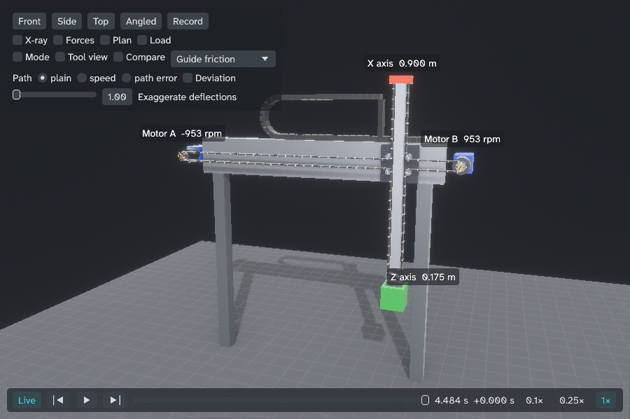

# Overview and tour

What the simulator can tell you, what it cannot, and a five-minute tour of the command line with real output. Start with the [README](../README.md) for installation.

## What it can and cannot tell you

It can tell you, for a machine described in a config file:

- peak, RMS and cubic-mean torque, speed, current, winding temperature rise and energy per motor over a cycle or a path
- how much of each motor's torque goes to inertia, gravity, friction and the belt, where the energy of a cycle is lost (each guide, shaft, gearbox, damper, winding, the braking resistor), and what each guide's friction does at its operating point
- pass or fail of that cycle against the ratings in the config (torque-speed curve, S1, winding temperature, gearbox, belt tension, slack and tooth load, DC link and braking resistor, guide and shaft load, settling at the pick), and the machine's own checks: a ball screw's speed, DN value, buckling and life, a rack's feed force, a strain wave gear's life, a press's force capacity, a wafer's slip, a cable's tension, a web's tension at both ends of the roll, a stepper's synchronism, a pneumatic cylinder's cushion energy
- how many hours the pulley shaft bearings, the gearbox's planet bearings and the guides last on that cycle, against a required life (ISO 281 with a_ISO, Siemens' gearbox formula, the guide makers' formula; the belt has a tooth load rating instead, because no belt maker publishes a life), and how long a gearbox's gearing lasts above its rated torque
- how those results move when an uncertain value is at its low or high bound, or when all uncertain values are off at once
- how far the tool tip is from its path, and what gains, corner blending, input shaping and friction feedforward do to that
- how fast a path can be run within every limit a verdict judges at a point of the path (a time-optimal plan)
- how far the machine travels when it is stopped in category 0, 1 or 2 at its worst moment, with the brakes' delays
- the machine's resonances over its working range, to set the input shapers by, and their mode shapes
- which catalogue motor with its drive (and gearbox), on which catalogue axis, is the cheapest that passes, with the installed weight standing in for the price
- a shorter cycle (higher limits, corner blending, input shaping, lower or rounded lifts) that still passes every check, as written and within the error bands
- the energy per cycle against the cycle time: the settings no other beats in both, and in peak motor utilisation
- from a drive trace: the payload's mass, per motor the added inertia, friction and constant torque (per link on the arms), and the belt's stiffness from its moves
- what your own controller does with the machine: torque or velocity mode per motor from the FMU or Python's `ks.Sim`, judged by the same analysis and verdicts as the built-in drive

The motors are permanent-magnet servo motors, two-phase hybrid steppers on an open-loop drive, or induction motors on a frequency converter (V/f or field-oriented); a machine file can put pneumatic cylinders with their valves beside the servo axes.

What stands behind the numbers ([docs/validation.md](validation.md)):

| Checked against | What | Where |
| --- | --- | --- |
| Hand calculations | Every component and every analysis figure has a test that compares it with a number worked out by hand: belt frequency, friction levels, backlash, cycle torque, winding temperature, DC link voltage, guide and shaft loads, path error, stops, the stepper and induction motor, the cylinder, and more | [validation](validation.md) |
| Independent implementations | The T-gantry's open-loop move against SciPy (0.2 % of the travel); the arms' rigid-body dynamics and flange pose against MuJoCo 4.0.1 (six URDF files, 60 states each, 2e-14 relative); the D3's dynamics against a Lagrangian in SymPy and its mass split against a MuJoCo multibody model; the D2's and the linear delta's inverse dynamics against Lagrangians; the drive's closed loop on the single axis against a Python implementation written from the model reference (four stages, 5e-10 to 1.1e-4 of each signal's peak) | [independent reference](validation.md#independent-reference) |
| Measured data | One ball screw bench of ISW, University of Stuttgart (public recordings), replayed and fitted; what matched and what did not is below. One row per dataset, generated from each one's `fit --dataset --report`: [datasets/RESULTS.md](../datasets/RESULTS.md); to add a machine: [contributing a measured machine](measurement-procedure.md#contributing-a-measured-machine-step-by-step) | [against measured data](validation.md#against-measured-data), [results per dataset](../datasets/RESULTS.md) |
| Vendor formulas and documents | Festo's own torque formula for the EXCT-30 within 2 %; the same Siemens motors read from two documents by two scripts must agree; catalogue values must fit their own physics | [catalogue](catalogue.md) |
| Bad input | Property tests of configs, machine files, programs, traces, URDF and the FMU's C functions; every number of every shipped config set to bad values; fuzz targets for the readers of untrusted input | [validation](validation.md) |

These checks show that the equations are solved as documented and that the catalogue data was read correctly; MuJoCo, an implementation by other people, can also catch a wrong equation in the arms' chain. They do not show that the parameters describe a real machine.

**One machine has been measured, by others; no other.** The ball screw bench of ISW Stuttgart ([`datasets/isw-ball-screw-axis`](../datasets/isw-ball-screw-axis/), CC BY 4.0) was replayed from its recorded setpoints. With the friction fitted on its S-profile recording and the screw's efficiency from its lead angle the simulated motor torque is off the measured by 4.6 % of the peak in RMS (27 % at the worst sample); on the two recordings kept as checks 13.1 % and 6.1 % (34 % and 25 %). The fit puts the moved mass 57 kg below the config's 549 kg (92 kg before the screw's efficiency), the held force at rest has the wrong sign on one check, and the model's first mode is at 137 Hz where the bench's sweeps give 123 to 134 Hz. For every other config friction, damping, guide and frame stiffness, belt pretension, winding resistance and inductance, DC link and braking resistor data are estimates. The configs say so: [`exct-30.toml`](../crates/machine-t-gantry/exct-30.toml) marks every value `[catalogue]` or `[estimate]`, and each config has a `[bounds]` table with a low and a high value for its estimates. Trends and comparisons (this motor against that one, with and without shaping) are sound. Absolute numbers are as good as the estimates. Use `verdicts --bands` to see how far a result moves with them.

Other limits that matter:

- The default configs of the two belt machines are made-up placeholder machines, not products. The deltas' configs are sized like products (Autonox RL3-1200-3kg, Codian D2-800, Festo EXPT-95; Siemens motors and gearboxes from the catalogue), but their arm and rod lengths, masses and inertias are estimates: the makers do not publish them. The other machines are sized examples whose mechanics are estimates of a typical part of that size, not one maker's article. Steppers, induction motors, vacuum cups and valve flow values have no catalogue data: theirs are estimates.
- A servo motor is one equivalent winding (R, L, back-EMF) that carries the RMS phase current and gets at most sqrt(3/2) times the DC link voltage; with field weakening (`effects.field_weakening`, on in the shipped configs) it is the q axis of a d-q model whose d current follows its setpoint with the current loop's time constant. There is no three-phase model and no PWM ([model reference](model-reference.md)).
- The time-optimal plan keeps the limits judged at a point of the path, not those judged over the whole cycle (warming, S1, RMS current, lives, mean braking power): four machines' time-optimal cycles overheat a motor.
- Stops: category 2 brakes along the direction of motion without a jerk limit, one delay serves all brakes of a machine, and the stop verdicts are given by `sim-cli stop` only; no stop has been compared with a measured one.
- The life figures are the makers' formulas and nothing more: ISO 281's life factor a1 on the bearings and a_ISO on the pulley shaft bearings alone, one bearing per pulley shaft, the gearing's life from a Wöhler exponent and knee that are estimates, load ratings and lubrication values that are partly estimates. They are not validated.
- The OPC UA server was tested against a client written with the same library (its secured endpoints and jitter figures included), not against a PLC.
- The FMU was checked with fmpy's validator and simulator and run in OpenModelica 1.27.1 through OMSimulator; not imported into Simulink or Dymola, and not with the Modelica Association's `fmusim` or the FMU Compliance Checker ([docs/fmi.md](fmi.md#validation)).
- The browser's numbers agree with the command line's to four or five significant digits, not bit for bit ([docs/web.md](web.md)).
- The app's window is tested by synthetic mouse, keyboard and resize input and its pictures were read; its file dialogs were not tested, how the motion looks over time was not watched, and at 1280 x 720 the view's controls cover much of the machine ([validation](validation.md#what-is-not-validated)).
- Trace import and the fit were tested on traces the simulator made and on the one bench's recordings, converted to CSV by a script; no drive's own export (Startdrive, TwinCAT, CODESYS) has been read.
- The hexapods and the spatial cable robot run only 1.35 to 2 times faster than real time on one core (processor time); on a slow or busy computer they can fall behind.

What is not built yet: [ROADMAP.md](../ROADMAP.md).

## Five-minute tour

All commands print CSV to standard output, or to a file with `--out FILE`. Messages and errors go to the error stream. The output below is real, with columns and rows left out where marked. More examples, each tested: [examples/README.md](../examples/README.md).

**The machines.**

```text
$ cargo run -q --release -p sim-cli -- list
t-gantry	T-gantry
single-axis	Single axis
delta-d3	Delta picker (3 arms)
delta-d2	Planar delta picker (2 arms)
parallel-scara	Parallel SCARA (five-bar in the horizontal plane, Z stroke, tool turn)
delta-linear	Linear delta (3 belt axes)
delta-d4	Delta picker (3 arms and a turning tool)
delta-h4	Quattro-type delta (4 arms, two-part plate)
screw-axis	Ball screw axis
rack-axis	Rack and pinion axis
linear-motor-axis	Linear motor axis
rotary-table	Rotary indexing table
urdf-arm	Six-axis arm (URDF)
scara	SCARA arm (URDF)
slider-crank	Slider-crank (servo press)
rotary-knife	Rotary knife (cross cutter)
flying-saw	Flying saw
palletiser	Palletiser (URDF, parallelogram)
hexapod	Hexapod (6 electric cylinders)
cable-planar	Planar cable robot (4 cables)
cable-spatial	Spatial cable robot (8 cables)
disc-cam	Disc cam with roller follower
tripod	Tripod (3-RPS, 3 electric cylinders)
wafer-handler	Wafer handler (R-theta-Z arm with banded links)
toggle-press	Toggle press (knuckle-joint press)
arm-on-track	Six-axis arm on a linear track (URDF, rack and pinion)
winder	Winder and unwinder with dancer
hexapod-rotary	Six-axis platform on cranks (6-RSS, rotary actuators)
geneva-drive	Indexing table with Geneva drive
cam-indexer	Indexing table with cam index drive
mover-track	Mover track (independent movers on a closed loop)
overhead-crane	Overhead crane (bridge, trolley, hoist)
```

A machine file is run like a registered machine: `sim-cli verdicts --machine-file machines/h-bot.toml`, or `sim-app --machine-file machines/h-bot.toml`.

**Cycle analysis of the default T-gantry.** One row per motor, measured over the second pass of the pick-and-place cycle. The first seven of 40 columns:

```text
$ cargo run -q --release -p sim-cli -- analyze t-gantry
Thermal start: warm, at the rises the cycle settles at; largest change of a rise over the measured pass 0.000 K
motor,cycle_s,peak_torque_nm,rms_torque_nm,peak_speed_rad_s,utilisation,thermal_utilisation,...
a,6.080000,0.556283,0.166135,200.4497,0.1469,0.1308,...
b,6.080000,0.461583,0.153897,200.4183,0.1215,0.1212,...
```

**Verdicts.** The same cycle judged against the motor data and the `[ratings]` of the config:

```text
$ cargo run -q --release -p sim-cli -- verdicts t-gantry
Thermal start: warm, at the rises the cycle settles at; largest change of a rise over the measured pass 0.000 K
check,motor,value,limit,result
motor-peak,a,0.1469,1.000,ok
motor-thermal,a,1.238,100.0,ok
motor-s1,a,0.1661,1.270,ok
...
gearbox-peak,a,2.176,64.00,ok
pulley-bearing-life,a,472048,20000,ok
gearbox-life,a,6519740756,20000,ok
belt-tooth-load,a,0.1910,1.000,ok
dc-link-energy,a,6.114,6.205,ok
dc-link-overvoltage,a,223.8,257.6,ok
motor-peak,b,0.1215,1.000,ok
...
dc-link-energy,b,6.205,6.205,ok
braking-resistor-continuous,b,0.9018,20.00,ok
braking-resistor-peak,b,35.18,500.0,ok
dc-link-overvoltage,b,224.7,257.6,ok
settling,,0.00004292,0.0001000,ok
belt-tension,,333.5,1500,ok
belt-least-tension,,205.1,0,ok
guide-load,,177.2,2000,ok
guide-life,,4967636,20000,ok
thermal-warm-start,,0.00001066,0.1000,ok
```

The three lives are in hours: the bearing that takes the belt's pull on each pulley shaft (ISO 281, with its a_ISO for lubrication and contamination), the gearbox's planet bearings (Siemens' formula) and the guide, each against the 20000 h of `ratings.required_life_h`. The cycle is judged warm: with the windings at the temperature rises they settle at when it repeats for long (the first line, on the error stream, and the row `thermal-warm-start`). `motor-s1` is the RMS torque at the mean speed against the motor's S1 curve. `belt-tooth-load` is the belt's tooth load over what its teeth allow at the pulley's speed (Megadyne's method): no belt maker publishes a life in hours.

The DC link is simulated (`effects.dc_link`). Motor B's braking fills the capacitors: 6.2 J of room between the DC link voltage of 155 V and the chopper's threshold of 224.65 V. That is `ok` because the config has a braking resistor, which burns the rest and is judged in the next two rows. Values are printed with four significant digits.

**A catalogue machine.** [`exct-30.toml`](../crates/machine-t-gantry/exct-30.toml) is a Festo EXCT-30 with two Siemens 1FK2205-4AF motors:

```text
$ cargo run -q --release -p sim-cli -- verdicts t-gantry --config crates/machine-t-gantry/exct-30.toml
Thermal start: warm, at the rises the cycle settles at; largest change of a rise over the measured pass 0.000 K
check,motor,value,limit,result
motor-peak,a,0.2927,1.000,ok
motor-thermal,a,8.880,100.0,ok
...
pulley-torque,a,3.125,12.50,ok
gearbox-radial-load,a,982.9,2000,ok
pulley-bearing-life,a,325634,20000,ok
belt-tooth-load,a,0.3528,1.000,ok
dc-link-energy,a,9.943,9.943,ok
braking-resistor-continuous,a,8.461,100.0,ok
braking-resistor-peak,a,204.2,5700,ok
dc-link-overvoltage,a,770.0,820.0,ok
...
settling,,0.00003477,0.0001000,ok
belt-tension,,554.5,2140,ok
belt-least-tension,,257.9,0,ok
guide-load,,184.4,2000,ok
guide-life,,2996062,20000,ok
thermal-warm-start,,0.00002397,0.1000,ok
```

The lowest belt tension in the cycle is 258 N. With `--bands` the same command runs the cycle with each bounded value at its low and at its high bound, one at a time: the slackest section keeps 158 N and the tool is at most 0.039 mm off in the dwell. With `--bands --samples 200` all bounded values lie between their bounds at once in 200 runs: 140 N and 0.042 mm at worst. With `--bands --worst` (a search for the worst corner of the bounds) it is 90 N and 0.082 mm against 0.1 mm. Every check passes in all three, but one: the pulley shaft bearings last 324000 h as written and pass in both band modes (at least 72800 h one at a time, 55400 h in the samples), but fail 20000 h at the worst corner (9950 h, every bounded value against them at once); Festo publishes no data on them, and their load rating and lubrication values are estimates. An earlier state of this config failed `belt-least-tension` and `settling` in the worst case. For that the belt pretension was raised from 300 N to 450 N, the X jerk limit lowered from 500 to 150 m/s³, input shaping and corner blending switched on, and a second input shaper at 17.5 Hz added; the comments in the file give the reasons.

**A motor by name.** `--motor ARTICLE` puts a motor of the Siemens S210 catalogue into any config:

```text
$ cargo run -q --release -p sim-cli -- verdicts t-gantry --motor 1FK2104-5AK
Thermal start: warm, at the rises the cycle settles at; largest change of a rise over the measured pass 0.000 K
check,motor,value,limit,result
motor-peak,a,0.07979,1.000,ok
motor-thermal,a,4.528,100.0,ok
...
dc-link-energy,a,6.436,75.18,ok
dc-link-overvoltage,a,564.8,896.7,ok
...
```

The motor brings the 540 V DC link of its supply. The config's braking threshold and trip level are scaled with the DC link voltage (224.65 V and 257.6 V at 155.13 V become 782 V and 897 V), and its velocity gain is retuned for the motor's rotor. See [user guide](user-guide.md#check-a-real-catalogue-machine).

**The search.** Every 1FK2 motor on the EXCT-30's cycle, each with the converter the catalogue pairs with it, passing ones first, cheapest first (no catalogue has prices; the installed weight of motors and gearboxes stands in):

```text
$ cargo run -q --release -p sim-cli -- search t-gantry --config crates/machine-t-gantry/exct-30.toml --series 1FK2
Not simulated (a part the config cannot take, or a cycle that does not run; the reason is in the table): 0 / 28 candidates
Search time on 16: ... s
axis,motor,gearbox,drive,vendor,supply,mass_kg,cost_kg,result,tightest_check,tightest_utilisation,peak_torque_nm,winding_rise_k,...
,1FK2104-4AF,,6SL3210-5HE10-4UF0,siemens,400v,2.05,4.10,ok,drive-current,0.9843,3.2653,97.95,...
,1FK2104-4AK,,6SL3210-5HE11-0UF0,siemens,400v,2.05,4.10,ok,motor-thermal,0.9956,3.2633,99.56,...
,1FK2104-5AF,,6SL3210-5HE10-8UF0,siemens,400v,2.85,5.70,ok,motor-s1,0.5087,3.3377,20.42,...
...
,1FK2205-4AF,,6SL3210-5HE11-5UF0,siemens,400v,5.20,10.40,ok,gearbox-radial-load,0.5002,3.6557,8.88,...
...
,1FK2203-4AK,,6SL3210-5HE10-8UF0,siemens,400v,1.49,2.98,FAIL,motor-s1,1.0021,3.2601,97.80,...
,1FK2103-4AH,,6SL3210-5HE10-8UF0,siemens,400v,1.65,3.30,FAIL,motor-thermal,1.0161,3.2439,101.61,...
...
,1FK2210-4AC,,6SL3210-5HE17-0UF0,siemens,400v,27.00,54.00,FAIL,belt-least-tension,inf,12.6807,20.73,...
```

The two lightest motors pass close to their limits: the 1FK2104-4AF at 0.98 of its drive's current, the 1FK2104-4AK at 0.996 of its winding's rise; the next ones are held by their S1 curve (0.51 to 0.56), and from the 1FK2104-6AF on the tightest check is the belt's pull on a pulley shaft (1000 N of 2000 N), which the motor hardly changes; `winding_rise_k` and `peak_torque_nm` tell those apart. `--supply s120` searches the S120 motors with their Motor Modules, `--gearboxes NRK` adds gearboxes on a machine that has one, and `--axes` tries every motor on every axis of the catalogue of the machine's kind as well (Festo EXCT and Bahr ELZI for this one: 338 candidates; the Bahr ELZI 40 comes out lighter than the EXCT-30). A drive, a belt or an axis can be named like a motor (`--drive`, `--belt AT5-25`, `--axis ELZI-40`). The table goes on with rank, energy, thermal and drive utilisation, following error, inertia ratio, the failing checks, what the catalogue left to estimates and one column per check; `--rank-by energy` (or a weighted mix) ranks by what matters, `--drives neighbours` tries the next drive sizes, several `--config` with `--weights` judge a duty mix, `--robust N` ranks the best again at the worst corner of their bounds, `sim-cli transmission` sweeps the gear ratio or pulley radius for its optimum, and `sim-cli compare-kinematics TASK.toml --machines t-gantry,delta-d3,...` runs one pick-and-place task on several kinematics side by side ([which drive works best](user-guide.md#which-drive-works-best-rank-mix-sweep-and-compare)).

**The optimiser.** A shorter cycle that still passes every verdict, in the error bands too:

```text
$ cargo run -q --release -p sim-cli -- optimise t-gantry --config crates/machine-t-gantry/exct-30.toml
setting,before,after
cycle_s,2.0480,1.7560
dwell_error_peak_m,3.477e-5,4.899e-5
dwell_angle_error_peak_rad,-0.000e0,-0.000e0
bands_fastest_cycle_s,,1.3900
bands_fastest_fails,,belt-least-tension settling
bands_steps_back,,4
bands_excused,,
Cycles simulated: search + error bands 40 + 834
axis.x.max_acceleration_m_s2,25.0,56.25
axis.x.max_velocity_m_s,2.5,3.75
axis.z.max_acceleration_m_s2,15.0,33.75
axis.z.max_velocity_m_s,1.5,2.25
effects.input_shaping,true,false
```

The search judges the config as written; its fastest setting, 1.39 s, fails `belt-least-tension` and `settling` in the error bands (each bounded value at its low and at its high bound, as `verdicts --bands`). So the optimiser goes back four steps of its search, to 1.756 s, which passes there too. The bands are one value at a time: at the worst corner of the bounds (`verdicts --bands --worst` with the five settings above) this result fails `settling` (0.26 mm against 0.1 mm; the belt keeps 32 N), so it takes back the margins the config was given for its worst case. `optimise --worst` judges the result at that corner instead, at the cost of a far longer search.

**A path file.** Lines, arcs and splines, from where the machine stands (the default T-gantry starts at 0.1, 0.35):

```text
$ cat examples/corner.path
# A path on the T-gantry's two axes (x, z in m): line, arc, line, from the start pose (0.1, 0.35).
# The first path file printed in docs/overview.md; see docs/user-guide.md, "Run a path and read path error".
line,0.5,0.35
arc,0.6,0.25,0.5,0.25,cw
line,0.6,0.05

$ cargo run -q --release -p sim-cli -- analyze t-gantry --path examples/corner.path
Thermal start: warm, at the rises the cycle settles at; largest change of a rise over the measured pass 0.046 K
motor,cycle_s,peak_torque_nm,...,path_error_peak_m,path_error_rms_m,tracking_error_peak_m,...
a,2.128000,0.552014,...,1.268e-4,4.329e-5,1.746e-4,...
b,2.128000,0.298401,...,1.268e-4,4.329e-5,1.746e-4,...
```

With `--time-optimal` the same path takes 1.658 s instead of 2.128 s (both include 0.3 s of rest at the end), and the path error rises from 0.13 mm to 0.17 mm. That plan takes speed and acceleration from what the machine can give instead of from the axis limits, and keeps the jerk limits of the axes. It keeps, point by point along the path, every limit a verdict judges at a point: the motors' torque-speed curves and speeds, the drives' maximum current, the gearbox's torque and input speed, the pulley, the belt's tension, the guides, the braking resistor's peak power and the machine's own parts; not what is judged over the whole cycle (warming, S1, RMS current, the lives), which the analysis shows.

Within the axis limits the path crawls into and out of the arc at 0.07 m/s, because the acceleration towards the centre steps there. `--set profile.path_tolerance_m=0.0001` lets the planner put transition curves at both ends of the arc: the path is then off the file's by up to 0.1 mm, enters the arc at 0.40 m/s and takes 1.890 s.

Lines of `spline,x,z` that follow one another form one smooth curve through their points:

```text
$ cat examples/curve.path
# A path on the T-gantry's two axes (x, z in m): a line, a smooth curve through two via points (spline), a line,
# from the start pose (0.1, 0.35). The second path file printed in docs/overview.md; see docs/user-guide.md, "Run a path".
line,0.3,0.35
spline,0.45,0.3
spline,0.55,0.15
line,0.55,0.05

$ cargo run -q --release -p sim-cli -- analyze t-gantry --path examples/curve.path
Thermal start: warm, at the rises the cycle settles at; largest change of a rise over the measured pass 0.036 K
motor,cycle_s,peak_torque_nm,...,path_error_peak_m,path_error_rms_m,tracking_error_peak_m,...
a,2.101000,0.551950,...,1.318e-4,4.403e-5,1.780e-4,...
b,2.101000,0.291156,...,1.318e-4,4.403e-5,1.780e-4,...
```

The curve leaves the first line in its direction and ends in the direction of the last one. Where it joins a line the curvature steps, so the path is slow there, like a line into an arc.

**More in the user guide:** stopping distances (`sim-cli stop`), your own controller in torque or velocity mode (Python `ks.Sim`, the FMU's `command.mode.<motor>`), a stepper belt axis and an induction motor lift, a pneumatic cylinder beside a servo axis, replaying and fitting a measured trace ([user guide](user-guide.md)).



**The app** does the same from its right panel: the cycle analysis with its checks and their error bands (one value at a time or sampled, also drawn over the traces), the sensitivity ranking, the optimiser, the motor search with a button that puts a motor into the running machine, paths and traces from files (a planned path is also drawn in the 3D view, the travelled one coloured by its error, speed or utilisation; a replayed trace is plotted against its simulation), the operating points over the torque-speed curve, the frequency response of the mechanics with the fit of the belt stiffness, the mode shapes swung in the 3D view, the workspace map, and the tuning help.
