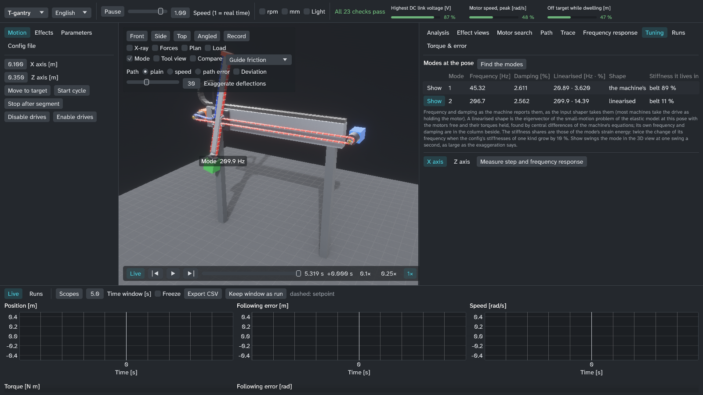
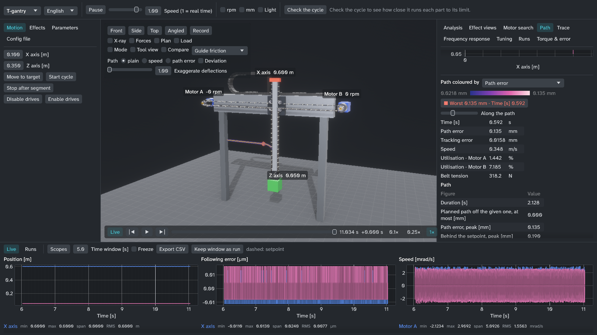
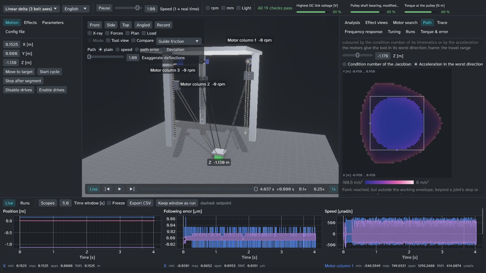
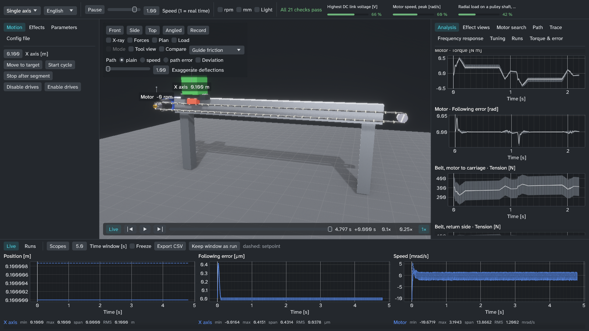

# User guide

One section per task. Each gives the command, what the output means, and the limits that matter for that task. The physics behind it is in the [model reference](model-reference.md); the config keys are in the [config reference](config-reference.md).
Deutsche Fassung: [Benutzerhandbuch](de/benutzerhandbuch.md).

- [Common to all commands](#common-to-all-commands)
- [Size a motor for a cycle](#size-a-motor-for-a-cycle)
- [Check a real catalogue machine](#check-a-real-catalogue-machine)
- [Find the lightest motor](#find-the-lightest-motor)
- [See which unknown parameters matter, and judge with error bands](#see-which-unknown-parameters-matter-and-judge-with-error-bands)
- [Shorten a cycle](#shorten-a-cycle)
- [Size a delta picker](#size-a-delta-picker)
- [Size a linear delta](#size-a-linear-delta)
- [Size a hexapod or a cable robot](#size-a-hexapod-or-a-cable-robot)
- [Size a tripod](#size-a-tripod)

- [Size a winder](#size-a-winder)
- [Run a path and read path error](#run-a-path-and-read-path-error)
- [Programs: G-code and robot programs](#programs-g-code-and-robot-programs)
- [Verdicts, search and optimise on a path](#verdicts-search-and-optimise-on-a-path)
- [Shape the moves](#shape-the-moves)
- [Tune gains and use input shaping](#tune-gains-and-use-input-shaping)
- [Replay a drive trace and fit parameters](#replay-a-drive-trace-and-fit-parameters)
- [See where torque and energy go](#see-where-torque-and-energy-go)
- [Record raw signals, switch the drives off](#record-raw-signals-switch-the-drives-off)
- [Connect a PLC over OPC UA](#connect-a-plc-over-opc-ua)
- [Use the model in Simulink / Modelica via FMI](#use-the-model-in-simulink--modelica-via-fmi)
- [Use the app](#use-the-app)

The examples write `sim-cli` for `cargo run -q --release -p sim-cli --`. All output shown was produced by the commands shown.

## Common to all commands

```text
sim-cli COMMAND MACHINE [options]
```

`MACHINE` is `t-gantry` or `single-axis` (`sim-cli list` prints them). Options that every command but `list` takes:

| Option | Effect |
| --- | --- |
| `--machine-file FILE` | In place of `MACHINE`: a machine defined in a TOML or JSON file, wired together from components without Rust code (an FMU of it carries the file). See [machine files](machine-files.md) |
| `--config FILE` | Use this config instead of the machine's default. The EXCT-30 config is `crates/machine-t-gantry/exct-30.toml` |
| `--motor ARTICLE` | Put a motor of the Siemens S210 catalogue into the config, e.g. `1FK2205-4AF`. Sets `parts.motor` |
| `--supply 230v` or `400v` | The supply the motor data is for. Sets `parts.motor_supply`. Default as in the config |
| `--gearbox SIZE-FRAME-RATIO` | Put a catalogue gearbox into the config, e.g. `NRK070-04-5`. Sets `parts.gearbox` |
| `--set path=value` | Change one config value, e.g. `--set mass.payload_kg=3.0`. Repeatable. Applied after the parts, so single values can be set on top of a catalogue part; a drive's installation conditions (`ratings.drive_ambient_c`, `drive_altitude_m`, `drive_pulse_frequency_hz`) before them, as the drive is derated when it is put in. A key the config has not got is added where a config file may have it: a motor's own value in `[drive.<id>]` and the other per-motor tables (`--set drive.b.velocity_kp_nm_s_rad=0.05`), or a key a file may add (the ratings beyond the default, these conditions); any other is refused with the nearest key |
| `--out FILE` | Write the CSV to a file instead of standard output |
| `--lang en` or `de` | Language of messages. The CSV headers are not translated |
| `--catalog DIR` | Read the component catalogue from DIR, a copy of [`catalog/`](../catalog) of the same schema version, instead of the one built in; a table with a missing column or a short row is refused, naming the file and the column or line (see [catalogue](catalogue.md)). `sim-app` takes it too |

Rules that are easy to trip over:

- `--set` only changes values that exist. A misspelt key is refused and the nearest key is named where one is close (`Configuration value is missing: mass.cariage_kg (did you mean mass.carriage_kg?)`), and so is a value of the wrong type. A value out of range is shown with its path and value, and with the limit where a mass, radius, stiffness, damping, payload or other shared reading of the config refused it (`Configuration value is out of range: mass.payload_kg = -5 (must not be negative)`, or `(must be above 0)`, or the finite-number limit of at most 1e15); a check made elsewhere shows the value only.
- `--motor`, `--supply` and `--gearbox` need a `[parts]` table in the config. All three shipped configs have one.
- Every option except `--cycle`, `--time-optimal`, `--bands` and `--worst` takes a value. An option without its value is refused (`This option needs a value: --time`), and so is an option the command does not know, such as a misspelt one (`This command has no such option: --cylce`). A number has to be finite: `--time inf` is refused.
- `--cycle`, `--move`, `--trajectory` and `--path` exclude each other (`Only one of these options can be given at a time: --cycle --move`).
- A config file may only have keys that the machine's default config has: a misspelt key is refused (`Configuration has a value this machine does not know: mass.cariage_kg`). The exceptions are `[bounds]`, which has its own check, and `ratings.pulley_max_torque_nm`.
- Numbers are checked when a config is read. NaN and infinity are refused for every value, a negative number where the quantity cannot be negative (a payload, a damping, a backlash, the belt pretension), and a start pose outside the axis ranges. The message names the key: `Configuration value is out of range: gearbox.backlash_rad`.
- A failure prints one line on the error stream and exits with code 2.
- `sim-cli help` lists the commands, one to a line, in the language of `--lang`; `sim-cli help COMMAND` (or `sim-cli COMMAND --help`) prints the options of one command, `sim-cli help options` those every command takes, `sim-cli help paths` the path file formats and `sim-cli help units` the units of the columns. A call with wrong or missing arguments names the help of its command. `sim-cli --version` (or `-V`) prints the version.
- Exit codes: 0 when the command ran and everything it judged passes, 1 when it ran and printed a failing row (`FAIL` in the result column of `verdicts`, `margins`, `report`'s checks, `replay --tolerance` and `fit --within`, or among the verdicts `stop` and `accuracy` print on the error stream), 2 for a usage or config error. The table is printed in full before the code is 1, so a script can read the rows and test the code. The overhead crane's default config fails `residual-sway` on purpose, so `verdicts` exits 1 on it.
- A result that is not finite (an unstable loop gives `inf` or `nan`, and so does a winding that heats up without end) is named on the error stream after the table: run `sim-cli margins MACHINE` to measure the loops.
- If the axis limits ask more of a motor than the drive data allows, commands that start a simulation directly (`run`) print a warning on the error stream and carry on:

  ```text
  $ sim-cli run t-gantry --set axis.x.max_velocity_m_s=2.0 --time 0.01 --out x.csv
  The axis limits ask for more motor speed than the drive allows: Motor A: 600.0000 > 420.0000
  The axis limits ask for more motor speed than the drive allows: Motor B: 600.0000 > 420.0000
  ```

  The check compares the motor speed at the highest axis speeds with `drive.rated_speed_rad_s`, and the rigid-model torque at the highest axis accelerations with `drive.peak_torque_nm`, for every combination of axis directions.

## Size a motor for a cycle

The cycle is the list of `[[cycle.segment]]` in the config: target pose, dwell time, and whether the payload is attached on arrival. Edit a copy of the config to change it; `--set` cannot edit the cycle.

```text
$ sim-cli analyze t-gantry
Thermal start: warm, at the rises the cycle settles at; largest change of a rise over the measured pass 0.000 K
motor,cycle_s,peak_torque_nm,rms_torque_nm,peak_speed_rad_s,utilisation,thermal_utilisation,belt_tension_min_n,belt_tension_max_n,rms_current_a,winding_rise_k,energy_in_j,energy_regenerated_j,peak_regenerated_power_w,largest_regeneration_j,path_error_peak_m,path_error_rms_m,tracking_error_peak_m,dwell_error_peak_m,path_angle_error_peak_rad,path_angle_error_rms_rad,tracking_angle_error_peak_rad,dwell_angle_error_peak_rad,cubic_mean_torque_nm,braking_resistor_energy_j,braking_resistor_mean_power_w,dc_link_peak_voltage_v,belt_slack_time_s,radial_load_peak_n,guide_load_peak_n,guide_life_km,mains_energy_j,guide_life_h,pulley_bearing_life_h,gearbox_life_h,belt_tooth_utilisation,gearbox_gearing_life_h,motor_bearing_life_h,housing_rise_k,drive_overload,torque_unit,speed_unit
a,6.080000,0.559815,0.168995,200.4655,0.1478,0.1331,203.94,334.05,0.3757,1.28,86.325,11.097,28.85,6.261,1.065e-4,3.560e-5,1.812e-4,4.296e-5,0.000e0,0.000e0,0.000e0,0.000e0,0.201808,0.060,0.010,224.65,0.0000e0,6.4501e2,1.7711e2,3.6271e6,0.000,3.8234e6,4.7197e5,6.0841e9,1.9371e-1,,,0.00,0.0000,N m,rad/s
b,6.080000,0.466646,0.156888,200.4541,0.1229,0.1235,203.94,334.05,0.3488,1.10,76.318,16.854,35.76,8.361,1.065e-4,3.560e-5,1.812e-4,4.296e-5,0.000e0,0.000e0,0.000e0,0.000e0,0.179829,6.607,1.087,224.65,0.0000e0,6.4501e2,1.7711e2,3.6271e6,0.000,3.8234e6,4.7070e5,9.1482e9,1.5539e-1,,,0.00,0.0000,N m,rad/s
```

The simulator starts the cycle, lets the first pass go by, and measures the second. One row per motor. Columns that describe the machine, not one motor, repeat in every row.

| Column | Unit | Meaning |
| --- | --- | --- |
| `cycle_s` | s | Duration of the measured pass |
| `peak_torque_nm` | N m | Highest absolute motor torque (from the winding current, at the motor shaft) |
| `rms_torque_nm` | N m | RMS of the motor torque over the pass |
| `peak_speed_rad_s` | rad/s | Highest absolute motor speed |
| `utilisation` | fraction | Highest ratio of the torque the velocity loop asks for (before the torque limit) to the torque the torque-speed curve leaves at that speed. Above 1 the cycle asks for more than the curve gives: the drive sits on its torque limit and the axis falls behind |
| `thermal_utilisation` | fraction | RMS torque over `drive.rated_torque_nm`. For information; the verdict `motor-thermal` judges the winding rise, which rests on `motor.rated_current_a` |
| `belt_tension_min_n`, `_max_n` | N | Lowest and highest tension of any belt section, looked at once per millisecond. Machine-wide |
| `rms_current_a` | A | RMS winding current |
| `winding_rise_k` | K | Temperature rise the winding settles at if this cycle repeats for long |
| `energy_in_j` | J | Electrical energy the winding drew while the power was positive |
| `energy_regenerated_j` | J | Energy fed back while braking |
| `peak_regenerated_power_w` | W | Highest power fed back |
| `largest_regeneration_j` | J | Most energy fed back in one braking (one unbroken stretch of negative power) |
| `path_error_peak_m`, `_rms_m` | m | How far the tool was from the path its setpoint drew, in the axes in m (its place). Machine-wide |
| `tracking_error_peak_m` | m | The peak [tool position error](model-reference.md#tool-position-error): how far the tool was from where its plan was at the same moment, in the axes in m. Machine-wide |
| `dwell_error_peak_m` | m | Most the tool was off its target in the second half of a dwell, in the axes in m. Machine-wide |
| `path_angle_error_peak_rad`, `_rms_rad`, `tracking_angle_error_peak_rad`, `dwell_angle_error_peak_rad` | rad | The same three of the axes in rad (the tool's turn: the D4's c, the SCARA's c, an arm's orientation or its joints, the table), apart: metres and radians are never added. 0 on a machine without such an axis. Machine-wide |
| `cubic_mean_torque_nm` | N m | Cube root of the mean of torque cubed, weighted with speed, of the motor torque. The check `gearbox-continuous` takes the same mean of the gearbox output torque |
| `braking_resistor_energy_j` | J | Energy the simulated braking resistor burned. 0 without `effects.dc_link` |
| `braking_resistor_mean_power_w` | W | That energy over the cycle time |
| `dc_link_peak_voltage_v` | V | Highest DC link voltage. Stays at `drive.bus_voltage_v` without `effects.dc_link` |
| `belt_slack_time_s` | s | Time any belt section spent without tension. Machine-wide |
| `radial_load_peak_n` | N | Highest pull of the belt on a pulley shaft. Machine-wide |
| `guide_load_peak_n` | N | Highest load on the guide with the highest equivalent load. Machine-wide |
| `guide_life_km` | km | L10 = (C / P)³ · 50 km for that guide. Empty without `ratings.guide_dynamic_load_rating_n` |
| `mains_energy_j` | J | With `effects.regenerative_supply`: energy the line module fed back into the mains over the pass (after its efficiency). 0 without |
| `guide_life_h` | h | `guide_life_km` over the mean speed of that guide's axis. Machine-wide |
| `pulley_bearing_life_h` | h | Rating life of the bearing that takes the belt's pull on this motor's pulley shaft: (C / P)³ · 10⁶ / (60 n), C = `ratings.pulley_bearing_load_rating_n`, P the cubic mean of the radial load weighted with the speed, n the pulley's mean speed in r/min; times ISO 281's a_ISO for lubrication and contamination where the config has the four values it needs |
| `gearbox_life_h` | h | Life of the gearbox's planet bearings by Siemens' formula, 20000 h · (n2B / n2) · (M2N / M2eq)^(10/3). Empty without `ratings.gearbox_rated_torque_nm` and `gearbox_reference_speed_rpm` (the EXCT-30 has no gearbox) |
| `belt_tooth_utilisation` | fraction | The belt's tooth load on this motor's pulley over what its teeth allow at the pulley's speed (Megadyne's method, with `ratings.belt_service_factor`), the highest over the cycle. Not a life: no belt maker publishes one |
| `gearbox_gearing_life_h` | h | Life of the gearbox's gearing from the torque above its rated torque (Palmgren–Miner on Siemens' two torque figures). Empty where the cycle never takes the gearbox above `ratings.gearbox_rated_torque_nm` |
| `motor_bearing_life_h` | h | Life of the motor's bearings under the belt's pull. Only where the pulley sits on the motor shaft (`ratings.motor_bearing_load_rating_n` set, no gearbox); empty in every shipped config |
| `housing_rise_k` | K | With `effects.motor_thermal_nodes`: the rise the motor's stator and housing settle at, the winding's times the housing's share of the thermal resistance; 0 without |
| `drive_overload` | 1 = rated current held | With `effects.drive_overload`: the highest the drive's thermal image (i²t) reaches when the cycle repeats for long; 0 without |
| `torque_unit`, `speed_unit` | | The unit of the torque and speed columns: `N m` and `rad/s`, on a linear motor `N` and `m/s` |

The exact definitions are in the [model reference](model-reference.md#analysis-quantities).

`--points FILE` also writes the operating points, one per millisecond and motor (`motor,speed_rad_s,torque_nm`), for plotting over the torque-speed curve.

Then judge the cycle:

```text
$ sim-cli verdicts t-gantry
Thermal start: warm, at the rises the cycle settles at; largest change of a rise over the measured pass 0.000 K
check,motor,value,limit,result
motor-peak,a,0.1478,1.000,ok
motor-thermal,a,1.282,100.0,ok
motor-s1,a,0.1690,1.270,ok
motor-speed,a,200.5,420.0,ok
drive-current,a,0.3757,3.000,ok
drive-peak-current,a,1.250,10.90,ok
gearbox-radial-load,a,637.2,1500,ok
gearbox-continuous,a,0.8206,40.00,ok
gearbox-input-speed,a,1914,13000,ok
gearbox-peak,a,2.207,64.00,ok
pulley-bearing-life,a,471971,20000,ok
gearbox-life,a,6084053913,20000,ok
belt-tooth-load,a,0.1937,1.000,ok
dc-link-energy,a,6.205,6.205,ok
braking-resistor-continuous,a,0.009861,20.00,ok
braking-resistor-peak,a,4.671,500.0,ok
dc-link-overvoltage,a,224.7,257.6,ok
...
settling,,0.00004296,0.0001000,ok
belt-tension,,334.0,1500,ok
belt-least-tension,,203.9,0,ok
guide-load,,177.1,2000,ok
guide-life,,3823437,20000,ok
thermal-warm-start,,0.00001066,0.1000,ok
```

| Check | Value | Limit | Unit |
| --- | --- | --- | --- |
| `motor-peak` | `utilisation` (the torque asked for, not the torque delivered) | 1 | fraction |
| `motor-thermal` | `winding_rise_k` (with `effects.motor_thermal_nodes` the winding node's, which settles where the one node does) | `motor.rated_temperature_rise_k` | K |
| `motor-s1` | `rms_torque_nm` at the cycle's mean speed, as Siemens sizes a cycle | the S1 curve there: the maker's graph (`motor.s1_curve_*`, which a named S210 motor brings), else the static torque k_t `motor.stall_current_a` at standstill, straight to `drive.rated_torque_nm` at the rated speed | N m |
| `motor-speed` | `peak_speed_rad_s`, where the config gives `drive.max_speed_rad_s` (a catalogue motor sets it) | `drive.max_speed_rad_s` | rad/s |
| `drive-overload` | `drive_overload`, with `effects.drive_overload` only | the image's trip level, r² − (r² − 1) exp(−`ratings.drive_max_current_time_s` / `drive_overload_time_constant_s`), r = maximum over rated current | 1 = rated current held |
| `pulley-torque` | peak of the torque at the gearbox output (signal `gearbox.<motor id>.output_torque`) | `ratings.pulley_max_torque_nm` | N m |
| `gearbox-continuous` | cubic mean of the torque at the gearbox output, weighted with speed | `ratings.gearbox_rated_torque_nm` | N m |
| `gearbox-input-speed` | peak motor speed | `ratings.gearbox_max_input_speed_rpm` | r/min |
| `gearbox-peak` | peak of the torque at the gearbox output, looked at every simulation step | `ratings.gearbox_max_torque_nm` | N m |
| `dc-link-energy` | energy into the DC link capacitors | room between the DC link voltage (`drive.bus_voltage_v`) and the braking threshold | J |
| `braking-resistor-continuous` | mean power of the resistor | `ratings.braking_resistor_continuous_w` | W |
| `braking-resistor-peak` | peak power of the resistor | `ratings.braking_resistor_peak_w` | W |
| `dc-link-overvoltage` | highest DC link voltage (only with `effects.dc_link`) | `ratings.dc_link_overvoltage_v` | V |
| `settling` | `dwell_error_peak_m` | `ratings.settling_tolerance_m` | m |
| `settling-angle` | `dwell_angle_error_peak_rad` | `ratings.settling_tolerance_rad` | rad |
| `gripper-hold` | the most the held part asks of a vacuum cup, m (a_z + g) + m |a_xy| / μ (with `effects.gripper_time`) | its hold A p_hold over `ratings.gripper_safety_factor` | N |
| `belt-tension` | highest belt tension | `ratings.belt_max_tension_n` | N |
| `belt-least-tension` | lowest belt tension | `ratings.belt_min_tension_n` | N |
| `gearbox-radial-load` | `radial_load_peak_n` | `ratings.shaft_max_radial_load_n` | N |
| `guide-load` | `guide_load_peak_n` | `ratings.guide_max_load_n` | N |
| `pulley-bearing-life` | `pulley_bearing_life_h` | `ratings.required_life_h` | h |
| `gearbox-life` | `gearbox_life_h` | `ratings.required_life_h` | h |
| `gearbox-gearing-life` | `gearbox_gearing_life_h` (only where the cycle exceeds the rated torque) | `ratings.required_life_h` | h |
| `motor-bearing-life` | `motor_bearing_life_h` | `ratings.required_life_h` | h |
| `guide-life` | `guide_life_h` | `ratings.required_life_h` | h |
| `belt-tooth-load` | `belt_tooth_utilisation` | 1 | fraction |
| `gearbox-thermal` | where the hottest gearbox settles on the cycle (only with `effects.part_heating`; none on a direct drive) | `thermal.gearbox_max_rise_k` | K |
| `guide-thermal` | where the hottest guide settles on the cycle (only with `effects.part_heating`) | `thermal.guide_max_rise_k` | K |
| `belt-tooth-jump` | how often the belt's teeth jumped over a driven pulley in the cycle (only with `effects.belt_tooth_jump`) | 0 | count |
| `belt-span-resonance` | how close a free belt span's first sideways mode came to what the drive excites, at steady speed, as a share of the mode (only with `effects.belt_span_vibration`); passes at or above the limit | `ratings.belt_span_resonance_band` | fraction |
| `thermal-warm-start` | how far the rises the measured pass started at lie from those it settles at (only with `effects.thermal_warm_start`, where something that warms acts back on the run) | 0.1 | K |
| `thermal-cycle-repeat` | only where the warm start converged neither per pass nor over a period: how far apart two passes started at the same rises settle; beyond the limit the cycle's motion does not repeat itself (a load still swinging from the pass before), which no start temperature settles | 0.1 | K |

Limits for this task:

- Which thermal start was used is on the error stream (`Thermal start: cold` or `warm`) and in the row `thermal-warm-start`. With `effects.thermal_warm_start` (on in the shipped configs) the measured pass runs with the windings and, with `effects.thermal_feedback`, the gearboxes and guides at the rises they settle at when the cycle repeats for long, found by repeating the cycle (at most 4 warm passes, to 0.1 K, then a period of 2 or 3 passes, or one more pass that tells whether the cycle repeats at all: `thermal-cycle-repeat`); off, it starts cold and a cycle of seconds sees every part at ambient. With the feedback on, the EXCT-30's X guide settles at 15.9 K started warm, 23.7 K judged from cold (its oil thins as it warms). See the [model reference](model-reference.md#thermal-warm-start).
- A rating that the config leaves out is not judged. No row is not a pass. The same holds for `gearbox-thermal` and `guide-thermal` with `effects.part_heating` and `effects.thermal_feedback` off, for `belt-tooth-jump` without `effects.belt_tooth_jump` and for `belt-span-resonance` without `effects.belt_span_vibration`. With it on, the EXCT-30's X guide settles at 23.7 K of 40 K and fails the worst case of `--bands` (47.4 K at the high bound of its thermal resistance); the thermal resistances are estimates (see the config reference).
- `belt-least-tension` and the lives are the checks where the value has to stay above the limit. `belt-least-tension` also fails if any section spent any time without tension.
- The lives are the makers' formulas with ratings that are partly estimates; see the [model reference](model-reference.md#analysis-quantities) for what they leave out. The motors' own bearings have no figure in these configs: the belt does not pull on a motor shaft.
- `dc-link-energy` is `ok` whenever the config has a braking resistor to fall back on, even when the value is at or above the limit. The two resistor rows appear only when the resistor is needed. All three default configs simulate the DC link (`effects.dc_link = true`); with it off the braking rows are estimates from what the motor feeds back.
- A braking threshold at or below `drive.bus_voltage_v` is refused (`Configuration value is out of range: ratings.braking_threshold_v`), simulated or not: it is a rating for another DC link voltage.
- Values are printed with four significant digits and no exponent, so `settling` shows as `0.00004336`.
- `motor-peak` judges what the velocity loop asks for before the torque limit. A cycle that sits on the torque limit fails it; the delivered torque, which never exceeds the curve, is `peak_torque_nm` of `analyze`.
- With input shaping, a dwell and the gripper wait until the shaped setpoint has arrived, one period of the shaper after the plan. `settling` is then judged from that moment.
- Gearbox and pulley torques are the torque at the gearbox output, the signal `gearbox.<motor id>.output_torque`. In the elastic model that is what the gear's spring passes on to the pulley, with the efficiency applied (with `effects.gearbox_mesh_friction`, on in the joint kit and the cable robots, the efficiency's loss is a friction in the mesh: it holds a load at rest anywhere between the torques that lower and lift it, and a gear driven back passes 1 / (2 − η) of the power instead of η); in the rigid model it is the value the solver works out. The torque that accelerates the rotor itself does not count against the gearbox, and a load that drives the gearbox back (braking, lowering) counts with what it puts on the output. `cubic_mean_torque_nm` of `analyze` is still the motor's.
- The motor, friction and drive values of the default configs are placeholders. See the README on what the absolute numbers rest on.

**The gripper's time, and whether a vacuum cup holds.** By default the gripper grips and lets go at once on arrival. With `effects.gripper_time` and a `[gripper]` table (see the [config reference](config-reference.md#gripper)) jaws take `close_s` and `open_s`, and a vacuum cup the time its generator needs to evacuate it to the switch level and its vent to let go (a first-order build-up from cup volume and flow). The dwell at pick and place lasts at least that long and the payload comes or goes when the gripper is done, so a short dwell makes the cycle longer: on the single axis jaws of 0.3 s and 0.25 s against dwells of 0.1 s add 0.35 s. With a vacuum gripper and `ratings.gripper_safety_factor` the verdict `gripper-hold` judges the most the held part asks of the cup, m (a_z + g) + m |a_xy| / μ from the tool's acceleration, against the cup's hold A p_hold over the factor: on the rigid single axis (10 m/s², 2 kg, μ 0.5) 61.86 N, which a 70 N cup holds and a 55 N one does not. A faster cycle raises it, and `optimise` stops where the cup still holds. None of the shipped configs has the gripper's time on.

**One DC link for all drives.** `effects.shared_dc_link` (off by default, needs `effects.dc_link`) gives the drives of a machine one DC link, as with one Line Module on a SINAMICS S120. What a braking motor feeds back, a motoring one draws; only the net power charges the capacitors. The link has the capacitance of all drives together (each brings `ratings.dc_link_capacitance_uf`), one chopper with one braking resistor of the `[ratings]` powers, and one trip. Every motor then shows the same DC link voltage and resistor power, and the braking checks appear once per motor with the same shared values. On a machine with one drive the switch changes nothing.

```text
$ sim-cli verdicts t-gantry --set effects.shared_dc_link=true
...
dc-link-energy,a,6.205,6.205,ok
braking-resistor-continuous,a,0.06270,20.00,ok
braking-resistor-peak,a,21.80,500.0,ok
dc-link-overvoltage,a,224.7,257.6,ok
...
dc-link-energy,b,6.205,6.205,ok
braking-resistor-continuous,b,0.06270,20.00,ok
braking-resistor-peak,b,21.80,500.0,ok
dc-link-overvoltage,b,224.7,257.6,ok
...
```

On the default cycle the DC link reaches the chopper's threshold, 224.65 V, with separate links (both motors) and with the shared one; the shared resistor burns 0.38 J per cycle, the two separate ones 6.67 J (0.06 J on motor A, 6.61 J on B). (On 17 November the shared link peaked at 224.45 V, below the threshold: since cb5f0a40 the belt's vertical runs, 0.16 kg, weigh on Z, which then gives back more as it lowers.)

**Feeding back into the mains.** `effects.regenerative_supply` (off by default, needs `effects.dc_link`) puts a regenerative line module in place of the plain rectifier, as an Active Line Module on a SINAMICS S120: it holds the DC link at the bus level from above too and feeds what the motors give back into the mains, up to `ratings.line_module_max_power_w`, of which `ratings.line_module_efficiency` arrives there. The braking resistor then takes only what is beyond the line module's power. `analyze` reports the energy fed back per motor (column `mains_energy_j`), the energy budget gets the rows `mains` and `line_module` (its loss), the app shows both, and two checks judge the line module: `line-module-continuous` (its mean power, drawn and fed back, against `line_module_rated_power_w`) and `line-module-peak` (its highest power against `line_module_max_power_w`). The shipped values are the smallest S120 Active Line Module, 16 kW rated and 35 kW at most, far above what these machines need. On the default T-gantry 27.4 J of the 28.0 J the motors regenerate per cycle go back into the mains; the resistor burns nothing and the DC link stays at 155.13 V.

## Check a real catalogue machine

A config can describe a real machine with its values taken from the catalogue. [`exct-30.toml`](../crates/machine-t-gantry/exct-30.toml) does that for a Festo EXCT-30 with two Siemens 1FK2205-4AF motors on S210 converters at 400 V. Every value in it is marked `[catalogue]` or `[estimate]`.

```text
$ sim-cli analyze t-gantry --config crates/machine-t-gantry/exct-30.toml
Thermal start: warm, at the rises the cycle settles at; largest change of a rise over the measured pass 0.000 K
motor,cycle_s,peak_torque_nm,rms_torque_nm,peak_speed_rad_s,utilisation,thermal_utilisation,belt_tension_min_n,belt_tension_max_n,rms_current_a,winding_rise_k,...
a,2.048000,3.690330,1.480367,156.9733,0.2981,0.3218,255.84,556.02,1.1672,9.05,...
b,2.048000,3.064170,1.413208,156.9640,0.2478,0.3072,255.84,556.02,1.1127,8.62,...
```

Five values in this config are choices of the designer, made so that the checks pass in the worst case of the error bands ([below](#see-which-unknown-parameters-matter-and-judge-with-error-bands)): a belt pretension of 450 N, an X jerk limit of 150 m/s³, input shaping at a fixed 25 Hz with a second shaper at 17.5 Hz, and corner blending. The comments in the file give the reasons.

Like the default configs, this one has `effects.dc_link = true`, so the braking rows of `verdicts` are simulated, not estimated: the DC link voltage rises to the chopper threshold of 770 V and the resistor burns the rest.

```text
dc-link-energy,a,9.943,9.943,ok
braking-resistor-continuous,a,8.273,100.0,ok
braking-resistor-peak,a,204.4,5700,ok
dc-link-overvoltage,a,770.0,820.0,ok
```

**Parts by name.** `[parts]` in a config, or `--motor`, `--supply`, `--gearbox`, `--drive`, `--belt` and `--axis` on the command line, name a motor, a gearbox, a drive, a belt and an axis from the catalogue. Their catalogue values then replace the config's numbers. They go in in the order axis, belt, gearbox, motor, drive, so a belt named beside an axis replaces the axis's belt:

| Part | What it sets |
| --- | --- |
| Motor | `motor.rotor_inertia_kgm2`, `motor.torque_constant_nm_a` (static torque over stall current), `motor.max_current_a`, `motor.torque_constant_at_max_current_nm_a`, `motor.rated_current_a` (the catalogue's own, at most 1.05 times the stall current), `motor.thermal_time_constant_s` (where the configuration manual has it), `drive.peak_torque_nm` (capped by `ratings.pulley_max_torque_nm` over the gear ratio), `drive.rated_torque_nm`, `drive.rated_speed_rad_s`, `drive.bus_voltage_v` (the DC link voltage: 540 V for `400v`, 325 V for `230v`), `drive.no_load_speed_rad_s` (sqrt(3/2) × DC link voltage over the torque constant), and `ratings.braking_threshold_v` and `ratings.dc_link_overvoltage_v` scaled with the DC link voltage |
| Motor on S120 (`--supply s120`) | The same keys from the S120 data: for a 1FK7 or 1FT7 [`motors_s120.csv`](../catalog/siemens/motors_s120.csv) and its data sheet (maximum torque and current, thermal time constant), for a 1FK2 or 1FT2 its S120 configuration manual. A 1FK7 or 1FT7 also brings its winding: `motor.resistance_ohm` and `motor.inductance_h` are three times the data sheet's phase values (the model's one winding carries the phase current at three times the phase voltage), and the current controller is retuned with them, `drive.current_kp_v_a` = L / T for the config's own current loop time constant T (its inductance over its gain) and `drive.current_tn_s` = L / R. The DC link is 540 V |
| Gearbox | `gearbox.ratio`, `gearbox.efficiency`, `gearbox.stiffness_nm_rad`, `gearbox.backlash_rad` and `gearbox.inertia_at_input_kgm2` (both where the manual gives them), `ratings.gearbox_rated_torque_nm` and `ratings.gearbox_max_torque_nm` (where the config has them) |
| Drive | An S210 converter ([`converters_s210.csv`](../catalog/siemens/converters_s210.csv)) or an S120 Motor Module ([`motor_modules_s120.csv`](../catalog/siemens/motor_modules_s120.csv)) by article number: `ratings.drive_rated_current_a` and `ratings.drive_max_current_a`, its rated and maximum output current (per axis for a Double Motor Module). Where the config gives the drive's installation conditions (`ratings.drive_ambient_c`, the cabinet's air, not the machine's `ambient_c`; `drive_altitude_m`; `drive_pulse_frequency_hz`; a config file may add them, absent means the rated 40 °C, 1000 m and the rated pulse frequency) the rated and the base load current are derated by Siemens' tables ([`derating_s210.csv`](../catalog/siemens/derating_s210.csv), [`derating_s120.csv`](../catalog/siemens/derating_s120.csv)), a condition beyond them is refused naming the key, and the factors of an S120 multiply (an assumption on the safe side: Siemens does not say how they combine). The maximum current is not derated (Siemens does not say whether it is); the search's `estimated` names `drive-derating`. `verdicts` judges the cycle's RMS motor current against the first (`drive-current`) and its peak against the second (`drive-peak-current`). With `effects.drive_current_limit` (on in the shipped configs) the drive's maximum current also limits the simulated current: a cycle that asks more lags behind its plan, and `drive-peak-current` judges the current asked for. The DC link: an S210 converter brings its internal braking resistor and trip level ([`braking_s210.csv`](../catalog/siemens/braking_s210.csv)); an S120 Motor Module its DC link capacitance (half per axis for a Double) and, as it has no resistor of its own, the Braking Module's of [`braking_s120.csv`](../catalog/siemens/braking_s120.csv): `braking_resistor_continuous_w` 1.5 kW, `_peak_w` 100 kW, `braking_threshold_v` 770 V, and `dc_link_overvoltage_v` 820 V, the booksize units' trip. One Braking Module serves the whole line-up, so with an S120 Motor Module (`drive.braking_module` on) `verdicts` judges the axes' braking power together, once for the machine: the mean of their sum against 1.5 kW and the peak of their summed power against 100 kW. An S210, with a resistor of its own, is judged per axis |
| Belt | As profile-width, e.g. `AT5-25`: a Megadyne MEGALINEAR belt with standard steel cords ([`megadyne/belts.csv`](../catalog/megadyne/belts.csv); T5, AT3, AT5, AT10 and the HTD-compatible MTD3, MTD5, MTD8). `belt.stiffness_ea_n` (the allowable pull over the stretch at it, 4 mm/m), `belt.mass_kg_m`, `belt.tooth_pitch_m`, and where the config has them `ratings.belt_max_tension_n` (the allowable pull, a quarter of the breaking strength), `ratings.belt_width_mm` and the tooth load table `ratings.belt_tooth_load_rpm` and `_n_cm`. A width between two standard widths is interpolated, one outside them taken in proportion to the nearest |
| Axis | By name: `EXCT-15`, `EXCT-30`, `EXCT-100` (Festo, [`festo/belt_axes.csv`](../catalog/festo/belt_axes.csv)) and Bahr's axes and X/Z gantries as series-size, e.g. `ELZI-40` or `ELZ-60S` ([`bahr/belt_axes.csv`](../catalog/bahr/belt_axes.csv)). An X/Z gantry goes on a config with a Z stroke, a single axis on one with one stroke; the other way round, and a stroke the axis does not have, is refused. Sets `geometry.pulley_radius_m`, the belt (as above, for the axis's profile and width: Festo's EXCT as AT, Bahr's HTD as MTD; Festo's EA from its stated stretch), `ratings.belt_teeth_in_mesh` (half the pulley's teeth), `ratings.pulley_max_torque_nm` where the config has it (Festo's maximum torque; Bahr's peak feed force times the radius), and the moved masses: Bahr's gantry sheets give them per axis (Z axis, and the carriage as X less Z); Festo gives the Z mass of its torque formula, and the carriage is fitted so that the machine needs Festo's torque at 45 degrees, as `exct-30.toml` was written. The strokes stay; an EXCT gets the shortest Z stroke Festo offers that holds the config's. Bahr's single axes state no moved mass, so the config's carriage stays |
| Any but the drive | `drive.velocity_kp_nm_s_rad`, retuned for the part (see below) |

**Mechanics of other makers** (since 14 November 2026, see [the catalogue](catalogue.md#mechanics-gearboxes-screws-guides-linear-motors-belts-belt-axes)): a gearbox by name also from WITTENSTEIN (`SP+100MF-19-20`, size-hub-ratio), Neugart, Apex and Harmonic Drive, with `-r` after it for the reduced backlash (`SP100-05-20-r`); an axis by name also a ball screw of HIWIN (`25-20K4-FDC`, into the config's screw tables), a guide set of four carriages (`HGH25CAx4`, the guide ratings), both joined with `+`, and Festo's and Rexroth's single belt axes (`EGC-TB-KF-70`, `CKR-110`); a motor by name also a linear motor (`1FN3050-2WC00-0xAx` at `s120`, `AL8024-0G` at `beckhoff-400v`). `search --gearboxes` takes a maker or a maker's series (`wittenstein-sp`, `neugart-ple`), and `search --axes` on the screw, rack and linear motor axes tries the screws, guides and linear motors.

What a part by name does **not** set, and what follows from that:

- **Winding resistance and inductance.** Siemens does not publish them for the 1FK2 and 1FT2. The config's resistance stays. A 1FK2 gets an inductance [estimate] from its maximum short-circuit braking torque in Siemens' braking table, k_t² / (2 p M_br,max), and the current controller is retuned for it; a 1FT2 keeps the config's inductance and gains. (For the 1FK7 and 1FT7 on S120 both are set from the data sheet, see above.)
- **Brake and encoder.** `parts.motor_brake = true` takes the motor's inertia and weight with its holding brake (the search weighs it so too); `parts.motor_encoder` names the encoder (`AS22DQC`, `AM22DQC`, for a 1FT2 also the 26-bit `AS26DQC`, `AM26DQC`) and sets `drive.encoder_counts_per_rev`.
- **The drive with the motor.** Naming a motor does not name its drive; the config's drive ratings stay. The search pairs each motor with its drive (below).
- **The DC link capacitance and the braking resistor's powers.** They stay as the config has them. The braking threshold and the trip level keep their ratio to the DC link voltage, which is sound for placeholders and no more: set all five DC link ratings for the real drive before trusting the braking rows.
- **Gearbox input speed, radial load and life.** The gearbox files do not have them. `ratings.gearbox_max_input_speed_rpm`, `ratings.shaft_max_radial_load_n`, `ratings.pulley_bearing_load_rating_n` and `ratings.gearbox_reference_speed_rpm` stay as the config has them.

**The velocity gain is retuned.** A motor with a much lighter rotor oscillates with a gain tuned for a heavier one, which is a failure of the tuning, not of the motor. So wherever a part is named (`[parts]`, `--motor`, `--gearbox`, the search), `drive.velocity_kp_nm_s_rad` is scaled by the square root of (ratio of the inertia the motors turn) × (ratio of the rotor inertias, the gearbox's own included). The reference is the config's own numbers as the file states them before the part goes in: the gain in a config is taken to be tuned for the rotor, gearbox and masses written in that config. Where the lower gain would leave the position loop too close to its edge of stability, `drive.kv_1_s` is lowered with it: a P position loop on a PI velocity loop on an inertia J is stable while (Kp / J) (Tn + 1/Kv) > 1, and the retune keeps that figure at 1.25 at least, or at the config's own where that is smaller (`velocity_tn_s` stays: the integral holds the axis against friction in the dwell). A part that leaves the figure above that keeps the config's Kv. `--set drive.velocity_kp_nm_s_rad=...` (or `drive.kv_1_s`) on the command line is applied after the parts and overrides the retuned value.

```text
$ sim-cli verdicts t-gantry --config crates/machine-t-gantry/exct-30.toml --motor 1FK2204-6AF
motor-peak,a,0.3563,1.000,ok
motor-thermal,a,12.40,100.0,ok
...
settling,,0.00002974,0.0001000,ok
belt-least-tension,,251.6,0,ok
```

The rotor of the 1FK2204-6AF has a third of the inertia of the config's 1FK2205-4AF; the gain goes from 0.45 to 0.14 N m s/rad. (0.45 happens to be calm for this motor too.) The 1FK2104-5AF has a ninth of the inertia: with the gain left at 0.45 it oscillates and its winding never settles. Retuned to 0.049 with Kv left at 50 it sits at the edge of the position loop's stability: it does not come to rest in the dwells (22.8 mm off its target) and its winding's rise does not settle. (3.5 mm and a settling winding on 17 November: the T-gantry's belt runs weighing on Z since 21 November, cb5f0a40, tipped it from the one side of the edge to the other; on either build Kv 49.9 stays calm, 1.2 and 3.8 mm, and 50.1 swings, 22 mm.) With Kv lowered to 24 it runs the cycle calmly with 1.22 N m RMS, and misses `settling` (0.15 mm against 0.1 mm): its gain, held to the rotor's crossover, is too low to settle within the dwell.

An unknown article is refused: `The catalogue has no such part: motor 1FK9`. A motor that the catalogue does not offer at the chosen supply is refused the same way, and so are unknown drives, belts and axes.

Naming the axis of `exct-30.toml` gives its own numbers back (the test `an_axis_by_name_gives_the_numbers_of_the_hand_written_exct_30`): the carriage fitted again is 7.136 kg against the file's 7.16 kg, the belt's mass from the AT5 table 97.9 g/m against the file's estimate of 0.1 kg/m.

## Find the lightest motor

```text
$ sim-cli search t-gantry --config crates/machine-t-gantry/exct-30.toml --series 1FK2
Not simulated (a part the config cannot take, or a cycle that does not run; the reason is in the table): 0 / 28 candidates
Search time on 16: 25.2 s
axis,motor,gearbox,drive,vendor,supply,mass_kg,cost_kg,result,tightest_check,tightest_utilisation,peak_torque_nm,winding_rise_k
,1FK2204-5AF,,6SL3210-5HE10-8UF0,siemens,400v,2.90,5.80,ok,motor-s1,0.5361,3.3060,22.16
,1FK2204-5AK,,6SL3210-5HE11-5UF0,siemens,400v,2.90,5.80,ok,motor-s1,0.5360,3.3052,26.00
,1FK2104-6AF,,6SL3210-5HE11-0UF0,siemens,400v,3.40,6.80,ok,settling,0.6739,3.3929,10.87
,1FK2204-6AF,,6SL3210-5HE11-0UF0,siemens,400v,3.50,7.00,ok,gearbox-radial-load,0.5016,3.3796,12.40
,1FK2205-2AF,,6SL3210-5HE11-0UF0,siemens,400v,3.75,7.50,ok,gearbox-radial-load,0.5013,3.5312,14.34
...
,1FK2208-3AC,,6SL3210-5HE13-5UF0,siemens,400v,12.60,25.20,ok,motor-peak,0.5404,6.6737,8.95
...
,1FK2104-5AF,,6SL3210-5HE10-8UF0,siemens,400v,2.85,5.70,FAIL,settling,1.5331,3.3423,20.26
,1FK2104-4AF,,6SL3210-5HE10-4UF0,siemens,400v,2.05,4.10,FAIL,settling,3.6107,3.2641,97.99
...
,1FK2203-2AK,,6SL3210-5HE10-4UF0,siemens,400v,1.16,2.32,FAIL,motor-thermal,inf,1.8519,inf
,1FK2103-2AH,,6SL3210-5HE10-4UF0,siemens,400v,1.18,2.36,FAIL,motor-thermal,inf,1.9507,inf
,1FK2210-4AB,,6SL3210-5HE15-0UF0,siemens,400v,27.00,54.00,FAIL,belt-least-tension,inf,13.0329,19.51
,1FK2210-4AC,,6SL3210-5HE17-0UF0,siemens,400v,27.00,54.00,FAIL,belt-least-tension,inf,13.1502,21.39
```

(The columns from `rank` on are left out here; see [which drive works best](#which-drive-works-best-rank-mix-sweep-and-compare).) On the EXCT-30 the lightest passing motor is the 1FK2204-5AF (2.90 kg): its tightest check is `motor-s1` (0.54 of what the motor gives continuously at the cycle's mean speed), and its winding settles 22.2 K warm. The 1FK2104-6AF's tightest check is the dwell (0.67 of the tolerance), and for the others the belt's pull on a pulley shaft (1000 N of 2000 N), which hardly depends on the motor: compare them by `winding_rise_k` and `peak_torque_nm`. The pulley shaft bearings last about 325000 h, against 20000 h required. The two lighter 1FK2104 fail: the 5AF misses `settling` (0.15 mm against 0.1 mm, see the retuned gain [above](#check-a-real-catalogue-machine)), the 4AF misses it as well (0.36 mm), and its winding settles at 98 K of the 100 K allowed. Before 14 November the 1FK2208-3AC was ruled out without a simulation by the shared rated speed and peak torque (13 of the 28; see below), though it passes every verdict.

The search runs every motor of the catalogue that is offered at the supply on the config's cycle, each with the drive the catalogue pairs with it, on all processor cores. Passing motors come first, cheapest first. Failing ones follow, nearest to passing first. A candidate whose drives trip on DC link overvoltage comes after all of these, with `inf` as its `tightest_utilisation`: its figures end at the trip.

**Cost.** No catalogue file has a price, and Siemens publishes no list prices on a server that can be read automatically (its Industry Mall refuses such access). The installed weight stands in for the price: `cost_kg` is motor and gearbox times the number of motors that take the candidate (not those with a motor of their own, `[motor.<id>]` or `[parts.<id>]`), plus the axis where one of the catalogue is tried (`--axes`). Passing candidates are ranked by it, then by `mass_kg`. For a motor search on a fixed machine the two give the same order.

**Your own prices.** Weight is a stand-in; a price list of your own replaces it ([why no shipped table has prices](catalogue.md#what-stands-in-for-the-price)). Write a CSV with the header `part_number,price`, one part per line, `#` notes and blank lines allowed, and give it as `--prices FILE`. The part numbers are the strings the table prints in its columns `motor`, `gearbox`, `drive` and `axis`; the price is a positive number in whatever currency you use (the file carries none and the program prints none). A candidate's `price` is the sum over its motor, gearbox, drive and axis, each times how many of it the machine takes (three motors buy three of the motor, the gearbox and the drive), and exists only where every part is in your list. With `--prices` the default ranking becomes `--rank-by price` (priced passing candidates first, cheapest first, ties in the weight order; unpriced ones after them), the table gets a `price` column beside `cost_kg` (empty where there is none), and the error stream says how many candidates have no price and names up to ten part numbers to add. A duplicate part number, a price that is not a positive number or a missing header is refused with file and line. `--rank-by price` is also a criterion for mixes (`price=1,energy=0.5`), but a mix cannot place a candidate without a price, so it is refused while a passing one has none; without `--prices` it is refused too.

```text
$ cat prices.csv
part_number,price
# EUR, supplier quote of March
1FK2104-6AF,900
6SL3210-5HE11-0UF0,200
$ sim-cli search t-gantry --config crates/machine-t-gantry/exct-30.toml --series 1FK2104-6AF --prices prices.csv
```

(The EXCT-30 has two motors, each with its drive: 2 × 900 + 2 × 200 = 2200 in the `price` column of the 1FK2104-6AF's row, beside its 6.80 in `cost_kg`.)

| Option | Effect |
| --- | --- |
| `--series PREFIX` | Only article numbers that start this way, e.g. `1FK2`, `1FT2105`, `1FK7`, `AM804` or `AKM2G` |
| `--vendor NAME` | The supplies of that maker, all of them unless `--supply` names one: `siemens`, `beckhoff`, `br`, `kollmorgen`, `lenze`, `mitsubishi`, `rexroth`, `sew`, `yaskawa`, or `all` for every supply of every maker. The candidates of all of them are ranked together; the columns `vendor` and `supply` say whose each is. E.g. `--vendor beckhoff --series AM804` |
| `--supply 230v`, `400v` or `s120` | `230v` and `400v`: the S210 motors ([`motors_s210.csv`](../catalog/siemens/motors_s210.csv)) at that supply, each with the S210 converter the D 32 catalogue lists beside it (at 230 V the single-phase one where there is one). `s120`: the motors on a SINAMICS S120 at 400 V, the 1FK7 and 1FT7 of [`motors_s120.csv`](../catalog/siemens/motors_s120.csv) with a data sheet and the 1FK2 and 1FT2 of their S120 manuals, each with its Single Motor Module (see [parts by name](#check-a-real-catalogue-machine)). `s210new-230v`, `s210new-400v`: the S210 motors with the new 6SL5310 converters D 32 lists beside them. `<vendor>-<volts>v` (e.g. `beckhoff-400v`, `kollmorgen-240v`): another maker's motors at that line voltage, each with the drive the maker pairs it with, or where the maker publishes no pairing the smallest of its drives that carries the motor's stall current ([the catalogue](catalogue.md#other-makers)). Default `400v` |
| `--gearboxes SERIES` | Also try each motor with every gearbox of that series (`NRB`, `NRK`, `NLC`, or a size such as `NRK070`) that fits its frame and has a ratio between half and twice the config's; on a direct drive (ratio 1) between half and twice the classic optimum for that motor, beside the motor without a gearbox (see [which drive works best](#which-drive-works-best-rank-mix-sweep-and-compare)). Only for the motors the series is made for |
| `--axes` | Also try every axis of the catalogue of the machine's kind (below) |
| `--prices FILE` | Your price list, `part_number,price` (see "Your own prices" above): adds the column `price`, ranks by it by default, and allows `--rank-by price` |
| `--motor-id ID` | Size one motor of a machine with several, a machine file's motor `ID`: each candidate becomes `[parts.ID]`, the other motors stay as the file has them, that motor's own velocity gain is retuned, `--gearboxes` fits its own ratio, and `cost_kg` is that one motor's weight (see [machine files](machine-files.md#motors-that-differ)). Not with `--axes` |

| Column | Meaning |
| --- | --- |
| `axis` | The axis of the catalogue the motor was tried on; empty for the config's own |
| `motor`, `gearbox` | The candidate. `gearbox` is empty where the config's own gearbox stayed |
| `drive` | The drive the catalogue pairs with the motor; the cycle is judged against its currents (`drive-current`, `drive-peak-current`) |
| `vendor`, `supply` | The maker and the supply the motor was tried at (`siemens` for `230v`, `400v`, `s120`, `s210new-*`) |
| `mass_kg` | Mass of the motor without brake and of its gearbox (Siemens' configuration manual 01/2023, see [the catalogue](catalogue.md)) |
| `cost_kg` | The stand-in for the price: installed weight, see above |
| `price` | Only with `--prices`: your price for the candidate's parts, empty where one of them is not in your list |
| `result` | `ok` if every verdict passes |
| `tightest_check` | The check closest to its limit, or furthest beyond it. Two DC link checks are left out while they pass, because their ratio says nothing about the margin: `dc-link-energy` when a braking resistor is in use (the capacitors then fill to their limit by design) and `dc-link-overvoltage` (the voltage is never below the DC link's own level). The belt's slack counts once it fails (a pushed section: `inf`). With `--motor-id` only that motor's checks count, and the whole machine's where they fail. For a candidate that was not simulated: why (`config`, a cycle error, `axis-stroke`, `axis-payload`, `axis-speed`) |
| `tightest_utilisation` | Value over limit of that check |
| `peak_torque_nm` | Highest peak torque of any motor of the machine; with `--motor-id` of that motor |
| `winding_rise_k` | Highest settled winding rise of any motor; with `--motor-id` of that motor |

Every candidate is simulated. Before 14 November the catalogue numbers were a screen first: the motor speed at the highest axis speeds against the shared rated speed, the rigid torque at the highest accelerations against the shared peak torque, every axis at its limits at once. That ruled out motors that pass every verdict (on EXCT-30 at 400 V 32 of 84, on the CoreXY 21), so the verdicts judge now: `motor-peak` against the torque-speed curve, `motor-speed` against the maximum speed. A candidate that cannot run (a part the config cannot take, a cycle refused) is listed with `NaN` and why. The error stream says how many candidates that were, with `--gearboxes` how many motors no gearbox of the series fits (they are tried with the config's own, `gearbox` empty), and how long the search took on how many cores.

Each candidate's velocity gain is retuned by the rule of [parts by name](#check-a-real-catalogue-machine): the square root of (ratio of the inertia the motors turn) × (ratio of the rotor inertias), against the config's own numbers. A linear motor's gain goes with the whole moving mass alone: its coil moves with the load, joined by nothing elastic. `--gearbox NAME` for the whole search and `--gearboxes SERIES` give the same result for the same pair: the gearbox's inertia has a key of its own (`gearbox.inertia_at_input_kgm2`) and stays when a motor goes in.

With gearboxes, on the single axis:

```text
$ sim-cli search single-axis --series 1FK2104 --gearboxes NRK070
Not simulated (a part the config cannot take, or a cycle that does not run; the reason is in the table): 0 / 35 candidates
No gearbox of the series fits, so tried with the config's own gearbox (gearbox empty in the table): 0 candidates
Search time on 16: 2.7 s
axis,motor,gearbox,drive,vendor,supply,mass_kg,cost_kg,result,tightest_check,tightest_utilisation,peak_torque_nm,winding_rise_k
,1FK2104-4AF,NRK070-04-10,6SL3210-5HE10-4UF0,siemens,400v,3.45,3.45,ok,motor-speed,0.6633,0.4611,1.31
,1FK2104-4AF,NRK070-04-3,6SL3210-5HE10-4UF0,siemens,400v,3.45,3.45,ok,gearbox-radial-load,0.4190,0.7650,3.85
,1FK2104-4AF,NRK070-04-4,6SL3210-5HE10-4UF0,siemens,400v,3.45,3.45,ok,settling,0.4568,0.6019,2.50
,1FK2104-4AF,NRK070-04-5,6SL3210-5HE10-4UF0,siemens,400v,3.45,3.45,ok,settling,0.4635,0.5300,1.91
...
```

The S120 motors on the EXCT-30:

```text
$ sim-cli search t-gantry --config crates/machine-t-gantry/exct-30.toml --supply s120 --series 1FK7
Not simulated (a part the config cannot take, or a cycle that does not run; the reason is in the table): 0 / 61 candidates
Search time on 16: 41.4 s
axis,motor,gearbox,drive,vendor,supply,mass_kg,cost_kg,result,tightest_check,tightest_utilisation,peak_torque_nm,winding_rise_k
,1FK7040-2AK7,,6SL3120-1TE13-0AD0,siemens,s120,3.20,6.40,ok,motor-s1,0.8352,3.3814,60.08
,1FK7034-2AK7,,6SL3120-1TE13-0AD0,siemens,s120,3.50,7.00,ok,motor-s1,0.8135,3.3326,56.19
,1FK7042-2AC7,,6SL3120-1TE13-0AD0,siemens,s120,4.60,9.20,ok,gearbox-radial-load,0.5015,3.5109,17.27
,1FK7042-2AF7,,6SL3120-1TE13-0AD0,siemens,s120,4.60,9.20,ok,gearbox-radial-load,0.5015,3.5114,18.05
,1FK7042-2AK7,,6SL3120-1TE15-0AD0,siemens,s120,4.60,9.20,ok,gearbox-radial-load,0.5015,3.5109,18.93
...
```

**Axis combinations.** `--axes` keeps the config's cycle, payload and strokes and tries every motor on every axis of the catalogue of the machine's kind: on the T-gantry the Festo EXCT-15, -30 and -100 and Bahr's X/Z gantries ELZI 30, 40 and 60; on the single axis Bahr's 56 single axes. Each axis goes in as `[parts] axis` does ([parts by name](#check-a-real-catalogue-machine)). Before any motor is tried, the axis's catalogue numbers rule it out where the stroke is longer than it has (`axis-stroke`; an EXCT gets the shortest Z stroke Festo offers that holds the config's), the payload is above its rating (`axis-payload`; Festo's rated load, or Bahr's dynamic vertical load on the slide against the Z axis and payload), or an axis limit of the config above its speed or acceleration (`axis-speed`). Such an axis has one row without motor. On the EXCT-30's cycle, all S210 motors at 400 V:

```text
$ sim-cli search t-gantry --config crates/machine-t-gantry/exct-30.toml --axes
Not simulated (a part the config cannot take, or a cycle that does not run; the reason is in the table): 2 / 338 candidates
Search time on 16: 268.0 s
axis,motor,gearbox,drive,vendor,supply,mass_kg,cost_kg,result,tightest_check,tightest_utilisation,peak_torque_nm,winding_rise_k
ELZI-40,1FK2204-6AF,,6SL3210-5HE11-0UF0,siemens,400v,3.50,26.05,ok,dc-link-energy,0.7454,3.9838,14.62
ELZI-40,1FT2204-6AF,,6SL3210-5HE11-0UF0,siemens,400v,3.50,26.05,ok,dc-link-energy,0.7455,3.9814,14.62
ELZI-40,1FK2205-2AF,,6SL3210-5HE11-0UF0,siemens,400v,3.75,26.55,ok,dc-link-energy,0.8028,4.0718,14.46
...
EXCT-30,1FK2204-5AF,,6SL3210-5HE10-8UF0,siemens,400v,2.90,46.90,ok,motor-s1,0.5305,3.2708,21.65
...
EXCT-100,1FK2204-5AF,,6SL3210-5HE10-8UF0,siemens,400v,2.90,57.02,ok,motor-s1,0.7884,5.0837,54.06
...
ELZI-40,1FK2204-5AK,,6SL3210-5HE11-5UF0,siemens,400v,2.90,24.85,FAIL,settling,1.1441,4.1198,28.57
...
ELZI-30,,,,,,NaN,NaN,FAIL,axis-speed,NaN,NaN,NaN
EXCT-15,,,,,,NaN,NaN,FAIL,axis-stroke,NaN,NaN,NaN
```

The Bahr ELZI 40 is the lightest axis that carries this cycle (19.05 kg at 1 m by 0.25 m, against 41.1 kg for the EXCT-30), so it ranks first. The EXCT-15 has no 250 mm Z stroke; the ELZI 30 allows 2 m/s, the config asks for 2.5 m/s. Read the ELZI rows with care: the config's shaper, belt pretension, friction, frame and tool estimates are the EXCT-30's, and Bahr publishes neither the gantry's rated payload nor the belt's stretch (the belt is Megadyne's HTD-compatible MTD5 at the sheet's width).

Limits for this task:

- **Weight stands in for price.** See above. The drive's weight is not counted: the converter files have none.
- The retuning is a rule of thumb, not a tuning from the machine's frequency response. A candidate can still fail for its gain. Check a chosen motor with `tuning`.
- The axis search keeps everything of the config that the axis does not set: its gearbox, friction, frame, shaper and gains. Bahr's single axes state no moved mass, so the config's carriage stays for them; Bahr's maximum lengths are taken as the longest stroke.
- Belts are not searched; a belt is named with `--belt`. Combinations of different motors per axis are not searched.
- The DC link capacitance and the braking resistor stay as the config has them; the braking threshold and the trip level are scaled to the motor's DC link voltage (see the previous section). On a default config the braking rows of every candidate are judged against placeholders.

## Which drive works best: rank, mix, sweep and compare

The search above answers "which is the lightest motor that passes". The same search answers more with these options; the table has the same rows and more columns.

**The wide table.** After `winding_rise_k` every row has:

| Column | Meaning |
| --- | --- |
| `rank` | The row's place in the ranking (`--rank-by`, below) |
| `front` | `true` for a passing candidate that no other passing one beats in all of cost, drive size (its rated current), margin (`tightest_utilisation`), energy and following error at once: the candidates worth a look whatever weighs most |
| `cycle_s` | Cycle time (with a duty mix the mean per cycle, weighted) |
| `energy_j` | Energy from the supply per cycle, J: what the drives drew less what they fed back, plus what the braking resistor burned (as the optimiser's front counts it) |
| `thermal_utilisation` | RMS torque over the torque the motor gives continuously, the highest of the motors |
| `drive_current_utilisation` | The drive's RMS current over its rated current (the `drive-current` check) |
| `following_error_m`, `settling_error_m` | The most the tool lagged behind its setpoint, and the most it was off its target late in a dwell, m |
| `inertia_ratio` | Load over motor inertia at mid travel: what the motor turns besides its rotor (the load, and a gearbox's own inertia), reflected to its shaft, over the rotor's; the highest of the motors (with `--motor-id` that motor's). Per axis it is the rigid machine's torque per unit of that axis's acceleration over the motor acceleration it takes, standing |
| `failing` | Every check that fails, separated by `;` |
| `estimated` | What the motor and drive leave to the config's estimates (empty: everything from the catalogue): `motor-winding` (no phase resistance and inductance; Siemens prints them for the 1FK7 and 1FT7 only), `motor-thermal-time`, `motor-pole-pairs`, `motor-standstill` and `motor-rated` (another maker prints no standstill or no rated values; the other ones stand for them), `drive-max-current` (no peak current printed: Mitsubishi), `drive-base-load` (no base load current: every drive but the S120 Motor Modules), `drive-derating` (the drive's currents derated by installation conditions that are not the rated ones) |
| `u_<check>` | One column per check of any candidate: its utilisation, value over limit (for a life, limit over value), the highest of the motors. Empty where a candidate has no such check |

**Rank by what matters.** `--rank-by` orders the passing candidates by `cost` (the default), `margin` (the tightest check's utilisation), `energy`, `error` (following error), `thermal`, `inertia` (inertia ratio), `drive` (the drive's rated current) or `price` (your price list, `--prices`; the default with it), or by a weighted mix such as `--rank-by cost=1,energy=0.5`: each figure over the best one of the passing candidates, times its weight, summed, so that kilograms and joules weigh as the weights say. Failing candidates follow as before.

**The drive as a dimension.** `--drives neighbours` tries each motor with the drive the catalogue pairs with it and with the next size down and up by rated output current: among the S210 converters of the supply (at 230 V the 1 AC and 3 AC ones, at 400 V the 3 AC ones), the S120 Single Motor Modules, or the maker's drives at the line voltage. `--drives all` tries every drive of the supply. A smaller drive is judged against its own currents (`drive-current`, `drive-peak-current`) and, with effects.drive_current_limit, limits the simulated current. On the EXCT-30 the 1FK2204-5AF runs on the 6SL3210-5HE10-4UF0 (1.2 A) at 0.998 of its rated current, on its paired 5HE10-8UF0 (2.3 A) at 0.52:

```text
$ sim-cli search t-gantry --config crates/machine-t-gantry/exct-30.toml --series 1FK2 --drives neighbours
Not simulated (a part the config cannot take, or a cycle that does not run; the reason is in the table): 0 / 77 candidates
Search time on 16: 81.7 s
motor,drive,cost_kg,result,tightest_check,tightest_utilisation,rank,front,cycle_s,energy_j,thermal_utilisation,drive_current_utilisation,inertia_ratio,estimated
1FK2204-5AF,6SL3210-5HE10-4UF0,5.80,ok,drive-current,0.9983,1,true,2.0480,187.31,0.5298,0.9983,16.507,motor-winding;motor-pole-pairs;drive-base-load
1FK2204-5AF,6SL3210-5HE10-8UF0,5.80,ok,motor-s1,0.5361,2,true,2.0480,187.31,0.5298,0.5209,16.507,motor-winding;motor-pole-pairs;drive-base-load
1FK2204-5AF,6SL3210-5HE11-0UF0,5.80,ok,motor-s1,0.5361,3,false,2.0480,187.31,0.5298,0.3993,16.507,motor-winding;motor-pole-pairs;drive-base-load
1FK2204-5AK,6SL3210-5HE11-0UF0,5.80,ok,drive-current,0.7819,4,false,2.0480,218.48,1.4128,0.7819,16.507,motor-winding;motor-pole-pairs;drive-base-load
...
```

(Columns picked from the table.) The catalogue has no weight of a drive, so `cost_kg` leaves the drive out; the front and `--rank-by drive` count its size instead.

**Duty mix.** A machine rarely runs one cycle only. Give each cycle as a config of its own, several `--config FILE`, and how often each runs with `--weights W1,W2,...` (1 each without): weight 3 against 1 is three cycles of the first to one of the second. Each candidate runs every cycle with the same parts and is judged on the worst result per check (a peak, a speed, a life) but on the heat over the mix, as the cycles take turns, each w times in a row, in the order given, over and over: the highest the winding's temperature model reaches in that periodic state (its one node, or two with `effects.motor_thermal_nodes`, its resistance rising with its temperature), driven by each cycle's heat; the drive's RMS current through the drive's thermal image (`ratings.drive_overload_time_constant_s`, with the chips where the config has `drive_chip_share`; without a time constant sqrt(Σ w I² t / Σ w t) of the cycles' RMS currents I); `motor-s1` and `thermal_utilisation` as each cycle's share of its limit squared into the motor's one node. Cycles far shorter than the time constants (minutes) give the heat of the mix's mean, cycles far longer the worst cycle's own. `energy_j` and `cycle_s` are the weighted mean per cycle. The parts and `--set` of the command line go into every config; the first config is the one the search is set up on. Each config may have its own path or timing. On the EXCT-30 with three cycles of an empty gripper to one with the 3 kg payload (`exct-30-empty.toml`, not in the repository: `exct-30.toml` with `effects.payload = false`), the 1FK2204-5AF's thermal utilisation drops from 0.53 to 0.47, and its tightest check becomes the belt's pull on its pulley shaft (the loaded cycle's); the 1FK2104 fail `settling` on the loaded cycle, as alone (21 November 2026):

```text
$ sim-cli search t-gantry --config crates/machine-t-gantry/exct-30.toml --config exct-30-empty.toml --weights 1,3 --series 1FK2 --rank-by cost=1,energy=1
motor,drive,cost_kg,result,tightest_check,tightest_utilisation,rank,front,cycle_s,energy_j,thermal_utilisation,drive_current_utilisation
1FK2204-5AF,6SL3210-5HE10-8UF0,5.80,ok,gearbox-radial-load,0.5012,1,true,2.0480,173.88,0.4696,0.4813
1FK2204-5AK,6SL3210-5HE11-5UF0,5.80,ok,gearbox-radial-load,0.5012,2,true,2.0480,199.31,1.2521,0.4334
1FK2104-6AF,6SL3210-5HE11-0UF0,6.80,ok,settling,0.6739,3,true,2.0480,172.58,0.3464,0.3587
...
```

**Robust ranking.** `--robust N` judges the first N passing candidates once more, each at the worst corner of the bounds of its own config (`verdicts --bands --worst`; the bounds follow a part put in, as for `verdicts`), and adds the columns `robust_rank`, `robust_result`, `robust_check` and `robust_utilisation`; the error stream says whether the order of the N changes (those that pass at the worst corner first). It costs a worst-corner search per candidate, a few hundred cycles on a config with many bounds: on the EXCT-30 four candidates took 11 minutes on 16 cores. There all four fail `pulley-bearing-life` at their worst corner (utilisation 2.0), and the order stays (17 November 2026; not re-run on 21 November, a worst-corner search per candidate). With a duty mix each config is judged at its own worst corner, and those verdicts are mixed as the search mixes the cycles (the heat over the mix).

**Gear ratio and pulley radius.** `sim-cli transmission MACHINE` sweeps the gearbox ratio (`--key gearbox.ratio`, the default) or the pulley radius (`--key geometry.pulley_radius_m`) from `--from` to `--to` in `--count` values spaced evenly on a log scale (by default half to twice the config's, 9 values), each run on the cycle with the velocity gain retuned for it, and adds the classic optimum: the value at which the motors need the least torque per unit acceleration (for a pure inertia J_m i + J_L / i is least at i = sqrt(J_L / J_m)). A swept pulley radius takes the pulley's inertia `pulley.inertia_kgm2` with it as a disc of the same width and material, with r⁴. Each row has the torque per unit acceleration (of every axis in turn, summed), the inertia ratio, the cycle time and the result with its tightest check; the error stream says the classic optimum and the best value for the cycle (the passing row with the most margin). With `--gearboxes SERIES` and a motor (`--motor`, or the config's `[parts] motor`) the series' gearboxes that fit the motor within half to twice the best ratio are run as well, rows `catalogue`. The EXCT-30 is a direct drive (ratio 1):

```text
$ sim-cli transmission t-gantry --config crates/machine-t-gantry/exct-30.toml --motor 1FK2104-5AF --from 1 --to 20 --count 7 --gearboxes NRK
Classic optimum (least torque per unit acceleration) and best value for the cycle of gearbox.ratio: 5.1970, 2.7144
kind,value,gearbox,torque_per_acceleration,inertia_ratio,cycle_s,result,tightest_check,tightest_utilisation,torque_unit
sweep,1.000000,,0.394342,35.3729,2.0480,FAIL,settling,1.5331,N m
sweep,1.647549,,0.254001,13.0315,2.0480,ok,settling,0.7810,N m
sweep,2.714418,,0.178307,4.8008,2.0480,ok,motor-speed,0.6071,N m
sweep,4.472136,,0.147993,1.7686,2.0480,FAIL,motor-speed,1.0018,N m
classic,5.197001,,0.146339,1.3097,2.0480,FAIL,motor-speed,1.1633,N m
...
catalogue,3.000000,NRK070-04-3,0.183699,4.2785,2.0480,ok,motor-speed,0.6710,N m
catalogue,4.000000,NRK070-04-4,0.165260,2.4572,2.0480,ok,motor-speed,0.8944,N m
...
```

The classic optimum (5.2) needs the least torque but fails: the motor would have to turn 1.16 times its maximum speed. The direct drive (ratio 1) fails as well, on `settling` (see [parts by name](#check-a-real-catalogue-machine)). From 1.65 to 2.7 the cycle passes; at 4.5 the motor's speed limit is passed. The best for this cycle is 2.71, and the NRK gearboxes of ratio 3 and 4 that fit the frame pass, those of ratio 5 do not. `search --gearboxes SERIES` does the same on a direct drive: it tries each motor without a gearbox and with the series' gearboxes around its own classic optimum (the square root of the load's inertia over its rotor's); on a geared machine around the config's ratio, as before.

**Gearbox radial load per motor.** `gearbox-radial-load` is judged per motor: each shaft's peak radial load against that motor's own `ratings.shaft_max_radial_load_n` (a smaller Z gearbox has its own, `[ratings.<id>]`). Before 14 November it was judged once for the machine, the highest shaft against the shared rating; a machine that reports no shaft of its own motors still is.

### Which kinematics for a task

`sim-cli compare-kinematics TASK.toml --machines ID,ID,...` runs one task on several kinematics and gives per machine the best combination of parts side by side. The task file ([`examples/pick-place-task.toml`](../examples/pick-place-task.toml)) is in tool space:

| Key | Meaning |
| --- | --- |
| `pick`, `place` | x, y, z in m from each machine's origin, z up |
| `lift_m` | How far the tool lifts above pick and place |
| `dwell_s` | How long the gripper acts at pick and at place |
| `payload_kg` | The payload, put into each config's `mass.payload_kg` (refused on a machine whose config has none) |
| `cycle_time_s` or `rate_per_min` | The target: one pick and one place in this time; `meets` says whether the best candidate passes and is that fast |
| `via` | Optional points the way across passes through (the `via` of `[[cycle.segment]]`) |
| `set` | Optional settings made on every machine's config, e.g. `['cycle.timing = "time_optimal"']` |
| `[origin]` | Optional, per machine id, its origin in its own tool coordinates (one value per axis); by default the middle of its axis ranges |

Each machine gets the cycle: start above the pick, down to it (the gripper closes and dwells), up, across through the via points, down to the place (it opens), up, back. A task position goes to the machine's axis of id `x`, `y` or `z` (in m); its other axes stay at the origin. A machine the task cannot be mapped onto is listed with why: `task-axis-missing` (the task moves along an axis the machine has not, e.g. z on the H-bot), `task-out-of-range` (a pose beyond an axis's range), the machine's own reason for a pose it cannot reach (e.g. outside a delta's working range), `task-payload`, `task-origin` or `task-set`. Then the catalogue search runs on each, at each machine's own supply unless `--supply` or `--vendor` names one, with `--series`, `--gearboxes`, `--drives` and `--rank-by` as for `search`. Machines by id, and each `--machine-file FILE` as well, each with its default config and `--set`.

```text
$ sim-cli compare-kinematics examples/pick-place-task.toml --machines t-gantry,delta-d3,delta-d2 --machine-file machines/h-bot.toml --series 1FK2
machine,result,refused,motor,gearbox,drive,supply,cost_kg,cycle_s,target_s,meets,energy_j,tightest_check,tightest_utilisation,thermal_utilisation,following_error_m,inertia_ratio,passing,tried,estimated
t-gantry,ok,,1FK2203-2AK,,6SL3210-5HE10-4UF0,400v,2.32,2.0720,1.5000,false,37.48,gearbox-radial-load,0.4351,0.4272,3.8682e-4,4.496,28,28,motor-winding;motor-pole-pairs;drive-base-load
delta-d3,ok,,1FK2104-5AF,,6SL3210-5HE10-8UF0,400v,8.55,0.7620,1.5000,true,26.67,motor-s1,0.7851,0.7852,1.1346e-3,41.220,22,28,motor-winding;motor-pole-pairs;drive-base-load
delta-d2,ok,,1FK2104-5AF,,6SL3210-5HE10-8UF0,400v,5.70,0.7620,1.5000,true,32.09,dc-link-energy,0.7303,0.7031,8.8303e-4,24.979,22,28,motor-winding;motor-pole-pairs;drive-base-load
h-bot,refused,task-axis-missing z,,,,,,,1.5000,false,,,,,,,0,0,
```

The gantry's lightest motor passes, but its cycle at the gantry's own axis limits takes 2.07 s against the 1.5 s asked; both deltas make it in 0.76 s. The cycle is timed as each config times it; to compare at the motors' limits, set the timing in `set`.

The Python function `sizing` gives the same columns ([Python](python.md)).

## See which unknown parameters matter, and judge with error bands

A config gives each uncertain value a low and a high bound in `[bounds]`, a table that mirrors the config:

```toml
[bounds]
belt.pretension_n = [350.0, 550.0]
friction_x.coulomb_n = [12.0, 26.0]
```

A part named in `[parts]` or by `--motor`, `--supply`, `--drive`, ... carries its own values, and the bounds of those values follow it: they are scaled by the part's value over the config's own, so a band keeps its width relative to the value (see [config reference](config-reference.md#bounds)). EXCT-30's braking threshold bounds, 750 to 790 V around 770 V on its 540 V bus, move with the threshold for a 230 V motor and drive, which follows their 325 V bus.

**Sensitivity.** The cycle is run with each parameter at its low and at its high value, one at a time, and the rows are sorted by how much the results change. `ratings.bearing_reliability_percent` is left out: it is a choice of how to judge, and 20 % either way leaves its range of 90 to 99.95 %:

```text
$ sim-cli sensitivity t-gantry --config crates/machine-t-gantry/exct-30.toml --group mass --group friction_x --group belt
parameter,value,low,high,peak_torque_low,peak_torque_high,rms_torque_low,rms_torque_high,cycle_time_low,cycle_time_high,belt_tension_min_low_n,belt_tension_min_high_n
friction_x.viscous_n_s_m,20.0,10.0,40.0,-0.0428,+0.0861,-0.0168,+0.0457,+0.0000,+0.0000,263.27,240.08
mass.z_axis_kg,4.7,3.7600000000000002,5.64,-0.0625,+0.0623,-0.0668,+0.0683,+0.0000,+0.0000,267.20,244.23
mass.carriage_kg,7.16,5.728000000000001,8.592,-0.0555,+0.0552,-0.0466,+0.0481,+0.0000,+0.0000,270.13,241.08
mass.payload_kg,3.0,2.4000000000000004,3.5999999999999996,-0.0338,+0.0341,-0.0272,+0.0277,+0.0000,+0.0000,263.24,248.02
friction_x.coulomb_n,20.0,12.0,26.0,-0.0202,+0.0155,-0.0093,+0.0078,+0.0000,+0.0000,261.40,251.72
...
belt.pretension_n,450.0,350.0,550.0,+0.0000,-0.0000,+0.0000,-0.0000,+0.0000,+0.0000,155.84,355.83
...
belt.tooth_mesh_stiffness_n_m,5000000.0,2500000.0,10000000.0,+0.0000,+0.0000,+0.0000,+0.0000,+0.0000,+0.0000,255.84,255.84
```

| Column | Meaning |
| --- | --- |
| `parameter`, `value` | Config path and its value in the config |
| `low`, `high` | The two values the cycle was run with: the config's bounds, or the value times (1 − delta) and (1 + delta) where it has none |
| `peak_torque_low`, `_high` | Relative change of the peak torque (a fraction: `+0.0671` is +6.71 %), of the motor it changes most |
| `rms_torque_low`, `_high` | The same for the RMS torque |
| `cycle_time_low`, `_high` | Relative change of the cycle time |
| `belt_tension_min_low_n`, `_high_n` | Lowest belt tension in N at the low and at the high value. An absolute value, not a change |

| Option | Effect |
| --- | --- |
| `--group TABLE` | Only vary this config table. Repeatable. Without it every table is varied except `sim`, `effects`, `drive`, `profile`, `start`, `axis` and `temperature` |
| `--delta FRACTION` | Width for values without bounds. Default 0.2 |

The masses in the example have no bounds in the config, so they were varied by 20 %. A parameter whose changed value the machine refuses is left out of the table. The pretension hardly moves the torques, so it stands far down, but it sets the lowest belt tension: 156 N at its low bound. The last row shows a parameter of an effect that is switched off: it changes nothing.

**Error bands on the verdicts.**

```text
$ sim-cli verdicts t-gantry --config crates/machine-t-gantry/exct-30.toml --bands
Thermal start: warm, at the rises the cycle settles at; largest change of a rise over the measured pass 0.000 K
check,motor,value,limit,result,low,high,worst_case
motor-peak,a,0.2981,1.000,ok,0.2876,0.3199,ok
motor-thermal,a,9.045,100.0,ok,8.882,9.498,ok
motor-s1,a,1.480,5.836,ok,1.455,1.548,ok
motor-speed,a,157.0,628.3,ok,157.0,157.0,ok
drive-current,a,1.167,5.000,ok,1.147,1.222,ok
drive-peak-current,a,2.926,19.00,ok,2.822,3.141,ok
pulley-torque,a,3.158,12.50,ok,3.027,3.426,ok
gearbox-radial-load,a,983.9,2000,ok,783.9,1184,ok
pulley-bearing-life,a,325701,20000,ok,73146,1194182,ok
belt-tooth-load,a,0.3566,1.000,ok,0.2972,0.5095,ok
dc-link-energy,a,9.943,9.943,ok,4.971,23.79,ok
braking-resistor-continuous,a,8.273,100.0,ok,4.472,13.13,ok
braking-resistor-peak,a,204.4,5700,ok,147.5,221.8,ok
dc-link-overvoltage,a,770.0,820.0,ok,712.6,790.0,ok
...
settling,,0.00003544,0.0001000,ok,0.00003128,0.00003989,ok
belt-tension,,556.0,2140,ok,456.0,656.0,ok
belt-least-tension,,255.8,0,ok,155.8,355.8,ok
guide-load,,184.5,2000,ok,176.6,284.9,ok
guide-life,,3767969,20000,ok,470996,30143755,ok
thermal-warm-start,,0.00002810,0.1000,ok,0.000005736,0.00008921,ok
```

`low` and `high` are the lowest and highest value the check took over all runs: the config as it is, and each bounded parameter at its low and at its high bound. `worst_case` is `ok` only if the check passed in every run. Here every check passes in every run: with the belt set to its low bound of 350 N the slackest section keeps 156 N, the tool is at most 0.040 mm off its target in the dwell, and the belt pulls a pulley shaft with at most 1202 N. The pulley shaft bearings last 324100 h as written and at least 72800 h, against 20000 h required (motor B's, the lower). Their load rating and the lubrication values behind a_ISO are estimates (Festo publishes none; see the config's comments). This run simulated 139 cycles (69 bounded values, 2 · 69 + 1, as the optimiser's error bands below count them) on all processor cores.

An earlier state of this config failed here: with 300 N of pretension a belt set to 200 N went slack, and with the frame at the soft end of its bounds the tool was 0.16 mm off in the dwell, against a tolerance of 0.1 mm (the tool position counts the frame's sway). The pretension was raised to 450 N, the X jerk limit lowered from 500 to 150 m/s³, and input shaping and corner blending were switched on; later a second shaper at 17.5 Hz was added for the worst corner (below). The cycle takes 2.048 s now, against 2.136 s before.

**All bounded values at once.** With `--samples N` the cycle is run N times, each time with all bounded values between their bounds:

```text
$ sim-cli verdicts t-gantry --config crates/machine-t-gantry/exct-30.toml --bands --samples 200
Thermal start: warm, at the rises the cycle settles at; largest change of a rise over the measured pass 0.000 K
check,motor,value,limit,result,low,high,worst_case,pass_share
motor-peak,a,0.2981,1.000,ok,0.2853,0.3460,ok,1.000
motor-thermal,a,9.045,100.0,ok,8.775,9.927,ok,1.000
motor-s1,a,1.480,5.836,ok,1.439,1.616,ok,1.000
motor-speed,a,157.0,628.3,ok,157.0,157.0,ok,1.000
drive-current,a,1.167,5.000,ok,1.133,1.272,ok,1.000
drive-peak-current,a,2.926,19.00,ok,2.800,3.399,ok,1.000
pulley-torque,a,3.158,12.50,ok,2.984,3.735,ok,1.000
gearbox-radial-load,a,983.9,2000,ok,780.2,1192,ok,1.000
pulley-bearing-life,a,325701,20000,ok,55655,5820634,ok,1.000
belt-tooth-load,a,0.3566,1.000,ok,0.2914,0.5578,ok,1.000
dc-link-energy,a,9.943,9.943,ok,4.968,31.73,ok,1.000
braking-resistor-continuous,a,8.273,100.0,ok,0.1095,14.77,ok,1.000
braking-resistor-peak,a,204.4,5700,ok,14.88,234.0,ok,1.000
dc-link-overvoltage,a,770.0,820.0,ok,680.9,789.7,ok,1.000
...
settling,,0.00003544,0.0001000,ok,0.00002410,0.00004288,ok,1.000
belt-tension,,556.0,2140,ok,447.9,666.0,ok,1.000
belt-least-tension,,255.8,0,ok,138.6,356.4,ok,1.000
guide-load,,184.5,2000,ok,172.4,329.6,ok,1.000
guide-life,,3767969,20000,ok,186127,29594219,ok,1.000
thermal-warm-start,,0.00002810,0.1000,ok,0.0000003445,0.001168,ok,1.000
```

The values are drawn as a Latin hypercube: each value's range is cut into N equal parts, each part is used in exactly one run, and the order of the parts is random per value. The random numbers come from `--seed S` (default 1), so the same call gives the same table. `low`, `high` and `worst_case` are the envelope of these runs and the config as it is. `pass_share` is the share of the runs, the config as it is included, in which the check passed. Here the bands are wider than one at a time (139 N instead of 156 N in the slackest section, 0.043 mm instead of 0.040 mm off in the dwell, 1210 N on a pulley shaft), and every check passes in all 201 runs. The pulley shaft bearings last 55400 h at least.

`--samples` without `--bands`, 0 samples, a fraction, and `--seed` without `--samples` are refused (exit code 2). The runs of both kinds use all processor cores.

**The worst corner.** With `--worst` the bands search, per check, for the combination of bounds that makes it worst:

```text
$ sim-cli verdicts t-gantry --config crates/machine-t-gantry/exct-30.toml --bands --worst
Cycles simulated in the search for the worst corners: 3101
check,motor,worst,limit,worst_case,at_high_bound,at_low_bound
motor-peak,a,0.4138,1.000,ok,...
...
pulley-bearing-life,a,10043,20000,FAIL,...
...
dc-link-energy,a,36.57,36.57,ok,...
...
settling,,0.00008666,0.0001000,ok,...
belt-tension,,688.5,2140,ok,...
belt-least-tension,,87.99,0,ok,...
guide-load,,392.3,1000,ok,...
guide-life,,103891,20000,ok,...
thermal-warm-start,,0.009977,0.1000,ok,...
```

It starts from the one-at-a-time runs: each check gets the corner where every bounded value is at the bound that made that check worse alone. Then, up to three times, each value that moved the check is flipped to its other bound, one at a time, and what made it worse is kept (all such flips together, or the best one alone, whichever is worse). The last two columns name the values at their high and at their low bound, separated by `;`. "Worse" is judged by the margin to the limit, because some limits are bounded themselves: in this config the DC link's capacitance and threshold, so the `limit` column shows the limit at that corner. `dc-link-energy` is judged by the energy instead: it fails only where the braking resistor is needed and has no rating, and with a resistor the link fills up to its room at every corner that brakes hard, so its margin says nothing (here all its 36.57 J of room on motor A, with the capacitance at its high bound; 9.94 J as configured). The one-at-a-time runs and the config as it is count as candidates too, so the worst is never better than the bands; where one of them is the worst, the values it leaves as configured are named in neither column. The search took 3101 cycles here.

On the EXCT-30 it found what neither band mode found: with the 25 Hz shaper alone and all values at their worst at once the tool was 0.115 mm off its target in the dwell, against 0.1 mm allowed (0.040 mm one at a time, 0.043 mm in 200 samples, both with the second shaper below). A second shaper at 17.5 Hz, the peak of the tool's response, brings it to 0.087 mm (the comment of `profile.shaper2_frequency_hz` in the file lists what else was tried). The belt keeps 88 N in its slackest section and the shafts carry 1233 N of their 1500 N at the lowest rating bound. The pulley shaft bearings fail at their worst corner, every bounded value against them at once: 9955 h of 20000 h. Their rating and lubrication values are estimates, so this is the part to ask Festo about, not proof that the axis wears out.

`--worst` without `--bands`, or with `--samples` or `--seed`, is refused (exit code 2). The app has it as "worst corner" beside the error bands.

**Global sensitivity: which bounded values to measure first.** The sensitivity above moves one value at a time; `--method` moves all values of `[bounds]` at once and ranks them per result, so a value that matters only together with another one shows too.

```text
$ sim-cli sensitivity t-gantry --method morris --samples 10
Cycles simulated for the global sensitivity: 320
Measure these first: motor-peak:a: gearbox.efficiency, friction_x.coulomb_n, motor.friction_coulomb_nm
...
result,rank,parameter,mu_star,mu,sigma
motor-thermal:a,1,motor.friction_coulomb_nm,0.2517,-0.2517,0.04312
motor-thermal:a,2,friction_x.viscous_n_s_m,0.2256,-0.2256,0.02806
motor-thermal:a,3,motor.friction_viscous_nm_s_rad,0.1663,-0.1663,0.02200
...
```

`--method morris` is Morris' elementary-effects screening: from a random start on a grid of four levels per value (0, 1/3, 2/3 and 1 of its range) each value is stepped once by 2/3 of its range, in a random order; `--samples` such trajectories (10 by default) cost `samples` × (k + 1) cycles for k bounded values. `--method sobol` gives Sobol' indices (Saltelli's sampling, Jansen's estimators) for the variance of a result: `--samples` N base rows (64 by default), N × (k + 2) cycles. Both use all processor cores and `--seed S` (default 1): the same call gives the same table.

| Column | Meaning |
| --- | --- |
| `result` | What is ranked: a verdict's margin, `check` or `check:motor` (its room to the limit in the check's unit, as `verdicts` shows value and limit: limit − value, or value − limit for the checks that must stay above their limit; negative where it fails), or a figure of the cycle: `peak-torque:motor`, `rms-torque:motor` (N m), `winding-rise:motor` (K), `path-error-peak`, `path-error-rms`, `dwell-error-peak` (m; the dwell error is the settling) |
| `rank` | 1 is the value to measure first for this result |
| `mu_star` (Morris) | Mean of the absolute effects: how much the result changes when the value goes over its whole range, in the result's unit. The ranking figure |
| `mu` (Morris) | Mean of the effects with their sign. Near 0 with a large `mu_star`: the effect changes sign over the range |
| `sigma` (Morris) | Spread of the effects: large against `mu_star` where the effect depends on the other values (interaction) or is curved |
| `first`, `first_low`, `first_high` (Sobol) | Share of the result's variance the value explains alone, with its bootstrap 95 % interval (200 resamples of the rows) |
| `total`, `total_low`, `total_high` (Sobol) | Share with all its interactions; the ranking figure. A value with total 0 does not matter, whatever the others do |

| Option | Effect |
| --- | --- |
| `--method morris\|sobol` | Global instead of one at a time. Refused together with `--delta` |
| `--samples N` | Morris trajectories (10) or Sobol' base rows (64) |
| `--seed S` | Another set of random numbers (1) |
| `--result NAME` | Only the rows of this result. Repeatable; an unknown name is refused (after the runs, which name the results) |
| `--group TABLE` | Only the bounds of this config table. Repeatable |

On the default T-gantry (31 bounded values that act on the cycle, 320 cycles) the ranking is what the physics says:

| Result | 1st | 2nd | 3rd |
| --- | --- | --- | --- |
| `motor-thermal:a` (K of room) | `motor.friction_coulomb_nm` 0.25 | `friction_x.viscous_n_s_m` 0.23 | `motor.friction_viscous_nm_s_rad` 0.17 |
| `motor-peak:a` | `gearbox.efficiency` | `friction_x.coulomb_n` | `motor.friction_coulomb_nm` |
| `settling` (m of room) | `belt.stiffness_ea_n` 1.3e-5 | `friction_z.stiction_n` 4.3e-6 | `frame.stiffness_n_m` 4.1e-6 |
| `path-error-peak` (m) | `frame.stiffness_n_m` 7.6e-5 | `tool_flex.tilt_stiffness_nm_rad` 7.1e-5 | `belt.stiffness_ea_n` 2.3e-5 |
| `belt-least-tension` (N of tension) | `belt.pretension_n` 200 | `friction_x.coulomb_n` 8.4 | `friction_x.viscous_n_s_m` 7.0 |
| `pulley-bearing-life:a` (h) | `ratings.bearing_lubricant_viscosity_mm2_s` | `belt.pretension_n` | `ratings.bearing_contamination_factor` |

The masses of the T-gantry have no bounds, so friction leads the heat: what is unknown about the drive train is its friction, and that is what to measure first (a constant-speed run per axis, see "Replay a drive trace and fit parameters"). The belt's slackest section moves one to one with the pretension (μ* 200 N for a range of 200 N, σ 0.003 N): a value that acts alone and in a straight line has σ near 0. The frame's stiffness has σ (7.9e-6 m) twice its μ* on settling: where the tool settles depends on it together with the shaper and the belt.

On the D3 (36 values, 370 cycles) the masses lead every torque and heat result (`mass.platform_kg`, `mass.forearm_pair_kg`, `mass.elbow_kg`, then `geometry.upper_arm_m`; μ* of `rms-torque:1` 0.38, 0.24, 0.13 N m), and the gearbox's play leads the tool's accuracy: `gearbox.backlash_rad` leads `path-error-peak` and `settling`, followed for the path by `geometry.upper_arm_m` and `gearbox.stiffness_nm_rad`, for the dwell by `gearbox.lost_motion_band_rad`. So: weigh the platform and the forearms, and measure the gearboxes' lost motion.

Sobol' on the D3's masses alone, for its first motor's RMS torque:

```text
$ sim-cli sensitivity delta-d3 --method sobol --samples 32 --group mass --result rms-torque:1
Cycles simulated for the global sensitivity: 288
Measure these first: rms-torque:1: mass.platform_kg, mass.forearm_pair_kg, mass.elbow_kg
result,rank,parameter,first,first_low,first_high,total,total_low,total_high
rms-torque:1,1,mass.platform_kg,0.806,0.670,0.905,0.880,0.617,1.178
rms-torque:1,2,mass.forearm_pair_kg,-0.040,-0.388,0.311,0.123,0.082,0.184
...
```

32 rows are few: the first-order indices of the smaller values scatter around 0 (even below it, which the estimator allows) and their intervals are wide. Screen with Morris first, then run Sobol' with `--group` on the few values that lead, and raise `--samples` until the intervals are narrow enough to decide. Python: `ks.global_sensitivity(cfg, method="morris", samples=10, groups=None, results=None)` returns the same columns.

Limits for this task:

- **Plain `--bands` is one at a time.** Two values that are both off can take a result beyond its band. `--samples` shows that.
- **Samples do not find the worst corner.** A sample never sits exactly on a bound (plain `--bands` does that), and a few dozen runs do not find the worst combination of many values. `--worst` searches for it, but it is a search, not a proof: a worst case that no chain of single flips from the corner of the one-at-a-time signs reaches, or one between the bounds (a stiffness that puts a resonance on the cycle), can be missed. Run all three.
- The bounds are themselves estimates. In the default configs only friction, damping, stiffness, pretension, ripple and gearbox efficiency are bounded, not the masses, inertias and backlash.
- Where a bound changes a rating (the EXCT-30 config bounds its DC link ratings), the `limit` column still shows the nominal limit.
- A bound on a key that the config does not have is refused. So is a pair where low is above high.

## Shorten a cycle

```text
$ sim-cli optimise t-gantry --config crates/machine-t-gantry/exct-30.toml
setting,before,after
cycle_s,2.0480,1.7560
dwell_error_peak_m,3.544e-5,5.006e-5
dwell_angle_error_peak_rad,0.000e0,0.000e0
bands_fastest_cycle_s,,1.3900
bands_fastest_fails,,belt-least-tension settling
bands_steps_back,,4
bands_excused,,
Cycles simulated: search + error bands 40 + 834
axis.x.max_acceleration_m_s2,25.0,56.25
axis.x.max_velocity_m_s,2.5,3.75
axis.z.max_acceleration_m_s2,15.0,33.75
axis.z.max_velocity_m_s,1.5,2.25
effects.input_shaping,true,false
```

The optimiser tries corner blending and higher velocity, acceleration and jerk limits (all axes together, in steps of ×1.5 and ×1.2). It keeps a change if the cycle gets shorter and every verdict still passes, among them `settling`, so a faster move that leaves the tool swinging at the pick does not count. Input shaping makes no cycle shorter by itself, because every stop waits one period of the shaper. So it is tried where it can help: a faster setting that fails on `settling` alone is run again with the shaper (and with `effects.shaper_follows_pose` where the machine reports a resonance) and taken if it then passes and is shorter; one that still fails on `settling` alone with the shaper is run again with a second shaper (see [Tune gains and use input shaping](#tune-gains-and-use-input-shaping)). Where the shaper is on already, switching it off is tried too. The first rows are the cycle time and the dwell error (position and angle) before and after. The other rows are what to change in the config. No config file is edited. The settings tried in one step of the search run side by side on the processor cores, a batch at a time (the first alone, as it is often taken, then twice as many each batch while they fail, up to one per core), and are then counted in their order as if they had run one after the other: the first faster one is taken and the runs after it are dropped, so the result and the number of runs are the same with any number of cores (with 16 threads the default single axis's 40 runs took 9 s instead of 26 s). The steps themselves follow each other, each from the setting the step before took.

**In the error bands.** The result also has to pass every check in the error bands of the config's `[bounds]` (one value at a time, as `verdicts --bands`), not only with the config as written. The search itself judges as written; then its fastest setting is judged in the bands, and where it fails there, the steps the search took are gone back, fastest first, until one passes (2n + 1 cycles per step judged, n the bounded values). A check that the cycle as configured fails in its bands already cannot be kept, so it is not judged: it is listed as `bands_excused`. The `bands_*` rows say how fast the search got on the config as written (`bands_fastest_cycle_s`), what that fails in the bands, and how many steps back the result is; the error stream says how many cycles the search and the bands took.

The EXCT-30 config has corner blending and the shaper on already, so here the optimiser raises the limits and switches the shaper off (both shapers). On the config as written that gives 1.39 s, but with the values at their bounds the belt goes slack and the tool fails `settling` in the dwell. Four steps back, with the jerk as configured, passes: 2.05 s to 1.76 s, the tool 0.050 mm off in the dwell instead of 0.035 mm. The shipped config passes every check in its bands, so nothing is excused (`bands_excused` is empty). The bands took 834 cycles (six settings at 139 each, 69 bounded values), the search 40. The default T-gantry goes from 6.08 s to 3.25 s (3.24 s as written, which fails `settling` in the bands), with 189 cycles of bands.

`--nominal` judges the config as written alone, as before: on the EXCT-30 1.39 s. `--runs N` limits the number of cycles of the search (default 40); the bands come on top.

**At the worst corner.** `--worst` judges the result at the worst corner of all bounds at once (as `verdicts --bands --worst`) instead of in the bands, rows `worst_*` in place of `bands_*`. A worst-corner search costs some 2000 cycles where the bands cost 2n + 1, so it is kept down three ways: the search stops at the first batch of runs that fails a check the result is judged on (a failing step costs about as much as its bands); the fastest step is judged first, and where it fails, the steps from the fastest down until one passes (until 17 November a bisection, which could end below a faster step that passes); and each search starts from the worst corners of the step judged before. All runs share the processors. A check the cycle as configured fails at its worst corner is excused, as in the bands; finding that out takes one whole search of the cycle as configured, where the fastest step fails. On the EXCT-30 no step the search took holds at the worst corner: the fastest, 1.390 s, fails `belt-least-tension` and `settling` there, so does every one of the eight steps, the cycle as configured fails `pulley-bearing-life` there already (excused), and the result is the cycle as configured, 2.048 s (`worst_steps_back,,8`): 40 cycles of search and 5371 of worst-corner search, 18 min on 4 threads (21 November 2026). The default T-gantry went from 6.08 s to 5.44 s (5.36 s in the bands; the search's 5.34 s failed `settling` at the corner), three steps back: 4964 cycles, 16 min 28 s on 16 threads, with the bisection and the default T-gantry of before 17 November (not re-run: some 5000 corner runs; in the bands it now goes to 3.25 s, above). That is too long for every run, so it is not the default: run it on a result before you build it. In the app, tick "worst corner" beside "with error bands" before you run the optimiser.

**Energy against cycle time.** `--pareto FILE` writes the settings that no other beats in cycle time, energy per cycle from the supply and peak motor utilisation at once, fastest first, as CSV: `cycle_s,energy_j,peak_utilisation,velocity_factor,acceleration_factor,jerk_factor,corner_blending,input_shaping` (the factors on the axes' limits as configured). They come from the settings the search ran anyway that pass every check as written, and six slower ones from the result (acceleration and jerk, and all three limits, at 0.8, 0.6 and 0.4 times). The energy is what the drives drew less what they fed back, plus what the braking resistor burned; with no resistor (no DC link simulated) braking energy counts as fed back. On the EXCT-30 the front runs from 1.39 s at 383 J and a peak utilisation of 0.58 to 2.66 s at 138 J and 0.22; the result's 1.76 s takes 243 J. A slower acceleration saves the kinetic energy a stop burns in the resistor, ½ m v² where the move does not reach its top speed (`a_lower_acceleration_takes_the_hand_calculated_braking_energy_less_from_the_supply`). The app draws the front below the optimiser's table.

**Lift heights and rounded lifts.** The cycle's geometry is a variable too. A lift, traverse and lower (lift straight up from the pick, traverse at that height, lower straight down to the place; the default T-gantry has two) is tried first as low as `profile.min_clearance_m` allows: that far above the higher of pick and place, and where the config has `obstacles`, that far above the obstacles in the way of the traverse, measured from the machine's collision bodies (see below). The shipped T-gantry configs set it to the lifts they have, so nothing changes there. With an obstacle of 0.1 m:

```text
$ sim-cli optimise t-gantry --set profile.min_clearance_m=0.1
setting,before,after
cycle_s,6.0800,2.3440
...
cycle.segment[1-2-3].lift_m,0.3500,0.1500
cycle.segment[4-5-0].lift_m,0.3500,0.1500
```

With the other steps (higher limits, corner blending, input shaping) the cycle takes 2.34 s (2.23 s with `--nominal`, which fails `settling` in the bands; the bands took 252 cycles, the search 40). Lowering alone saves 2.000 s: four Z moves of 0.2 m less at 0.4 m/s (`the_optimiser_lowers_the_lifts_to_the_clearance_and_saves_the_hand_calculated_time`). Segments are counted from 0. Last, once nothing else helps, the optimiser also tries to round a lift's two corners: one segment that goes straight up, through a via point on a spline, and straight down (`via` in [`[[cycle.segment]]`](config-reference.md#cyclesegment)), timed by the path planner, as long as the path keeps the clearance; such a row reads `cycle.segment[1-2-3].via_m,,0.5000 0.3000`. On the default T-gantry it never won: an arch is slower than two stops with corner blending. In the app, "Apply" writes the new cycle into the config (saved, the file is then written without its comments).

**Over obstacles.** Where the config has `obstacles`, each lift is lowered no further than its traverse keeps `profile.min_clearance_m` to them with the machine's collision bodies (the T-gantry's Z axis, flange and payload), looked at every millimetre at rest. A box across the traverse puts the lift at its top plus the clearance plus how far the lowest body reaches below the tool. With a 0.1 m box under the middle of the default T-gantry's traverse:

```text
$ sim-cli optimise t-gantry --set profile.min_clearance_m=0.05 --set 'obstacles=[{ name = "box", centre_m = [0.65, -0.05, -0.65], size_m = [0.1, 0.2, 0.1] }]'
setting,before,after
cycle_s,6.0800,3.0520
...
cycle.segment[1-2-3].lift_m,0.3500,0.2521
cycle.segment[4-5-0].lift_m,0.3500,0.1521
```

By hand: the box's top at -0.6 m in the view, the payload's bottom 0.802 m below the tool on the way there, the flange's 0.702 m on the way back: -0.6 + 0.05 + 0.802 = 0.252 m and 0.152 m (without the box both would go down to 0.1 m). The lifts end 0.1 mm higher: the run sways the payload 0.05 mm nearer than the plan at rest, and the bounds a little more, so the optimiser runs such a setting again with the lifts higher by what was missing (`the_optimiser_lifts_each_traverse_over_a_box_across_it_by_hand`). A lift that an obstacle raised is also tried rounded through a via point over the obstacle, its ends as low as pick and place allow; a via point whose planned path comes nearer to an obstacle than the clearance is not run.

**A height profile.** Where two or more obstacles are in a traverse's way, the lift is also tried as a profile that passes each at its own height: two via points per obstacle, at its top plus the clearance plus the body below the tool, where the traverse at the lowest height begins and ends to come nearer to it than the clearance; obstacles whose stretches overlap are passed as one, at the higher height. The path runs on a spline through them, so the machine does not stop at each one, and goes down between them as far as the spline does. The spline sags a little between its points: where the planned path comes nearer than the clearance, the points are raised by what it lacks (three times at most), and a profile that still does not keep it is not tried. The optimiser takes it where it is faster; such a row lists every point, apart by `;`. One obstacle in the way gives no profile: the lift at its height, as above (`the_lift_passes_two_boxes_each_at_its_own_height`). Two boxes under the default T-gantry's traverse, 0.1 m wide at 0.3 m and 0.7 m of the axis, their tops at -0.7 and -0.6 m: on the way there the profile passes them at 0.152 m (from 0.151 to 0.449 m) and 0.252 m (from 0.551 to 0.849 m); the spline sagged 11.6 mm below that, so the points go 11.6 mm higher, and the cycle through them runs with `effects.crash` on and keeps 51 mm. On the way back only the second box is in the way of the flange: no profile. The optimiser does not take it there: 4.72 s against 3.87 s with the lifts flat at 0.252 and 0.152 m and corner blending (200 runs; not re-run on 21 November 2026); as with one via point, an arch on a spline is slower on this gantry than two stops with blending.

Limits for this task:

- A search by trial, not a proof of the optimum. It stops at the first setting from which no single step is an improvement.
- Only lifts, traverses and lowers are varied (heights, via points, profiles); pick and place and the other segments stay as configured.
- The cycle as configured has to pass every verdict to begin with, or the command is refused.
- A candidate whose axis limits exceed the motor limits (the warning of [Common to all commands](#common-to-all-commands)) is not accepted.
- Without `--worst` it judges the error bands one value at a time, not the samples or the worst corner. Run `verdicts --bands --worst` on the result, or optimise with `--worst`. The result above takes back the margins the config was given for its worst case: at the worst corner (3164 cycles) it fails `settling` (0.24 mm against 0.1 mm; the belt keeps 33 N), and `pulley-bearing-life` as the shipped config does.

**Corner blending by hand:** `--set effects.corner_blending=true`, with `profile.blend_time_s` as the longest lead. The next segment starts while the current one is still braking. It applies only where the machine need not stop: no dwell, no gripper action, no axis reversing, and only on the ramps. On lift-traverse-lower cycles every axis stays within its limits; for other shapes of cycle the sum of two segments on one axis is not checked against the limits.

## Size a delta picker

`delta-d3` is a three-arm rotary delta (Clavel), sized like the Autonox DELTA RL3-1200-3kg: working range 1200 mm across, 200 mm high at the edge and 386 mm at the centre, 3 kg payload, three Siemens 1FK2105-4AF motors on S210 converters behind planetary gearboxes of ratio 20. Autonox does not publish its arm lengths and masses; [the config](../crates/machine-delta-d3/default.toml) marks every value `[catalogue]` or `[estimate]` and bounds the estimates. Its cycle is the Adept cycle 25/305/25 mm (up 25 mm, across 305 mm, down 25 mm and back), each leg a move of its own with a stop, and 35 ms at pick and place for the gripper.

The tool is the platform's centre, x, y and z in metres, z up from the plane of the arms' shoulder axes (so the platform works at about −0.7 to −1.1 m). A target outside the working range is refused with its reason: outside the cylinder or below its spherical bottom, out of the arms' reach, beyond an arm's stop, or too near a singularity.

```text
$ sim-cli analyze delta-d3
Thermal start: warm, at the rises the cycle settles at; largest change of a rise over the measured pass 0.007 K
motor,cycle_s,peak_torque_nm,rms_torque_nm,peak_speed_rad_s,utilisation,thermal_utilisation,...,rms_current_a,winding_rise_k,...
1,0.720000,7.054946,2.507657,118.1266,0.4706,0.5451,,,2.3722,20.97,...
2,0.720000,4.032147,1.521630,64.6741,0.2695,0.3308,,,1.4207,7.22,...
3,0.720000,4.032147,1.521630,64.6741,0.2695,0.3308,,,1.4207,7.22,...
```

The cycle lies along x, so arm 1 (pointing along +x) works hardest, and arms 2 and 3 alike. Its 0.720 s are the S-curves by hand (traverse d/v + v/a + a/j = 0.1817 s, a 25 mm lift 4 (d / 2j)^(1/3) = 0.0684 s, 0.7069 s with the dwells) on the controller's 1 ms profile cycle (`the_adept_cycle_takes_the_hand_calculated_time`). The makers' figures for the same cycle are shorter (ABB IRB 360-3/1130: 0.40 s at 1 kg, 0.52 s at 3 kg): they round the corners instead of stopping, and run faster than the 3 m/s and 50 m/s² this config allows each axis. `sim-cli optimise delta-d3` rounds the corners through via points (splines on three axes) and raises the limits as far as every check allows.

```text
$ sim-cli verdicts delta-d3
motor-peak,1,0.4706,1.000,ok
motor-thermal,1,20.97,100.0,ok
drive-current,1,2.372,5.000,ok
gearbox-continuous,1,62.70,347.0,ok
gearbox-peak,1,126.6,278.0,ok
gearbox-life,1,16938396,20000,ok
...
settling,,0.0001793,0.0005000,ok
singularity,,2.072,5.000,ok
thermal-warm-start,,0.007320,0.1000,ok
```

Every check passes, with `--bands` too, at both bounds of every estimate (peak gearbox torque 118 to 136 N m, settling 0.13 to 0.22 mm); the search for the worst corner of all the estimates at once (`--bands --worst`, 1174 cycles) passes too, settling 0.37 mm of 0.5 mm (21 November 2026; 0.54 mm, failing, before). What to read from them:

- **Gearbox.** The arm's gearbox, Siemens' SP100 precision planetary (the SP+ 100 of WITTENSTEIN alpha), carries up to 127 N m of its 278 N m; the cubic mean, 63 N m, is what its 347 N m rating is for, and below it the gearing takes no damage. Its planet bearings last 16.9 million h. Its no-load torque (0.93 N m at the motor at 3000 r/min and 20 °C), the motor's breakaway and the flanks' lost motion with a hysteresis of half an arcmin are on (`effects.gearbox_drag`, `motor_stiction`, `gearbox_lost_motion`, see the [model reference](model-reference.md#gearbox)); the drag's heat warms the gearbox. Until 14 November 2026 the config had the economy NRB080 (192 N m maximum, 120 N m rated): its peaks above 120 N m wore its gearing to about 11600 h of the 20000 h required.
- **Settling: a sizing finding, settled by the gearbox.** It is judged against 0.5 mm, an estimate of the positioning accuracy of the class (Festo EXPT: ±0.5 mm), not the 0.1 mm repeatability the makers state. The gearboxes' twist and backlash under the platform's weight leave the tool off where the motors' encoders put it, the same every pass, which repeatability does not see. With the economy NRB080's 9 arcmin the cycle failed: 0.64 mm at pick and place at rest, 0.68 mm in the dwell, up to 2.09 mm at the rim's lower edge; every economy gearbox of this size and ratio (NRB, NRK, NLC) has 7 to 9 arcmin. So the config takes the precision SP100 with the reduced-backlash option: at most 3 arcmin (a typical 2.25 taken, bounds 1.5 to 3) and three times as stiff (31 N m/arcmin). Siemens fits it to 1FT2 motors only, so the motor is the 1FT2105-4AF, whose torque, current and inertia in D 32 are the 1FK2105-4AF's Autonox names. 0.18 mm in the dwell, up to 0.66 mm at the rim's lower edge at rest.
- **Singularity**: the highest condition number of the Jacobian in the cycle, against `ratings.max_condition_number` (5). Near a singularity a little motor angle moves the platform a lot and the motor torques for a force grow without bound; the working range has up to 3.6, the cycle 2.07.
- **No belt, pulley or guide checks**: the delta has none.

To size for another payload, change `mass.payload_kg` (and `ratings` where the parts change); for another motor or gearbox, name them as on the other machines (`--motor`, `--gearbox`, `sim-cli search delta-d3`). Paths on three axes are written `line,x,y,z`, `spline,x,y,z` and `arc,x,y,z,cx,cy,cz,cw` (see [run a path](#run-a-path-and-read-path-error)).

The forearms are rigid rods with their mass and rotational inertia, their spin about their own axes included (`effects.forearm_inertia`; off, the lumped model of Codourey and Olsson, which put 2.7 % more RMS torque on motor 1 in this cycle with the NRB080: 2.645 against 2.576 N m, peak 7.791 against 7.643 N m; the spin alone changes the peak by 1e-6 N m). With `effects.link_elasticity` (off by default; its stiffnesses are estimates) the upper arms bend, in the plane they turn in and out of it, and the platform rings after a move: the cycle's tracking error grew from 4.0 to 5.3 mm and the dwell error from 0.68 to 0.73 mm (with the NRB080). The lowest mode with the motors held (the gearboxes' springs, with the switch the arms' bending too) is what `effects.shaper_follows_pose` sets the input shaper to: at the centre with the arms level the platform's sideways mode, 51 Hz on the SP100s alone, 32 Hz with bending arms (the forearms lumped; 28 and 23 Hz with the NRB080's third of the stiffness). The forearm rods and the upper arms are collision bodies: a forearm or an arm that runs into an obstacle is a crash.

What the delta does not have: elastic rods and ball joints, the arms' bending out of the plane they turn in, the ball joints' cone limits (the stops and the working range stand in), a fourth axis, a transition curve where two arcs meet in different planes. Trace replay and fit take it since 13 November, the fit in its motors' coordinates (see [Replay a drive trace and fit parameters](#replay-a-drive-trace-and-fit-parameters)). Held by constant motor torques it is unstable in its vertical mode in the upper part of its range; the drives' position loops hold it (see the [model reference](model-reference.md#delta-picker-d3)).

### The planar delta D2

`delta-d2` is a two-arm delta in the vertical x-z plane: two rotary arms, each with a pair of forearms down to a plate that keeps its orientation, sized like the Codian Robotics D2-800-S020 (working range 800 mm wide and 477 mm high, 5 kg payload, up to 210 picks a minute). Codian names no motors; the config uses the D3's 1FT2105-4AF on S210 converters behind its SP100 gearbox of ratio 20, and marks every value `[catalogue]` or `[estimate]` ([the config](../crates/machine-delta-d2/default.toml)). The tool pose is (x, z); paths are written `line,x,z` and `arc,x,z,cx,cz,cw` as on the gantries. The cycle is the D3's Adept cycle in the plane, 100 mm below the top of the range: 0.720 s.

```text
$ sim-cli verdicts delta-d2
motor-peak,1,0.5599,1.000,ok
gearbox-continuous,1,67.45,347.0,ok
gearbox-peak,1,150.1,278.0,ok
...
settling,,0.0002105,0.0005000,ok
singularity,,1.135,5.000,ok
thermal-warm-start,,0.02322,0.1000,ok
```

Every check passes, with `--bands` too (settling 0.16 to 0.26 mm, gearbox peak up to 157 N m); the search for the worst corner of all the estimates at once (`--bands --worst`, 1094 cycles) passes narrowly, settling 0.496 mm of 0.5 mm (21 November 2026; 0.74 mm, failing, before). Two arms carry the 5 kg where the D3's three carry 3 kg, so the gearbox works nearer its rating: the lines planned within the axis limits take it to 233 N m of the SP100's 278 N m (the NRB080 the config had until 14 November 2026 was taken to 247 N m of its 192 N m). Its backlash, the SP100's typical 2.25 arcmin with reduced backlash, was an estimate of 1 arcmin before: with the NRB080's 9 arcmin the cycle failed settling, 0.85 mm, for the D3's reason: both arms always hold the plate up and rest at one side of their backlash. The model keeps the plate level, as the real machine's parallelograms do (see the [model reference](model-reference.md#delta-picker-d2)).

## Size a linear delta

`delta-linear` is a linear delta: three vertical toothed-belt axes on the columns of a frame, each carriage with a pair of rods down to a plate that stays level. It is sized like the Festo EXPT-95 tripod: working range 950 mm across and 100 mm high, EGC-80 belt axes driven without gearbox, 1 kg rated load at its highest dynamics, here with three Siemens 1FK2205-2AF motors on S210 converters. Festo publishes neither rod length nor column layout nor moving masses; [the config](../crates/machine-delta-linear/default.toml) marks every value `[catalogue]` or `[estimate]` and bounds the estimates. Its cycle is the D3's Adept cycle 25/305/25 mm, at the top of the range.

The tool is the plate's centre, x, y and z in metres, z up from the carriages' upper stop (the plate works at −1.12 to −1.22 m). A target is refused with its reason where it lies outside the cylinder, out of the rods' reach, where a rod would stand at more than 60° to its column (upright: from the vertical), where a carriage would leave its stroke, or too near a singularity.

```text
$ sim-cli analyze delta-linear
Thermal start: warm, at the rises the cycle settles at; largest change of a rise over the measured pass 0.016 K
motor,cycle_s,peak_torque_nm,rms_torque_nm,peak_speed_rad_s,utilisation,thermal_utilisation,belt_tension_min_n,belt_tension_max_n,rms_current_a,winding_rise_k,...
1,0.720000,4.912547,2.036777,106.1231,0.4562,0.6789,149.52,536.27,1.6547,27.26,...
2,0.720000,3.944539,1.368100,58.6634,0.3670,0.4560,149.52,536.27,1.1071,11.63,...
3,0.720000,3.944840,1.368100,58.6631,0.3670,0.4560,149.52,536.27,1.1071,11.63,...
```

The cycle lies along x, towards column 1 and away from it, so column 1 works hardest. Its 0.720 s are the D3's: the same cycle and axis limits. Festo times the EXPT-95 at up to 150 of these cycles a minute at light loads (0.4 s each) with rounded corners and up to 7 m/s and 110 m/s²; `sim-cli optimise delta-linear` rounds the corners and raises the limits as far as every check allows.

```text
$ sim-cli verdicts delta-linear
motor-peak,1,0.4562,1.000,ok
motor-thermal,1,27.26,100.0,ok
drive-current,1,1.655,3.000,ok
pulley-torque,1,4.135,5.000,ok
gearbox-radial-load,1,789.8,1500,ok
pulley-bearing-life,1,23462,20000,ok
belt-tooth-load,1,0.8254,1.000,ok
...
settling,,0.00007352,0.0005000,ok
belt-tension,,536.3,1000,ok
belt-least-tension,,149.5,0,ok
guide-load,1,116.9,3050,ok
guide-life,1,466602127,20000,ok
...
singularity,,3.278,5.000,ok
thermal-warm-start,,0.01605,0.1000,ok
```

Every check passes. With `--bands` two fail at a bound of an estimate: the pulley bearing's life (5068 h on column 1 with C at its low bound of 3000 N; Festo publishes no bearing for the EGC's drive shaft) and the belt's teeth (1.16 with a service factor of 1.4 on Festo's 350 N). What to read from them:

- **Motor.** A Compact motor, for its rotor: the High Dynamic 1FK2104-5AF has the torque (its 7.5 N m against 4.9 N m needed), but 0.65 kg cm² of rotor against about 6 kg cm² of carriage, plate and pulley at its shaft: its velocity loop rang near 450 Hz above 0.1 N m s/rad and the cycle settled to 2.5 mm, not 0.5 mm. The 1FK2205-2AF's 4.0 kg cm² take a gain of 0.25 with at least 51.7° of phase margin over the bounds, 39.0° with the motors' and guides' friction off (21 November 2026), and an integral time of 0.012 s (0.01 s left 34°), short so that the integrator pushes the carriages through their guides' friction soon after a move.
- **Belts.** Each column's belt carries the carriage's weight and its share of the plate's (22 N at the centre) and what accelerating them takes: 150 to 536 N in its two sections, against the pretension of 300 N.
- **Singularity.** The condition number is 3.15 already at the centre: a metre of carriage moves the plate further sideways than up. The range has up to 3.98, at its bottom rim opposite a column.
- **Guides, pulley bearings, belt teeth.** The EGC-80's guide carries at most 117 N across column 1 (3050 N allowed for Festo's 5000 km): it holds the plate's weight at rest (3.4 N at the centre) and, through the rods, what accelerating the plate sideways at 50 m/s² takes. Its life is far beyond the 20000 h. The pulley shaft's bearing carries both belt sections' pull, up to 790 N, and lasts 23462 h on column 1 with an estimated C of 5000 N. The belt's teeth are at 0.83 of what gives Festo's 350 N of feed force, as the pulley torque is at 4.135 of 5 N m: Festo gives one figure for both. No gearbox checks: the axes have none.

**Inclined columns.** `geometry.column_incline_deg` leans the columns, positive with their tops towards the axis; the carriages then travel along them (their stroke and upper stop count along the column), the belt holds the carriage's weight times the cosine and the guide the rest. The shipped machine stands upright. The default range and cycle suit an outward lean and small inward ones; at +20° the cycle's corner (−0.1525, 0, −1.13) is refused, column 1's rod standing 60° from its column:

```text
$ sim-cli verdicts delta-linear --set geometry.column_incline_deg=-20
pulley-torque,1,4.653,5.000,ok
belt-tooth-load,1,0.9289,1.000,ok
settling,,0.0001084,0.0005000,ok
guide-load,1,31.87,3050,ok
singularity,,3.716,5.000,ok
...
```

Leaning out, the columns run nearly along the rods: the guides carry less (32 N against 117 N upright), the condition number rises (3.72 against 3.28) and so do the motors' torques. Leaning in by 10° every check passes (guide 149 N); by 20° with `workspace.max_rod_angle_deg=65` too, but the pulley bearing of column 1 (16131 h against 20000 h; the guide carries 167 N).

What the linear delta does not have: the rods' own rotational inertia, elastic frame, rods and joints, a fourth axis, the guides' moments, and warming belts and pulleys (its guides warm with `effects.part_heating`: 9.1 K on the cycle). Trace replay and fit take it, the fit in its motors' coordinates as on the D3. See the [model reference](model-reference.md#linear-delta).

### The parallel SCARA

`parallel-scara` is the D2's five-bar laid flat, as Mitsubishi's RP series: the two arms turn about vertical axes and
the plate moves in the horizontal x-y plane; at the plate a Z stroke on a ball screw (motor 3, a 1FK2103-2AH behind a
coupling, 20 mm lead, 200 mm stroke) and a turn of the tool about z (motor 4, a 1FK2103-2AH behind an NRB060-03-8 of
ratio 8). Gravity is out of the plane: the arms' motors hold nothing at rest, the Z motor holds the carriage and the
payload. The tool pose is (x, y, z, c); paths are written `line,x,y,z,c`. The cycle is the Adept cycle laid flat: down
25 mm on the stroke, up, across 305 mm with the tool turned by 90°, down, up and back, the pick 20 mm above the place,
so every axis moves on each traverse: 0.906 s.

    $ sim-cli verdicts parallel-scara
    motor-peak,1,0.4959,1.000,ok
    gearbox-peak,1,137.4,278.0,ok
    motor-peak,3,0.4585,1.000,ok
    ...
    settling,,0.0003347,0.0005000,ok
    screw-speed,3,1513,5160,ok
    singularity,,1.135,5.000,ok

Every check passes, with `--bands` too. The plate carries 12.8 kg (the two units, the carriage and the payload) against
the D2's 6.4 kg, so the axes accelerate at 30 m/s² instead of 50. Their gearboxes are the D2's SP100 now, and at 50
(`--set axis.x.max_acceleration_m_s2=50 --set axis.y.max_acceleration_m_s2=50`) every check still passes: the arms'
gearboxes at 225 N m of their 278 N m, motor 1 at 0.83 of its peak. Switch an axis off with `--set z_axis.enabled=false` or `--set tool_turn.enabled=false`, and give the cycle
targets and `start.pose` with as many values, e.g.

    $ sim-cli verdicts parallel-scara --set tool_turn.enabled=false --set 'start.pose=[0.1525,-0.5,0.075]' \
        --set 'cycle.segment=[{target=[0.1525,-0.5,0.05],dwell_s=0.035,payload=false}, ...]'

### The wafer handler

`wafer-handler` is the R-θ-Z arm of semiconductor handling: a column that lifts (motor 3, a 1FK2103-2AH on a ball screw
16 x 10) and turns (motor 1), and an arm of two links of 320 mm whose forearm and end effector are coupled to the
shoulder by steel bands at 2:1 and 1:2, so that motor 2 runs the wafer straight in and out along the radial line while
the effector keeps pointing outwards (motors 1 and 2: 1FK2103-2AH behind strain wave gears of ratio 50). The tool pose
is (r, θ, z): the wafer centre's distance from the column's axis, the effector's direction (rad), the lift. The cycle
swaps a 300 mm wafer between a load port and a chamber 90° apart at r = 0.55 m and 0.2 m apart in height: turn to the
chamber while rising, extend and settle, lower the wafer onto it, draw back, turn back while lowering, extend under the
next wafer and settle, lift it, draw it back to r = 0.05 m: 7.76 s.

    $ sim-cli verdicts wafer-handler
    motor-peak,1,0.06877,1.000,ok
    ...
    settling,,0.00004754,0.0001500,ok
    settling-angle,,0.0001133,0.0002000,ok
    wafer-slip,,1.830,2.452,ok
    effector-direction,,0.00001268,0.0005000,ok
    elbow-band-slack,,0.06467,0.5000,ok
    wrist-band-slack,,0.01172,0.5000,ok
    singularity,,1.226,4.000,ok

The motors are lightly loaded: what limits the cycle is the wafer on its friction pads (`wafer.hold = "pads"`, μ 0.3),
`wafer-slip`, its in-plane acceleration against μ g over the safety factor 1.2. Turning fast pushes the wafer outwards
(r θ̇²) and motor 2 holds the arm against it; extending during a turn adds the Coriolis acceleration 2 ṙ θ̇. So the turn
happens with the wafer drawn back near the column's axis, and faster limits fail: `--set
axis.r.max_acceleration_m_s2=3 --set axis.r.max_jerk_m_s3=30` slips the wafer (`wafer-slip` 3.40 m/s² against 2.45). Vacuum
pads (`wafer.hold = "vacuum"`) or an edge grip (`"edge"`) hold more. The bands stretch under the arm's acceleration
(`effects.band_elasticity`): the forearm and the effector lag and ring on them near 20 Hz, the effector turns out of its
radial line (`effector.direction_error`, judged at the stations by `effector-direction`), and each span's swing is
judged against half its pretension. `sim-cli optimise wafer-handler` keeps every verdict, `wafer-slip` among them. See
the [mechanisms](mechanisms.md#banded-r-theta-z-arm-wafer-handler) and the
[model reference](model-reference.md#wafer-handler).

### The four-axis delta D4

`delta-d4` is the D3 with a fourth axis that turns the tool about the vertical, as ABB's IRB 360 with its fourth axis: a fourth, smaller motor in the centre of the base (a 1FK2104-4AF on its own S210 converter), behind a planetary gearbox of ratio 8 (Siemens NRB060-04-8), drives a telescopic shaft with a cardan joint at each end down to the tool's shaft in the platform. The tool pose is (x, y, z, c), c in rad; `start.pose` and the cycle's targets have four values. Its cycle is the D3's Adept cycle with the tool turned by 90° on each traverse (+90° to the pick, back to 0° to the place): still 0.720 s, the turn fits into the traverse. The two cardan joints are bent alike (both shafts vertical), so the tool turns exactly with the motor; only the shaft between them turns unevenly (`shaft.speed`). The shaft's weight share and the telescope's friction load the arms ([the config](../crates/machine-delta-d4/default.toml), [model reference](model-reference.md#delta-picker-d4)).

```text
$ sim-cli verdicts delta-d4
motor-peak,1,0.5534,1.000,ok
gearbox-peak,1,146.8,192.0,ok
...
motor-peak,4,0.1086,1.000,ok
gearbox-peak,4,2.223,29.00,ok
...
settling,,0.0003088,0.0005000,ok
settling-angle,,0.0001866,0.005000,ok
singularity,,2.072,5.000,ok
thermal-warm-start,,0.01540,0.1000,ok
```

Every check passes. Motor 1 carries more than on the D3 (peak 0.553 against 0.471 of its limit): the shaft's 0.7 kg at the platform and the telescope's friction, and the D4 keeps the NRB080 gearbox the D3 had until 14 November 2026. The fourth motor has its own motor, gearbox, drive and ratings (`[motor.4]`, `[gearbox.4]`, `[drive.4]`, `[ratings.4]` over the shared tables): a 1FK2104-4AF at 11 % of its peak, its gearbox judged by the common `gearbox-*` checks against its own 18 and 29 N m. The still smaller 1FK2103-2AH has the torque and passes the cycle, but its rotor is too light for the speed loop behind the soft shaft: tuned to settle the tool, its loop kept 24° of phase margin at the payload inertia's high bound. `sim-cli search delta-d4 --motor-id 4` sizes it alone. The gearboxes' backlash is an estimate of 3 arcmin on the arms and 1 arcmin on the tool (reduced-backlash precision planetaries, as on the D2): with the catalogue's 9 and 10 arcmin (`--set gearbox.backlash_rad=2.618e-3 --set gearbox.4.backlash_rad=2.909e-3`) settling fails, 0.69 mm, the arms' sag in their backlash; the tool rests 1.09 mrad off in its own, which `settling-angle` judges apart, against 5 mrad. With `--bands` every check passes too (settling at most 0.37 mm). A path with a turn is written `line,x,y,z,c`; arcs and splines take three axes and are refused on the D4. `sim-cli modes delta-d4` lists the tool's torsion (41 Hz with the payload: the telescopic shaft twists) beside the arms' modes.

### The Quattro-type delta H4

`delta-h4` is a four-arm delta of the Quattro / H4 type, sized near the Omron Quattro s650H class: working range 1300 mm
across, 250 mm high at the edge and 450 mm at the centre, 6 kg payload, four Siemens 1FK2105-6AF on S210 converters
behind planetary gearboxes of ratio 20 (NRB120-05-20). Omron publishes no geometry, masses or drives; every such value is
an `[estimate]` with bounds ([the config](../crates/machine-delta-h4/default.toml)). There is no fourth motor for the
tool: the plate is in two parts, arms 1 and 2 carrying one and arms 3 and 4 the other, and the parts slide against each
other; a pinion between a rack on each part and a gear stage turn the tool by 30 rad per metre of half slide
([mechanisms](mechanisms.md#two-part-plate-with-a-rack-and-pinion-amplifier-delta-h4)). The tool pose is (x, y, z, c),
c in rad; the cycle is the D3's Adept cycle with the tool turned by 90° on each traverse, at 100 mm below the top of the
range: 0.720 s. The signal `plate.slide` is the parts' slide against each other (2 h), `plate.amplifier_twist` the
amplifier's twist at the tool.

```text
$ sim-cli verdicts delta-h4
motor-peak,1,0.5721,1.000,ok
motor-thermal,1,33.48,100.0,ok
gearbox-peak,1,244.8,416.0,ok
...
settling,,0.0004359,0.0005000,ok
singularity,,2.028,5.000,ok
thermal-warm-start,,0.009744,0.1000,ok
```

Every check passes, `settling` narrowly, a finding of the type: the tool's turn is 30 times the plate's slide, so the
arms' gearbox twist and backlash, which the motors' encoders do not see, and the ringing of the slide after the traverse
turn the tool in the dwell: 0.44 mm of the 0.5 mm allowed (a turning axis's error in rad counted as mm). With the
catalogue's 9 arcmin backlash (`--set gearbox.backlash_rad=2.618e-3`) it fails, 0.88 mm; with 1 arcmin and an input shaper at 12 Hz
(`--set gearbox.backlash_rad=2.909e-4 --set effects.input_shaping=true --set profile.shaper_frequency_hz=12 --set profile.shaper_damping=0.1`)
0.31 mm. Motor 1 (along +x, the cycle's direction) works hardest: 0.57 of its peak, 33 K winding rise; motors 2
and 4 carry 0.26 and 0.27. `sim-cli modes delta-h4` lists the arms' four modes (30.5 Hz twice at the centre, 46.8 and 51.9 Hz;
20 Hz at the rim) and the tool's turn on the amplifier (76.5 Hz with the payload).

### SCARA and six-axis arm in tool space

By default the SCARA's and the arm's axes are their joints, so a move is a straight line of the joints and a curve of the tool. With `kinematics.tool_space = true` the axes are the flange's pose (SCARA: x, y, z in m and the turn c in rad; arm: x, y, z and the orientation rx, ry, rz as a rotation vector), and moves, paths and cycles are straight lines of the tool, as on the deltas. Two configs have it on, with a cycle of straight lines:

```bash
sim-cli verdicts scara --config crates/machine-joint-kit/config/scara-tool.toml
```

```bash
sim-cli verdicts urdf-arm --config crates/machine-joint-kit/config/arm-tool.toml
```

Both pass every check. The SCARA picks 100 mm down, carries the part 500 mm across at x = 0.4 m turning it by 1.5 rad, and back: 2.542 s, motor 1 at 5 % of its peak and 288 of its 615 rad/s (the arm swings fastest where the line passes nearest the base), settling 0.03 mm. The arm does the same with its flange pointing down all along (ry = π/2): 3.858 s, motor 2 at 23 % of its peak, settling 2.3 mm of the 5 the config allows and the flange's orientation 3.1 of 5 mrad (`settling-angle`): under the 6 kg payload the gears twist and the flange rests away from where the encoders put it (0.14 mm and 0.09 mrad in the rigid model, `--set effects.joint_elasticity=false`). A path in tool space is written `line,x,y,z,c` (or six numbers on the arm); `--time-optimal` times it as fast as the motors allow through the inverse kinematics: the SCARA's line across (`line,0.4,0.25,0.15,1.5` from the start pose) takes 0.751 s instead of 1.025 s, motor 1 at 547 of its 615 rad/s. A target the arm cannot reach is refused with the reason (`The arm cannot reach the target.`), as is one too near a singularity (the SCARA's stretched arm: `workspace.max_condition_number`, 25), and a path through one. The SCARA's elbow is `kinematics.elbow` ("right" or "left"); the arm keeps the branch of `kinematics.home_joints` (shoulder, elbow and wrist as there).

### Six-axis arm on a linear track

`arm-on-track` is the six-axis arm on an 80 kg carriage that runs 4 m on a floor track, driven through a rack and pinion
by a 1FK2105-4AF behind a planetary gearbox of ratio 10: a seventh axis, the first, in metres. Track and arm are one
chain, so the arm's swing pushes on the track and the track's acceleration loads every joint of the arm; the carriage's
four guide blocks carry the arm's weight and its tilting moments, and `guide-load` and `guide-life` judge the most loaded
block ([mechanisms](mechanisms.md#an-arm-on-a-track)).

```bash
sim-cli verdicts arm-on-track
sim-cli verdicts arm-on-track --config crates/machine-joint-kit/config/arm-on-track-tool.toml
```

The default cycle picks at 0.5 m on the arm's left and places at 3.5 m on its right, the arm swinging round while the
track travels, and back empty: 7.27 s, every check passes; the track's motor at 15 % of its peak torque and its rated
3000 r/min, the rack's teeth at 583 of their 2400 N, the most loaded guide block at 927 N (3709 N for the set of four,
against 320 N a block from the weight alone). In tool space the axes are the track's position beside the flange's
x, y, z, rx, ry, rz (`kinematics.tool_axes = ["j1", "x", ...]`): seven axes for seven joints, the track given and the arm
solved for the pose, so a line moves the track and the flange straight together.

## Size a press, a rotary knife or a flying saw

`machine-crank-cam` has the crank and cam cases of a servo sizing tool ([mechanisms](mechanisms.md#crank-and-cam-mechanisms-machine-crank-cam)).
Their shipped cycles are ordinary segments; with `cam.run = true` each runs its electronic cam, and a pass is one master
period at speed:

```text
$ sim-cli analyze slider-crank --set cam.run=true          # 30 strokes a minute
motor,cycle_s,peak_torque_nm,rms_torque_nm,peak_speed_rad_s,utilisation,thermal_utilisation
1,2.000000,1.961555,0.781834,117.4215,0.1308,0.1700
$ sim-cli analyze rotary-knife --set cam.run=true          # 0.5 m formats at 1 m/s
1,0.500000,2.493662,0.501795,151.7643,0.1675,0.1091
$ sim-cli analyze flying-saw --set cam.run=true            # 1.5 m lengths at 1 m/s
1,1.500000,4.539616,1.927127,159.1095,0.3031,0.4189
```

All three pass every verdict. The knife's peak motor speed is the hand calculation's: between cuts on a 0.5 m format the
roll turns 15.17 rad/s at mid-span (1 / R + 1.875 × (12.76 − 1 / R)), times the gearbox's 10. The press's own checks are
the rod force (2.7 kN against 20 kN), the ram guide's load across and the crank bearing's load. Change the format, the
web speed or the strokes and look again: `--set knife.format_length_m=0.35` asks 26.6 rad/s of the roll, beyond its axis
limit of 20, and `run` and the app say so (`limit-cam-speed`, with acceleration and jerk). A press cam of your own goes
into `[[cam.segment]]`, or as a CSV of master and slave (and slopes) into `cam.table_file`. In the app the scope shows the
ram's position and force, the rod force and the inertia the crank feels over the stroke; the following error is that of
the slave against the cam.

The toggle press (`toggle-press`) is the knuckle-joint form: its crank pushes the knee of two links in line, and near
their dead centre a small crank torque holds a large ram force. `sim-cli verdicts toggle-press` judges, besides the
motor's checks, the press force against the force capacity at every pose (`press-capacity`: the rated 20 kN, or less
where the crank's torque over the ratio dx/dq gives less: 3989 N half way down the stroke), the links' and the rod's
forces and the frame's stretch (`frame-deflection`, 0.23 mm under the 11.5 kN of the shipped part against 0.4 mm). Move
the forming force up the stroke (`--set 'process.distance_m=[0.02, 0.021, 0.022, 0.023]'`) and `press-capacity` and
`motor-peak` fail (1.70 and 27.6), and with them the drive's current, the motor's heating, the gearbox's peak and its
gearing's life, and `settling-angle`: far from the dead centre the mechanism gives little force, and the crank stops
1.18 rad short of its target. In the scope the ram's height stops
0.23 mm above the bottom dead centre (`ram.height`, the frame's stretch, `effects.frame_stretch`), and in the dwell at
the dead centre the press force stays while the motor's torque falls to almost nothing.

## Size a hexapod or a cable robot

Two parallel kinematics, generic proportions with Siemens 1FK2105-4AF motors on S210 drives (every other value an
estimate, bounded); see [mechanisms](mechanisms.md#parallel-kinematics-hexapod-and-cable-robots) and the
[config reference](config-reference.md#hexapod).

`hexapod` is a Stewart-Gough platform of 25 kg (up to 30 kg on it) on six electric cylinders, each a ball screw 25 x 10
on its own motor. The tool pose is x, y, z (m) and the platform's orientation rx, ry, rz (rad, a rotation vector); its
cycle shifts, tilts and turns the platform and back.

```text
$ sim-cli analyze hexapod
motor,cycle_s,peak_torque_nm,rms_torque_nm,peak_speed_rad_s,utilisation,...
1,1.294000,1.012178,0.300390,109.8636,0.0675,...
3,1.294000,1.125365,0.472308,160.9470,0.0753,...
$ sim-cli verdicts hexapod
settling,,0.000001259,0.00005000,ok
screw-buckling,3,388.1,168353,ok
...
```

Every check passes. Each leg's force (`joint.<i>.force`) is judged against its screw's buckling load and static rating;
a target is refused where a leg would leave its stroke, stand steeper at a joint than 40°, or near a singularity
(`workspace.max_condition_number`; the workspace map shows the condition number). The velocity loop's gain is 0.4 N m
s/rad: with 0.1 the platform settles 5.0 µm off at the dwells, against 1.3 µm with 0.4.

`hexapod-rotary` is the other build of a hexapod, a motion base on six cranks (6-RSS): six 1FT2104-5AF with planetary
gearboxes SP100 50:1 on the base, each turning a crank of 200 mm, each crank joined to the platform by a rod of 550 mm
with a ball joint at both ends; a platform of 35 kg carrying a seat with its occupant, 80 kg, 300 mm above the platform
joints. Its cycle heaves the platform up, then surges, sways, rolls, pitches and yaws it, each from the pose before,
and brings it back level.

```text
$ sim-cli verdicts hexapod-rotary
settling,,0.0004185,0.001000,ok
singularity,,3.589,15.00,ok
gearbox-peak,3,144.6,278.0,ok
crank-dead-centre,1,0.4372,1.222,ok
rod-buckling,4,767.1,3530,ok
platform-ball-joint,1,0.5734,0.6981,ok
...
```

Every check passes. Beyond the motors' and the gearboxes' own, each leg is judged for its crank's distance from the
dead centre (`crank-dead-centre`: the rod's angle from the crank's tangent against 90° less
`ratings.crank_dead_centre_margin_deg`, where the motor's torque arm falls with its cosine), its rod's buckling
(`rod-buckling`: the compression against the Euler load of the tube in `[rod]` over its safety) and both ball joints'
angles. A target is refused where a rod cannot reach, a crank comes nearer its dead centre than
`workspace.min_dead_centre_margin_deg`, a ball joint would leave its angle, two rods would come nearer than
`workspace.min_rod_clearance_m`, or near a singularity. `crank.branch` picks the cranks' configuration (`"out"` or
`"in"`) once for all legs.
On its cycle the motors use at most 37 % of their torque curve, the gearboxes see at most 145 of their 278 N m, the
cranks keep at least 65° from their dead centres, the rods carry at most 767 N against the 3530 N their buckling allows,
and the platform settles within 0.42 mm: much of it the gearboxes' twist and backlash under the seat's weight, which the
motors' encoders do not see. The velocity loops' gain is 0.10 N m s/rad (46.8° and 11.1 dB at the
level pose, 38.7° and 9.6 dB with the friction off; 0.12 left 34.2° there).

`cable-planar` hangs a carriage of 3 kg (up to 2 kg on it) in a vertical plane from 4 cables, `cable-spatial` a platform
of 4 kg (up to 4 kg) with six degrees of freedom from 8; each cable runs over a swivelling pulley onto a winch behind a
planetary gearbox 5:1. The tensions come from a small QP, those nearest the pretension (`cable.reference_tension_n`)
that carry the platform within the band from `cable.min_tension_n` to the breaking load over the safety factor:

```text
$ sim-cli verdicts cable-planar
settling,,0.0001485,0.0003000,ok
cable-max-tension,2,186.7,400.0,ok
cable-min-tension,2,0,0,ok
...
$ sim-cli modes cable-planar
position,mode1_hz,mode1_damping,mode2_hz,mode2_damping
-0.600000,26.2007,0.04929,31.8525,0.06000
...
```

Every check passes on both. `cable-min-tension` fails when a cable fell below the least tension at any moment (its
value: by how much); with 60 N of pretension the planar robot's bottom-left cable went slack while the carriage
accelerated up and right at 10 m/s², which 120 N prevent. A target where no tensions in the band hold the platform with
its payload is refused as outside the wrench-feasible workspace. The cables stretch with EA / l, so the stiffness and
the modes change over the workspace (`sim-cli modes`): 24.6 Hz at the planar robot's centre. The spatial robot's cables
run from corner to corner and hold little moment: turns of 0.05 rad already take some near the band's top, and its
platform rests up to 1.03 mrad off its orientation in the dwells (`settling-angle`, against 2 mrad; its position
0.04 mm off, against 1 mm).

## Size a tripod

`tripod` is a 3-RPS tilting table: a platform of 20 kg carrying 40 kg off its centre (0.05 m out, 0.1 m up) on three
electric cylinders, each a Hiwin 20-10K3-FDC ball screw on a Siemens 1FK2104-4AF with an S210, a trunnion at the base
and a ball joint at the platform (see [mechanisms](mechanisms.md#tripod) and the [config
reference](config-reference.md#tripod)). The tool pose is z (m) and the tilts rx, ry (rad); the platform's shift in x,
y and its turn about its normal follow from the legs and are reported (`platform.x`, `platform.y`, `platform.turn`,
`platform.pose_error`). Its cycle tilts about x, about y raised and both lowered with the part on the table, and goes back level without it:

```text
$ sim-cli verdicts tripod
motor-peak,1,0.1971,1.000,ok
...
tripod-leg-force,1,382.0,1500,ok
tripod-leg-stroke,2,0.05162,0.1000,ok
tripod-revolute-angle,2,0.2100,0.5236,ok
tripod-cone-angle,2,0.3762,0.6109,ok
tripod-parasitic,,0.002874,0.005000,ok
```

Every check passes; the motors are used to a fifth of their peak and run 8 K warm, sized for a heavier load or faster
tilts. Beyond the screws' checks each leg's force is judged against the cylinder's 1500 N, its extension against its
stroke, its swing at the trunnion and its cone at the ball joint against 30° and 35°; `tripod-parasitic` judges the
largest distance of a point of the joint circle from where a pure tilt would put it, 2.9 mm against the 5 mm of
`ratings.parasitic_tolerance_m` (leave the key out to judge none). A target is refused where a leg would leave its
stroke or a joint its range, or near a singularity (`workspace.max_condition_number`; level the condition number is
√2). The velocity loops (`sim-cli margins tripod`), with a gain of 0.03 N m s/rad, keep at least 60.4° and 18.20 dB, and 50.6° and 17.07 dB across the bounds (`--bands`).

## Size a stepper or an induction motor

`motor.kind` puts another motor behind the drive (see [model reference](model-reference.md#stepper-motor) and
[config reference](config-reference.md#motor-kinds)); without it every machine keeps its servo motor. Two machine files
show them, both with [estimate] values:

```text
$ sim-cli verdicts --machine-file machines/stepper-axis.toml
$ sim-cli verdicts --machine-file machines/induction-lift.toml
$ sim-cli verdicts --machine-file machines/induction-lift.toml --set geometry.incline_deg=0 --set 'drive.induction_control="vf"'
```

**A stepper belt axis.** A NEMA 23 stepper (1.26 N m holding torque at 2.8 A per phase, 0.9 Ω, 2.5 mH, 50 rotor teeth)
straight on a 16 mm pulley, 48 V, 16 microsteps, the drive set to 3.5 A (`drive.stepper_current_a`, 88 % of the rating:
holding torque 1.11 N m). The drive runs open loop: it counts the setpoint in microsteps and puts the current vector there,
and the rotor follows on the "magnetic spring" of the holding torque. Three checks size it:

- `stepper-synchronism`: the highest load angle over the cycle against the pull-out angle, 90° electrical. The shipped
  cycle reaches 0.42 rad (24°). A rotor that falls out of step has lost position for good (the drive does not know): the
  value then is above π. With `--set mass.payload_kg=25` the 5 m/s² alone ask for 2.08 N m of the 1.11 N m, and it fails.
- `motor-peak`: the torque against the pull-out curve, the holding torque up to the corner speed, here 85 rad/s
  ((R I + k_E ω)² + (N ω L I)² = U²), falling above: 44 % on the shipped cycle. The torque-speed chart shows the curve.
- `motor-thermal`: a stepper carries its current at standstill too; the winding settles at 59 K of its 80 K. At the full
  3.96 A it would sit at its rated rise.

Siemens' S1 check (`motor-s1`) is a servo motor's and is not made. In the scope the motor speed shows the rotor ringing
on its spring after each move (about 60 Hz here, sqrt(N T_hold / J) / 2π with the load's inertia), and the following
error the load angle at the motor: the true position against the counted one.

**An induction motor lift.** A four-pole 1.5 kW, 400 V, 50 Hz motor (1440 rpm, 10 N m) through a gearbox 10 onto a
vertical belt lift with 50 kg, field-oriented (`drive.induction_control = "foc"`) under the drive's speed and position
loops. Its torque-speed curve is the breakdown curve of its equivalent circuit (27.1 N m at the rated voltage) and the
converter's current limit; the copper loss of stator and rotor heats it. It passes every check: 24 % of the curve,
17.5 K, 0.2 mm off its target in the dwells against the 0.5 mm allowed. Laid flat and run on V/f (the third command) the
converter follows the plan's speed open loop with the slip compensated, and the carriage stops about 9 mm off its targets:
V/f has no position. The motor's data are the name plate (`rated_voltage_v`, `rated_frequency_hz`,
`drive.rated_speed_rad_s` for the rated slip) and the equivalent circuit (`resistance_ohm`, `rotor_resistance_ohm`,
`magnetizing_inductance_h`, the two leakages); makers publish the circuit for some series, else it has to be estimated
(the files say which and bound them).

## Size a pneumatic axis beside a servo axis

Pick-and-place machines often lift with a pneumatic cylinder while servo axes travel. A machine file adds one with a
`[[machine.cylinder]]` node and a table of its values (bore, rod, stroke, moved mass, dead volumes, supply pressure,
the valve's and tube's ISO 6358 C and b, the meter-out throttles, the cushions, the seals; keys in
[config-reference.md](config-reference.md#a-machine-files-pneumatic-cylinders)). The cycle commands it by its valve and
waits for its end-position sensors:

```toml
[[cycle.segment]]
target = [0.1]          # X to the pick
dwell_s = 0.05          # counted once the sensor reports
payload = false
valves = { z = "extend" }
wait = ["z.extended"]
```

`machines/pneumatic-axis.toml` is a servo X with a Festo DSBC-32-100 Z hanging down from its carriage:

```text
$ sim-cli verdicts --machine-file machines/pneumatic-axis.toml
$ sim-cli run --machine-file machines/pneumatic-axis.toml --cycle --time 5 --out z.csv
```

The verdicts judge the cylinder beside the motor: `cushion-energy` (the kinetic energy entering the cushion, 0.012 to
0.029 J here, against the cylinder's rated 0.4 J) and `load-factor` (what it works against over its theoretical force
at supply pressure, 0.024 against the usual 0.7). The traces `cylinder.z.*` have the piston's position and speed, both
chambers' pressures and temperatures, the spool and the end sensors, the last stroke times (0.55 s out, 0.65 s back),
the speed entering the cushion and at the stop, bounce and settling, the air per double stroke (1.10 normal litres)
and its energy at the compressor (474 J at 0.12 kWh/m³). The extend speed is set by the rod side's meter-out throttle:
choked, the piston runs at C p0 / A2 (0.216 m/s here), whatever the load. Within the cushion the bleed screw sets the
speed the same way (0.05 l/(s bar): 0.072 m/s). A cylinder whose dead volume is too small for the step is refused with
`error-cylinder-unstable`, which names the rate and the sub-step it needs (`sim.substeps`).

Festo prints C and b for no VUVG valve; the shipped valve's are estimated from its nominal flow. The cylinder does not
act back on the axis carrying it (its mass belongs in the carriage's), and there is no proportional valve yet.

## Size a winder

`winder` is a web line: an unwind roll, a dancer, a rewind roll, both rolls centre-driven (details in
[mechanisms](mechanisms.md#winder-and-unwinder-with-a-dancer-machine-winder)). Its axis is the line position in metres of
web; the shipped run is 3 m at the roll's start, up to 2 m/s and down again, and back. A run takes metres of a roll of
1286 m, while the motors' load changes with the roll: the speed is highest at the core, the torque at the full roll, the
inertia grows with r⁴. So beside the motors' own checks the winder judges both ends of the roll:

```text
$ sim-cli verdicts winder
check,motor,value,limit,result
...
web-tension,,102.6,250.0,ok
web-slack,,0.3106,1.000,ok
dancer-travel,,0.000007135,0.04000,ok
inertia-ratio,unwind,10.40,15.00,ok
torque-at-full-roll,unwind,4.088,18.00,ok
torque-at-core,unwind,1.205,18.00,ok
speed-at-core,unwind,311.1,508.8,ok
tension-torque-at-full-roll,unwind,2.204,5.400,ok
...
```

`web-tension` and `web-slack` are the web's highest tension against what it may carry and its lowest against its
minimum (the minimum over the lowest: above 1 fails); `dancer-travel` the dancer's largest travel against its room.
Per motor: the inertia ratio at the full roll (the roll's inertia at the motor over rotor and gearbox), the motor torque at
the full roll and at the core for the line speed, acceleration and tension of each moment of the cycle, the motor speed
at the core, and the tension's torque at the full roll against the rated torque. Read the inertia ratio first: here it,
not the torque, decides the motor (a smaller 1FK2 has the torque, and 22 times its inertia at the full roll).

What to change: `web.tension_n` and `web.taper` (the tension at the core and how it falls towards a large roll),
`axis.web.max_velocity_m_s` and `max_acceleration_m_s2` (the line), `roll.core_radius_m` and `full_radius_m`, the web's
`thickness_m`, `width_m`, `density_kg_m3`, `gearbox.ratio` (speed at the core against torque and inertia at the full
roll), and `roll.run_from_m` to run the cycle elsewhere on the roll. An emergency stop: `sim-cli stop winder --category 2`
brakes the line along its path and keeps the web's tension; a category 1 stop brakes each motor on its own ramp, which
parts the rolls where their radii differ and overloads the web.

## Run a path and read path error

A path file has one piece per line. The path starts where the machine stands (`start.pose`).

```text
# line, arc, line from the start pose (0.1, 0.35)
line,0.5,0.35
arc,0.6,0.25,0.5,0.25,cw
line,0.6,0.05
```

| Line | Meaning |
| --- | --- |
| `line,a,b` | Straight to this point: one position per axis, in metres |
| `arc,a,b,ca,cb,cw` or `ccw` | On a circle around the centre (ca, cb) to the point (a, b). `cw` and `ccw` are seen with the first axis to the right and the second upwards |
| `spline,a,b` | On a smooth curve through this point. Lines of `spline` that follow one another form one curve, one via point per line |
| `line,x,y,z`, `spline,x,y,z`, `arc,x,y,z,cx,cy,cz,cw` or `ccw` | The same on a machine with three axes (the delta). An arc lies in the plane of its start, its end and its centre, and `cw`/`ccw` is seen from the side of that plane its normal points to, taken upwards (+z), for a vertical plane towards the viewer (−y), for the y-z plane from +x. A half or full turn leaves the plane open and is refused. Transition curves (`profile.path_tolerance_m`) are laid in the plane of the arc they meet; two arcs that meet in different planes keep their junction, and a line has to lie in its arc's plane to 1 nm (write the numbers with all their digits) |
| empty, or starting with `#` | Skipped |

An arc whose end is the end point of the piece before it (the same numbers, to a nanometre) is a full turn. Any other arc turns from that point to its own end, however short: an arc of 80 µm is an arc of 80 µm. The stated end has to lie on the circle around the centre through the end point of the piece before, within 10 µm. The arc is laid from where the path really stands and keeps the radius it has there, so it ends beside its stated end by what the two radii differ. Over arcs that follow one another around one centre these offsets add up if every stated end lies further out than the one before: four arcs, each 9 µm further out, end 36 µm beside the last stated end. Where the path ends beside a stated end, the largest such distance is part of the deviation the planner reports (`The planned path is off ...`, below, and "Planned path off the given one" in the app). The command line says it from 0.05 µm, the smallest it can show.

The first piece has no point before it. A path starts at the setpoint of the machine at rest, which belt stretch and gear twist put up to 0.1 mm from the start pose (some hundredths of a millimetre on the default gantry). So an arc as the first piece is judged against where the machine stands: its end may be 0.1 mm off the circle through that place, and it has to end at least 1 mm from that place. Nearer, a full turn cannot be told from a short arc, so neither is guessed and the path is refused (`The path starts with an arc that ends less than 1 mm from where the machine stands. ...`). To start a path with a full turn or with an arc shorter than that, state its start first with a `line` to the start pose; the arc is then judged against that point. Arcs need a machine with two axes, or three (in a plane, see the table), or more: then the arc is on the first three and the other axes go along evenly with the distance (`arc,x,y,z,c,cx,cy,cz,cw` on the SCARA or the D4, six positions and the centre on the arm in tool space). On the delta the setpoint at rest can be up to 2.3 mm from the start pose (`Machine::setpoint_slack`: what its gearboxes' twist and backlash can sag under the platform's weight anywhere in the range, worked out from stiffness, backlash and masses; 0.6 mm at the default start pose), and a first arc's end may be that far off the circle. That slack is for where a path starts only: a pose further from the start than the slack has to lie within the range (on an axis whose start lies beyond an end, no further beyond than the start), so a path cannot run past the range where a move there is refused.

A spline runs through all its via points with no step in position, direction or curvature at a via point (a cubic spline over the straight distance between the points). It leaves the line or arc before it in that piece's direction and ends in the direction the line or arc after it starts with. At an end of the path, or where there is no line or arc, it ends without curvature. Splines need a machine with two to six axes. Via points and directions that would make the curve turn back on the spot are refused (`The path cannot be laid out: ...`).

A spline can swing past its via points: between them the curve bulges outwards, the more the sharper it has to turn. A curve that leaves the travel range although every via point is inside is refused (`The path leaves the travel range. ...`). Move the via points inwards or add one where it bulges.

```text
$ sim-cli analyze t-gantry --path corner.path
Thermal start: warm, at the rises the cycle settles at; largest change of a rise over the measured pass 0.000 K
motor,cycle_s,peak_torque_nm,...,path_error_peak_m,path_error_rms_m,tracking_error_peak_m,dwell_error_peak_m,...
a,2.128000,0.546983,...,1.324e-4,4.412e-5,1.779e-4,0.000e0,...

$ sim-cli analyze t-gantry --path corner.path --time-optimal
a,1.658000,0.715304,...,1.781e-4,5.166e-5,2.513e-4,0.000e0,...
```

For a path, `cycle_s` is the planned duration plus 0.3 s of rest at the end, so that the settling of the tool counts.

Two planners time the path:

| | Default | `--time-optimal` |
| --- | --- | --- |
| Speed and acceleration | The limits of every axis (`[axis.*]`) | What each motor allows by its own drive and motor: up to its maximum speed (`drive.max_speed_rad_s`, or the gearbox's input speed rating where lower, less 1 %), its torque-speed curve at the speed it turns (above the rated speed falling) or the torque of the drive's maximum current (`ratings.drive_max_current_a`) and as it brakes no more than the braking resistor takes, less (1 − `profile.torque_reserve`) of its torque at a standstill at every speed, and the same share of the gearbox's and the pulley's torque rating at the output; the guides', the belt's and the machine's own parts' ratings (screw, rack) |
| Jerk | The limit of every axis | The same |
| At a corner (direction turns by more than 1 mrad) | Stops; with `profile.corner_tolerance_m` a corner between two lines is rounded within that tolerance and passed without a stop | The same |
| Where a line meets an arc | Slows down so far that the step in acceleration stays within half the jerk limit; with `profile.path_tolerance_m` a transition curve takes the path into the arc at speed (below) | The same |
| On a spline | Each span between two via points gets one speed, one acceleration and one jerk limit, from its tightest curvature and the fastest change of curvature on it (sampled at 257 places, raised by 5 % as margin), shared out as on arcs | The same, from what the motors allow |
| Where a spline meets a line or an arc | The curvature steps, so it slows down as from a line into an arc; with `profile.path_tolerance_m` the spline's end is eased to the curvature of its neighbour, and the junction is passed at speed (below) | The same |
| Model used to plan | None, only the axis limits | The rigid model: no friction, no belt stretch |

The time-optimal plan keeps every motor within its curve less the reserve and within its maximum speed, and every axis within its jerk limit at every planned pose. With the default jerk limit of 100 m/s³ the jerk decides nearly everywhere: the example's motors turn at up to 394 rad/s, below their limit of 420 rad/s less 1 %, and ask for at most 0.19 of the torque available at their speed (`utilisation`). A higher jerk limit makes it faster (0.69 s plus rest at 2000 m/s³).

Reading the result:

- `path_error_peak_m` is the distance of the tool tip from the line its setpoint has drawn, wherever along it. Lagging behind along the path does not count. This is the number for contour accuracy.
- `tracking_error_peak_m` is the distance from where the setpoint is at the same moment. It includes the lag.
- On the T-gantry the tool tip is the tip of the leaning Z axis (`effects.tool_flex`) on a frame that sways (`effects.frame_compliance`), seen from the floor where the workpiece stands. It is not the carriage's position along the beam and not what the motor encoders say.
- With `effects.base_compliance` (every machine, off as shipped) the whole machine stands on a base on springs (`[base]`), and the tool tip moves with it too. By default one-way: the base sways under the machine's reactions, but the motors do not feel it. With `effects.base_reaction` it is two-way: the base's acceleration pushes on everything that moves on it, so the sway shows in the following error and the drives hold against it, and the base's energy and damping loss are in the energy budget (`power.base`). It costs computing time: every step works the machine's mass out from its energy at each of its speeds and each pair of them (model reference, "Compliant base").

**Arcs entered at speed.** Where a line runs into an arc the acceleration towards the centre steps from 0 to v²/r, so the default planner passes that place at a crawl: 0.07 m/s for a radius of 0.1 m at 100 m/s³. With `profile.path_tolerance_m` above 0, both planners first put transition curves (clothoids) there, and where two arcs meet: curves whose curvature changes evenly with the distance. To fit one in, the arc keeps its centre and gets a slightly smaller radius, so the planned path is off the lines and arcs of the file by a small amount, and the error stream says by how much:

```text
$ sim-cli analyze t-gantry --path corner.path --set profile.path_tolerance_m=0.0001
The planned path is off the given lines and arcs by up to 0.1000 mm (transition curves, and arcs that end beside their stated end).
Thermal start: warm, at the rises the cycle settles at; largest change of a rise over the measured pass 0.000 K
motor,cycle_s,peak_torque_nm,...,path_error_peak_m,...
a,1.890000,0.547180,...,8.117e-5,...
```

1.89 s instead of 2.13 s, with every axis still within its velocity, acceleration and jerk limit. The rules:

| | |
| --- | --- |
| Deviation of an arc of radius r with curves of length L | e = L² / (24 r). The arc moves in by this much; on the curves the path is closer to the given one |
| Length of the curves | Per arc, L = v³ dk / (0.4 j): what the faster of its two junctions needs to pass at the speed v of its slower piece, with 0.4 of the smallest jerk limit j. dk is the step of the curvature, 1 / r for a line into an arc. But no longer than the tolerance allows on that arc: L = sqrt(24 · tolerance · r). Arcs that hand over to one another turning the same way share one L |
| Speed on a curve that is shorter than needed | v = (0.4 j L / dk)^(1/3) |
| Example above (r = 0.1 m, 100 m/s³, arc at 0.4 m/s) | Needed 16 mm, allowed sqrt(24 · 0.0001 · 0.1) = 15.5 mm: the arc moves in by the full 0.1 mm and is entered at 0.396 m/s instead of 0.071 m/s. With a tolerance of 1 mm the curves are the 16 mm they need, and the path is off by 0.107 mm |

Each arc gets the curves its own junctions need. An arc at a corner, at the start or end of the path, or next to a spline has to end there where the file says. If its other end meets a line or an arc, it still gets its curve: its circle shrinks and moves towards the fixed end so that it passes through that end in the same direction, and leaves the room for the curve at the other end. An arc that turns more than half a circle that way moves by at most half the tolerance (halfway round the new circle is twice that inside the old one), so its curve is shorter. An arc fixed at both ends meets nothing in its direction and keeps its radius. If a piece is too short for its curves, or a curve would turn half a circle or more (a tolerance that is large against the radius of a tight arc), every length of the path is halved, up to eight times; after that the path is planned as given. On three axes (the delta) the curves lie in the plane of the arc they meet. With a tolerance of 0 (the default) nothing changes.

**A path with a spline.** Two via points between two lines:

```text
# line, a curve through two via points, line; from the start pose (0.1, 0.35)
line,0.3,0.35
spline,0.45,0.3
spline,0.55,0.15
line,0.55,0.05
```

```text
$ sim-cli analyze t-gantry --path curve.path
Thermal start: warm, at the rises the cycle settles at; largest change of a rise over the measured pass 0.000 K
motor,cycle_s,peak_torque_nm,...,path_error_peak_m,path_error_rms_m,tracking_error_peak_m,dwell_error_peak_m,...
a,2.101000,0.546394,...,1.400e-4,4.504e-5,1.779e-4,0.000e0,...

$ sim-cli analyze t-gantry --path curve.path --time-optimal
a,1.640000,0.590204,...,1.877e-4,6.485e-5,1.877e-4,0.000e0,...
```

2.101 s within the axis limits and 1.640 s as fast as the motors allow, both with 0.3 s of rest. The curve leaves the first line horizontally and arrives on the last one going straight down, but with the curvature its via points ask for, so the path slows down at both junctions as into an arc. With `--set profile.path_tolerance_m=0.0001` the spline's ends are eased: near each junction the spline is bent so that its curvature there is that of the line (0), over a length l = sqrt(tolerance / (0.01728 dk)) for a step dk of the curvature, at most half the span, and only as long as the speed needs. The via points stay where they are; the spline moves by at most the tolerance. Here: 1.985 s within the axis limits and 1.521 s as fast as the motors allow. The eased part changes its curvature about nine times as fast as a clothoid of the same length would, so it is passed more slowly than a transition curve between a line and an arc (see the [model reference](model-reference.md#transition-curves-profilepath_tolerance_m)).

Other ways to give a path:

- `--trajectory FILE`: poses at times, CSV with the time in seconds and one position per axis per line. Lines that do not start with a number are skipped. The first time has to be 0 and the first pose where the setpoint stands, on each axis within the machine's setpoint slack (`Machine::setpoint_slack`: 0.1 mm on the gantries, 2.3 mm on the delta); times have to rise; every pose has to lie within the travel range, except near the start (see the limits below); the path ends at rest. The controller runs a cubic curve through the points.
- `sim-cli run MACHINE --path FILE` or `--trajectory FILE` writes all signals instead of the analysis.

Limits for this task:

- Without a path tolerance a rounded corner is slow with the default planner: 0.07 m/s into an arc of 0.1 m radius at 100 m/s³.
- Splines: without a path tolerance, where one joins a line or an arc the curvature steps, so the path passes that junction slowly, like a line into an arc. With one, the eased junction is passed at speed, but more slowly than a clothoid would allow for the same deviation. A span has one limit, from its tightest place, so a span with one tight bend is slow along its whole length.
- Transition curves between lines and arcs: none where two arcs meet in their direction in different planes (three axes), which the path passes slowly; a piece too short for its curves halves the curves of the whole path, not only its own. Their length follows the speeds the plan allows: the axis limits, or for `--time-optimal` the motors (the example takes 1.370 s with a tolerance of 0.1 mm, 1.658 s without).
- The time-optimal plan knows the belt's tension ratings (`ratings.belt_max_tension_n`, `belt_min_tension_n`): it takes `profile.tension_margin_n` (31 N on the default T-gantry, the guide friction the belt pulls) off both and keeps every section's tension in the rigid model within `profile.tension_reserve` (0.5) of the room to what is left, because the belt's vibration can add as much again as the rigid model's change of tension (see the [model reference](model-reference.md#as-fast-as-the-motors-allow---time-optimal)). It also keeps every other rating whose verdict depends on the motion at a point of the path: the drive's maximum current (`ratings.drive_max_current_a`, with `effects.drive_current_limit` or without, as "drive-peak-current" judges it either way), `profile.torque_reserve` of the gearbox's and the pulley's torque rating at the output (`ratings.gearbox_max_torque_nm`, `pulley_max_torque_nm`, where the machine reports the gearbox's output torque), the gearbox's maximum input speed (`ratings.gearbox_max_input_speed_rpm`), the guides' load rating (`ratings.guide_max_load_n`), the braking resistor's peak power (`ratings.braking_resistor_peak_w`: a braking that would feed back more is not available), and the machine's own parts: a screw's speed, d n and axial force, a rack's feed force. Speed ratings keep 1 % back for the loops' following. It knows the gearbox's losses (`gearbox.efficiency` with `effects.gearbox_efficiency`: the motor gives them on top), the motors', guides' and joints' friction, and keeps `profile.torque_reserve` of the guides' rating, as of the motors' torques. `profile.time_optimal_margin` (1 in the shipped configs) plans at that share of every limit: 0.9 for 90 %. What is judged over the whole cycle is not in the plan: the winding's warming ("motor-thermal", "motor-s1"), the drive's RMS current, the lives and the braking resistor's mean power. So a time-optimal cycle, run, passes the plan's own checks on every shipped machine (a test per machine, `crates/sim-machines/tests/time_optimal.rs`), but can still overheat a motor: the linear motor axis's, the flying saw's, the parallel SCARA's and the four-arm delta's do. Run `analyze` or `verdicts` on it. On the delta the gearboxes' M2max binds where it is below what the motors give through the ratio: with the 192 N m of the NRB080 it had until 14 November a line across its range takes 0.434 s, with the shipped SP+ 100's 278 N m 0.412 s (see the [model reference](model-reference.md#as-fast-as-the-motors-allow---time-optimal)).
- The time-optimal plan reads the motors' limits point by point (every 2 mm) and follows the highest speed they allow within a piece, up and down, but it is not proven the fastest one possible: the runs from both ends of a piece meet on a short cruise or on the speed curve, whichever is quicker, and on a curve the ramps get 0.4 of the jerk limit (see the [model reference](model-reference.md#as-fast-as-the-motors-allow---time-optimal)). Planning takes some milliseconds (2 to 21 ms on the shipped machines). On the full model the motors can pass the speed the plan keeps to by what the control loops and the belts' twist add; the plan keeps that twist's speed back too, so with a jerk limit of 2000 m/s³ the example's motors reach 414.3 and 416.8 rad/s, within the drive's 420 (before the plan kept the twist back, 420.7 and 423.5 rad/s).
- A machine that stands on an end of a stroke has its setpoint some hundredths of a millimetre beyond it: the setpoint is where the motors stand, under belt stretch and gear twist. A path from there starts that far outside the travel range and is run. Only near its start may a path leave the range: a pose within the machine's setpoint slack of the start (0.1 mm on the gantries, 2.3 mm on the delta) may lie that far outside it; any other pose has to lie within the range (on an axis whose start lies beyond an end, no further beyond than the start; rounding of 1e-9 m aside). Other poses are refused (`The path leaves the travel range. ...` for a path of pieces, `The trajectory needs at least two points inside the travel range, at rising times from 0.` for poses at times).
- The payload is as the machine has it when planning (attached, at the start).
- `sensitivity` works on the cycle only, not on a path; `verdicts`, `search` and `optimise` take `--path` (see [Verdicts, search and optimise on a path](#verdicts-search-and-optimise-on-a-path)). With `--set 'profile.cycle_timing="time_optimal"'` the commands judge the cycle timed as fast as the motors allow, each segment rest to rest (T-gantry 3.522 s against 6.080 s within the axis limits; see the [config reference](config-reference.md#profile)).
- In the app paths are under "Path" (see [Use the app](#use-the-app)); a PLC sends them over OPC UA (see [Connect a PLC over OPC UA](#connect-a-plc-over-opc-ua)).

## Check for obstacles and crashes

Put the obstacles of the work area into the config as boxes along the axes of the 3D view (see the [config reference](config-reference.md#top-level) for where each machine's tool is), and say how close the machine may come with `profile.min_clearance_m`:

```text
$ sim-cli run single-axis --move 0.9 --time 1.5 --out run.csv --set "effects.crash=true" \
    --set "effects.drive_monitoring=true" \
    --set 'obstacles=[{name="wall",centre_m=[0.75,-0.03,0.06],size_m=[0.1,0.2,0.2]}]'
Planned path: least clearance to the obstacles -115.0 mm
Planned path: first contact with an obstacle at the pose 0.4700
Run: least clearance to the obstacles -2.6 mm
Run: first contact with an obstacle (name: time, speed of the tool, pose) wall: 0.4701 s, 1.0000 /s, 0.4700
Run: largest contact force, contact force now and impact energy 7205.5 N, 0.0 N, 1.3050 J
Run: the drives tripped (monitor: motor, time; fault reaction per motor) following error beyond its window: m, 0.4750 s; m: OFF3, the speed ramps down on the fast-stop ramp
Run: stopping distance per axis from the trip (the machine stood at) 0.0070 (0.4884 s)
```

- `run` says before the run what the move, path or cycle keeps from the obstacles as planned, and after it the run's least clearance and its first contact: when, how fast the tool went and where; with the crash the largest contact force, the force now and the impact energy; and when the drives tripped, which monitor of which motor, how each drive stops and how far each axis went from the trip until the machine stood. Nothing is said without obstacles or a trip.
- `verdicts` says the same of the cycle as planned and judges the run with the check `collision`: its least clearance against `profile.min_clearance_m`, failing at any contact. Without obstacles the check is not made.
- `effects.crash` (off by default) makes the obstacles push back, with their contact stiffness and damping (`stiffness_n_m`, `damping_n_s_m` in an obstacle's entry; 1e7 N/m and 1e4 N s/m without), with the drives on or off: the axes in contact are blocked, the others go on. A drive at its current limit pushes with its peak torque times ratio over pulley radius (950 N on the single axis) and stays there as long as nothing trips it. Off, contacts are reported and the machine moves through.
- `effects.drive_monitoring` (off by default) has the drives watch themselves as servo drives do: the following error against a window (`drive.following_error_window_rad`, 1 rad at the motor), the following error at standstill against a tighter one, a motor held at its torque limit at low speed for 3 s, and optionally the torque against the model's. The first that trips stops all drives, each by `drive.fault_reaction` (per motor as `[drive.<id>]`): `"off3"` ramps down on the fast-stop ramp (`off3_ramp_s`, 0.1 s from the rated speed), `"off1"` on the normal ramp (`off1_ramp_s`, 1 s), `"current_limit"` brakes at the torque limit, `"sto"` lets the motor coast. A blocked axis trips some window / speed after the contact (4 ms on the single axis at 1 m/s); an axis not in contact stops within v² / (2a) of its ramp. Enabling the drives acknowledges the trip; enabled again, they can take the machine out of the obstacle, and a move into it trips them again. A PLCopen axis reports a crash as ErrorID 8 once the drives are off.
- `--time-optimal` refuses a path that comes nearer than the clearance; `optimise` takes no setting whose run does.
- The app draws the obstacles as translucent boxes with their edges, red while touched, the clearance to the nearest as a red line with its value in mm, and the first contact as a red mark on the timeline. When the drives trip, Messages says at once which motor tripped when, on which monitor, and how each drive stops, while the 3D view and the scopes show the axes ramping down or coasting; once the machine stands, how far each axis went from the trip.
- The clearance is between the boxes of the tool, carriage, Z axis, platform and payload as the 3D view draws them (not their CAD shapes) and the capsules of the slanted parts: the delta's forearm rods and upper arms and the D4's telescope, each the points within half its drawn width of its drawn segment, exact however it slants.
- **The machine's own parts against each other.** `run` and `verdicts` also say, apart from the obstacles' figure, the least clearance between two parts of the machine itself along the planned path or cycle, in mm, which two (`box N` is the Nth box, `capsule N` the Nth capsule of the machine's collision parts, counted from 1) and at which pose: `Planned path: least clearance between the machine's own parts (clearance, the two parts, pose) ...`. It is looked at at every pose the obstacle check samples (every millimetre, the machine at rest) and judged against the same `profile.min_clearance_m`: a gap below it, or an overlap, is said as `the machine's own parts come too close or touch`. It does not need obstacles. Which pairs count: parts that touch, overlap or lie closer than the clearance to each other at the first pose checked are taken as joined (a carriage on its rail, a link at its joint) and not checked against each other; every other pair is. **That rule cannot see a collision between parts that are already in contact at the start pose.** The arms, SCARAs and the palletiser say their adjacency exactly instead (link with the next link, across a link of no length; the flange with the last two links) and draw their links as capsules for it; their bars as drawn do not include the base or the motors. A machine with fewer than two parts to compare (most of those that give only the tool) says nothing: that is "not checked", not "clear". The check is a plan of the path, not contact dynamics: the parts do not push each other in the simulation, and nothing stops a run on it; the figure is not a row of `verdicts` and does not set the exit code.

## How far does it travel after an emergency stop?

Stop the cycle (or a path, `--path FILE`) at many moments and see how far the machine goes before it stands:

```text
$ sim-cli stop t-gantry --category 1 --points 3
moment,trigger[s],tool_distance[m],stop_time[s],peak_deceleration[m/s2],hard_stop,peak_dc_link[V],braking_resistor_energy[J],tripped,x_distance[m],z_distance[m]
grid,0.0000,0.000001,0.0000,0.241,false,155.14,0.0000,false,0.000000,0.000001
grid,2.0263,0.025441,0.5873,44.693,false,184.09,0.0000,false,0.025441,0.000104
energy,2.0800,0.026007,0.5662,38.564,false,188.67,0.0000,false,0.026006,0.000114
grid,4.0527,0.000243,0.0174,17.480,false,224.04,0.0000,false,0.000035,0.000242
fastest_z,4.2740,0.006423,0.0491,17.477,false,186.44,0.0000,false,0.000044,0.006423
fastest_x,5.0750,0.025844,0.5944,42.133,false,179.64,0.0000,false,0.025844,0.000066
worst,2.0800,0.026007,0.5662,38.564,false,188.67,0.0000,false,0.026006,0.000114
Worst stop: triggered at 2.0800 s (energy)
Stop verdict: stop-dc-link: 224.0 / 257.6 ok
```

- The stop categories are those of IEC 60204-1 as a servo drive makes them (`--category`, 0 without it): **0** takes the torque off at once (STO, as `--disable-at`): the axes coast until the holding brakes hold. **1** brakes every drive on its quick-stop ramp (`drive.off3_ramp_s`, the time from the rated speed), with its torque and current limits and the DC link and braking chopper acting as in any move; once all stand the brakes engage and the torque goes off, or when `drive.ss1_time_s` (0.5 s) runs out first. **2** brakes the planned motion at the axes' acceleration limits along the direction it moves and holds there with the torque on.
- The moments: where each axis is fastest (`fastest_x`), where the kinetic plus potential energy is largest (`energy`), and `--points` moments evenly over the pass (`grid`, 20 by default). The last row repeats the worst, the stop that took the tool farthest.
- Per stop: how far the tool got from where it was at the trigger (the farthest, over the axes in metres) and each axis, the time until every axis is below a hundredth of its speed limit, the peak deceleration over 1 ms, whether an axis went into its hard stop, the DC link's peak voltage, the energy the braking resistor took, and whether a drive tripped on overvoltage (it then coasts, as in category 0).
- `stopping-distance` judges the worst against `ratings.max_stopping_distance_m`, which you add to `[ratings]` in a config file (`--config`); `stop-dc-link` (with `effects.dc_link`) fails when a stop trips a drive.
- A hanging axis falls while its brake engages: switch on `effects.brake_delay` (off by default) and the brakes take `brake.engage_delay_s` (0.03 s, an estimate) to hold and `brake.release_delay_s` (0.06 s) to let go. On the T-gantry in category 0 (`sim-cli stop t-gantry --points 3 --set effects.brake_delay=true`) the worst stop then takes the tool 30.9 mm instead of 9.5 mm, and stopped where Z is fastest it goes 8.6 mm instead of 1.4 mm.
- One stop at a time: `sim-cli run t-gantry --cycle --stop-at 5.076 --stop-category 1` writes every signal around it. From Python `ks.Sim(config).stop(1)` stops a stepped simulation, `enable()` switches it on again; the FMU's input `command.stop_category` says how `command.enable` turning false stops the drives; over OPC UA writing 0, 1 or 2 to `command.stop_category` stops the machine.
- What it does not know: category 2 brakes along the direction of motion, not along a curved path; no jerk limit in a stop; the brakes have one delay for all; nothing has been compared with a measured stop yet (see [validation](validation.md#stops-and-brake-delays)).

## How accurate and repeatable is an axis?

Run the machine to a line of targets along each axis, as a laser interferometer test does, and see where the tool really stands at each one:

```text
$ sim-cli accuracy t-gantry --points 3 --repeats 2
axis,unit,target,mean_up,mean_down,std_up,std_down,reversal
x,m,0.100000,1.2769e-5,2.5830e-5,1.0562e-7,3.6126e-10,-1.3061e-5
x,m,0.500000,-1.3056e-5,1.3517e-5,4.4702e-9,2.3783e-10,-2.6573e-5
x,m,0.900000,-2.5365e-5,-1.3040e-5,4.2473e-10,7.8329e-12,-1.2325e-5
Accuracy along ISO 230-2, axis x [m]: B 2.657e-5, R 2.658e-5, E 5.119e-5, M 3.850e-5, A 5.120e-5 (...)
z,m,0.050000,-5.1871e-5,-3.8951e-5,8.9065e-8,2.9629e-10,-1.2920e-5
z,m,0.250000,-5.3650e-5,-4.0079e-5,1.1624e-8,3.8820e-10,-1.3571e-5
z,m,0.450000,-5.2216e-5,-3.9032e-5,3.0884e-9,1.1161e-9,-1.3184e-5
Accuracy along ISO 230-2, axis z [m]: B 1.357e-5, R 1.360e-5, E 1.470e-5, M 1.454e-6, A 1.472e-5 (...)
Accuracy at the tool along ISO 9283, over the axes in metres: AP 5.625e-5, RP 1.569e-7, vAP 2.657e-5 (...)
```

- The test (`sim_components::accuracy::study`): per axis `--points` targets (5) evenly over the middle 80 % of its stroke, the other axes at the start pose; ISO 230-2's linear cycle run `--repeats` times (5): up through all targets, each approached from below, then down, each approached from above, with an overrun of 5 % of the stroke before the first target of each pass. At each target the machine rests `--dwell` seconds (0.3) and the tool's real pose is averaged over the last tenth of that. Targets the machine cannot reach (with their overruns) are left out; one simulation runs the whole test, so the parts warm as it goes.
- Per target the mean deviation (real less target) and its standard deviation from below (`up`) and from above (`down`), and their difference, the reversal. Per axis ISO 230-2's figures: B the largest reversal error, R the bidirectional repeatability (the largest of 2s↑ + 2s↓ + |B_j|, 4s↑ and 4s↓), E the systematic deviation (range of all means), M the range of the mean bidirectional deviation, A the accuracy (max(x̄ + 2s) − min(x̄ − 2s)). At the tool, over the axes in metres, ISO 9283's: AP the largest distance of a target's barycentre (per direction) from the target, RP the largest l̄ + 3 S_l, vAP the largest distance between the two directions' barycentres.
- What puts the tool off: everything the simulation has, as configured: backlash, gearbox twist and belt stretch under the load the axis holds at rest, guide and frame compliance, the encoder's step, sensor noise (`effects.sensor_noise`, off in the shipped configs, so the repeatability there is the reversal alone), friction where the axis settles. On the T-gantry the Z axis stands 52 µm low under its own weight on the belt; on the single axis the gearbox's 3 arcmin of backlash give 17 µm of the 29 to 52 µm reversal (`sim-cli accuracy single-axis --points 3 --repeats 2`).
- Two more effects, both off unless a config file switches them on in `[effects]`: **`thermal_growth`**, the screw or belt grown with its temperature, and **`lead_error`**, a lead (pitch) error table. They act on the axes listed in `[accuracy]`:

  ```toml
  [effects]
  thermal_growth = true
  lead_error = true

  [accuracy]
  # Steel 11.5e-6 / K by default; the belt's [estimate] is that of its steel cords, 11.5e-6 / K.
  screw_expansion_per_k = 11.5e-6
  belt_expansion_per_k = 11.5e-6
  axes = [
      # A screw fixed at x = 0, 4 K warm by itself plus the rise of the guide's heated part, with a pitch table
      # (position, error) in the axis's unit, linear between rows.
      { axis = "x", drive = "screw", fixed_end = 0.0, rise_k = 4.0, heated_part = "guide_x",
        lead_error = [[0.0, 0.0], [0.4, 6.0e-6], [0.8, -2.0e-6]] },
  ]

  [ratings]
  max_positioning_error_m = 50.0e-6
  max_repeatability_m = 20.0e-6
  ```

  The real position is then the one the motor encoder holds plus expansion × (rise_k + the heated part's rise) × (x − fixed_end) plus the table's error at x. `heated_part` is one of the machine's heated parts (`effects.part_heating`; the gearbox and guide ids of the [thermal view](model-reference.md#thermal-model-and-view)); without part heating its rise stays 0. With `effects.load_encoder` neither effect applies: the scale reads the carriage itself.
- The verdicts: `positioning-accuracy` judges the largest A of the axes in metres against `ratings.max_positioning_error_m`, `positioning-repeatability` their largest R against `ratings.max_repeatability_m`; without the rating, no verdict.
- From Python: `ks.accuracy(config, points=5, repeats=5, dwell=0.3)`, the same columns, a `summary` per axis, the tool's figures and the verdicts.
- What it does not know: the growth and the pitch error are a map from the encoder's position to the real one, applied to the tool pose at rest; the run's signals and dynamics do not carry them. The frame's own growth, a temperature gradient along the screw and the screw's own heating from its nut are not modelled (give them as `rise_k`). See [validation](validation.md#hand-calculations-positioning-accuracy).

## Programs: G-code and robot programs

`--path FILE` (and the app's path field) reads a program as well as a path file, by the file's extension. Its moves become the lines and arcs of a path, timed by the same planners.

```text
$ sim-cli analyze t-gantry --path pocket.nc
$ sim-cli run delta-d3 --path pick.mod --time-optimal
```

| Extension | Read as | What is read |
| --- | --- | --- |
| `.nc`, `.ngc`, `.gcode`, `.g`, `.cnc`, `.tap` | G-code (DIN 66025 / ISO 6983) | G0 rapid, G1 line, G2/G3 arc (centre I, J, K from the start, or R; R < 0 the longer arc), F feed per minute, G17/G18/G19 plane, G20 inch / G21 mm (default), G90 absolute (default) / G91 incremental; X, Y, Z, A, B, C for the axes of those ids (A, B, C in degrees); G4 P (dwell in seconds), G61, G64 and G64 P (corner modes, see below). Taken without effect: N, O, M, S, T words, G40, G49, G54, G80, G94, comments `( )` and `;`, `%` lines; M2 and M30 end the program |
| `.src` | KUKA KRL | `PTP {X 100, Y 0, Z 500}`, `LIN {...}`, `CIRC {aux}, {end}` in mm and degrees; components left out are kept from the point before; A, B, C, S, T and others move axes of those names where the machine has them and are left out otherwise. On an arm in tool space (axes x, y, z, rx, ry, rz) A, B, C are the orientation (Rz(A) Ry(B) Rx(C)). `$VEL.CP = 0.2` (m/s) is the speed along the path of the LIN and CIRC moves after it; PTP runs at the axes' limits |
| `.mod`, `.prg` | ABB RAPID | `MoveL`, `MoveJ`, `MoveC` to robtargets in place (`[[x, y, z], [q1, q2, q3, q4], ...]`) or declared (`CONST robtarget p10 := [[...]];`), positions in mm; on an arm in tool space the quaternion is the orientation. The speed: `v100` (mm/s), `vmax` (the axes' limits), in place `[250, 500, 5000, 1000]` or declared (`VAR speeddata vfast := [...];`), its TCP speed; the zone is left out |
| any other, with lines `MoveL`, `MoveJ`, `MoveC` | robot moves as CSV | `MoveL,x,y,z`, `MoveJ,x,y,z`, `MoveC,via...,end...`: one value per axis in m (rad) |
| any other | path file | as above |

- The program starts where the machine stands; an axis a block does not name stays.
- Each move at a feed (G1/G2/G3 at F, a RAPID move at its speed, a KRL LIN or CIRC at `$VEL.CP`) is planned within the axis limits with its speed along the path capped at its own feed. In G-code F is modal and the moves between two G0 form one run, so a changed F changes the cap with no stop (a corner still stops the path); RAPID and KRL runs at different speeds follow one another with a stop between. F is read as Siemens SINUMERIK does with its default FGROUP: degrees per minute for a block that moves only rotary axes, and in a mixed block the rotary axes follow in the linear axes' time. F is the speed along the path: G1 X100 Y100 F6000 runs the diagonal at 100 mm/s, each axis at 70.7 mm/s (before 14 November F capped each axis, and the diagonal ran at 141 mm/s). G0, `vmax`, PTP and robot CSV run at the axes' limits, as fast as the motors allow with `--time-optimal`. On an arm in tool space (x, y, z, rx, ry, rz) a RAPID or KRL speed is the tool centre's, and the tool turns at no more than `program.orientation_speed_rad_s` (500 degrees per second where the config has none, RAPID's default `v_ori`): a move takes the longer of the two times, and one that only turns the tool runs at that rate. G-code's F counts as above.
- G-code's dwell and corner words are RS-274NGC's, as LinuxCNC reads them (the G-code above is otherwise DIN 66025, with Siemens' reading of F): `G4 P0.5` stops the path at the end of the move before, stands 0.5 s (P in seconds, 0 to 3600; whole profile cycles, as a cycle segment's dwell) and goes on, and `G4` stands alone in its block. `G61` is exact stop (corners stopped at: tolerance 0 from there on), `G64` continuous mode (the config's `profile.corner_tolerance_m`, the default, which is 0 in every shipped config: then G64 stops too), `G64 P0.02` with a P in the program's length unit (G20 inch, G21 mm) the corner tolerance from that block on, as `profile.corner_tolerance_m` has it (a curve nowhere further than P from the two lines; 0.5 mm at a right angle starts 2.67 mm before the corner). The mode in force for the block after a corner governs it; but a change of mode, like a dwell, ends the run, so the corner at the change is stopped at: from G64 to G61 that is as RS-274 has it, from G61 to G64 RS-274 would round it. Siemens' `G4 F` and `G64` without P, and Fanuc's `G4 P` in milliseconds, are not read in these forms.
- `profile.feed_override` (default 1, above 0 and at most 2: this simulator's limit, not a vendor's; Sinumerik's and LinuxCNC's override switches go to 200 %) multiplies the programmed feed of every move with one (G1, G2, G3, a RAPID move's speed, a KRL LIN or CIRC's `$VEL.CP`); G0, `vmax`, PTP and robot CSV, which have no feed, are not scaled, and the axes' limits still hold, so 2 on a feed above half the limit runs at the limit. It is a planning value, set in the config or with `--set`; the running simulation (OPC UA) does not change it. At 1 the plan is the one without the key.
- A PTP or MoveJ is a straight line in the machine's axes, as a MoveL: the readers suit machines whose axes are positions (gantries, deltas) and arms in tool space.
- Anything else is refused with its line: another G code (G41, G81, ...) or letter, a G4 without P or with a P outside 0 to 3600 or a move in its block, a negative G64 P, a G1 before any F, an axis the machine does not have, an arc that also moves the plane's third axis (a helix), an arc whose start and end are at different distances from its centre, MoveAbsJ, PTP_REL, SPLINE, a named KRL point, an undeclared robtarget.

## Verdicts, search and optimise on a path

`verdicts`, `search` and `optimise` judge the configured cycle; with `--path FILE` (and `--time-optimal`) they judge a path or program in its place, read as `run --path` reads it (path file, G-code, KRL, RAPID, robot CSV). The path is planned once first, so a line that cannot be read is said with its number before any run. Every run then plans the path anew from where the machine stands, with that run's config: the bands with each bounded value, each catalogue candidate with its motor, gearbox and drive, each optimiser setting with its limits.

```text
$ sim-cli verdicts t-gantry --path pocket.nc --bands
$ sim-cli search t-gantry --path corner.path --time-optimal --series 1FK2
$ sim-cli optimise t-gantry --path corner.path --runs 20
```

- The run is measured as `analyze --path` measures it: the path and 0.3 s of rest. With `effects.thermal_warm_start` it is repeated (back to the path's start and a rest between passes) until the windings and parts start a pass at the rises they settle at, as a cycle is.
- The optimiser shortens the path's time: the axis limits (all three factors), the input shaper, and, where the config allows a deviation (the larger of `profile.path_tolerance_m` and `corner_tolerance_m`), the transition curves and the corners rounded within it. It has no lifts to lower on a path; its changes are config values (`profile.*`, `axis.*`, `effects.*`).
- Under the hood the config gets an optional `[path]` table ([config reference](config-reference.md#path)); a config file with one judges its path in place of the cycle in every command and in Python.

## Pick from a moving conveyor

[`crates/machine-delta-d3/conveyor.toml`](../crates/machine-delta-d3/conveyor.toml) is the D3's default with a [`[conveyor]`](config-reference.md#conveyor) table: a belt along x at 0.3 m/s brings a part every second through a window 0.5 m long; the delta meets each part with the belt's speed, moves with it while the gripper closes, lifts it off and places it at a fixed place. The table works the same on the other deltas and the gantries (one value per tool axis).

```text
$ sim-cli analyze delta-d3 --config crates/machine-delta-d3/conveyor.toml
Thermal start: warm, at the rises the cycle settles at; largest change of a rise over the measured pass 0.011 K
Conveyor: picks, tracking error during the grip along the belt, parts missed 60.00 / min, 0.098 mm, 0.00 / min
$ sim-cli verdicts delta-d3 --config crates/machine-delta-d3/conveyor.toml
...
pick-tracking,,0.00009770,0.001000,ok
parts-missed,,0,0,ok
$ sim-cli analyze delta-d3 --config crates/machine-delta-d3/conveyor.toml --set conveyor.pitch_s=0.5
Conveyor: picks, tracking error during the grip along the belt, parts missed 63.63 / min, 0.063 mm, 63.63 / min
```

- The delta's own pass takes 0.94 s; at a part a second it waits for each part to reach the window, and picks 60 a minute, all the belt brings. At a part every 0.5 s it cannot keep up: the parts that leave the window unpicked are missed, and `parts-missed` fails.
- `pick-tracking` is the most the tool was from the part along the belt while the gripper closed, against `conveyor.tracking_tolerance_m`.
- `run --cycle` runs the passes as any cycle; its trace shows the payload attached at the end of each grip.
- In the app, open the file with "Open…" in the config panel and start the cycle: the 3D view draws the belt, its slats running with it, and the parts on it.
- The T-gantry, the D2, the D4 and the linear delta have a conveyor example next to their default config (`crates/machine-t-gantry/conveyor.toml` and likewise): the deltas pick a part a second from a belt at 0.3 m/s (the D4 turns each by 90 degrees to the place), the T-gantry a part every 5 s from a belt at 0.1 m/s, its pass taking about 3.7 s.
- With `conveyor.ramp_s` the belt speeds up first; parts are picked during the ramp too, met where they are with their speed then.
- With input shaping the passes are planned for the shaped setpoint: the part a mean shaper delay ahead and grip and release longer by the shaper, so the gripper closes while the shaped setpoint is on the part.

## Shape the moves

`profile.shape` sets the shape of every move from rest to rest (`MoveTo`, the cycle's segments); a `[[cycle.segment]]` can name its own with `shape = "..."`:

- `"s-curve"` (default): seven segments, the jerk limit used fully.
- `"sin2"`: the speed rises as sin² over each ramp (Bestehorn); its peak acceleration is (π/2) v / T_ramp, its jerk smooth inside the ramp.
- `"poly345"` and `"poly4567"`: the polynomial motion laws of VDI 2143, which run the whole move without a cruise; 4-5-6-7 also starts and ends without jerk. Peak speeds 1.875 h / T and 2.1875 h / T for a move of h in T.

```text
$ sim-cli analyze t-gantry --set 'profile.shape = "sin2"'
$ sim-cli analyze delta-d3 --set 'profile.shape = "poly4567"' --set profile.deceleration_ratio=0.8
```

`profile.deceleration_ratio` brakes within a share of the acceleration limits (the S-curve and sin² then brake on a ramp of their own). For an axis that lifts against gravity, `profile.vertical_axis = "z"` (`"-z"` where up is minus) and `profile.up_acceleration_ratio` give it less acceleration upwards than downwards: a move up speeds up gently and brakes hard, a move down the other way round.

Trajectories (`--trajectory`, planned paths, a segment's via points) run a cubic spline through their poses whose acceleration is continuous (`profile.trajectory_spline = "c2"`); `"hermite"` runs the curve as before 14 November 2026, whose acceleration steps at each pose.

## Tune gains and use input shaping

The gains are in `[drive]`: `kv_1_s` (position), `velocity_kp_nm_s_rad` and `velocity_tn_s` (velocity), `current_kp_v_a` and `current_tn_s` (current). The three commands below put a test signal on the position setpoint only, without feedforward, so they show the feedback loops.

**Friction feedforward.** `effects.friction_feedforward` adds friction to the torque feedforward, so that the velocity loop's integrator need not build it up while the axis moves. `drive.friction_feedforward_model` says which: `"characteristic"`, the points `drive.friction_feedforward_*` a drive records at constant speeds, or `"machine"`, the friction of the machine's own model at the planned speed (guides, motor shaft, gearbox drag, joints, idlers, cable chain), which every machine tells. It is on with `"machine"` in the shipped configs where it cuts the following error while moving and the settling at the pick (the T-gantry's 199.9 um to 182.0 um and 48.4 um to 43.4 um; the screw axis 79.9 to 31.1 um and 45.2 to 7.4 um); the [validation](validation.md#friction-feedforward-in-the-shipped-configs) has the table for every config and why the single axis and the linear delta keep it off. A feedforward does not change the loop's margins. Try it on any config with `--set effects.friction_feedforward=true --set 'drive.friction_feedforward_model="machine"'`.

**One line per axis:**

```text
$ sim-cli tuning t-gantry
axis,rise_time_s,overshoot,settling_time_s,bandwidth_hz
x,0.03025,0.0550,0.40375,8.754
z,0.04875,0.0000,0.09400,8.163

$ sim-cli tuning t-gantry --set drive.kv_1_s=150
axis,rise_time_s,overshoot,settling_time_s,bandwidth_hz
x,0.01200,0.3109,0.50000,22.184
z,0.00575,0.1751,0.04350,57.798
```

| Column | Unit | Meaning |
| --- | --- | --- |
| `rise_time_s` | s | Time from 10 % to 90 % of a 1 mm step |
| `overshoot` | fraction | Highest excursion beyond the step, as a fraction of it |
| `settling_time_s` | s | After this time the tool stays within 2 % of the step |
| `bandwidth_hz` | Hz | Where the closed-loop gain first falls below 1/√2. Empty if it never does up to 200 Hz |

With Kv = 45 1/s (50 until 22 November 2026, when X's closed loop rode its frame mode above 1/√2 and its band read 20.5 Hz) the position loop behaves like a first-order lag with time constant 1/Kv: bandwidth about Kv / 2π = 7 Hz. Z shows that plainly. In X the tool position counts the frame's sway: the step sets the lightly damped frame mode (about 21 Hz) ringing, which is the 5.5 % of overshoot and the 0.40 s until the tool stays within 2 %. Kv = 150 makes X overshoot by 31 %.

**Stability margins of the velocity loops.** `margins` measures each motor's velocity loop open: a sine torque is added to what the loop asks for, with the machine holding its start pose, and the loop's answer gives the open-loop response L at 60 frequencies from 10 Hz to 2 kHz (a drive's own measurement function works this way). Where |L| is still below 1 at 10 Hz (the integrators put the crossover lower), the measurement steps on down at the same spacing until |L| > 1, to 1 Hz at the lowest. A sharp resonance can hide between two of those points, 9.4 % apart: the machine's resonances at the start pose (`sim-cli modes`) are measured too, and wherever L or the plant (motor torque to speed) turns by more than 30° or changes by more than 3 dB from one point to the next, their middle is measured as well, in up to eight rounds, down to points 0.1 % apart. On the default configs this adds a few points and leaves the margins nearly as they were:

```text
$ sim-cli margins t-gantry
run,motor,crossover_hz,phase_margin_deg,gain_margin_db,peak_sensitivity,peak_frequency_hz,play_margin_db,result
,a,178.1,57.7,9.93,1.773,277.3,,ok
,b,170.5,56.1,9.84,1.768,277.3,,ok
start.pose=[0.1 0.05],a,210.3,51.1,9.18,1.927,277.3,,ok
start.pose=[0.1 0.05],b,170.1,57.1,10.21,1.733,253.5,,ok
start.pose=[0.9 0.35],a,166.3,58.5,10.19,1.721,253.5,,ok
start.pose=[0.9 0.35],b,181.7,55.9,9.57,1.828,277.3,,ok
start.pose=[0.9 0.05],a,174.3,54.8,9.78,1.777,253.5,,ok
start.pose=[0.9 0.05],b,206.3,54.4,9.60,1.870,277.3,,ok
Motor A: least over the poses the cycle stops at: 51.09 deg start.pose=[0.1 0.05], 9.18 dB start.pose=[0.1 0.05] (phase margin, gain margin, then the margin across the backlash, each at its pose)
Motor B: least over the poses the cycle stops at: 54.42 deg start.pose=[0.9 0.05], 9.57 dB start.pose=[0.9 0.35] (phase margin, gain margin, then the margin across the backlash, each at its pose)

$ sim-cli margins single-axis --bands
run,motor,crossover_hz,phase_margin_deg,gain_margin_db,peak_sensitivity,peak_frequency_hz,play_margin_db,result
,m,181.5,59.9,11.56,1.607,253.5,,ok
start.pose=[0.9],m,143.4,62.0,11.35,1.496,211.8,,ok
belt.damping_n_s_m=50.0,m,186.8,54.3,11.59,1.652,231.7,,ok
belt.damping_n_s_m=200.0,m,175.1,66.0,11.45,1.602,253.5,,ok
...
```

| Column | Unit | Meaning |
| --- | --- | --- |
| `run` | | Empty for the config as it is at its start pose; `start.pose=[...]` for each other pose the cycle stops at (the targets of `cycle.segment`, once each, in the start's payload state); with `--bands` one row per motor for each value of `[bounds]` at its low and at its high bound, at the start pose. With several poses stderr names per motor the least phase margin, gain margin and margin across the play over them, each with its pose |
| `crossover_hz` | Hz | Where \|L\| = 1, the crossover with the smallest phase margin. Below 10 Hz where the measurement stepped down (the single axis with its motor's Coulomb friction at the high bound: 4.4 Hz, 92.0°). Empty, as is `phase_margin_deg`, where the loop has no gain crossover down to 1 Hz; the result is then the gain margin's alone |
| `phase_margin_deg` | ° | 180° plus the phase of L there (the phase followed without jumps, taken between −360° and 0° at the first crossover); negative: the loop is unstable |
| `gain_margin_db` | dB | By how much the gain may rise before L reaches −1, at the worst place where the phase falls through −180° that a later rise through −180° with \|L\| > 1 does not undo (a Nyquist count; a fall and rise beyond −1 below the crossover is conditionally stable and not counted); negative where \|L\| > 1 there (unstable); `inf` if no such place up to 2 kHz |
| `peak_sensitivity` | | The highest \|1 / (1 + L)\|: 1 over the shortest distance of L from −1. Up to 2 means at least 6 dB and 29° |
| `peak_frequency_hz` | Hz | Where it is highest |
| `play_margin_db` | dB | With `effects.gearbox_backlash` on: by how much the gain may rise before the loop hammers across the play, the describing function's margin with the rotor's friction faded (each run is measured a second time with the play closed for it; `margins` takes some 15 % longer). Empty where the play does not change the loop (it stays closed under the test torque, or there is none on that motor). Told, not judged: the time run below decides `result`. The five-bar's tool turn: 3.56 dB at the shipped 0.033 N m s/rad, −4.18 dB at 0.08 (it hammers from 0.0497 by it, from 0.048 in a time run with the friction off, from 0.078 with it on) |
| `result` | | `ok`, or `FAIL` where a margin is negative or the measurement is not valid: the loop ran into its torque limit or moved on its own (oscillated) during it. Then the loop is unstable and its margins are `NaN`. Also `FAIL` where the loop hammers across its gearbox's play: inside the play the measurement sees the rotor alone and the margins can look fine, so with `effects.gearbox_backlash` on each loop is also kicked at rest by a sweep of its motor's rated torque and watched for 0.3 s; one that keeps swinging from flank to flank (and does not with the play off) is named on stderr, e.g. `Motor tool turn: hammers across the backlash at 650 Hz, 0.77 N m` (the frequency, and the peak of the torque the loop asks for), the five-bar's tool turn at 0.08 N m s/rad |

The default configs' velocity gains were chosen with it: at least 35° of phase margin and 6 dB of gain margin in every run of `--bands`, also with `--set effects.motor_friction=false --set effects.guide_friction=false` (friction damps the loop near standstill, as the measurement holds the machine, but not in a cruise). Found: T-gantry 0.04 N m s/rad, at least 46.2° and 8.38 dB, 35.7° and 7.42 dB with friction off, then 0.037 (22 November 2026), when the margins took the cycle's poses: 0.04 left 33.0° with friction off at the left with Z down, 0.037 at least 35.5° and 7.7 dB there; single axis 0.025, at least 50.3° and 10.83 dB, 39.0° and 10.05 dB with friction off (measured 17 November 2026 on the configs as shipped). The gain of 0.08 the configs had before left the T-gantry 12° and 2 dB (motor B hunted in its gearbox backlash in a cruise) and the single axis 1° and 0.3 dB (it went unstable with the belt at its stiffest bound). The EXCT-30 was tuned the same way, from 0.6 (34.9° and 6.6 dB, 29.6° and 5.8 dB with friction off) to 0.45: at least 48.8° and 9.36 dB, 40.6° and 8.61 dB with friction off (17 November). The figures for the earlier gains are from before 13 November, measured without the phase unwrapped.

**Finding the gains: `sim-cli tune`.** `tune MACHINE [--phase-margin DEG] [--gain-margin DB] [--no-notch]` does by program what the paragraph above did by hand. For each motor, in the order the machine lists them, it looks for the largest `drive.velocity_kp_nm_s_rad` at which the least phase margin and the least gain margin over all poses of the cycle (the start pose and every target of `cycle.segment`, as `margins` takes them) reach the targets (35° and 6 dB, the pair the shipped configs are held to) and the loop is stable at every pose (`result` `ok` in `margins`). It starts at the config's own gain, doubles or halves it up to eight times until the targets are met and missed, then bisects six times (1.1 % resolution): at most 15 measurements per motor, each measuring every motor at every pose. `drive.velocity_tn_s` stays. `drive.kv_1_s` stays where the gain rises and is lowered where the gain falls, so that the position loop keeps its own margin Kp/J (Tn + 1/Kv) (the catalogue's retune does the same with a floor of 1.25); `tune` prints the rows of the keys it changed, and a motor's `--set` words are on the error stream. Motors act on each other through the mechanics, so after the last motor all motors are measured once more with all tuned gains set; a motor that misses the targets there is lowered by 20 % (at most four times) and named. The gains it prints are those of that last measurement. Where no gain meets the targets (or the joint check fails after four rounds) the rows say `FAIL`, the exit code is 1 and the gains are the best found. `--bands` is not part of it: the shipped gains were also held over the `[bounds]`, so a tuned gain can be higher than a shipped one; run `margins --bands` on the result. The table has per key `before` and `after` and the least phase margin and gain margin over the poses before and after, each with the pose it occurs at; nothing is written to a file. Unlike `tuning`, which only measures one axis's step and frequency response, `tune` changes the gains and measures the loops. Notch: on a machine with one motor, where the gain margin stops the gain (the next gain up misses the gain margin) at a resonance (the sensitivity peaks at more than 1.5 times the crossover), `tune` puts the notch (`effects.notch_filter`, `drive.notch_frequency_hz`) at the frequency of that peak, 0.7 times that frequency wide (the flying saw's hand-tuned ratio), searches the gain again and keeps the notch only where the gain is at least 15 % higher with it; the `--set` words then include the notch. `--no-notch` leaves it out. The notch switch belongs to the whole machine, so with several motors it is not tried. The desktop app and the Python module do not have this yet.

**The step response as a trace:**

```text
$ sim-cli step t-gantry --axis-index 0
time_s,setpoint,response
0.000000,1.000000000e-3,0.000000000e0
0.000250,1.000000000e-3,2.442885061e-10
0.000500,1.000000000e-3,3.121861117e-9
...
```

`--axis-index N` (0 is the first axis; `--axis` names a catalogue axis, as for every command), `--size M` (default 0.001 m), `--time SECONDS` (default 0.5). `response` is the tool position relative to where it stood, four samples per millisecond.

**The closed-loop frequency response:**

```text
$ sim-cli bode t-gantry --axis-index 0 --count 8
frequency_hz,gain,gain_db,phase_deg
1.0000,9.830301e-1,-0.149,-11.512
2.1317,9.699874e-1,-0.265,-21.141
4.5440,8.748395e-1,-1.161,-39.797
9.6863,6.761918e-1,-3.399,-68.123
20.6478,6.353218e-1,-3.940,159.079
...
```

`gain` is tool amplitude over setpoint amplitude. The phase turning past 157° at 20.6 Hz is the frame mode, which the tool position counts. Options: `--from HZ` (1), `--to HZ` (200), `--count N` (40), `--amplitude M` (0.0005 m). Frequencies have to be above zero here too.

**The mechanics without control:**

```text
$ sim-cli sweep single-axis --from 20 --to 200 --count 12
frequency_hz,gain_rad_s_per_nm,phase_deg
20.0000,5.522398e1,-82.358
...
131.5866,9.881837e1,-60.793
```

A sine torque on one motor on top of the holding torques, measured at that motor's speed. Belt resonances show as peaks; the load swinging against the held motor shows as a dip. Options: `--motor N` (index, 0 is the first), `--from` (5), `--to` (500), `--count` (120), `--amplitude NM` (1.5 N m, or 40 % of the drive's peak torque where that is less). Frequencies have to be above zero: `--from 0` is refused (`Configuration value is out of range: frequency`). With friction on, a small amplitude mostly measures stiction: at 0.05 N m neither default machine shows a dip. The default amplitude finds it on every motor of both default configs and of `exct-30.toml` (21.6 Hz on the T-gantry, 20.7 Hz on the EXCT-30, 84.3 Hz on the single axis). A larger one is no better: at 2 N m the single axis shows a second, false dip at 61 Hz, which `fit --sweep` then takes as the lowest. The rows may be in any order of frequency, and `--from` may be above `--to`.

**The notch filter:** `--set effects.notch_filter=true`, with `drive.notch_frequency_hz` and `drive.notch_bandwidth_hz`. It acts on the torque setpoint.

**Input shaping.** A ZVD shaper spreads every setpoint over three steps half a vibration period apart, so that the swings they start cancel:

```text
--set effects.input_shaping=true --set profile.shaper_frequency_hz=25 --set profile.shaper_damping=0.03
```

`profile.shaper_type` picks the shaper: `"zv"` (two steps, the shortest, 31 % left at ±20 % off the frequency), `"zvd"` (default, three steps, 10 %), `"zvdd"` (four, 3 %), `"ei"` (three steps, V = `profile.shaper_ei_tolerance` left at the frequency and at most about V over ±20 %) and `"ei2"` (two-hump EI, four steps, a wider band within V). Further resonances go into `profile.shaper_modes`, each convolved with the others, and can act on some axes only; `profile.shaper_axes` limits the first and second shaper the same way:

```text
--set 'profile.shaper_axes = ["x"]' --set 'profile.shaper_modes = [{ frequency_hz = 42.0, damping = 0.02, type = "ei", axes = ["z"] }]'
```

Set the frequency to the resonance of the tool. On the T-gantry that changes with the Z height, so `--set effects.shaper_follows_pose=true` lets the shaper take the frequency from the machine at the planned pose. The shaper takes the lowest mode the machine reports, on the T-gantry the frame swaying with the carriage on it (18.7 Hz at z = 0.05 m and 20.1 Hz at z = 0.15 m for the default config at x = 0.9 m, from `sim-cli modes t-gantry --axis-index 1 --points 11 --set 'start.pose=[0.9,0.35]'`). The single axis reports its carriage on the belt (65.8 Hz at x = 0.5 m). A second shaper (`profile.shaper2_frequency_hz` above 0) follows the machine's second mode as well: on the T-gantry the carriage swaying against the frame with the Z axis leaning, 30.7 Hz at z = 0.05 m.

**Resonances over the stroke**, to choose the shaper frequencies: `modes` asks the machine for its modes at `--points` places (21 by default) over the stroke of one axis (`--axis-index`, the first by default), the other axes at the start pose. A machine that reports none writes the column `position` alone. The app's tuning panel plots the same over the axis it measures, under the shaper frequencies configured.

```text
$ sim-cli modes t-gantry --axis-index 1 --points 3
position,mode1_hz,mode1_damping,mode2_hz,mode2_damping,mode3_hz,mode3_damping,mode4_hz,mode4_damping
0.000000,17.5908,0.02270,27.8795,0.03654,75.6296,0.08121,120.9295,0.05001
0.250000,20.5810,0.01634,53.4229,0.03945,88.3456,0.07216,203.2193,0.02491
0.500000,19.2547,0.01567,34.1440,0.02848,79.2017,0.07949,96.6925,0.06845
```

The Z axis is stiffest where its centre of mass hangs at the carriage (z = 0.3 m here), and every mode rises towards there (with `--points 11` the second mode peaks at 54.4 Hz at z = 0.3 m).

What it does on the EXCT-30 cycle. The config has the shaper on, at a fixed 25 Hz with a second one at 17.5 Hz; the first run switches both off:

```text
$ sim-cli analyze t-gantry --config crates/machine-t-gantry/exct-30.toml --set effects.input_shaping=false
Thermal start: warm, at the rises the cycle settles at; largest change of a rise over the measured pass 0.000 K
motor,cycle_s,...,path_error_peak_m,...,dwell_error_peak_m
a,1.852000,...,5.346e-4,...,5.856e-5

$ sim-cli analyze t-gantry --config crates/machine-t-gantry/exct-30.toml
a,2.048000,...,4.460e-4,...,3.544e-5
```

With the shapers the tool is 0.035 mm off its target in the dwell instead of 0.059 mm, and the cycle takes 2.048 s instead of 1.852 s.

The tool swing after a traverse is the signal `axis.x.tool_deflection` of `run`.

**A second resonance.** `--set profile.shaper2_frequency_hz=62` adds a second ZVD shaper (damping `profile.shaper2_damping`), convolved with the first: nine copies of the plan instead of three, and each move ends both periods later. A shaper at f_s leaves cos²(π f / (2 f_s)) of an undamped mode at f: one at 25 Hz leaves 53 % of a mode at 62 Hz, and the two together leave nothing of either (the test `a_second_shaper_suppresses_a_second_resonance_by_the_zvd_formula`). 0, as in the two default configs, is no second shaper; the EXCT-30 has one at 17.5 Hz. It stays at its frequency when the first follows the pose. `optimise` tries it where a faster setting with the shaper still fails `settling` alone, at this frequency or, where it is 0, at the resonance the machine reports at the start pose if that is more than 10 % off the first shaper's.

**Fieldbus delay and jitter.** `--set effects.fieldbus_delay=true` makes the drives use the motor setpoints `profile.fieldbus_delay_cycles` profile cycles late. `--set effects.fieldbus_jitter=true` makes each frame take 0 to `profile.fieldbus_jitter_cycles` cycles more, drawn evenly and the same in every run (from `drive.noise_seed`); a late frame leaves the drives the one before. At 1 m/s on the single axis one cycle of jitter puts the drive's position setpoint 0 or 0.25 rad behind, half the time each: an RMS of 0.18 rad. It works with or without the delay.

Limits for this task:

- The step is 1 mm. With friction on it also shows stiction.
- The shaper handles two resonances at most (`profile.shaper2_frequency_hz`, below). The frame mode and the stiffness of the control loops are not in the frequency the machine reports.
- Each move's setpoint ends one vibration period later. Where the cycle dwells or the gripper acts, both wait for the shaped setpoint, so the cycle above is 196 ms longer: two dwells, each waiting about one period of each shaper (1/25 s + 1/17.5 s = 97 ms). Segments without a dwell and without a gripper action go on with the plan.
- Most of the path error on the EXCT-30 is the frame giving way under the acceleration forces (0.53 mm peak without the shapers, 0.45 mm with them), which a shaper set to the tool's resonance does little about.
- No real drive has been compared. Drive vendors do not document their internal filters, and the delays here are whole cycles. The fieldbus can have jitter (below), the drives' own loops have none.
- The margins are measured with a tenth of the rated torque. Near standstill the motor's Coulomb friction (smoothed over 0.5 rad/s) damps the loop at that amplitude, so the margins are larger with friction on; take the ones with friction off for a cruise.
- A gain that is fine at the nominal values can be unstable when rotor inertia, belt stiffness or inductance are off. That was found on the EXCT-30 config, whose velocity gain was lowered from 1.4 to 0.6 for it (and later to 0.45 for the margins above). Run `sensitivity` after tuning.

**Take the settings to the drive.** The gains and filters above are config keys in the simulator's own units. `sim-cli parameters MACHINE` lists, for each motor, the settings of the config as resolved (the parts applied, a motor's own `[drive.<id>]` over the shared one) with the SINAMICS parameter that takes each and its value in that parameter's unit:

```
sim-cli parameters t-gantry --config crates/machine-t-gantry/exct-30.toml
motor,key,value,unit,parameter,name,parameter_value,parameter_unit,basis
```

The columns `motor,key,value,unit` are the config's; `parameter,name,parameter_value,parameter_unit` the drive's (the name as the Siemens document prints it); `basis` is `printed` where the parameter's quantity and unit are the document's and the conversion only changes the unit (Nms/rad stays, 0.02 s is 20 ms), `derived` where the relation is worked out here from what the document prints, and `none` where there is no parameter (the parameter columns are empty; a number is never guessed). The family comes from the config's drive part: an S210 converter of `converters_s210.csv` or an S120 Motor Module of `motor_modules_s120.csv` (`--drive`, or `[parts] drive`); `--family s120|s210` names it where the config has none. A config without a catalogue drive, or with another maker's, is refused with a message that names the two families (the S210 New generation, the 6SL5310 converters, is not in the document and is refused too). Rotary servo motors only: a linear motor's gains have other units (N s/m), a stepper or an induction motor has no such cascade. A setting whose effect is off in the config (the notch, the speed filter, the monitoring settings) was not used by the simulation and has no row. One line on the error stream says that the list is an aid to be checked against the drive's own firmware version: the numbers come from Siemens' SINAMICS S120/S150 List Manual 07/2018 (LH1) and the S210 Operating Instructions 09/2022, the pages are in `catalog/siemens/parameters_s120.meta.toml` and `parameters_s210.meta.toml`.

| Config key | S120 servo | S210 | Conversion |
| --- | --- | --- | --- |
| `velocity_kp_nm_s_rad` | p1460 (Nms/rad) | p1460 | unchanged: torque at the motor shaft per speed error at the motor shaft |
| `velocity_tn_s` | p1462 (ms) | p1462 | seconds × 1000 |
| `kv_1_s` | p2538 (1000 rpm) | none | p2538 = Kv / 16.667 (the manual prints the unit 1000 rpm; Kv in 1/s is 1000/60 times it, derived); needs the function module position control |
| `velocity_feedforward_factor` | p2534 (%) | none | × 100 |
| `precontrol_balance_s` | p2536 (ms) | none | seconds × 1000. Not p1429: that symmetrizes the speed setpoint of the speed controller for torque precontrol; the simulator lags the position setpoint |
| `current_tn_s` | p1717 (ms) | none | seconds × 1000 (Tn = L/R holds in the simulator's winding and the drive's alike) |
| `velocity_filter_s` | p1441 (ms) | p1441 | seconds × 1000 (a first-order low pass on the actual speed in both) |
| `notch_frequency_hz`, `notch_bandwidth_hz` | current setpoint filter 1: p1657 = 2 (general 2nd order filter), p1658 and p1660 = the frequency, p1659 = D, p1661 = 0; switch it on with p1656 bit 0 | none | D = bandwidth / (2 × frequency), from the manual's f_3dB = 2 D f_notch; the simulator's bandwidth is the −3 dB width of its second order notch. Filters 2 to 4 are p1662 to p1676 |
| `peak_torque_nm` | p1520 and p1521 (Nm) | p1520, p1521 | + and − the value; the drive's limit is constant where the simulator's also falls with the torque-speed curve |
| `max_speed_rad_s` | p1082 (rpm) | p1082 | × 60/(2π) |
| `off1_ramp_s`, `off3_ramp_s` | p1121, p1135 (s) | p1121, p1135 | the drive's ramp times run from the maximum speed p1082, the simulator's from the rated speed: p1121 = ramp × p1082 / rated speed |
| `pulse_off_speed_rad_s` | p1226 (rpm) | none | × 60/(2π) |
| `blocked_speed_rad_s`, `blocked_time_s` | p2175 (rpm), p2177 (s) | none | × 60/(2π); unchanged |
| `standstill_time_s` | p2543 (ms) | none | seconds × 1000; needs the function module position control |

No direct parameter, listed as `none`, and why: `current_kp_v_a` (the simulator's gain is that of its one winding, three times a phase's, and Siemens prints no convention for p1715 to convert to; the S210 documents p1715 in an alarm remedy only, no entry), `torque_filter_s` (a first-order lag of the torque setpoint: the current setpoint filters take a PT2 or a general filter, no PT1, and the S210 lists none; p1414 to p1416 filter the speed setpoint, a different place in the loop), `torque_feedforward_factor` (a servo has no weighting parameter: p1402.4 switches the torque precontrol on and the inertia, p0341 and p0342 with p1498 for the load, sets it; p1496 is for vector control only), `following_error_window_rad` and `standstill_window_rad` (p2546 and p2542 are in the drive's length units, which depend on the axis's setting p2506), `ss1_time_s` (p9652 is a Safety Integrated parameter, not read here), and on an S210 every key it has no row for: the S210 holds no position controller (its Kv is read-only, r5276; the position loop is in the controller above it), no current controller or current setpoint filter parameters were found in its documents, and no jerk or acceleration limits. The friction characteristic (p3820 and on) is not listed: it is ten (speed, torque) pairs of an array, which the config holds as its own lists. Other parameter numbers the documentation names are not settings of the tuned loops and have no row: the motor's winding resistance and inductance (p0350, p0356), the function modules (p0108, for example bit 6, DSC with spline) and the sign-of-life tolerance of a cyclic fieldbus (p0925).

An example by hand: with `drive.kv_1_s` 50 1/s on an S120, p2538 is 50 / 16.667 = 3.0; with a notch of 60 Hz and a bandwidth of 20 Hz, p1658 and p1660 are 60 Hz and p1659 is 20 / (2 × 60) = 0.167. `--set` goes on top of the resolved parts as in every command, so `--set drive.velocity_kp_nm_s_rad=0.3` shows 0.3 in the list, where a motor by name would have had its gain retuned.

## Replay a drive trace and fit parameters

**What a trace is.** A CSV file with a header line. Needed columns, at the motor shaft:

| Column | Unit |
| --- | --- |
| `time` | s |
| `motor.<id>.angle_setpoint` | rad |
| `motor.<id>.angle` | rad |
| `motor.<id>.speed` | rad/s |
| `motor.<id>.torque` | N m |

`<id>` is `a` and `b` on the T-gantry and `m` on the single axis. A unit in brackets after a column name is ignored (`time[s]`), and so are other columns. So a file written by `sim-cli run` is a trace. One row per profile cycle (1 ms) reproduces the position setpoints exactly. At least four rows; a shorter trace is refused.

**Replay.** The position setpoints of the trace are turned into tool poses and run through the simulator:

```text
$ sim-cli run single-axis --cycle --time 2.5 --set effects.payload=false --set mass.carriage_kg=5.5 --out measured.csv
$ sim-cli replay single-axis --trace measured.csv --set effects.payload=false --out overlay.csv
motor,torque_rms_nm,torque_peak_nm,following_error_rms_rad,following_error_peak_rad
m,2.262567e-2,6.525419e-2,6.285277e-4,4.242306e-3
```

The replay starts from the trace's own state, whatever the config's start pose: at rest at a pose before the first row, it runs up to the first row's position setpoint at the first row's measured speed (a smooth run-up of 0.25 s or more, within a quarter of each axis's acceleration limit), so a trace cut out of a longer motion replays without the jolt of a start from rest; behind the last row the motion carries on, it is not forced to rest. The pose the run-up starts at has to be within the axes' ranges. Where the source records its setpoint in the same cycle as the position it is compared with (the simulator's trace holds the setpoint the drive worked with up to the row, the one of the cycle before), give the setpoint `time_offset_s` = one position cycle in the mapping, so that the following errors compare.

Here the "measured" machine is the simulator with a carriage 1.5 kg heavier than the config. The table gives, per motor, the RMS and the peak of the difference between measured and simulated torque and following error. `--out` writes both side by side, one line per row of the trace:

```text
time,motor.m.torque_measured,motor.m.torque_simulated,motor.m.speed_measured,motor.m.speed_simulated,motor.m.following_error_measured,motor.m.following_error_simulated
```

**Fit, stage 1: rigid values from a trace.**

```text
$ sim-cli fit single-axis --trace measured.csv --set effects.payload=false
quantity,of,config,fitted,standard_error,units
moved_mass_kg,x,6.551676e0,8.072046e0,6.987e-3,kg
viscous_friction_n_s_m,x,2.734540e1,2.674585e1,9.172e-2,N s/m
coulomb_friction_n,x,2.082094e1,2.145799e1,8.114e-2,N
constant_force_n,x,2.001275e-2,2.373566e-2,2.641e-2,N
presliding_stiffness_n_m,x,6.780653e5,7.133195e5,2.504e5,
Moved mass, axis x: +1.520 kg ± 0.007. Add this to the masses that move with the axis. The trace cannot tell load mass from rotor and pulley inertia.
Viscous friction, axis x: × 0.978 ± 0.003. Scale the viscous friction of the axis's guide and of the motor shafts by this factor; the trace cannot tell the two apart.
Coulomb friction, axis x: × 1.031 ± 0.004. Scale the Coulomb friction and stiction of the axis's guide and of the motor shafts by this factor; the trace cannot tell the two apart.
Constant force, axis x: +0.004 N ± 0.026. The measured axis needs this much more than the config gives: a weight, an incline or a cable pull the config lacks.
```

Per axis, a least-squares fit of force = mass × acceleration + viscous × speed + Coulomb × sign(speed) + constant. The same estimate is run on the trace (`fitted`) and on the config's own simulation of the same setpoints (`config`). The difference between the two is what the config is off by: here +1.520 kg, for a true 1.5 kg. The last column names each row's unit (the axis's own: kg m², N m s/rad and N m on a rotary axis). The advice lines go to the error stream. No config is edited.

Where the trace shows them, three rows of what the friction does beyond its sliding level follow, each estimated alike on the trace and on the replay: `held_force_n`, the force the axis holds at rest after its last motion (a friction smoothed through zero holds none, one that sticks holds what the loops wound up at the stop); `breakaway_force_n`, the friction at 1 to 5 % of the top speed while the speed falls towards a stop or a reversal, against the Coulomb value (above it where the friction rises towards rest); `presliding_stiffness_n_m`, from the travel over which the friction turns through zero at each reversal (Dahl's law: level · ln 2 / σ). They are compared, not advised: the guides' presliding state is `effects.slide_presliding` on the joint kit's slides, the LuGre bristles on the single axis and the gantries. The trace cannot tell the guides' friction from the motor's or a screw nut's: both act as a sign of the speed, so the fit gives their sum. A rigid fit needs the axis to move both ways (above). The three rows are there only where the trace tells them, in the CLI, in Python's `fit` and in the app alike: the held force after a stretch at rest of at least 0.1 s past its first 0.1 s that follows a motion; the breakaway force on at least ten windows (110 rows at 1 ms) of slow stretches towards a stop or reversal; the presliding stiffness from at least two reversals the trace resolves, and only where its standard error is below its value. On a machine whose friction has no presliding state (a Coulomb step smoothed over speed, LuGre bristles) the presliding row still reads, as a Dahl σ, how far the axis travels while its friction turns, the drive train's give and the loops' lag included: a value to compare with the replay's, not one to set. Not fitted in the motors' coordinates (the delta, the SCARA, the arm).

**Fit, stage 1 in the motors' coordinates: the delta, the SCARA, the arm.** Where the motors do not turn in proportion to the axes (the delta's arms), or the inertia a motor turns changes with the pose (a SCARA's or an arm's elbow; `trace::per_axis_fit` decides), `fit --trace` regresses the motor torques on the machine's own rigid model in regressor form, τ = Y(q, q̇, q̈) θ: per motor k, τ_k − τ_k,rigid = (θ_payload − 1) × (the payload's share of τ_k,rigid) + ΔJ_k q̈_k + b_k q̇_k + c_k sign(q̇_k) + τ0_k, the rigid torques from `Machine::rigid_motor_torque` at the trace's angles, speeds and accelerations (the acceleration from the angle, which an encoder measures far more precisely than the speed it differentiates). A trace that swings every axis at several frequencies (here a file of poses at times every 10 ms: the delta from its start pose ±0.2 m in x at 0.6 Hz and in y at 0.9 Hz, ±0.06 m up and down at 1.1 Hz, faded in and out over the first and last second, 8 s), of a delta with 4 kg of payload for the config's 3 and twice the joints' friction:

```text
$ sim-cli run delta-d3 --trajectory swing.csv --time 8 --out swing-trace.csv --set mass.payload_kg=4 --set joint.friction_coulomb_nm=0.6 --set joint.friction_viscous_nm_s_rad=0.1
$ sim-cli fit delta-d3 --trace swing-trace.csv
quantity,of,config,fitted,standard_error,units
payload_factor,payload,9.951222e-1,1.329930e0,2.671e-3,
added_inertia_kg_m2,1,1.869807e-6,7.112744e-7,2.232e-6,
viscous_friction_nm_s_rad,1,5.323636e-3,5.447417e-3,2.080e-5,
coulomb_friction_nm,1,1.073181e-1,1.223809e-1,4.637e-4,
constant_torque_nm,1,-1.517146e-3,-1.124006e-3,8.407e-4,
...
Payload: × 1.336 ± 0.003. Scale the payload's mass by this factor.
...
Coulomb friction at motor 1: +0.0151 N m ± 0.0005. Add this, at the motor shaft, to the Coulomb friction of the motor and its joint; the trace cannot tell it from gearbox losses.
...
```

The payload's factor is 1.330 / 0.995 = 1.336 for a true 4 / 3; the joints' Coulomb friction, doubled from 0.3 to 0.6 N m at the joint, is +0.015 N m at the motor behind the gearbox of 20 (0.3 / 20, the SP+ 100's teeth taken as loss-free with its no-load torque on), and comes out 0.0151 to 0.0152 ± 0.0005 on the three motors. (This trace has no noise; the test `the_delta_fit_finds_a_heavier_payload_and_more_joint_friction` fits the same motion with noise.) Pairs of values whose estimates correlate by more than 0.95 are named on the error stream (`Not told apart by this trace: ...`): only their sum is known. A factor on the rest of the rigid model (arms, platform) is not fitted: on the delta it was one with the motors' added inertias and constant torques. A rotor and its arm's own inertia about the joint are one added inertia. On strain wave gears (the SCARA's, efficiency 0.75) the losses grow with a heavier payload's torque and show as Coulomb friction on the joint that carries it.

**Links of an arm or a SCARA, and a payload that comes and goes.** On a machine built from a URDF chain the regressor also has per link the change of the rigid torques with its mass, first moment and inertia doubled (`link_mass_factor`) and with its first moment along x, y or z of its frame changed (`link_first_moment_x_kg_m`, ...), the link's other parameters kept; the torques are linear in each. Which of these a trace tells apart, the fit finds itself: it takes the payload's and the motors' values, then each link's, keeping a value only where no value's variance is then inflated by more than 100 (`identify::WEAK`) by the others'; every other one is folded into those before it and reported in what it combines (`fit-combined`), or as having no effect at all (`fit-no-effect`: a link's first moment along its own joint's axis). On the SCARA: arm 1's mass factor adds 0.3048 / 100² = 3.048e-5 kg m² to motor 1's inertia and nothing else; the quill's and the flange's enter the payload's with 1.5 / 3 and 1 / 3 (one mass on one axis). With arm 2 1.25 and the quill 1.5 times heavier than the config, the payload's value changes by + 0.445 ± 0.007, which those shares make 0.441. On the six-axis arm (gears rigid) link 2's mass factor is a value of its own: + 0.577 ± 0.013 for 1.2 times link 2 and 1.3 times link 3 (0.565 through the shares); with its gears elastic, as shipped, + 0.558 ± 0.025, the load put where each gear's twist holds it. With the shoulder held still it is folded, and named so. A payload picked or dropped during the trace is found in the torques and fitted before and after (`payload_step_s`): on the delta a pick at 3.5 s came out at 3.503 s, × −0.01 ± 0.01 before and × 0.99 ± 0.01 after; a pick at 2.5 s and a drop at 5.5 s in one trace at 2.489 and 5.502 s, × 0.006, 0.990, 0.007. On the fit per axis a step is the change of the payload's factor on each axis (`fit-axis-payload-step`). In the app's trace panel the links' rows carry the link's name, and the step its own row.

**Fit, stage 2: belt stiffness from a frequency sweep.**

```text
$ sim-cli sweep single-axis --from 50 --to 130 --count 30 --amplitude 1.5 --set belt.stiffness_ea_n=3.5e5 --out sweep.csv
$ sim-cli fit single-axis --sweep sweep.csv --amplitude 1.5
quantity,of,config,fitted,standard_error,units
resonance_hz,m,8.452246e1,7.242377e1,1.285e0,Hz
resonance_damping,m,7.932269e-2,7.912026e-2,,
Stiffness between motor and load: × 0.699 ± 0.029. Scale the belt stiffness by this factor. It holds only once the masses are right, so correct those first and sweep again.
```

The sweep file needs the columns `frequency_hz` and `gain_rad_s_per_nm` (motor torque to motor speed). `fit` runs the same sweep on the config, at the frequencies of the file, on motor `--sweep-motor N` (default 0) with `--amplitude NM` (default as for `sweep`), and compares where the dip is. Where the response has more than one dip (the T-gantry has three, near 22, 62 and 107 Hz), the one lowest in frequency is compared, in both. The "measured" belt here has 0.7 times the stiffness; the fit says 0.699 ± 0.029.

**Fit, stage 2 without a sweep: belt stiffness from the moves.**

```text
$ sim-cli run single-axis --cycle --time 3 --out cycle.csv --set belt.stiffness_ea_n=3.5e5 --set effects.payload=false
$ sim-cli fit single-axis --trace cycle.csv --stiffness --set effects.payload=false
quantity,of,config,fitted,standard_error,units
...
stiffness_factor,belt.stiffness_ea_n,1.000000e0,6.976264e-1,1.297e-3,
ringing_rms_nm,belt.stiffness_ea_n,,6.463437e-3,,
ringing_left_rms_nm,belt.stiffness_ea_n,,1.491646e-4,,
...
Stiffness between motor and load, from the moves: × 0.698 ± 0.001. ...
```

`--stiffness` replays the trace with the belts' stiffness (`belt.stiffness_ea_n`, or the key `--stiffness-key` names) times a factor and takes the factor whose motor torques ring as the trace's do: torques less their mean over ±10 ms, least squares over all motors and rows; nine replays from 0.25 to 4, then parabolas through seven replays twice (24 in all, about 1 s on the single axis). The replay has the config's loops, filters and friction, which damp the ringing as they do on the machine. The standard error comes from the curvature of the sum of squares and from how far the replays scatter about the parabola. The rows `ringing_rms_nm` and `ringing_left_rms_nm` are the ringing in the trace and what the fitted replay leaves of it. A trace whose moves do not ring the belt enough is refused, exit code 2: `No stiffness from this trace: its moves do not ring the load on its springs enough against the noise ...`, where the standard error is above a tenth of the factor or the best factor lies at an end of 0.25 to 4. On the single axis with noise a move of 2 mm at 1 m/s³ and 0.2 m/s² is refused; two moves of 0.8 m at the config's limits give 0.708 ± 0.015 for 0.7.

What the fit can and cannot recover:

| Recovered | Not recovered, or not told apart |
| --- | --- |
| Moved mass per axis (rotors and pulleys counted as mass at the axis) | Load mass from rotor and pulley inertia |
| Viscous friction per axis | Guide friction from motor shaft friction |
| Coulomb friction per axis | The belt's damping from friction (the damping of the dip includes friction and the gearbox) |
| Constant force per axis (weight, incline, cable pull) | A rotor from its arm or link on a delta, SCARA or arm: one added inertia per motor |
| One factor on the stiffness between motor and load, from a sweep or from the moves of a trace (`--stiffness`) | Which spring between motor and load is off: the factor counts all of them |
| On a delta, SCARA or arm: the payload's mass as a factor, per motor added inertia, viscous and Coulomb friction and constant torque at the shaft | A factor on the arms' and platform's masses (it is one with the motors' inertias and constant torques); friction from gearbox losses |
| | Drive delays and filters: per motor with `sim-cli identify` (below), not per axis |
| | Backlash, tooth stiffness, frame and Z-axis stiffness |

**Judging the twin.** `replay --tolerance NAME=LIMIT,...` states how far the replay may be from the trace: the names are the columns of the replay table (`torque_rms_nm`, `torque_peak_nm`, `following_error_rms_rad`, `following_error_peak_rad`), and only the limits you give are judged. The table is then one row per motor and limit, `motor,quantity,value,limit,result`, with `ok` or `FAIL` and the exit code 1 on a `FAIL` (see the exit codes above); without the option the table is the one shown above. `fit --within N` judges the fit: two columns `apart` (the distance between the fitted value and the config's, in standard errors, the "Apart" of the dataset report) and `result` are added, a row more than N standard errors apart says `FAIL`, and a row without a standard error or without a config value (the ringing rows, the payload steps) says `not judged`. Exit code 1 where a row fails.

```text
$ sim-cli replay single-axis --trace measured.csv --set effects.payload=false --tolerance torque_rms_nm=0.005,torque_peak_nm=0.02
motor,quantity,value,limit,result
m,torque_rms_nm,2.262567e-2,5.000000e-3,FAIL
m,torque_peak_nm,6.525419e-2,2.000000e-2,FAIL
```

**Writing a fit back.** `fit ... --write FILE` writes the config (the file of `--config` with the `--set` values and parts of the command line, else the machine's default) to FILE with every fitted quantity that is exactly one key of it set to the fitted value, and `bounds.KEY = [value - K * error, value + K * error]` beside it, K from `--sigmas K` (2 by default: about 95 % of a normal error). A bound is pulled in where the machine would refuse it (a stiffness must stay above 0). Two quantities are written: the factor on the stiffness of `--stiffness` (value = the config's value times the factor, error likewise), and the payload's factor of a joint fit (the arms, deltas, SCARAs: `payload_factor` where it stands for nothing else) on every key of the payload's mass and inertia (`payload…_kg`, `payload…_kgm2`), each times fitted / config, the bound of each from the factor's relative error. The payload's keys are taken only where the machine itself shows that doubling them doubles the payload's torque and changes nothing else; its position is not fitted and stays. The bounds of these keys are written apart, though they are one error: `verdicts --bands` samples them independently. The other quantities are the trace's values of what several keys make up (the moved mass of an axis is carriage and payload and whatever else moves; a friction that the guide and the motor share), so no single key can take the difference without a guess of how it splits; each is listed on the error stream with that reason and not written. A key that a named part (`[parts]`) sets is not written either, because the part would overwrite it. Nothing is written where the fit failed or nothing can be written, and FILE is overwritten only where you name it (name the input config to update it in place). The comments of a written file are not kept, and its keys come in alphabetical order within their tables (the values are the same). `verdicts --bands` reads the written bounds like any others. Not for `fit --dataset`.

Limits for this task:

- **The gripper.** A trace does not say when a payload comes and goes, so a cycle trace is replayed with the payload as the config starts it. A cycle trace of a machine that grips, fitted against a config with the payload on, comes out wrong: the single axis's own default cycle fits as −0.839 kg. Record without payload, or switch it off as above.
- `start.pose` of the config has to be where the trace starts.
- An axis that the trace does not move in both directions is not fitted (`Axis x: not fitted. The trace has to move it in both directions.`). One direction cannot tell Coulomb friction from a constant force.
- A wrong friction shows as a few percent of wrong mass and the other way round, because of gearbox losses. Change the config and fit again.
- The stiffness factor holds only once the masses are right.
- A sweep with a small amplitude finds no dip when friction is on. A sweep at 0.05 N m gives `No stiffness fitted: the measured sweep or the config's own shows no dip with both flanks inside the swept range.` That is a failure like any other: `fit` ends with exit code 2, after writing what a trace gave. The sweep also has to contain the dip and both its flanks. Its frequencies have to be above zero.
- All of this was tested on traces the simulator made, with added noise. No trace of a real drive has been read.

**Vendor traces.** `replay`, `fit` and `identify` take `--map FILE` beside `--trace FILE`: a mapping that says which signals of an export of a SINAMICS (Startdrive), TwinCAT Scope or CODESYS trace, or of any CSV, are the position setpoint, position, speed, torque and torque setpoint, and how to convert their units (LU, increments, mm, 1/min, %, ‰) to rad, rad/s and N m at the motor shaft. A template is in [datasets/template/map.toml](../datasets/template/map.toml).

**Identification without a config.** `sim-cli identify --trace FILE --map FILE` fits one motor's drive train from its own trace: total inertia, viscous, Coulomb and (where the trace shows it) Stribeck friction, the LuGre presliding stiffness, a constant torque, and the lag and dead time from torque setpoint to torque and from position setpoint to position. With `--from HZ --to HZ` (a trace with a noise excitation), `--sweep FILE` or `--step-from S` (a torque step) also stiffness and damping between motor and load as a two-mass model. Every value with its standard error and 95 % interval, and how well each model reproduces the trace. Which test moves to record, at which sample rate, and how to read the result: [Measuring a drive train](measurement-procedure.md). Measured datasets are published in [datasets/](../datasets/README.md) and checked with `sim-cli check-dataset DIR`.

## See where torque and energy go

Six views take one effect apart instead of leaving it in the torque trace: where each motor's torque goes, where the energy of a cycle goes, what each guide's friction does, how warm windings, gearboxes and guides get, what each belt section carries, and what one effect changes when it is switched off. How each figure is computed is in the [model reference](model-reference.md#effect-views).

**Torque breakdown.** `--breakdown FILE` writes, per motor, the peak and the RMS over the analysed pass of the four parts of its torque, and of the torque itself:

```text
$ cargo run -q --release -p sim-cli -- analyze t-gantry --breakdown breakdown.csv
$ cat breakdown.csv
motor,part,peak_torque_nm,rms_torque_nm,torque_unit
a,inertia,2.910635e-1,6.233483e-2,N m
a,gravity,1.404312e-1,1.223996e-1,N m
a,friction,1.446238e-1,8.291841e-2,N m
a,rest,6.327223e-2,1.152326e-2,N m
a,torque,5.610419e-1,1.688123e-1,N m
b,...
```

- **inertia**: what accelerates every moved mass, and the rotors and pulleys turning with the load.
- **gravity**: what holds the load against its weight. On the T-gantry each motor holds (m_z + m_runs) g r / (2 i) = 0.140 N m, one up, one down, m_runs the 0.16 kg of the belt's vertical runs.
- **friction**: guides, motor shafts and brakes, gearbox losses, idlers, cable chain.
- **rest**: everything else, mostly the belt and gearbox: the load lagging behind the motors on the belt, ringing, backlash. Also ripple and cogging, tooth meshing, the process force and the end stops.

At every moment the four parts add up to the motor torque. Their peaks and RMS values do not: they come at different times. A rest that is large against the torque means the belt or the gearbox is doing a lot of the work; on the rigid model it is nearly zero.

**Energy budget.** `--budget FILE` writes where the energy drawn from the supply over the pass went, in joules and as a share of the supply:

```text
$ cargo run -q --release -p sim-cli -- analyze t-gantry --budget budget.csv
$ cat budget.csv
item,energy_j,share
supply,1.440740e2,1.000000
copper.a,3.442941e0,0.023897
copper.b,2.965887e0,0.020586
resistor,6.539230e0,0.045388
discharge,0.000000e0,0.000000
line_module,2.881480e0,0.020000
power.guide_x,5.099429e1,0.353945
power.guide_z,1.913869e1,0.132839
...
power.shaft_a,2.454108e1,0.170337
power.shaft_b,2.454113e1,0.170337
power.gearbox_a,4.558829e0,0.031642
power.gearbox_b,4.471809e0,0.031038
power.belt,2.773820e-3,0.000019
...
windings,2.333651e-7,0.000000
capacitors,-4.928166e-4,-0.000003
energy.kinetic,1.213710e-8,0.000000
energy.potential,-2.040720e-7,-0.000000
energy.elastic,-1.793441e-8,-0.000000
payload,-2.253981e-4,-0.000002
unaccounted,-6.410095e-4,-0.000004
```

| Item | What |
| --- | --- |
| `supply` | Energy from the supply. With `effects.dc_link` what the rectifier (or the line module) drew from the line into the DC link; without, what the drives drew less what they fed back |
| `copper.<motor>` | Copper loss in each winding |
| `resistor` | The braking resistor (with `effects.dc_link`) |
| `discharge` | With `effects.dc_link`: what the DC links of drives switched off lost through their bleeders (`ratings.dc_link_discharge_time_constant_s`), which the rectifier drew back; 0 while the drives are on |
| `mains` | With `effects.regenerative_supply`: what the line module fed back into the mains |
| `line_module` | With `effects.dc_link`: what the rectifier or line module lost of what it drew (2 % on the T-gantry), and with `effects.regenerative_supply` also of what it fed back |
| `power.<place>` | Each loss of the machine: guide friction per guide, idlers, cable chain, shaft friction and brake per motor, gearbox per motor, belt damping, frame and Z guide damping, end stops, and `power.other` for ripple, cogging, tooth meshing and the process force (these can give energy as well as take it) |
| `windings`, `capacitors` | What the windings' inductance and the DC link capacitors hold more at the end than at the start |
| `energy.kinetic`, `.potential`, `.elastic` | What the machine holds more at the end of the pass than at the start; near zero for a repeating cycle |
| `payload` | Energy that left with the payload put down, less what came with the one picked up |
| `crash` | With `effects.crash`: the work the obstacles' pushes took out of the machine (what their damping lost and their springs hold) |
| `unaccounted` | What the rows leave of the supply. Below 0.1 % of it on every config, the loss-free ones included. The electrical side alone (supply against copper, resistor, mains, line module, windings, capacitors and the work of the torques on the shafts) is checked to a millionth of the supply: the winding current is integrated together with the mechanics |

On the default T-gantry the guides take half the supply, the motor shafts a third, gearboxes, windings, the braking resistor and the rectifier a few percent each; the belt's damping takes almost nothing.

**Friction per guide and joint.** The app draws, per guide (and per joint of an arm, as a torque in N m over its angular speed in rad/s), the friction force of steady sliding over the speed (Coulomb level, viscous part and the Stribeck rise towards standstill) at the guide load of the moment, and the point where the guide is now. A point off the curve is a guide that is not sliding steadily: breaking away, reversing, or held. The command line has no such view; `sim-cli run` writes the same signals (`axis.<id>.friction_speed`, `_coulomb`, `_viscous`, `_stiction`, `_load_scale`).

The torque parts, the loss powers and the energy parts are signals too, so `sim-cli run` writes them, the scopes of the app can show them and a PLC can read them.

**Temperatures.** The app draws the temperature rise of each motor winding over the scopes' window and, with the effect "Gearbox and guide heating" (`effects.part_heating`, off by default) on, of each gearbox and guide. Each of these warms with its own loss (`power.gearbox_*`, `power.guide_*`) through a thermal resistance, with a time constant and up to a rated rise, all three in `[thermal]` of the config. The table gives each one's rise now, where it settles when the analysed cycle repeats for long (for a part: thermal resistance times its mean loss), its rated rise and the share of the rating where it settles, marked "(above the rating)" over 100 %. The share is that of the settled rise, because the rise now is a few percent of it for many minutes; the checks `gearbox-thermal` and `guide-thermal` judge the same settled rise. On a direct drive (EXCT-30: gearbox ratio 1) there is no gearbox to warm; its `power.gearbox_*` is the coupling's damping and is labelled so. In the 3D view the motor housings, gearboxes, the carriage and (T-gantry) the Z axis take the colour of their rise against their rated rise: blue cold, yellow at half, red at the rating, magenta above it; the view draws this scale. With the default time constants of 20 to 40 minutes, a minute of the scopes shows a slow climb; to watch a part settle, shorten its time constant. With the effect "Temperatures act on friction, gearbox losses and belt stiffness" (`effects.thermal_feedback`, off by default) the parts warm the same way and feed back: a guide's viscous friction follows the viscosity of its lubricant (0.28 of it at 30 K above 20 °C), a gearbox loses less as its oil thins (a 95 % gearbox has 96.8 % at 30 K, with half its loss taken as viscous), and the belt's stiffness follows the ambient temperature, a little. The values are in `[thermal_feedback]`: the ambient temperature, the reference temperature the config's friction and efficiency hold at, the lubricant's viscosity slope, the viscous share of the gearbox's loss and the belt's loss of stiffness per kelvin. It replaces `effects.temperature`, whose two hand-set factors are not used while it is on. Over one cycle of seconds the parts barely warm with the default time constants of 20 to 40 minutes, so the cycle's figures move only where the ambient differs from the reference; to see a part settle where its loss and its heat flow balance, shorten its time constant. The command line writes the rises with `run` (signals `motor.<id>.winding_temperature`, `temperature.<part>`).

**Belt teeth and spans.** With `effects.belt_tooth_jump` (off by default) the belt's teeth climb out of a motor pulley's grooves when the pull there exceeds what the slack side's tension holds them in with (`belt.tooth_jump_factor` times the teeth in mesh times pitch over radius, times the slack side's tension: where both sides share the pull evenly, about 1.5 times the pretension with the defaults), and the belt slides one tooth on, or back. The signals `pulley.<motor>.tooth_jumps` count the jumps and `pulley.<motor>.tooth_slip` is how far the belt has slipped over the pulley; `power.tooth_jump` is what the jumps take, in the energy budget. Any jump in the cycle fails `belt-tooth-jump`. With `effects.belt_span_vibration` (off by default) each free span of the belt has its first sideways frequency, sqrt(tension / mass per metre) / (2 · length), as a signal `belt.span.<i>.frequency`, and `belt.span_detuning` says how far the closest of them is from what the drive excites: the tooth mesh (belt speed over pitch) and the motors' ripple and cogging. `belt-span-resonance` fails where a span runs within `ratings.belt_span_resonance_band` (10 %) of an excitation while the axes move at a steady speed. Only the frequencies are computed, not how far a span swings.

**Belt sections.** Per section the tension (the pretension dashed) and the stretch in mm over the scopes' window, and a table of both now with the tension allowed (`ratings.belt_max_tension_n`) and the share of it. The rating is not drawn: at five times the pretension it would flatten the lines. The stretch is the section's length less its unstretched belt, so a section at pretension is stretched too (0.18 mm on 0.3 m at 300 N and EA = 5·10⁵ N). The 3D view colours each section by the same tension: the belt's own dark grey at pretension, towards red above it (red at twice the pretension), towards blue below it (blue when slack); the view draws this scale with its numbers. `sim-cli run` writes the signals `belt.<i>.tension` and `belt.<i>.stretch`.

**An effect on and off.** `compare --effect NAME` runs the analysed pass of the cycle twice, with `effects.NAME` on and off, whatever the config has it at, and writes the chosen signals side by side, once per millisecond; `--differences FILE` writes the peak and the RMS of on less off per signal:

```text
$ cargo run -q --release -p sim-cli -- compare t-gantry --effect guide_friction --signal motor.a.torque --signal motor.b.torque --out compare.csv --differences diff.csv
$ head -3 compare.csv
time[s],motor.a.torque.on[N m],motor.a.torque.off[N m],motor.b.torque.on[N m],motor.b.torque.off[N m]
0.0000,7.461746892e-2,1.130953074e-1,-1.337527034e-1,-1.123198592e-1
0.0010,7.425170107e-2,1.127481431e-1,-1.341369179e-1,-1.128824051e-1
$ cat diff.csv
signal,unit,peak_difference,rms_difference
motor.a.torque,N m,9.967605e-2,4.615546e-2
motor.b.torque,N m,9.631324e-2,4.675712e-2
```

Without `--signal` every signal is written. In the app, the part "Effect on and off" of the effect views picks the effect and one quantity of the scopes (torque, speed, following error, ...), runs the comparison in the background on the config as it is, and overlays both runs: on solid, off dashed in the same colour, one colour per axis or motor, with a table of the difference. An effect that changes the cycle's timing (corner blending, input shaping) is compared only over the time both passes have.

## Record raw signals, switch the drives off

```text
$ sim-cli run single-axis --cycle --time 2.5 --out trace.csv
```

Writes every signal as CSV, one column per signal with its unit in the header (`axis.x.position[m]`, `motor.m.torque[N m]`, ...).

| Option | Effect |
| --- | --- |
| `--move a,b` | A point-to-point move to this pose, all axes synchronised |
| `--cycle` | Run the configured cycle |
| `--trajectory FILE`, `--path FILE [--time-optimal]` | See [Run a path](#run-a-path-and-read-path-error) |
| none of these | The machine stands at its start pose |
| `--time SECONDS` | Simulated time. Default 2 |
| `--every STEPS` | Write every N-th base step. Default 16, which is one row per millisecond |
| `--disable-at SECONDS` | Switch the drives off at that time |
| `--stop-at SECONDS [--stop-category 0\|1\|2]` | Stop the machine at that time in that stop category (0 without it; see [emergency stop](#how-far-does-it-travel-after-an-emergency-stop)) |

The signals:

| Signal | Unit | Meaning |
| --- | --- | --- |
| `time` | s | Simulated time |
| `payload` | 0 or 1 | Whether the payload is attached |
| `axis.<id>.position`, `.velocity` | m, m/s | Tool position and speed (on the T-gantry in X: of the tool tip over the floor, which is the carriage on the beam plus `frame.deflection` plus `axis.x.tool_deflection`) |
| `axis.<id>.position_setpoint`, `.velocity_setpoint`, `.acceleration_setpoint` | m, m/s, m/s² | The controller's setpoints, after input shaping and before the fieldbus delay, as the last profile cycle set them |
| `setpoint_age` | s | How long ago, at the sample, the profile cycle set those setpoints (0 to one cycle): the plan now is position + (velocity + acceleration · age / 2) · age, what the [tool position error](model-reference.md#tool-position-error) is measured against |
| `axis.<id>.following_error` | m | Motor following errors transformed to the tool axes |
| `motor.<id>.angle`, `.speed` | rad, rad/s | Motor shaft, before the gearbox |
| `motor.<id>.torque`, `.torque_command` | N m | Torque from the winding current, and the velocity loop's setpoint for it after the torque limit |
| `motor.<id>.current`, `.voltage`, `.electrical_power` | A, V, W | Winding |
| `motor.<id>.winding_temperature` | K | Temperature rise of the winding |
| `motor.<id>.dc_link_voltage`, `.braking_resistor_power` | V, W | DC link. With `effects.shared_dc_link` the same for every motor |
| `motor.<id>.speed_command`, `.following_error`, `.angle_setpoint` | rad/s, rad, rad | Position loop; the setpoint is the one the loop compared with (fine interpolation, balancing) |
| `motor.<id>.torque_feedforward`, `.torque_feedback`, `.speed_from_position` | N m, N m, rad/s | The velocity loop's output in its two parts, feedforward (rigid or inertia model, friction) and PI controller, and the position loop's share of the speed command (Kv times the following error) |
| `gearbox.<motor id>.output_torque` | N m | Torque at the gearbox output, on the pulley. What the checks `pulley-torque`, `gearbox-peak` and `gearbox-continuous` judge |
| `belt.<n>.tension` | N | Tension of belt section n |
| `axis.<id>.belt_stretch` | m | Tool position minus what the pulley angles say |
| `axis.<id>.friction` | N | Guide friction force |
| `belt.slack_time` | s | Seconds any belt section has spent without tension, counted up |
| `pulley.<id>.radial_load` | N | Pull of the belt on the pulley shaft |
| `axis.<id>.guide_load` | N | Load on the guide |
| `frame.deflection` | m | Frame deflection in X (T-gantry) |
| `axis.x.tool_deflection` | m | Tool tip against the carriage in X (T-gantry) |

**Drives off.** With `--disable-at` the drives give no torque from that time. The motor holding brakes engage (`effects.holding_brake`, on both machines, in the elastic and in the rigid model):

```text
$ sim-cli run t-gantry --move 0.5,0.2 --time 1.5 --disable-at 0.5 --out disable.csv
```

In that run the Z axis is at 0.2276 m at 0.498 s, moving, and rests at 0.2190 m at 1.498 s: a brake that engages at speed slips with its torque (`motor.brake_torque_nm`) and no more until the axis stands. With `--set effects.holding_brake=false` it falls to the lower hard stop (z = −0.00008 m at 1.498 s). A move or cycle under way is dropped, not resumed. While the drives are off their windings cool (with `effects.winding_heating`, by the factor e every `motor.thermal_time_constant_s`), and a DC link above the bus level, after a trip, discharges through its bleeder with `ratings.dc_link_discharge_time_constant_s` (130 s, an estimate) down to the bus level.

## Connect a PLC over OPC UA

```sh
cargo run --release -p sim-opcua -- t-gantry --port 4840 --lang en
```

This prints `OPC UA server listening at opc.tcp://127.0.0.1:4840/` and the folder of its certificates (`Certificates in ...\pki: ...`), and runs the machine in real time until stopped. The machine name (or `--machine-file`), `--config`, `--set` and `--trajectory` as `sim-cli` reads them, `--port` (default 4840), `--lang`, `--host` (default 127.0.0.1), `--cycle-ms` (default 10) and the security options `--pki`, `--trust-all`, `--user`, `--user-cert` and `--renew-certificate` are the only arguments. A machine the simulator does not have, a config, port, language, address or cycle it cannot read and any other word are refused with a message and exit code 2. PLCopen function blocks per axis, the real-time pacing and its measurement, TwinCAT and CODESYS examples and the soak test are in [PLC virtual commissioning](plc.md).

| Property | Value |
| --- | --- |
| Endpoint | `opc.tcp://127.0.0.1:PORT/` |
| Security | None, and Basic256Sha256, Aes128_Sha256_RsaOaep and Aes256_Sha256_RsaPss with Sign and with SignAndEncrypt; anonymous unless `--user` or `--user-cert` (see [Security](plc.md#security)) |
| Namespace | `urn:kinematics-simulation` |
| Node ids | Strings in that namespace, as in the table below |
| Update rate | Every signal is published once per tick of the simulation loop: 100 times a second at the default `--cycle-ms 10` |

| Node | Type | Access | Meaning |
| --- | --- | --- | --- |
| `signal.<signal id>` | Double | read | Every signal of the [signal table](#record-raw-signals-switch-the-drives-off), e.g. `signal.axis.x.position`, `signal.motor.a.torque` |
| `command.target.<axis id>` | Double | write | Target of the next point-to-point move, e.g. `command.target.x`. Reads the planned position until it is written |
| `command.move` | Boolean | write | `true` starts the move to the targets |
| `command.setpoint.<axis id>` | Double | write | Streamed position setpoint. The simulator interpolates towards it over `profile.setpoint_interval_s`. Reads the setpoint the controller follows |
| `command.cycle` | Boolean | write | `true` starts the cycle, `false` stops it after the segment under way |
| `command.disable` | Boolean | write | `true` switches the drives off; brakes engage |
| `command.enable` | Boolean | write | `true` switches the drives on again |
| `command.stop_category` | Int32 | write | 0, 1 or 2 stops the machine in that stop category (see [emergency stop](#how-far-does-it-travel-after-an-emergency-stop)); reads −1 until written |
| `command.path` | String | write | A path in the text of a path file (see [Run a path](#run-a-path-and-read-path-error)), one piece per line. Reads back what was written |
| `command.path_time_optimal` | Boolean | write | `true` plans the path as fast as the motors allow (as `--time-optimal`), `false` within the axis limits (the default) |
| `command.run_path` | Boolean | write | `true` plans `command.path` from where the machine stands and runs it |
| `status.busy` | Boolean | read | A move, a path or the cycle is under way |
| `status.refused` | String | read | Key of the last refused command, or empty |
| `status.cycle_s`, `status.cycle_period_s`, `status.jitter_max_s`, `status.jitter_rms_s`, `status.overruns`, `status.cycles`, `status.realtime_factor`, `status.steps`, `status.client_*`, `command.reset_pacing` | | read (reset: write) | The real-time pacing and the clients' read and write intervals, as [PLC virtual commissioning](plc.md) describes them |

How commands behave:

- The servo loops stay inside the simulator. The PLC sends targets or position setpoints, not torque.
- Numbers may be written as Double, Float, SByte, Byte, Int16, UInt16, Int32, UInt32, Int64 or UInt64 (64-bit integers up to 2^53). Anything else is answered with `BadTypeMismatch`.
- Setpoints of several axes written within the same 10 ms are taken together as one setpoint.
- An axis that is not written stays where it is. `command.target.<axis id>` reads the planned position until it is written, and again once the move it was written for has been commanded. `command.setpoint.<axis id>` reads the setpoint the controller follows, which is the planned position whenever no setpoint is on its way. So after a move or a cycle, a write to one axis does not send the others back to where they were before.
- A path is written first and then started: write `command.path` (and `command.path_time_optimal`) together with `command.run_path`, or before it. Written together, `command.path` and `command.path_time_optimal` count in whichever order they come in the write: the path run is the one written last. The commands of one write are carried out in the order written, and the path is planned when its turn comes, from where the machine stands then (after a `command.enable` written before it, for example), exactly as `sim-cli run --path` plans it, and runs in real time.
- `status.refused` holds a key such as `error-busy`, `error-target-out-of-range`, `error-setpoint-too-far` or `error-disabled`. For a path: `opcua-error-path-line` (a line that cannot be read), `error-path` (e.g. an arc on a machine with one axis), `error-path-first-arc`, `error-path-range` (outside the stroke), `error-path-long` (more than ten million poses), `error-path-torque`, `error-path-tension`, `error-path-guide`, `error-path-rating`, `error-path-singular`, `error-path-collision` (time-optimal only), `error-busy`, `error-disabled`. It stays until a command of the same kind (move, path, setpoint, cycle start, stop, disable, enable) is accepted. Accepted commands of another kind, such as a stream of setpoints, leave it.
- A streamed setpoint is refused while a move or the cycle runs.
- A setpoint further from the last one (or, with none on its way, from where the axis stands) than the axis travels at its speed limit in one `profile.setpoint_interval_s` (8 mm for the T-gantry's X axis) is refused with `error-setpoint-too-far` and not carried out. A PLC that has fallen further behind catches up with a move. A stream of one setpoint per interval is followed at its own speed, up to the speed limit; a setpoint that comes early finds the axis short of the last one and is followed that much faster.
- If the host cannot keep up with real time, the simulation falls behind instead of piling up work.

Limits for this task:

- **Not tested against a real PLC.** The client in the tests is written with the same library as the server. Interoperability with Siemens, Beckhoff or CODESYS clients, their data types, security settings and cycle jitter are untested.
- The server binds to one address (127.0.0.1 unless `--host` names another) and serves the config it was started with (`--config`, `--set`); the config cannot be changed while it runs.
- One user name (`--user`) or user certificates (`--user-cert`), no user accounts beyond those; no methods.
- Paths: `status.refused` names the key, not the line that could not be read. Poses at times run only from `--trajectory` at the start; there is no node for them. A path is planned inside the simulation's tick (10 ms by default): a long time-optimal path that takes longer to plan makes the simulation fall behind real time for that moment.
- The server writes its keys into a folder `pki` in the working directory, or the one `--pki` names.

## Use the model in Simulink / Modelica via FMI

```sh
cargo build --release -p sim-fmi                                   # the FMU's binary, target/release/sim_fmi.dll
sim-cli fmu t-gantry --config crates/machine-t-gantry/exct-30.toml --out exct30.fmu
```

`fmu` writes the machine with its config (the default, or `--config`, `--motor`, `--supply`, `--gearbox` and `--set` as for every command) as an FMI 2.0 Co-Simulation FMU. The FMU runs the same simulation as `sim-cli run`: drives, controller, every switched-on effect. Import it in Simulink (FMU block), OpenModelica (`File > Import > FMU`, or `importFMU`), Dymola (`File > Import > FMU`) or any other FMI 2.0 tool; a controller or PLC model there sends the position setpoints and reads back the signals. FMI 2.0 is the default because every one of those tools imports 2.0 Co-Simulation; `--fmi 3` writes an FMI 3.0 Co-Simulation FMU instead, with the same variables and the binaries under `binaries/<architecture>-<system>` (for example `binaries/x86_64-windows`). [FMI export](fmi.md) describes both versions, the FMU state, the derivatives, why there is no Model Exchange, how the FMUs were validated and how to import them.

What is in the FMU:

| File | Content |
| --- | --- |
| `modelDescription.xml` | The variables below, generated from the machine's signal list and config, with units and descriptions in the language of `--lang` |
| `resources/config.toml` | The config as given on the command line, catalogue parts filled in |
| `resources/model.txt` | Machine id and language |
| `binaries/win64/sim_fmi.dll` | The simulator. One binary for every machine; the resources say which machine it runs |

By default `fmu` takes the binary built next to `sim-cli` (`target/release/sim_fmi.dll`, on Linux `libsim_fmi.so`); without it, it stops and says how to build it. `--binary FILE` names it instead and may repeat: a `.dll` goes to `binaries/win64`, a `.so` to `binaries/linux64`, a `.dylib` to `binaries/darwin64` (the extension in any case: `SIM_FMI.DLL` is stored as `sim_fmi.dll`); two for the same platform are refused. An FMU for Windows and Linux is made by building `sim-fmi` on Linux (`cargo build --release -p sim-fmi`) and passing both files: `--binary sim_fmi.dll --binary libsim_fmi.so`. A machine file (`--machine-file`) goes into the FMU as `resources/machine.toml`, and the FMU builds its machine from it.

| Variable | Type | Causality | Meaning |
| --- | --- | --- | --- |
| `time` | Real | independent | Simulated time, s, from the start time of the experiment. Declared in the FMI 3.0 model description only; FMI 2.0 leaves it out of the list, where it is implicit (importers such as OpenModelica's refuse it without a start value, which FMI 2.0 forbids it), and its value reference 0 still answers |
| every other signal of the [signal table](#record-raw-signals-switch-the-drives-off) | Real | output | E.g. `axis.x.position`, `motor.a.torque`, `belt.1.tension`, with its unit |
| `command.setpoint.<axis id>` | Real | input | Position setpoint, as `command.setpoint.<axis id>` over OPC UA. Start value: the start pose |
| `command.enable` | Boolean | input | `false` switches the drives off (brakes engage), `true` on again. Start value `true` |
| `command.cycle` | Boolean | input | Turning `true` starts the configured cycle, turning `false` stops it at the end of its segment |
| `command.target.<axis id>`, `command.move` | Real, Boolean | input | `command.move` turning `true` moves to the targets (start value: the start pose) |
| `command.path`, `command.path_file`, `command.trajectory_file`, `command.run_path` | String, String, String, Boolean | input | `command.run_path` turning `true` plans the path (the text of a path file, or the file named) from where the machine stands and runs it; with `command.trajectory_file` set, it runs that file of poses at times (as `sim-cli run --trajectory` reads it) instead |
| `command.stop_category` | String | input | How `command.enable` turning `false` stops the drives: "0" (start value) takes the torque off at once, "1" brakes on the quick-stop ramp, "2" brakes and holds with the torque on (see [emergency stop](#how-far-does-it-travel-after-an-emergency-stop)) |
| `command.mode.<motor id>`, `command.torque.<motor id>`, `command.velocity.<motor id>` | String, Real, Real | input | The drive's mode, "position" (start value), "velocity" or "torque", and its speed or torque setpoint from your own controller ([below](#test-your-own-controller)) |
| `time_optimal` | Boolean | parameter | `true` times paths as fast as the motors allow (as `--time-optimal`), `false` (start value) within the axis limits |
| `machine` | String | parameter | The machine id |
| `config_file` | String | parameter | A config file to use instead of the one in the FMU; empty (the start value) for the one in the FMU |
| `effects.<name>` | Boolean | parameter | Each effect switch, start value as in the config; a value set here wins over the config file's |

The names are the signal ids as in the CSV columns (naming convention "flat"). The value reference of a variable is its place in the list, `time` counted as 0 (`command.stop_category` comes last, after the effects, so that the others keep theirs).

How a step works:

- The FMU steps by itself in its base step `sim.dt_s` (62.5 µs in the shipped configs) with its own integrator. A communication step that is not a whole multiple of it is refused (`fmi2Error`, with a message), as is a step from another time than where the simulation stands, a time or step size that is not a finite number, and a step of more than 4294967295 base steps (about 3 days of simulated time at 62.5 µs). `fmi2SetupExperiment` refuses a start time, and a stop time or tolerance it is told is defined, that is not a finite number. Nothing is interpolated. Outputs are read from initialisation mode on, as FMI 2.0 has it; `fmi2GetReal` before is refused.
- At the start of each communication step a changed setpoint input goes to the controller as one setpoint, which it interpolates towards over `profile.setpoint_interval_s` (10 ms), exactly as a PLC's setpoint over OPC UA. The communication step should therefore be that interval: it is the step size of the model description's default experiment. With shorter steps each new setpoint starts a new interpolation from where the last one had got to, which follows the stream with some lag; with `profile.setpoint_interval_s` set to the communication step in the config the two agree.
- A setpoint the controller refuses (too far for one interval, `error-setpoint-too-far`; outside the stroke) is logged as a warning, the step runs without it, and `fmi2DoStep` returns `fmi2Warning`. An axis whose input is not set stays where the controller has it.
- Parameters can be set until initialisation ends. A config file that changes the list of signals or their units is refused when initialisation ends, with the first signal that differs: export a new FMU for that config.
- Its signals are bit for bit those of `sim-cli run` with the same setpoints at the same times (tested).
- After a DC-link overvoltage trip with a braking resistor too small for the braking energy, `command.enable` set back to `true` right away trips again, and again, until the axis coasting after the trip has stopped: its kinetic energy still flows into the DC link as soon as the drives brake it. Observed 7 to 57 trips again over 6 to 60 ms before the link settles at the bus level and the drives stay on. That is the physics of an undersized resistor, not a defect of the FMU; wait until the axis stands, or size the resistor (`sim-cli verdicts`).

Limits for this task:

- Checked with fmpy and OMSimulator (validation against the FMI schema, simulation compared with `sim-cli run`; [FMI export](fmi.md#validation) has the commands). Run in OpenModelica 1.27.1 through OMSimulator (FMI 2.0; its Modelica import takes Model Exchange only); import into Simulink or Dymola is untested.
- Co-Simulation only, no Model Exchange ([why](fmi.md#why-there-is-no-model-exchange)). An FMU state holds a snapshot of the simulation and is set at once; a serialized one replays every step since initialisation, so setting it takes as long as simulating up to it ([FMU state](fmi.md#fmu-state)). The directional derivatives are zero, because the outputs depend on no input directly. No asynchronous steps.
- Inputs are position setpoints and the cycle, move and path triggers ([FMI export](fmi.md#cycle-moves-and-paths)); a setpoint input once set takes the axes over from a cycle, move or path. Torque and speed setpoints per motor go in through torque and velocity mode ([Test your own controller](#test-your-own-controller)); the current loop stays inside the FMU.
- Messages and descriptions in one language, the one of `--lang` when the FMU was written.
- A 64-bit Windows binary unless a Linux one is added as above; no 32-bit binaries.

## Test your own controller

The built-in drive closes the position, velocity and current loops itself. To try a control law of your own on the
simulated mechanics, put a drive in torque mode (your torque replaces its velocity loop's output) or velocity mode
(your speed replaces its position loop's output), as a real servo drive offers them; the torque limit, current loop,
winding and DC link stay in, so the current, voltage and thermal limits are true.

- In Python: `sim = ks.Sim(cfg)`, then per cycle of your controller `out = sim.step(torque=[...], time=0.001)` with the
  signals of the step's end in `out`; `sim.analyze()` and `sim.verdicts()` judge the run as the built-in drive's
  ([Python module](python.md#test-your-own-controller); the example `crates/sim-py/examples/own_controller.py` runs a
  PD against the built-in cascade).
- In Simulink or Modelica: the FMU's inputs `command.mode.<motor id>` ("torque" or "velocity") and
  `command.torque.<motor id>` / `command.velocity.<motor id>` ([FMI export](fmi.md#your-own-controller-torque-and-velocity-mode)).

Switching mode does not make the torque jump where the drive's loops take over; while a drive is out of position mode
the cycle, moves, paths and setpoints are refused.

## Use the app

```sh
cargo run --release -p sim-app
```

`sim-app --machine-file FILE` starts with a machine defined in a file ([machine files](machine-files.md)), `sim-app --catalog DIR` reads the catalogue from a directory instead of the built-in one. `sim-app --set path=value` (repeatable) starts with any config value changed, by its dotted path and with the value in TOML syntax, as `sim-cli --set` takes it: `cargo run --release -p sim-app -- --set mass.payload_kg=3.0`. It applies after `--machine-file`; a key the config does not have, a value of another type or one the machine refuses (outside its range) stops the start with the command line's message. "Save" then writes the value in place, keeping the file's order and comments.

The app remembers its language, theme, the rpm and mm switches, the speed and the config or machine file last opened (or saved; a JSON machine file too, which "Save" still never writes TOML over) with its machine, in `settings.toml` in the app's folder (`KinematicsSimulation`) of the user's config folder (`%APPDATA%` on Windows, `$XDG_CONFIG_HOME` or `~/.config` on Linux, `~/Library/Application Support` on macOS); `SIM_APP_SETTINGS=FILE` names another file. The environment and the command line win over what is stored: `SIM_APP_LANG`, `--machine-file`, `--set`. Without either, the language is the system's (`LC_ALL`, `LC_MESSAGES` or `LANG` on Linux and macOS; English on Windows). A settings file that cannot be read or is of another version is ignored with a message; a stored config file that is gone gives a message and the default machine. A run with `SIM_APP_SCREENSHOT` neither reads nor writes the file unless `SIM_APP_SETTINGS` is set.

The window has a bar on top (machine, language, run controls, units, theme and the tightest checks), the 3D view in the middle, the setup on the left (motion, effects, parameters, config file), the tools on the right (analysis, effect views, search, path, trace, frequency response, tuning, runs, torque & error, loop response) and the scopes at the bottom. The tables below go through the controls by what they do; the panel each is in follows from that layout.

**3D view.** Built from simple shapes. Pulleys, motor shafts and idlers turn; belt teeth travel (drawn every 40 mm, not at the tooth pitch); belt sections shift to red above pretension and to blue below. Labels show each motor's speed in rpm and each axis position. Drag with the left mouse button to orbit, with the right or middle button to pan, use the wheel to zoom; a drag that starts on a panel leaves the camera alone, and a smaller window or a wider panel moves the camera back as far as the machine needs. When a path is planned (the Path part of the right panel), the view draws the planned path as a wide yellow line where the tool will go, and over it in a thinner light blue line the path the tool tip really travels once the machine runs it. The view's controls colour that travelled path by the tool's speed or by its path error: its distance from the path the plan drew (the setpoints the drives follow), the same distance whose peak the path's analysis gives as its path error. Until 14 November it was measured from the plan's newest setpoint, which moves once per profile cycle (1 ms) while the tool moves on, and read up to the speed times the cycle too high (1.09 mm where the analysis gave 0.76 mm, on a square of the T-gantry). "Fixed scale" sets the scale's top by hand, so that two runs read alike; with the path error, "Tolerance" draws points further off red. The timeline under the view scrubs the recorded scenes: the travelled path ends at the time shown, and the compared run (the ghost) is shown at that time too.

**Left panel, top to bottom:**

| Control | Does |
| --- | --- |
| Machine | Switches machine. Restarts the simulation with that machine's default config. Where the config has edits that no file has (the mark "modified" under the bar), it asks first: Save writes the config to the file the config field names (to one the file dialog asks for where the field is empty) and then switches, Discard switches, Cancel stays. The same question comes when the window is closed, and when a config or machine file is opened over such edits ("Open" and "Open…"): there "Save" writes the file the config was last opened from or saved to (the file dialog asks where there is none, or where it was a JSON machine file), never the file about to be opened, which is then opened |
| Undo, Redo (top of the left panel) | Take the last edit of the config back and do it again, also by Ctrl+Z and Ctrl+Y or Ctrl+Shift+Z while no text field has the keys: every edit of a parameter, an effect switch, a part named, a "Set a value" and the optimiser's settings applied is one step, the last 50 are kept, and a drag on a value is one step, not one per frame. The simulation restarts on the config as before, as after any edit. "modified" shows while the config differs from the file it was opened from or saved to, or from the machine's default; undoing back to it clears it |
| Language | English or Deutsch, switchable while running |
| Pause / Resume | Stops and continues the simulation |
| Speed (1 = real time) | Simulated seconds per real second, 0.01 to 10, on a logarithmic slider. It is a request: a slow computer or a heavy machine model falls behind it and does not pile up work |
| rpm, mm (top bar) | One choice of units for every plot and for the tables of the runs and the operating points: motor speeds in rpm in place of rad/s, lengths in mm in place of m. Off, the scopes scale an SI unit by a prefix to a readable size (µm, mm) |
| Light (top bar) | The light theme of the panels in place of the dark one. The 3D view keeps its colours |
| View: Front, Side, Top, Angled | Camera presets |
| More… / Less (view) | Opens or folds the view's other controls (the overlays, mode, compare, path colours and exaggeration) below the presets. They start open where the view is at least 500 pixels tall, folded below that (at 1280 x 720 the view is 418 pixels tall, and opened they cover half of it) |
| Motion: one target per axis | Target of the next move |
| Move to target | Point-to-point move, all axes synchronised |
| Start cycle | Runs the configured cycle until stopped |
| Stop after segment | Finishes the segment under way, then stays. There is no fast stop |
| Disable drives / Enable drives | Drives off (brakes engage) and on again |
| Messages | Everything the app says: refused commands and config values, files that could not be opened or written, jobs that ended. At the top of the left panel on every tab, the newest first, with their number when there are several and a Clear button |
| Effects | One checkbox per `[effects]` switch. Takes effect at once, without a restart |
| Parameters | Every numeric config value, grouped by table. Drag to change; applied to the running simulation. A value the simulation refuses is reported under Messages and taken back. Hovering a value or its name shows its dotted config path (the key `--set` takes). "Filter" lists only the values whose name or path holds what is typed (any case); the groups with a match open. Once a value differs from the machine's default, "Changed from the default" lists each as it was and is. At the top, "Set a value: key = value" takes any key of the config, as `--set` does (`mass.payload_kg = 3.0`, `effects.crash = true`, `parts.motor = "1FK2104-4AF"`), applied with Set or Enter; a key the config does not have, a value of another type or a value the simulation refuses is answered right below the field with the command line's message, and the config stays as it was |

**Scopes and tools:**

| Control | Does |
| --- | --- |
| Time window [s] | Seconds of history the scopes show, 0.2 to 60 |
| Freeze | Keeps the traces in the window as they are; the simulation runs on. Only the window is kept, so a larger window afterwards shows no more |
| Export CSV | Writes every signal over the visible window to a file the system's dialog asks for, named `traces-<date>_<time>.csv` to start with, in the background (a minute of the six-axis arm is some hundred megabytes of text); a message says when it is written |
| Live, Runs (scopes' bar) | Live: the scopes of the running machine. Runs: the kept runs (see Runs below) as plots per quantity, each motor in its colour and each run in its own line (solid, dashed, dotted), and under each the runs less the reference on the reference's time. All share one time axis and cursor |
| Keep window as run | Keeps what the scopes show (every signal over the window) as a run |
| Save as SVG…, Save as PNG… | A right click on a plot (scopes, runs, trace against replay, operating points, path, the effect views' plots) saves it: as SVG, drawn as the sizing report draws its plots, or as PNG, a picture of the plot as the window shows it. Not yet on the frequency response, tuning, friction and optimiser plots |
| Runs | Runs kept side by side, at most eight (the oldest goes): every analysed cycle and every path that was run (judged, with their checks), the measured trace and its replay, the scopes' window ("Keep window as run"), the compared run beside the machine ("Keep ghost as run", while it is on), and the cycle of another config: "Changes" takes values as `--set` does, separated by `;` (`parts.motor = "1FK2208-4AF"; drive.velocity_kp = 0.2`), "Config file" a config or machine file of any machine to start from (empty: the config shown), and "Record cycle" runs it in the background. A run of the same machine, kind and label as one kept takes its place. Each run can be shown or hidden, made the reference, or forgotten. "Key figures" lists them side by side: duration, checks passed and failed, per motor peak and RMS torque, peak speed, peak and RMS following error, RMS torque of the rated torque, peak torque of the drive's peak torque and the electrical energy drawn net, and the tool's peak and RMS position error; after the runs' columns, one per other run with its value less the reference's ("Δ" and the run's label; on the checks' row, its failed checks less the reference's). Runs of different machines are compared by quantity: a motor's torque, speed and following error by its place in the machine's list (motor 1 with motor 1), the tool's position error as the length of the axes' following errors in metres. The time of each run counts from its start |
| Scopes (heading) | Which quantities are plotted |
| Config file: File, Open, Save | A file name, typed in. "Open" loads it as a config of the machine shown, as `--config FILE` does: it replaces the running config and restarts the simulation, as switching machine does. A config of another machine (one the machine shown refuses and another reads) switches to that machine and opens it there. A file that cannot be read or that no machine takes (a misspelt key, a value out of range) is answered under Messages, and the running config stays. "Save" writes the config as it is now, every change of the Effects and Parameters panels and of the part names included. Where only values were changed, the file keeps the comments and the layout of the file the config was read from (the opened file, or the machine's default config); where an array was changed it is written plainly, without comments. Switching machine empties the file field, and "Save" does not write over a file that holds another machine's config: it says so under Messages and leaves the file as it is |
| Config file: Open…, Save as… | The same with the system's file dialog, which starts where the field points. The window waits while the dialog is open |
| Config file: Motor article, Supply, Gearbox, Drive article, Belt, Axis, Use parts | The parts `[parts]` of the config names, shown as the config has them. Beside each field a "Catalogue" list of the articles that fit what is named before it (the supply's motors and drives, the motor's gearboxes, the standard belts as profile and width, the axes), narrowed by typing in it; picking one puts it in the field, which can still be typed in. "Use parts" names what is typed there in the running config, as `--motor`, `--supply`, `--gearbox`, `--drive`, `--belt` and `--axis` do and as "Use" of the motor search does: a motor by its article number (`1FK2104-5AK`), the supply `230v`, `400v` or `s120`, a gearbox as size-frame-ratio (`NRK070-04-5`), a drive by its article number (`6SL3210-5HE11-5UF0`), a belt as profile-width (`AT5-25`), an axis by name (`EXCT-30`, `ELZI-40`); an empty field names none. A name the catalogue does not have is refused under Messages, and so is any name in a config without `[parts]` |
| Analysis: Analyse and judge the cycle | The cycle analysis and the verdicts, as three tables: the figures of the machine (cycle time, path error, off target while dwelling, lowest belt tension, slack time, radial load, guide load, guide life), the load on each motor (peak, RMS and cubic-mean torque, winding rise, energy drawn and fed back, the braking resistor's energy and mean power, highest DC link voltage) and one row per check |
| Analysis: with error bands, samples | Ticked, "Analyse and judge the cycle" also runs the cycle with every value of `[bounds]` at its low and its high bound (two more cycles per value) and adds a fourth table: per check the lowest and the highest value, the worst-case result and "Runs passed [%]". The same as `sim-cli verdicts --bands`. With a number above 0 in the field "samples" beside the tick box, the cycle is instead run that often with all values of `[bounds]` between their bounds at once, and the table is headed "The checks with all uncertain values between their bounds at once". The same as `--bands --samples N`; the app always uses seed 1. With "worst corner" (only together with the error bands) it also searches per check for the worst corner of the bounds and shows a table of the worst value, the limit there, the result and the values at their high and at their low bound. The same as `--bands --worst`; it takes many more cycles |
| Analysis: operating points | After "Analyse and judge the cycle": one chart per motor (small multiples), each from that motor's own drive: the motor torque over the motor speed once per millisecond of the cycle, coloured from the start of the cycle (dark blue) to its end (light rose), over the peak curve (dashed: the peak torque, faded or field-weakened as the drive model gives it, sampled at 241 speeds), the rated S1 torque (dotted, both ways up to the rated speed), the voltage limit at the lowest DC link voltage of the cycle (red: what the winding's R, L and kE leave at that voltage, `DriveParams::voltage_limited_torque`) and the drive's current limit (red dashed, `ratings.drive_max_current_a` times Kt). The large marker is the RMS point: the RMS torque at the mean absolute speed. Below it the same points as a table that scrolls. The same as `sim-cli analyze --points`. There is no S3 line: no catalogue the simulator reads gives S3 data |
| Torque & error | The views of one kept run, the reference (picked in the list at the top, or made the reference in Runs; "Keep window as run" keeps the scopes' window for them). Torque over speed per motor: as the operating points above, with the points of every shown run in its own marker over the reference run's charts. Tool position error ([the one definition](model-reference.md#tool-position-error), as in the run figures and the analysis): normal (across the path, the contour error) and tangential (along it, positive when the tool lags) in m, the plan at that moment less where the tool really is (belt stretch and sag included, unlike the drives' encoder-side following error), split against the direction of their speed setpoints; for an analysed cycle or path also the analysis's distance to the drawn path each millisecond (dotted); the tolerance of the 3D view's coloured path as a red band; a histogram of the error across the path; the angle error apart on a machine with axes in rad. Torque split, stacked: per motor its torque to inertia, gravity, friction and the rest (belt, coupling, process) added one by one, the last line being the motor torque; and the velocity loop's feedforward against its feedback (the PI part). Utilisation: per motor in % of each limit over time: torque of what is available at its speed, current (q and d) of the drive's limit, both nodes of the drive's overload image of its trip level (with `effects.drive_overload`), winding and housing rise of the rated rise (with `effects.winding_heating`), DC link voltage of its overvoltage trip with the braking threshold dotted (with `effects.dc_link`). Spectrum: of each motor's following error and torque over the run (Hann window, the newest power of two of samples, amplitudes on a log scale) with the machine's resonances (`Machine::modes` at the start pose) as amber lines, and per motor the following error's spectrogram (frames of 256 ms every 128 ms). Scrubbing the timeline draws the tool's error at that moment in the 3D view as an arrow from the path to the tool, as many times longer as the deflections |
| Effect views | Opens when a cycle has been analysed; its own button "Analyse and judge the cycle" does the same as the Analysis part's. "Where each motor's torque goes": per motor a plot over the scopes' time window of the four parts of its torque (inertia, gravity, friction, belt and the rest) and, dashed, the torque itself, which they add up to; it shares the scopes' time axis and cursor. "Torque parts over the analysed cycle": per part and motor the peak and the RMS, as `sim-cli analyze --breakdown` writes them. "Energy budget of the analysed cycle": the supply, every loss and store that is not exactly zero, and what is not accounted for, in J and in percent of the supply, as `--budget` writes it, and below it the same as a flow diagram: from the supply (and any store that gave energy back) on the left to what the electrical side lost (copper, braking resistor, mains) and the shaft work in the middle, and from the shaft work on to what the machine lost or stored (guides, shafts, gearboxes, dampers, kinetic and potential energy) on the right, each band as wide as its energy; a bar too thin for its name has it in its tooltip. "Friction per guide": per guide the friction force of steady sliding over the speed (solid) and its Coulomb, viscous and stiction parts (dashed) at the guide load of the moment, the point where the guide is now, and a table of the speed, the three parts, the force and the load factor now. "Temperatures": the rise of each winding and, with gearbox and guide heating on, of each gearbox and guide over the scopes' window, the table of now, where each settles on the analysed cycle, its rated rise and the share of the rating where it settles, and the colour scale of the 3D view. "Belt sections": tension (pretension dashed) and stretch per section, the table of both now, and the belt's colour scale. "Effect on and off": an effect, a quantity and "Compare"; both runs overlaid, off dashed, and per line the peak and RMS of the difference. Above each plot, its lines' names in their colours. See [See where torque and energy go](#see-where-torque-and-energy-go) |
| Analysis: Sensitivity | The eight parameters with `[bounds]` that the cycle depends on most |
| Analysis: Optimise the cycle | The optimiser; with "error bands" ticked, its result has to pass in the bands too (the rows below the settings say how fast it got on the config as written and what that fails there). Below the table the front of energy per cycle against cycle time, the result marked. "Apply these settings to the running machine" puts its result into the config |
| Motor search | Supply (230v, 400v, s120, s210new-230v/-400v or another maker's, e.g. beckhoff-400v), how the article numbers start (empty: every motor of the catalogue) and optionally a gearbox series such as `NRK` or `NRK070`; ticked, "Every axis of the catalogue" tries each motor on every catalogue axis of the machine's kind as well (`--axes`). "Search" runs every such motor on the cycle and lists them, passing ones first, cheapest first (installed mass stands in for the price), with gearbox, axis, the mass of motor and gearbox, the installed mass, and the check nearest to its limit or the reason a motor or an axis was not run. "Use" in a row names that motor, its supply, its gearbox, its drive and its axis in `[parts]` of the running config. The same as `sim-cli search` |
| Path | A file name, typed in. "Lines, arcs and splines" is a path file, planned within the axis limits or, ticked, "As fast as the motors allow"; "Poses at times" is a trajectory file. "Plan, run and analyse" plans the path from where the machine's setpoint stands (its first pose is the live setpoint: the simulation of its own stands its tool one rest sag off it, so that its setpoint is there), analyses it on a simulation of its own (duration, deviation by transition curves, path error, tool position error, loads, checks), draws the planned path as a plot in the panel and as a line in the 3D view, and has the machine in the 3D view run it. The same as `sim-cli analyze --path` or `--trajectory`. Below the tables, the path's operating points over the torque-speed curves, as for the cycle (`--points` with `--path`). On the delta, the workspace map: a horizontal slice at the height the slider sets, from the travel range to half its width beyond each side, each point coloured by the condition number of the Jacobian (1 dark, the rated `ratings.max_condition_number` light, red beyond it); faint where the arms reach but the machine does not go (outside the working envelope, beyond a joint's stop, above `workspace.max_condition_number`), empty out of reach; the frame is the travel range, and the pointer shows the condition number under it |
| Trace, Mapping | A file name, typed in, and for a vendor's export its mapping file (as `--map` takes it; empty for a trace in the simulator's columns). "Replay and fit" replays the drive trace and shows per motor how far the simulation is from it (torque and following error, RMS and peak), per axis the fitted mass, friction and constant force next to the config's (on the delta, the SCARA and the arm the payload's factor and per motor added inertia, friction and constant torque), with what to change in the config; ticked, "Belt stiffness from the moves" adds the factor on the belts' stiffness (`fit --stiffness`, some twenty replays more); and per motor what the trace says by itself: inertia, friction, the loops' lags, each with its standard error and 95 % interval, and how well each model reproduces the trace. The same as `sim-cli replay`, `fit --trace` and `identify --trace`. The config's start pose has to be where the trace starts. Below, "Trace against replay": motor torque, motor speed and following error at the motor over the time, the trace solid and the simulation dashed, one colour per motor. "Export CSV" there writes them to a file the system's dialog asks for (`replay-overlay-<date>_<time>.csv` to start with), the same file as `sim-cli replay --out` Under the overlay, the residual: measured less simulated, per motor for the torque and the following error, on the overlay's time axis and cursor. |
| Frequency response of the mechanics | From, to, frequencies and torque amplitude as `sim-cli sweep` takes them (5 to 500 Hz, 120, and 1.5 N m or 40 % of the drive's peak torque where that is less, at the start). "Measure every motor" measures the open-loop response from each motor's torque to its speed, as `sim-cli sweep --motor N` does for one: gain in dB and phase over the frequency, one line per motor, and per motor the dip where the load swings on the belt (resonance and damping ratio of the dip lowest in frequency; empty where the range does not hold a dip with both its flanks). The defaults show it on every motor of the default machines. Before, they did not: the amplitude was 0.05 N m, at which stiction holds the motors, not the range. Switching machine or opening a config sets the amplitude to that config's default unless another one was typed |
| Frequency response: Measured response, taken on, Fit the belt stiffness | A file as `sim-cli sweep` writes it (the columns `frequency_hz` and `gain_rad_s_per_nm`), measured on the motor ticked with the torque amplitude above. "Fit the belt stiffness" runs the config's own response at the file's frequencies and shows resonance and damping ratio of both, and what to change in the config: the factor on the belt stiffness. The same as `sim-cli fit --sweep FILE --sweep-motor N --amplitude A` |
| Tuning: Measure step and frequency response | Step response and closed-loop response of one axis, with rise time, overshoot, settling time and bandwidth; below them the modes the machine reports over that axis's stroke, with the shaper frequencies dashed |
| Loop response: Measure the velocity loops | Measures every motor's velocity loop as `sim-cli margins` does (the same measurement, refined around resonances), in the background on a copy of the machine: a progress bar counts the points measured of those planned (the refinement adds to them), and "Cancel" stops it. Per motor (picked at the top): crossover, phase margin, gain margin and peak sensitivity, green where the loop is stable and red where not; a Bode plot of magnitude and phase with the open loop L, the closed loop T = L / (1 + L) and the plant from the motor's air-gap torque to its speed (in dB of 1 rad/s per N m: the mechanics with friction, without current loop, filters and delays), the phase margin marked at the crossover and the gain margin where the phase crosses −180°, the machine's resonances at the start pose as grey dotted lines, and the input shaper's frequencies (amber) and the notch filter's (pink) dashed where they are on; under it the Nyquist plot of L where \|L\| is at most 4, with the critical point −1 and the unit circle. With friction on, the plant leads at low frequencies: at a tenth of the rated torque the friction's bristles hold the axis like a spring (the single axis +47° at 10 Hz); without friction it lags by 90°, an inertia |
| Scope plots | One plot per quantity, one line per axis or motor; a motor has one colour in every plot of the app (the scopes, the operating points, the sweep, the runs). Setpoints are dashed in the colour of their actual value. Shared time axis and cursor; min, max, span and RMS per trace, the names in their colours below the plot (no legend over the lines); units switch to mm and µm by themselves unless rpm or mm is picked in the top bar. A long window is drawn with the lowest and highest sample of each of 3000 stretches, so a peak one sample wide still shows |

### Modes, the coloured path, the workspace's quality and the error bands

**Modes at the pose** (top of the Tuning tab). "Find the modes" asks the machine for its modes at the pose its setpoint stands at and lists them: the frequency and damping the machine reports (the ones the input shaper takes; most machines take the drive as holding the motor, so these are the modes with the pulley held), the mode of the linearised model the shape is of, where the shape comes from, and the kinds of stiffness that hold at least 5 % of its strain energy (belt, gearbox, guide, frame, base, link). Where the machine gives a shape of its own (`Machine::mode_shape`, the lowest mode on most), that one is shown; for every other mode the shape is the eigenvector of the small-motion problem of the elastic model at that pose: the machine's equations are differentiated by central differences at rest, their torques held, once with the motors free and once with the rotors held (the states that move a motor's angle or speed kept at rest, as the reported modes have them), and of the two the oscillation nearest the reported mode is taken, found by inverse iteration; a real eigenvalue (a friction's slope at rest, which damps without swinging) is never taken. Its own frequency and damping are in the column "Linearised"; they differ from the reported ones where the motors' being free matters. The stiffness shares come from the reported frequency: each kind's stiffnesses in the config are made 10 % stiffer and the share is twice the change of ln f over ln 1.1 (Rayleigh), so they add up to 1 where every stiffness the mode lives in is one of these kinds. "Show" swings that mode in the 3D view, at one swing a second and as large as the exaggeration slider says, with its frequency by the tool; "Show" again goes back to the machine's own mode. On the single belt axis the two-mass mode (carriage against pulley and rotor) comes out with the frequency and the motor-to-carriage amplitude of the hand calculation of three masses on two springs (`the_belt_axis_two_mass_mode_has_the_hand_calculated_shape`). The same as CSV: `sim-cli modes MACHINE --shapes` writes per mode the reported and linearised frequency and damping, the shape's source, the stiffness shares and the shape, per state its real and imaginary part.



**The path coloured by what happened on it** (Path tab, under the planned path's plot). After "Plan, run and analyse", "Path coloured by" colours the path the analysis ran in the 3D view along its length, once per millisecond at the tool's place: by the path error (the distance to the path the analysis measured, the values of `path_error_series`), the tool position error (to where the plan is at that moment, [as defined](model-reference.md#tool-position-error)), the speed, each motor's utilisation (its torque over what its drive gives at that speed, 100 % on the torque-speed curve) or the highest belt tension. The scale shows the lowest and the highest value along the path, the worst point is marked red in the view, and its button reads out every quantity there; the slider "Along the path", or a click on the path in the 3D view, reads them out at any other point, marked cyan. "nothing" draws the planned and the travelled path as two plain lines as before.



**Workspace map by acceleration** (Path tab). The map, for every machine that tells the condition number of its kinematics (the deltas, the parallel SCARA, the arms in tool space, the hexapod, the cable robots; the linear delta since 15 November 2026), is coloured by the condition number or by the largest acceleration the motors can give the tool there in its worst direction: with T = A a + g the rigid model's motor torques, motor k holds |g_k| + |A_k . d| a up to its peak torque, so the acceleration in every direction is the smallest (T_peak,k - |g_k|) / |A_k| (the weight is held). Dark where the machine does best, light where it does worst, for both. The pointer shows both numbers. `sim-cli workspace MACHINE [--z Z] [--points N]` writes the map as CSV: x, y, condition number, whether the machine goes there, acceleration in m/s². At the linear delta's centre both numbers are those of the hand calculation (`the_workspace_map_has_the_hand_calculated_condition_and_acceleration_at_the_linear_deltas_centre`).



**Error bands drawn on the traces** (Analysis tab, under the bands' table). "Run the bounds" runs the cycle with each bounded value at its low and at its high bound, one at a time (as `verdicts --bands` does; a bound whose low is its high runs nothing), keeps each motor's torque and following error and each belt section's tension, and draws per signal the envelope of those runs, from the lowest to the highest value at each millisecond, as a grey band under the nominal trace. Their operating points are drawn as a grey cloud under the cycle's own on the torque-speed charts. The bands are of the bounds one at a time, not of the samples (`--samples`).



The right panel scrolls as a whole, and each of its parts (Scopes, Config file, Analysis, Effect views, Motor search, Path, Trace, Frequency response of the mechanics, Tuning) folds away under its heading. A part opens by itself when its result arrives. The tables are laid out for the panel's default width: long names wrap, and numbers have four digits.

The buttons of these parts run in the background on simulations of their own, with the config as it is at that moment; a spinner stands in for the button meanwhile, with a bar of the runs done of those planned (it grows as the job plans more) and a "Cancel" button. Cancelling stops the job within the time of the runs already started (a single simulation run is not interrupted, the motor search's and the kinematics comparison's candidates included), says so in the message strip, and leaves the earlier results as they were. Switching the machine and opening another config or machine file cancel the jobs under way in the same way; an edit of a parameter does not, since the result is still shown, marked as computed for an earlier configuration. A cycle analysis or a run of the checks with bands that leaves a value that is not finite (the loop is unstable or diverges, or a winding heats up without end) says so once in the message strip. The running machine is not disturbed. A result is not redone when a parameter changes afterwards. It is marked "computed for an earlier configuration" instead, and nothing of it is applied to the changed config: "Apply these settings", "Use" and the run of a planned path answer with a message then (take the change back, or compute again). Naming a motor with "Use" does not outdate the search it came from, so another row can be tried after it; naming an axis of the axis search does, as the search ran on the config's own axis otherwise.

A file that is missing or cannot be read, a line of it that cannot be read, a supply the catalogue does not have and a search that finds no motor, or no gearbox of the series that fits one, are answered under Messages. So is a path that the machine cannot run because it has moved since the plan was made, or is busy.

A drive that trips on DC link overvoltage is reported under Messages, once per trip, for the running machine and for an analysed cycle or path. "Enable drives" brings the drives back.

What the running machine does with a change:

- A changed `gearbox.ratio` or `geometry.pulley_radius_m` rebuilds the machine's state at the tool's pose and speed, with belts and gears as they are at rest there. The belt tensions stay within some percent of what they were. The linear delta keeps its belts' stretch, its couplings' torque and its guides' friction as they were instead: at speed its belts carry 34 N more than at rest.
- A change to the input shaper (its switch, frequency, damping, or following the pose) is taken when the planned motion next stands still, so the setpoint does not jump. A cycle without a dwell and without a gripper action never stands still; there the change waits for Stop.
- A cycle that loses segments while it runs goes on within the segments it has.

Messages: one that only repeats the last one is not added. If the simulation or a background computation ends unexpectedly, a message says so; choosing the machine again starts the simulation anew. If the window stalls for more than ten seconds of simulated time, the scopes lose the samples before that.

Limits for this task:

- The app starts with the machine's default config; another one, such as the EXCT-30 config `crates/machine-t-gantry/exct-30.toml`, is opened under Config file. Values are changed with `--set` at the start or in the parameter panel.
- A number of a named part that is changed in the parameter panel is overwritten again.
- The cycle itself cannot be edited in the app.
- Not in the app, only on the command line: a sensitivity run over tables without `[bounds]`.
- The search table shows the tightest check only; peak torque and winding rise of a candidate are in `sim-cli search`, or in the cycle analysis after "Use".
- File names of paths, traces and measured frequency responses are typed; only the config file has a file dialog. A relative name is relative to the directory the app was started in.
- The lines of the planned and the travelled path in the 3D view were not checked on screen by a person.
- A path is analysed from where the machine stands when the button is pressed. A machine that is moving then will refuse the run.
- The base time step `sim.dt_s` cannot be changed while running.
- The mouse handling was not checked by a person. Screenshots of the window in both languages were.
- Desktop only.
